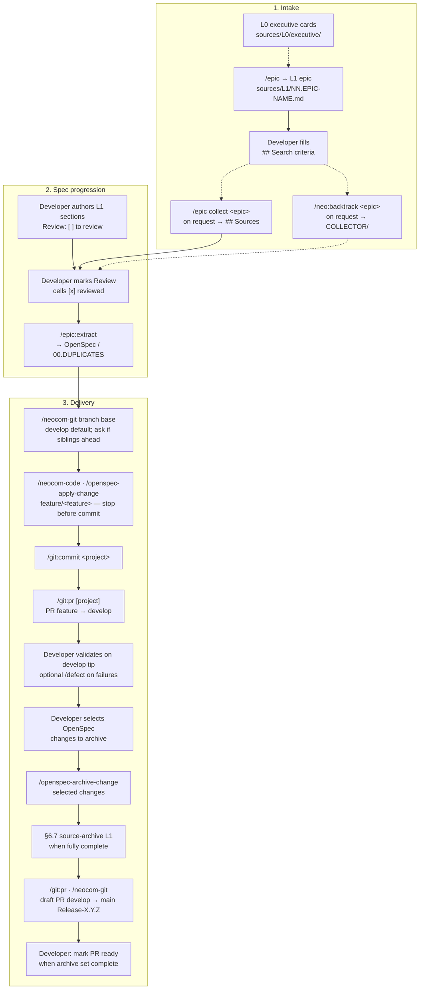
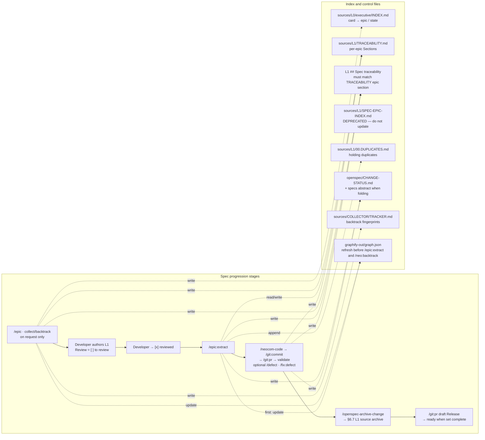
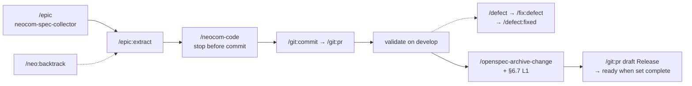
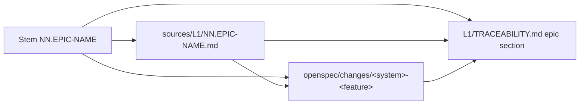
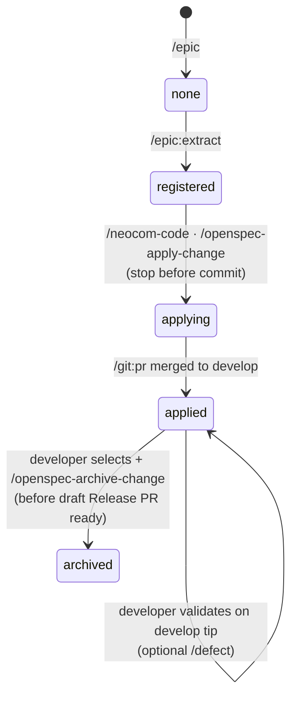
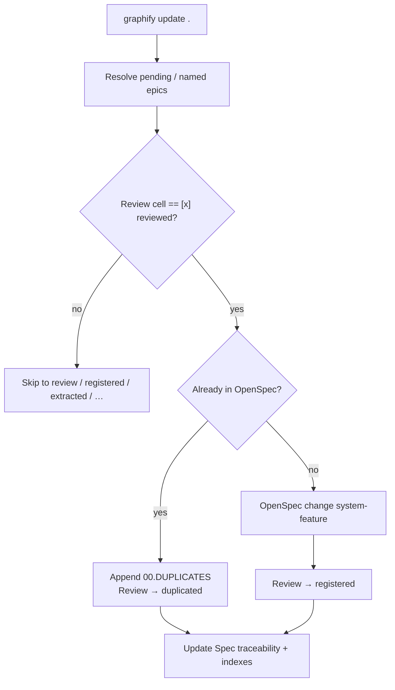
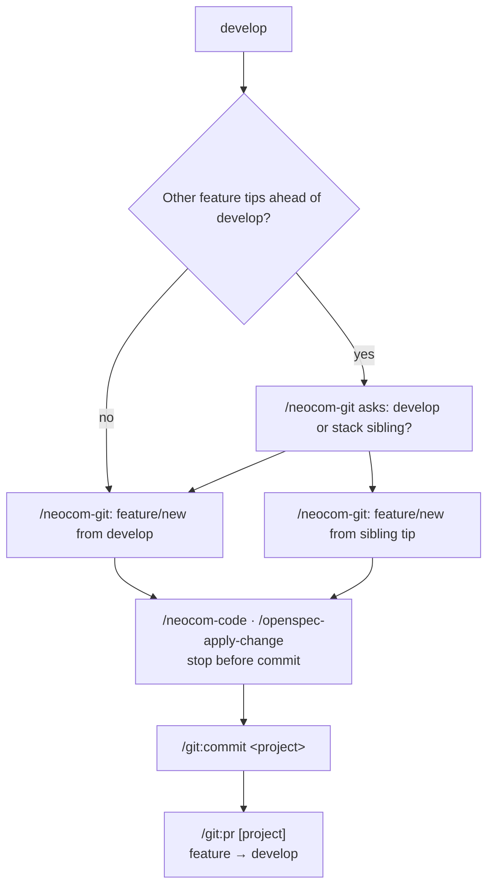
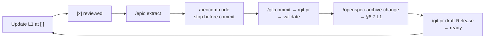

# NEOCOM methodology (DeepSeek Harness baseline)

This document extracts the **current** methodology as defined by `.dsh/` (agents, commands, skills, templates). It is the baseline for describing the pipeline and for later redefining or adjusting agent behaviour.

**Authority.** When this file and a live agent/skill disagree after a harness change, update this file to match `.dsh/`. When an epic’s prose describes a step differently from a skill, the skill wins (see Immutability). Product code does not live in `neocom-meta`; delivery commits land in the owning repository via `/neocom-git`.

**Path note.** Requirements live under `sources/` (`L0`, `L1`, `COLLECTOR`). `sources/L2/` is removed. Do not recreate it.

---

## 1. Purpose and shape

The methodology moves requirements **unidirectionally** from executive intake through authored epics, registered OpenSpec changes, feature-branch apply (**stop before commit**), developer commit, PR into `develop` (**validation intake**), validation on the **`develop` tip**, then **OpenSpec archive** (developer-selected changes) with L1 source-archive tracking, then a **draft** release PR `develop` → `main` that **documents** the already-archived set. The draft stays draft until every selected develop-validated change for that release is archived; only then is the PR marked ready for the developer to complete. Spec/`main` parity is not claimed until that archive set is complete.

| Stage | Intent | Primary owner |
| --- | --- | --- |
| Intake | Open an epic; attach L0 cards and legacy backtrack **only on explicit request** | `neocom-spec-collector`, `neocom-backtrack` |
| Spec progression | L1 reviewed → OpenSpec registration | `neocom-spec-workflow` |
| Delivery | Apply on `feature/<feature>` (default base `develop`; ask before stacking); stop before commit | `neocom-code` (destination rules) + OpenSpec apply |
| VCS + gates | Commit when asked; PR → develop (validation); validate on develop; archive selected OpenSpec; draft PR → main; ready when archive set complete | `neocom-git` + delivery-control + archive skills |



The overview stays linear on purpose. **Index and control files** sit beside that chain: agents **read** them to decide what is pending / skippable, and **write** them in the same turn as each transition. That map is a separate diagram so the stage flow above does not grow unreadable.



| Control file | Role | Who updates it |
| --- | --- | --- |
| `sources/L0/executive/INDEX.md` | Card usage: `selected` / `returned` / `out of scope` / `deleted` — prevents double collection | `/epic collect <epic>` (on request; requires Search criteria) |
| `sources/L1/TRACEABILITY.md` | **Authoritative** per-epic **Sections** (Review/pipeline). Delivery evidence → `DELIVERY-INDEX.md` | `/epic`, `/epic:extract`, apply, OpenSpec archive, L1 source archive, `/neocom-git` (Sections / Highest only) |
| L1 `## Spec traceability` | Per-epic header; must stay in sync with that epic’s TRACEABILITY section (Highest, OpenSpec) | Same as TRACEABILITY (status-only on the epic) |
| `sources/L1/SPEC-EPIC-INDEX.md` | **Deprecated** — keep on disk; **do not update**. Review/pipeline lives in `TRACEABILITY.md` Sections | — (frozen) |
| `sources/L1/00.DUPLICATES.md` | Holding epic for near-duplicates (review / reinsert / remove) | `/epic:extract` when a duplicate is found |
| `sources/L1/archive/` | Completed L1 epics whose OpenSpec coverage is fully archived (the active dir stays lean) | After OpenSpec archive (§6.7) |
| `openspec/CHANGE-STATUS.md` | OpenSpec change register (task counts from `npx openspec list --json`); notes for develop validation | `/epic:extract`, apply, PR accept, validate, archive |
| `.dsh/templates/openspec-delivery-control.md` | Required fields that **control PR contents** (feature→develop and develop→main) | `/neocom-git` / `/git:pr` when drafting PRs |
| `sources/COLLECTOR/TRACKER.md` | Legacy backtrack fingerprints / findings paths | `/neo:backtrack` |
| `graphify-out/graph.json` | Knowledge graph for skip / duplicate detection | **First action** on every `/neo:*` (`graphify update .`) |

Do not invent another dashboard beyond these. Skip decisions come from TRACEABILITY **Sections** (+ CHANGE-STATUS / DELIVERY-INDEX for OpenSpec coverage). Do not recreate `sources/L2/` or `### L2 delivery`.

---

## 2. Agents, commands, and skills

### 2.1 Agents

| Agent | Commands | Owns |
| --- | --- | --- |
| `neocom-spec-collector` | `/epic`, `/epic collect <epic>` | Epic creation; card collection **on request only**; L0 index; L1 TRACEABILITY epic section at `none` |
| `neocom-spec-workflow` | `/epic:extract` | L1 reviewed → OpenSpec; Review cells + Spec traceability; indexes |
| `neocom-backtrack` | `/neo:backtrack <epic…>` | Legacy code findings under `sources/COLLECTOR/` **on request only** (named epic required) |
| `neocom-code` | `/neocom-code` | Product coding: resolve **destination** (`front` / `back` / `domain`) first; shared pipeline + destination stack rules; OpenSpec apply; **never commits** |
| `neocom-git` | `/neocom-git`, `/git:commit`, `/git:pr` | All VCS: branch-base consult, commits, PRs (validation intake + release/archive), version hooks ownership |
| `neocom-defect` | `/defect`, `/fix:defect`, `/defect:fixed` | Validation defect register / fix / archive to `FIXED-DEFECTS.md`; no commit |
| `program-verifier` | `/program-verifier` | Read-only check of SPDD `program/` (separate meta tree; not the NEOCOM product pipeline) |

### 2.2 Spec and OpenSpec skills

| Skill | Slash | Role in the chain |
| --- | --- | --- |
| `epic-extract` | `/epic:extract` | L1 Review gate → OpenSpec `<system>-<feature>`; duplicates → `00.DUPLICATES` |
| `openspec-explore` | `/openspec-explore` | Discovery only; never implements |
| `openspec-propose` | `/openspec-propose` | Planning artifacts only (alternate/direct OpenSpec entry) |
| `openspec-update-change` | `/openspec-update-change` | Revise planning artifacts; no code |
| `openspec-apply-change` | `/openspec-apply-change` | Implement tasks; mark checkboxes (NEOCOM product apply still stops before commit via `neocom-code`) |
| `openspec-sync-specs` | `/openspec-sync-specs` | Merge deltas into main specs |
| `openspec-archive-change` | `/openspec-archive-change` | Archive completed change (NEOCOM: after develop validation, **before** ready release PR; developer selects the set) |
| `neocom-code` | `/neocom-code` | Destination-gated product apply; stop before commit |
| `defect-register` | `/defect` | Intake defect on `FEATURE-*_DEFECTS.md` |
| `defect-fix` | `/fix:defect` | Plan then implement Expected; stop before commit |
| `defect-fixed` | `/defect:fixed` | After validation, move defect to `FIXED-DEFECTS.md` |

### 2.3 Git skills and templates

| Skill / template | Role |
| --- | --- |
| `git-commit` | `/git:commit <project>` — commit on current branch (explicit developer request) |
| `git-pr` | `/git:pr [project]` — commit + **PR feature → develop** (validation intake); release PR is separate |
| `neocom-git-workflow` | Playbook loaded by `/neocom-git` |
| `templates/branch-names.md` | Feature/meta branches; default from `develop`; ask before stacking |
| `templates/commit-messages.md` | Conventional Commits examples |
| `templates/pull-requests.md` | PR title/body examples |
| `templates/openspec-delivery-control.md` | **Required fields** controlling OpenSpec lists on both PR kinds |



---

## 3. Artifact levels and dependency key

Each evolution step **reads** a source level and **writes** only the generated level plus indexes (plus the narrow L1 status exceptions below).

| Level | Path | Authored / written by |
| --- | --- | --- |
| L0 executive | `sources/L0/executive/*.md` + `INDEX.md` | Human / collector |
| L1 epic | `sources/L1/NN.EPIC-NAME.md` | `/epic` (+ later appends) |
| Legacy findings | `sources/COLLECTOR/NN.EPIC-NAME.md` + `TRACKER.md` | `/neo:backtrack` |
| OpenSpec change | `openspec/changes/<system>-<feature>/` | `/epic:extract` (or propose) |
| Product code | `neocom-front` / `neocom-back` / `neocom-domain` | `/neocom-code` (destination rules in `.dsh/agents/neocom-code.md`) |

**Dependency key:** the epic stem `NN.EPIC-NAME` links L1 → OpenSpec citations → TRACEABILITY row. A source change must evolve into the **same** OpenSpec change, not a parallel copy.



---

## 4. Status machines and indexes

Which stage reads or writes each control file is in the **Index and control files** diagram under [section 1](#1-purpose-and-shape). This section defines the status tokens those files carry.

### 4.1 Epic / OpenSpec status (`TRACEABILITY.md`)

```text
none → registered → applying → applied → archived
```

Legacy rows may still say `extracted`. That status belonged to the removed L2 copy. `/epic:extract` does not write it. A developer who wants those units in OpenSpec sets the Review cell back to `[x] reviewed`.

**File shape (authoritative):** one Markdown section per epic named `## \`NN.EPIC-NAME.md\``. Inside each section:

1. One-line header: Epic id · **Highest** OpenSpec status · Last updated.
2. **### Sections** — table `Section | Item | Status` (Review gate and/or pipeline for every register / requirement slice). **Active.**

- Authoritative central record: `sources/L1/TRACEABILITY.md` **Sections**.
- Commit/PR evidence lives in `openspec/DELIVERY-INDEX.md` (do not re-query GitHub for known rows).
- Each epic’s `## Spec traceability` must stay in sync after `/epic:extract` / apply / archive (Highest, OpenSpec names). Do not add an L2 field.
- Material covered by `applied` or `archived` changes is skipped on later runs; only new L1 material (Sections still `to review` / newly `reviewed`) is processed.
- When an epic’s Highest status is `archived` **and** every OpenSpec change it cites is archived, the L1 file becomes eligible for **source archive** (§6.7) — move under `sources/L1/archive/`, then refresh TRACEABILITY **Sections** / Spec traceability paths.
- Do not recreate `### L2 delivery` or `sources/L2/`.

### 4.2 Review gate (L1 sections / requirements)

Requirements are authored under epic sections (register + requirement tables). **Initial Review cell is `[ ] to review`** (checkbox + status; not registrable). Tables often do not render `[ ]` as a UI checkbox, so keep the status word. The developer marks **`[x] reviewed`** when the unit is a candidate for `/epic:extract`. After registration (or a duplicate move), the cell becomes a plain status word — **the checkbox disappears**. `UNREGISTERED REQUIREMENTS` headings are deprecated.

| Review cell | Logical status | `/epic:extract` |
| --- | --- | --- |
| `[ ] to review` (legacy: `[ ]` or `to review`) | `to review` | Skip |
| `[x] reviewed` / `[X] reviewed` (legacy: `[x]` / `reviewed`) | `reviewed` | Register into OpenSpec, then plain `registered`; or → `00.DUPLICATES` + plain `duplicated` |
| `registered` | `registered` | Skip (re-register only if set back to `[x] reviewed`) — **no checkbox** |
| `extracted` | `extracted` | Legacy. Skip unless set back to `[x] reviewed` — **no checkbox** |
| `duplicated` | `duplicated` | Skip — holding copy in `sources/L1/00.DUPLICATES.md` — **no checkbox** |
| `superseded`, `out of scope` | — | Never — **no checkbox** |

Processing record: `TRACEABILITY.md` **### Sections** table for that epic (Status column). Holding epic: `sources/L1/00.DUPLICATES.md`. (`SPEC-EPIC-INDEX.md` is deprecated — do not update.)

### 4.3 L0 card states (`sources/L0/executive/INDEX.md`)

| State | In epic `## Sources` |
| --- | --- |
| `selected` | Yes |
| `returned` | No — re-associated to another epic |
| `out of scope` | No — other domain / later epic |
| `deleted` | No — archived under `sources/L0/archive/` |

Never collect `BUG`-tagged cards from `BUGS.md` into specs.

### 4.4 OpenSpec register (`CHANGE-STATUS.md`)

After **any** OpenSpec write: refresh `openspec/CHANGE-STATUS.md` from `npx openspec list --json`. When folding features, refresh the **Specs abstract** sections in that same file (clusters, change abstracts, capability index). Do not recreate `openspec/SPECS-ABSTRACT.md`.

| Status | Meaning (NEOCOM delivery) |
| --- | --- |
| `registered` | Change under `openspec/changes/<name>/` with proposal, specs, design, tasks |
| `applying` | Implementation on `feature/<feature>` (default from `develop`; may be stacked). Apply **stops before commit** |
| `applied` | Merged (or accepted) onto **`develop`**; eligible for **validation on develop**; not archived yet. Note `validated on develop @ <sha>` when validation passes |
| `archived` | Developer-selected after develop validation; `/openspec-archive-change` done (into `changes/archive/` + `openspec/specs/`). May still await draft release PR ready/merge — **do not** claim main parity until the release archive set is complete |

PR content control: `.dsh/templates/openspec-delivery-control.md`.



---

## 5. Stage detail: inception → registered change

### 5.1 Open an epic (`/epic`)

1. Prompt is one sequence: short name, then purpose/scope description. Missing either → ask; do not invent.
2. Create `sources/L1/NN.EPIC-NAME.md` (`NN` = next number; name collision → stop / merge / rename — ask).
3. Write skeleton: `## Spec traceability` (`none`), `## Goals`, empty `## Search criteria`, empty `## Sources`, `## Version card`.
4. Add epic section in `sources/L1/TRACEABILITY.md` at Highest ⚪ `none` (empty **Sections** placeholder only).
5. `graphify update .` in `neocom-meta`.
6. **Do not** search cards or legacy code on create. Card collection and backtrack run **only on explicit request** (and still require filled Search criteria).

Later prompts that add designs/templates **append** to the same epic; only `/epic` opens a new one.

### 5.2 Search criteria, cards, backtrack (on request)

Filling `## Search criteria` alone does **not** trigger collection or backtrack.

- **Collector (`/epic collect <epic>`):** only when the developer asks. Match clear cards from `FRONT` / `BACK` / `DATAMANAGEMENT` / `INFRA` / `TESTING` → `## Sources` as `[selected]`; update L0 index. Skip already `selected`/`deleted`; handle `returned`/`out of scope` per re-association. Empty criteria → ask and stop.
- **Backtrack (`/neo:backtrack <epic…>`):** only when the developer asks with named epic(s). No bare `/neo:backtrack` all-changed scan. Search under `/Users/adam/IdeaProjects/neocom-infinity` only; write `sources/COLLECTOR/NN.EPIC-NAME.md` + mermaid connections; update `TRACKER.md`. Empty criteria → skip that epic, no search.

Both are optional inputs to authoring; they do not register OpenSpec.

### 5.3 Author and review L1

Developers expand the epic under **sections** (example: `## Section 19 — ServerStatusV1` with fields, render contract, and a requirements table). Every new requirement or register row starts at **`[ ] to review`**. Registration waits until the developer marks the cell **`[x] reviewed`**. Authored L1 sections are otherwise immutable for the workflow agent. Do not use an epic-level `UNREGISTERED REQUIREMENTS` inbox.

**Visual appearance PNGs.** For L1 Appearance blocks that document a render (e.g. Feature / model-strip specimens), agents **MAY** add a specimen on `neocom-front` `model-strip-page` (`/model-strip`) and capture that live render into `sources/L1/media/*.png`. Prefer that capture over inventing a stand-in image. Limit front edits to the specimen/render needed for the documentation PNG. This exception also applies when registering such visual features (§5.4).

### 5.4 Register reviewed units (`/epic:extract`)

**First action (hard):** `graphify update .` (prefer `.venv/bin/graphify`). Failure → stop.

`/neo:extract-l2` and `/neo:spec-evolution` are removed. Do not write `sources/L2/`.

Then:

1. Scope: no args → pending epics from TRACEABILITY (units still `[x] reviewed`); args → named epics only (prefer `01`, `02`).
2. Input: L1 only. Review gate: only `reviewed` rows (`to review` skipped). Legacy `extracted` is skipped unless set back to `[x] reviewed`.
3. Per unit: system / feature. Ambiguous → ask. Do not invent behaviour.
4. Duplicates (same / very similar already in OpenSpec) → append `sources/L1/00.DUPLICATES.md`, set source Review to `duplicated`.
5. Otherwise create or extend OpenSpec change `<system>-<feature>`; cite the L1 epic stem and the L1 id. Set Review to `registered`.
6. L1 edits allowed: Review `reviewed` → `registered` or `duplicated`, and `## Spec traceability` only.
7. Update TRACEABILITY **Sections** and `openspec/CHANGE-STATUS.md` (including Specs abstract when folding). Optionally PROGRAMME-DEFINITION. Do **not** update `SPEC-EPIC-INDEX.md`. Do not recreate `SPECS-ABSTRACT.md`.
8. **Visual features exception:** when the unit documents a UI Appearance and the L1 PNG is missing or not from a real strip specimen, agents **MAY** add the proposed render specimen on `neocom-front` `model-strip-page` and refresh `sources/L1/media/*.png` from that capture (see §5.3). Do not use this exception for unrelated product implementation.



---

## 6. Stage detail: registered change → release

Authority for this stage: `.dsh/agents/neocom-code.md`, `.dsh/agents/neocom-git.md` (OpenSpec feature flow), `.dsh/templates/openspec-delivery-control.md`.

### 6.0 Pipeline (summary)

```text
/neocom-git choose base → /neocom-code apply (stop before commit)
  → /git:commit when asked
  → /git:pr feature → develop (validation intake)
  → merge when asked → validate on develop tip (dev environment)
  → optional /defect → /fix:defect → /defect:fixed on validation failures
  → developer selects OpenSpec changes to archive
  → /openspec-archive-change (selected)
  → track TRACEABILITY; source-archive L1 when fully complete (§6.7)
  → /git:pr draft develop → main (Release-X.Y.Z)
  → keep draft until archive set for this release is complete
  → mark PR ready; developer completes merge when asked
```

### 6.1 Destination and branch base

**`/neocom-code`** resolves one primary destination per hop (`front` → `neocom-front`, `back` → `neocom-back`, `domain` → `neocom-domain`). Multi-system changes hop one destination at a time (default **domain → back → front** when types must exist first).

**`/neocom-git`** owns branch creation for product OpenSpec work:

1. Integration branch: **`develop`**. If missing, stop — do not use `main`.
2. Default create `feature/<feature-name>` from **`develop`**.
3. Before creating: list open `feature/*` tips **ahead of `develop`**. If any exist → **ask** the developer: stay on `develop`, or **stack** from a named sibling tip. Do not invent a base; do not silently fan every apply off `develop`.
4. **`neocom-meta`:** use **`feature/agents`** (default) or **`feature/cicd`** when commanded — not `feature/<product-feature>` per apply.
5. Do not open a PR at branch creation. Do not run an agent `version:sync` chore (hooks/CI own app versions).

### 6.2 Apply — stop before commit

1. Implement OpenSpec tasks for the active destination (`/neocom-code` / `openspec-apply-change`). Mark `- [x]`; refresh CHANGE-STATUS → **`applying`**.
2. **Stop before any commit.** Leave the working tree dirty for developer review. Applying OpenSpec is **not** a commit request.
3. Do not start the next destination or next change until the developer says to continue (or asks for a commit).
4. Commit only via `/git:commit`, `/git:pr`, or clear “commit” language through `/neocom-git`.



### 6.3 Rebase rules

- Rebase onto another open feature **only** when this feature needs that code (or that stack was chosen at branch creation); otherwise rebase onto current `develop` before the develop PR.
- Dependent feature waits until the dependency has been rebased onto `develop`.
- Ask before force-pushing a rewritten remote feature branch. Never force-push `develop` or `main`.

### 6.4 Pull request into `develop` — validation intake (`/git:pr`)

After apply stopped and the developer asked to commit:

1. Orient: status, diffs, log, `develop..HEAD`.
2. Work must be on the correct feature/fix branch (not `develop`/`main`).
3. Push `-u` if needed; `gh pr create --base develop`.
4. Body **must** satisfy `.dsh/templates/openspec-delivery-control.md` §A (and the Features shape in `pull-requests.md`): repositories, head/base, **OpenSpec change ids** + task N/N, feature labels, commit range, stack note, **out of scope**, **validation readiness**, test plan.
5. One PR may stack several features; every included OpenSpec change is named. Silent bundling of unlisted changes is forbidden.
6. Do **not** merge unless asked. Do **not** archive on this PR.
7. On accept into `develop`: CHANGE-STATUS → **`applied`** (awaiting develop validation); sync Spec traceability / TRACEABILITY; upsert **`openspec/DELIVERY-INDEX.md`** (PR merged, develop tip SHA per repo). Next apply runs the branch-base consult again.

### 6.5 Validation on `develop`

1. Run against the **post-merge `develop` tip** (SHA recorded), not only the old feature branch — including checks the developer runs in the **dev environment**.
2. Commands: those named by the included changes (unit/e2e); `npx openspec list --json`; gap check vs delta specs.
3. CHANGE-STATUS notes: `validated on develop @ <sha>` or `validation failed: …`. Mirror the tip into **`openspec/DELIVERY-INDEX.md`** (Validated column).
4. Only **complete + validated** changes may be **selected** for archive (§6.6). Do **not** open the release PR yet.
5. For “which PR / commit carried this OpenSpec?”, consult **`DELIVERY-INDEX.md`** (and graphify) before calling GitHub. `/neocom-git` owns that index.

### 6.6 OpenSpec archive first, then draft release PR

**Order is fixed:** archive (and L1 tracking) **before** the release PR is made ready. The PR documents what was archived; it does not trigger archive.

#### 6.6.1 Developer selects the archive set

After validation on develop is accepted, the developer names which OpenSpec changes to archive (from the `applied` + validated pool). Changes still `registered` / `applying` / not validated / deferred stay **out of** the set.

#### 6.6.2 Archive selected changes

1. For each selected change, run `/openspec-archive-change` (batch as appropriate).
2. Same turn: CHANGE-STATUS → **Archived**, sync into `openspec/specs/`, TRACEABILITY OpenSpec status → 📦 `archived`, `DELIVERY-INDEX` archived delivery rows.
3. **Immediately** run **§6.7 Source archive** eligibility for L1 epics touched by that change. Track state on TRACEABILITY **Sections** / Highest as files move.
4. **Collect** each successfully archived change id into the **release archive inventory** (used for the PR body). Do not invent ids that were not archived.

#### 6.6.3 Draft PR `develop` → `main`

1. When the first archive for this release lands (or when the developer asks to open the PR while archive continues), open PR **`develop` → `main`** as a **draft** (`gh pr create --draft`), title `Release-<MajorMinorPatch>` (temp worktree GitVersion calc; do not push that calculation; restore local `main`).
2. Body **must** satisfy delivery-control §C: develop SHA, **OpenSpec archived (this release)** = inventory so far, **OpenSpec still open / deferred**, test plan, draft note (“not ready until archive set complete”).
3. **Keep the PR in draft** while any change the developer selected for this release is still not archived, or while other develop-validated changes the developer included in the release set remain pending archive.
4. After each further archive: refresh the PR body inventory; re-check §6.7; update TRACEABILITY.
5. When **every** change in the selected release archive set is archived (and inventoriable in the body): **mark the PR ready for review** (leave draft). Spec/`main` programme parity for that set is only claimed at this point — not while the PR is still draft with a partial archive list.
6. Do **not** merge unless the developer asks after the PR is ready. Tag `vX.Y.Z` only when the user requests a release tag.

**Anti-claim:** do not state that `main` / main specs “match” develop for the release while the draft is open and the archive set is incomplete.

### 6.7 Source archive — L1 epics (declutter)

After OpenSpec changes are archived into `openspec/changes/archive/` and main `openspec/specs/`, move **fully completed** L1 epics out of the active tree so `sources/L1/` only holds work still in flight. Same idea as L0 cards under `sources/L0/archive/`.

An L1 epic `sources/L1/NN.EPIC-NAME.md` **may** move to `sources/L1/archive/NN.EPIC-NAME.md` when **all** of the following hold:

1. Epic TRACEABILITY status is **`archived`**.
2. **Every** OpenSpec change cited for that epic is **`archived`** (no deferred / applying / applied leftovers for that epic).
3. No Review cells remain at `to review` or `reviewed` that still need `/epic:extract` (leftover `to review` / `reviewed` → do **not** archive the epic; leave it active).

Do **not** move shared index files (`TRACEABILITY.md`, `SPEC-EPIC-INDEX.md` (deprecated, leave in place), `00.DUPLICATES.md`) into archive.

#### Index updates (same turn)

When moving files:

1. Update `sources/L1/TRACEABILITY.md` **Sections** / Highest for the archive location; keep the epic section (Highest `archived`) so history and skip logic remain.
2. Sync the epic’s `## Spec traceability` if the file still exists (now under archive) or note the archived path on the TRACEABILITY epic section.
3. Do not update `SPEC-EPIC-INDEX.md` (deprecated). Do not invent parallel dashboards; do not delete history — **move**, do not erase.

New work on a formerly archived epic is a **new** L1 append or a new epic (§8); do not silently resurrect by editing only under `archive/` without restoring to the active tree when reopening scope.

### 6.8 Information that controls PR contents (required)

Full tables: `.dsh/templates/openspec-delivery-control.md`. Incomplete control data → stop and ask before opening the PR.

| Gate | Must declare |
| --- | --- |
| **feature → develop** | Repos; head/base; OpenSpec ids + N/N; features; `develop..HEAD`; stack; out of scope; validation readiness; test plan; status move `applying` → `applied` on merge |
| **validate on develop** | Develop tip SHA; change set; validation commands; pass/fail notes; archive **eligibility** (not archive yet) |
| **select + archive** | Developer-selected OpenSpec ids; archive + §6.7; release inventory grows |
| **draft develop → main** | `Release-X.Y.Z`; develop SHA; **archived** inventory; deferred/open list; stays draft until set complete |
| **ready / merge** | Archive set complete → mark PR ready; merge only when asked |

```mermaid
sequenceDiagram
  participant Dev as Developer
  participant Spec as Spec agents
  participant Code as neocom-code
  participant Defect as neocom-defect
  participant Git as neocom-git

  Dev->>Spec: /epic
  Note over Dev: author L1; mark Review [x] reviewed
  Dev->>Spec: /epic:extract
  Dev->>Code: /neocom-code · /openspec-apply-change
  Code-->>Dev: stop before commit
  Dev->>Git: /git:commit then /git:pr feature → develop
  Note over Git: OpenSpec list = ready for validation
  Dev->>Git: merge to develop when asked
  Dev->>Spec: validate on develop tip / dev env
  opt validation defect
    Dev->>Defect: /defect
    Dev->>Defect: /fix:defect
    Defect-->>Dev: stop before commit
    Dev->>Git: /git:commit / /git:pr as needed
    Dev->>Defect: /defect:fixed after validate
  end
  Dev->>Spec: select OpenSpec changes to archive
  Spec->>Spec: /openspec-archive-change
  Spec->>Spec: §6.7 source-archive L1 when complete
  Dev->>Git: /git:pr draft Release develop → main
  Note over Git: draft until archive set complete
  Dev->>Git: mark ready; merge when asked
```

---

## 7. Hard invariants (agent behaviour)

These are non-negotiable in the current harness; changing them is a methodology change, not a silent agent improvisation.

1. **Unidirectional levels.** Do not rewrite authored L1 sections. `/epic:extract` may only flip Review cells and Spec traceability, append `00.DUPLICATES`, and write OpenSpec plus the indexes.
2. **No invented behaviour.** Gaps → ask or mark; never fill from assumption.
3. **Review gate exactness.** New requirements start at `[ ] to review` (not registrable). Only `[x] reviewed` (or legacy `[x]` / `reviewed`) registers; after registration the cell is replaced by a plain status word. `UNREGISTERED REQUIREMENTS` is deprecated.
4. **Graphify first.** First action on `/epic:extract` and `/neo:backtrack`; stop if update fails.
5. **Skip indexes are complete.** TRACEABILITY **Sections** (+ CHANGE-STATUS / DELIVERY-INDEX) — do not invent parallel dashboards. Do not recreate `sources/L2/` or TRACEABILITY `### L2 delivery`. Do not update deprecated `SPEC-EPIC-INDEX.md`.
6. **Repo boundaries.** Spec workflow writes only under `neocom-meta`. Product code only in owning clones. `neocom` / `neocom-esi` aside.
7. **Git ownership.** Only `neocom-git` (and `/git:*`) commits, branches, and opens PRs. **OpenSpec apply never commits.** Commit only when asked or when `/git:commit` / `/git:pr` run.
8. **Branch-base consult.** Product OpenSpec branches default from `develop`; if other `feature/*` tips are ahead, ask before stacking — no silent fanning from `develop`.
9. **PR content control.** Feature→develop and develop→main bodies must carry the OpenSpec control fields in `openspec-delivery-control.md`. No silent bundling; no archive of changes the developer did not select.
10. **Validate → select → archive → draft Release PR.** Validation runs on the **`develop` tip** after merge. OpenSpec archive runs from the **developer-selected set** after validation — **not** from a feature branch and **not** as a side effect of opening the Release PR. The Release PR starts as a **draft** documenting the archive inventory.
11. **Source archive during OpenSpec archive.** When every OpenSpec change for an L1 epic is archived, **move** that epic to `sources/L1/archive/` and refresh TRACEABILITY in the same turn. Do not leave completed epics cluttering the active L1 dir; do not move partial work. Do not recreate `sources/L2/`.
12. **Draft until archive set complete.** Do not mark the Release PR ready (and do not claim main/spec parity for the release) while selected develop-validated changes remain unarchived. Merge only when the developer asks after ready.
13. **On-request search.** Cards (`/epic collect <epic>`) and legacy backtrack (`/neo:backtrack <epic…>`) run only when the developer asks; both still require filled `## Search criteria`. Do not auto-scan on create, append, criteria fill, or fingerprint change.
14. **No Finder duplicate files.** Never create `* 2.*` conflict copies.
15. **OpenSpec naming.** Change = `<system>-<feature>` (hyphens only); delta under `specs/<system>/<feature>/spec.md`.
16. **Destination boundaries.** `/neocom-code` edits only the active destination repo; front≠back≠domain file ownership.

---

## 8. Iteration loop

Design and spec repeat without resetting delivery:

1. New material → append to L1 sections at Review `[ ] to review` (or new `/epic`).
2. Mark relevant Review cells `[x] reviewed`.
3. `/epic:extract` registers those units into OpenSpec (or moves duplicates to `00.DUPLICATES`).
4. Apply (stop before commit) → commit when asked → PR → develop → validate → select + archive OpenSpec → source-archive L1 (§6.7) → draft Release PR → ready when set complete.



---

## 9. Command cheat sheet (pipeline order)

| Step | Command | Output |
| --- | --- | --- |
| 1 | `/epic <name> <description>` | `sources/L1/NN.EPIC-NAME.md`, TRACEABILITY epic section Highest `none` |
| 2 | (human) fill Search criteria; **on request** `/epic collect <epic>` and/or `/neo:backtrack <epic>` | Sources / COLLECTOR |
| 3 | (human) author L1 sections; new rows at `[ ] to review`; mark batch → `[x] reviewed` | L1 register / requirements |
| 4 | `/epic:extract` [`NN`…] | OpenSpec change or `00.DUPLICATES`; status ≥ `registered` |
| 5 | `/neocom-code` · `/openspec-apply-change` on `feature/<feature>` (default from `develop`; `/neocom-git` asks before stacking) | Code — stop before commit |
| 6 | `/git:commit <project>` then developer review | Commits on feature branch |
| 7 | `/git:pr [project]` (for `neocom-domain`: all versioning via GitHub Actions — patch on push, minor/major on PR open; no local hooks / no GitVersion) | PR **feature → develop** (OpenSpec ready for validation); domain published to npm for front/back CI |
| 8 | Validate on **develop** tip / dev env; optional `/defect` → `/fix:defect` → `/defect:fixed` | CHANGE-STATUS notes; still `applied` |
| 9 | Developer selects OpenSpec to archive | Selected ids from validated `applied` pool |
| 10 | `/openspec-archive-change` (+ §6.7) | Archive selected; move completed L1; grow release inventory |
| 11 | `/git:pr` / `/neocom-git` draft Release PR `develop` → `main` | `Release-X.Y.Z` **draft**; body = archived inventory + deferred |
| 12 | Archive set complete → mark PR ready | Developer completes merge when asked |

**Defect side path (during / after validation):** `/defect` (register) → mark ready → `/fix:defect` (plan then fix; no commit) → `/git:commit` / `/git:pr` as needed → `/defect:fixed DEF-…` after developer validates.

Alternate OpenSpec-only planning: `/openspec-explore` → `/openspec-propose` → `/openspec-apply-change` — still lands on the same git delivery rules when implemented for NEOCOM.

---

## 10. How to use this document

- **Describe** the methodology: cite sections 1–6 and the diagrams.
- **Adjust agent behaviour:** edit the owning file under `.dsh/agents/` or `.dsh/skills/`, then update **this** file in the same change so the baseline stays true.
- **Do not** treat `PROGRAMME.md` path leftovers or an epic’s internal procedure prose as overriding `.dsh/` skills.

*Baseline extracted from `.dsh/AGENT-CATALOG.md`; agents `neocom-spec-collector`, `neocom-spec-workflow`, `neocom-backtrack`, `neocom-code`, `neocom-git`, `neocom-defect`; skills `epic-extract`, `neocom-code`, OpenSpec apply/archive/propose, `defect-register` / `defect-fix` / `defect-fixed`, `git-commit`, `git-pr`, `neocom-git-workflow`; templates `branch-names`, `commit-messages`, `pull-requests`, `openspec-delivery-control`. Re-sync this file whenever those specs change.*
