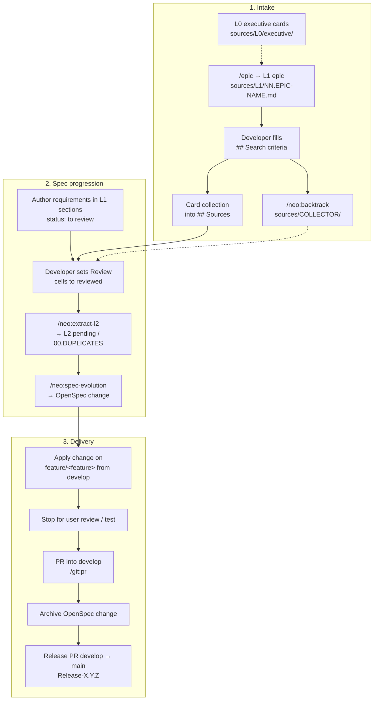
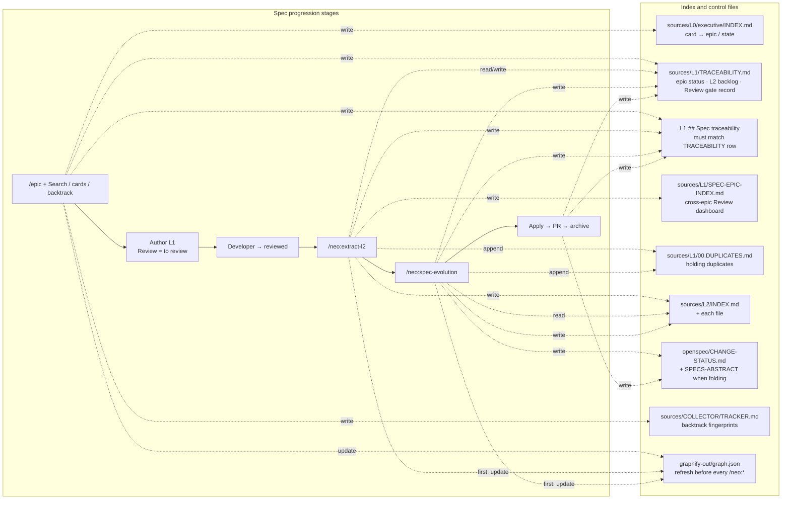
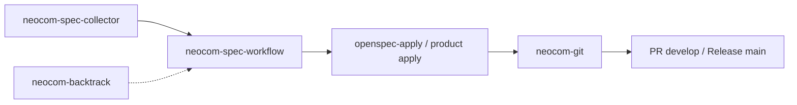
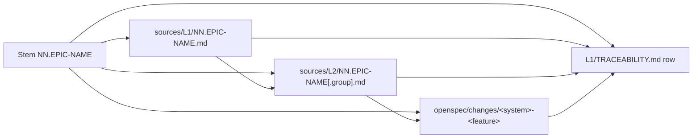
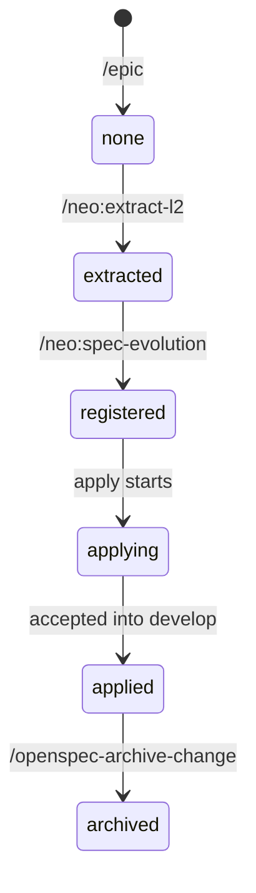
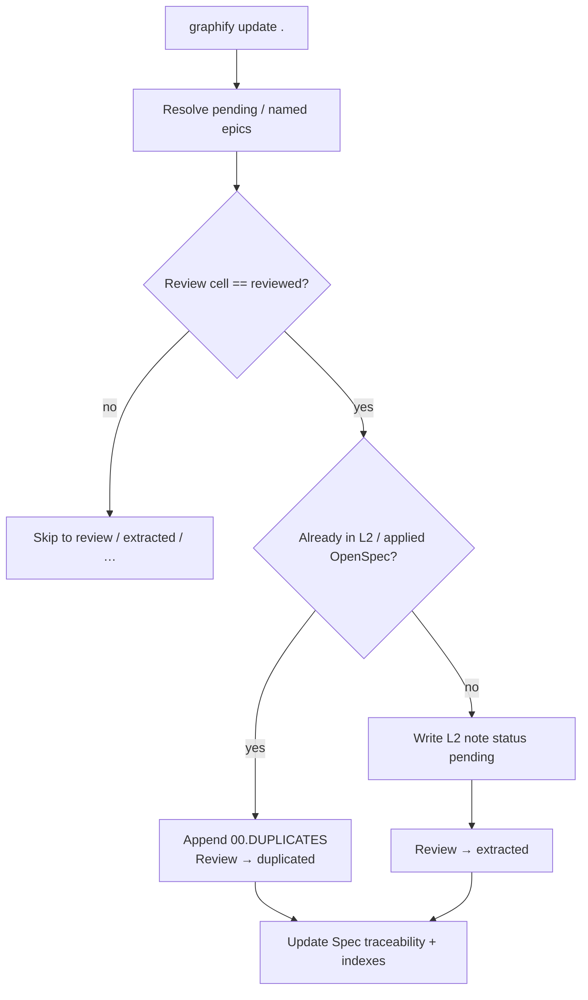
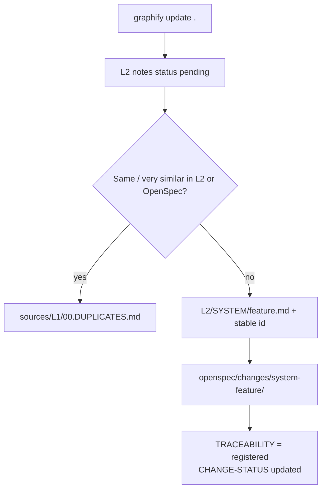
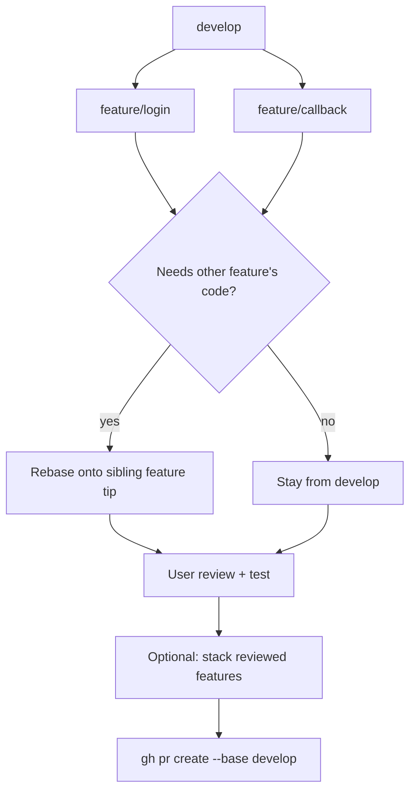
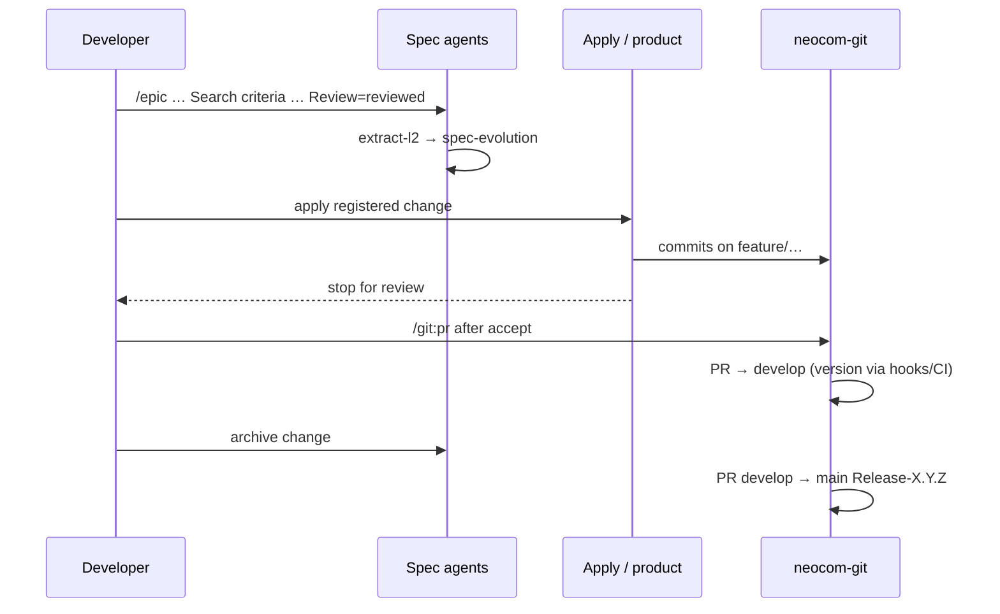
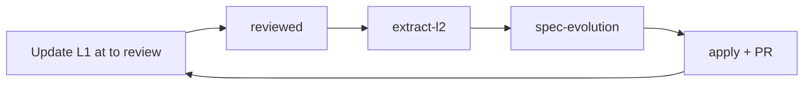

# NEOCOM methodology (DeepSeek Harness baseline)

This document extracts the **current** methodology as defined by `.dsh/` (agents, commands, skills, templates). It is the baseline for describing the pipeline and for later redefining or adjusting agent behaviour.

**Authority.** When this file and a live agent/skill disagree after a harness change, update this file to match `.dsh/`. When an epic’s prose describes a step differently from a skill, the skill wins (see Immutability). Product code does not live in `neocom-meta`; delivery commits land in the owning repository via `/neocom-git`.

**Path note.** Requirements live under `sources/` (`L0`, `L1`, `L2`, `COLLECTOR`).

---

## 1. Purpose and shape

The methodology moves requirements **unidirectionally** from executive intake through authored epics, extractable notes, registered OpenSpec changes, feature-branch implementation, user review, and pull requests into `develop` (then a release PR into `main` on archive).

| Stage | Intent | Primary owner |
| --- | --- | --- |
| Intake | Open an epic; later attach L0 executive cards and optional legacy backtrack | `neocom-spec-collector`, `neocom-backtrack` |
| Spec progression | L1 → L2 extract → OpenSpec registration | `neocom-spec-workflow` |
| Delivery | Apply registered change on `feature/<feature>` from `develop` | `neocom-code` (front/back destination rules) + OpenSpec apply |
| VCS | Commits, branches, PRs, version sync | `neocom-git` |



The overview stays linear on purpose. **Index and control files** sit beside that chain: agents **read** them to decide what is pending / skippable, and **write** them in the same turn as each transition. That map is a separate diagram so the stage flow above does not grow unreadable.



| Control file | Role | Who updates it |
| --- | --- | --- |
| `sources/L0/executive/INDEX.md` | Card usage: `selected` / `returned` / `out of scope` / `deleted` — prevents double collection | `/epic` collector (after Search criteria) |
| `sources/L1/TRACEABILITY.md` | **Authoritative** epic → L2 → OpenSpec map; **L2 backlog**; **Review gate record** (`Last seen` / `Processed`) | `/epic`, extract, evolution, apply, archive |
| L1 `## Spec traceability` | Per-epic header; must stay in sync with the TRACEABILITY row | Same as TRACEABILITY (status-only on the epic) |
| `sources/L1/SPEC-EPIC-INDEX.md` | Cross-epic Review dashboard (🟢 reviewed → 🔵 extracted, …) | `/neo:extract-l2` |
| `sources/L1/00.DUPLICATES.md` | Holding epic for near-duplicates (review / reinsert / remove) | extract and evolution when a duplicate is found |
| `sources/L2/INDEX.md` + `<!-- L2-STATUS -->` | L2 file backlog (📥 inbox / 📭 cleared / 📌 placed / …); Spec Evolution queue | extract and evolution |
| `openspec/CHANGE-STATUS.md` | OpenSpec change register (task counts from `npx openspec list --json`) | evolution, apply, archive (any OpenSpec write) |
| `sources/COLLECTOR/TRACKER.md` | Legacy backtrack fingerprints / findings paths | `/neo:backtrack` |
| `graphify-out/graph.json` | Knowledge graph for skip / duplicate detection | **First action** on every `/neo:*` (`graphify update .`) |

Do not invent another dashboard beyond these. Skip decisions come from TRACEABILITY + the L2 tree + `L2/INDEX.md` (+ CHANGE-STATUS for OpenSpec coverage).

---

## 2. Agents, commands, and skills

### 2.1 Agents

| Agent | Commands | Owns |
| --- | --- | --- |
| `neocom-spec-collector` | `/epic` | Epic creation, deferred card collection, L0 index, L1 TRACEABILITY row at `none` |
| `neocom-spec-workflow` | `/neo:extract-l2`, `/neo:spec-evolution` | L1→L2 and L2→OpenSpec; Review cells + Spec traceability; indexes |
| `neocom-backtrack` | `/neo:backtrack` | Legacy code findings under `sources/COLLECTOR/` (read-only on epics) |
| `neocom-code` | `/neocom-code` | Product coding in front/back (destination-selected rules); OpenSpec apply in product repos |
| `neocom-git` | `/neocom-git`, `/git:commit`, `/git:pr` | All VCS: branches, commits, PRs, version sync |
| `program-verifier` | `/program-verifier` | Read-only check of SPDD `program/` (separate meta tree; not the NEOCOM product pipeline) |

### 2.2 Spec and OpenSpec skills

| Skill | Slash | Role in the chain |
| --- | --- | --- |
| `extract-l2` | `/neo:extract-l2` | L1 Review gate → epic-named L2 (`pending`); duplicates → `00.DUPLICATES` |
| `spec-registration` | `/neo:spec-evolution` | L2 `pending` notes → placement + OpenSpec `<system>-<feature>` |
| `openspec-explore` | `/openspec-explore` | Discovery only; never implements |
| `openspec-propose` | `/openspec-propose` | Planning artifacts only (alternate/direct OpenSpec entry) |
| `openspec-update-change` | `/openspec-update-change` | Revise planning artifacts; no code |
| `openspec-apply-change` | `/openspec-apply-change` | Implement tasks; mark checkboxes |
| `openspec-sync-specs` | `/openspec-sync-specs` | Merge deltas into main specs |
| `openspec-archive-change` | `/openspec-archive-change` | Archive completed change |

### 2.3 Git skills and templates

| Skill / template | Role |
| --- | --- |
| `git-commit` | `/git:commit <project>` — commit on current branch |
| `git-pr` | `/git:pr [project]` — commit + PR into `develop` |
| `neocom-git-workflow` | Playbook loaded by `/neocom-git` |
| `templates/branch-names.md` | Feature/meta branch conventions |
| `templates/commit-messages.md` | Conventional Commits examples |
| `templates/pull-requests.md` | PR title/body examples |



---

## 3. Artifact levels and dependency key

Each evolution step **reads** a source level and **writes** only the generated level plus indexes (plus the narrow L1 status exceptions below).

| Level | Path | Authored / written by |
| --- | --- | --- |
| L0 executive | `sources/L0/executive/*.md` + `INDEX.md` | Human / collector |
| L1 epic | `sources/L1/NN.EPIC-NAME.md` | `/epic` (+ later appends) |
| Legacy findings | `sources/COLLECTOR/NN.EPIC-NAME.md` + `TRACKER.md` | `/neo:backtrack` |
| L2 extract | `sources/L2/NN.EPIC-NAME[.group].md` | `/neo:extract-l2` |
| L2 placement | `sources/L2/<SYSTEM>/`, `INFRASTRUCTURE-SPECS.md` | `/neo:spec-evolution` |
| OpenSpec change | `openspec/changes/<system>-<feature>/` | `/neo:spec-evolution` (or propose) |
| Product code | `neocom-front` / `neocom-back` / `neocom-domain` | `/neocom-code` (destination rules in `.dsh/agents/neocom-code.md`) |

**Dependency key:** the epic stem `NN.EPIC-NAME` links L1 → L2 filenames → OpenSpec citations → TRACEABILITY row. A source change must evolve into the **same** derived files, not a parallel copy.



---

## 4. Status machines and indexes

Which stage reads or writes each control file is in the **Index and control files** diagram under [section 1](#1-purpose-and-shape). This section defines the status tokens those files carry.

### 4.1 Epic / OpenSpec status (`TRACEABILITY.md`)

```text
none → extracted → registered → applying → applied → archived
```

- Authoritative central record: `sources/L1/TRACEABILITY.md` (includes **L2 backlog**).
- Each epic’s `## Spec traceability` must stay in sync after extract / register / apply / archive.
- Material covered by `applied` or `archived` changes is skipped on later extract/register; only new L1 material is processed.

### 4.2 Review gate (L1 sections / requirements) — replaces `UNREGISTERED`

Requirements are authored under epic sections (register + requirement tables). **Initial status is `to review`** (not extractable). `UNREGISTERED REQUIREMENTS` / L2 `DUPLICATED` headings are deprecated.

| Review cell | `/neo:extract-l2` |
| --- | --- |
| `to review` (any variant) | Skip — not extractable |
| `reviewed` | Extract to L2 as `pending`, then `extracted`; or → `00.DUPLICATES` + `duplicated` |
| `extracted` | Skip (re-extract only if set back to `reviewed`) |
| `duplicated` | Skip — holding copy in `sources/L1/00.DUPLICATES.md` |
| `superseded`, `out of scope` | Never |

Processing record: `TRACEABILITY.md` **Review gate record** (`Last seen` / `Processed`). Cross-epic dashboard: `sources/L1/SPEC-EPIC-INDEX.md`. Holding epic: `sources/L1/00.DUPLICATES.md`.

### 4.3 L2 file status (`L2/INDEX.md`)

| Token | Meaning |
| --- | --- |
| 📥 `inbox` | Has notes with status `pending` awaiting OpenSpec |
| 📭 `cleared` | No pending notes |
| 📌 `placed` | In system/feature register |
| 🔗 `pointer` | Pointer-only |
| ⛔ `parked` | Parked |

Each L2 file carries `<!-- L2-STATUS: … -->` aligned with the index. Spec Evolution queue = inbox / `pending` rows.

### 4.4 L0 card states (`sources/L0/executive/INDEX.md`)

| State | In epic `## Sources` |
| --- | --- |
| `selected` | Yes |
| `returned` | No — re-associated to another epic |
| `out of scope` | No — other domain / later epic |
| `deleted` | No — archived under `sources/L0/archive/` |

Never collect `BUG`-tagged cards from `BUGS.md` into specs.

### 4.5 OpenSpec register

After **any** OpenSpec write: refresh `openspec/CHANGE-STATUS.md` from `npx openspec list --json`. When folding features, refresh `openspec/SPECS-ABSTRACT.md`.



---

## 5. Stage detail: inception → registered change

### 5.1 Open an epic (`/epic`)

1. Prompt is one sequence: short name, then purpose/scope description. Missing either → ask; do not invent.
2. Create `sources/L1/NN.EPIC-NAME.md` (`NN` = next number; name collision → stop / merge / rename — ask).
3. Write skeleton: `## Spec traceability` (`none`), `## Goals`, empty `## Search criteria`, empty `## Sources`, `## Version card`.
4. Register row in `sources/L1/TRACEABILITY.md` at `none`.
5. `graphify update .` in `neocom-meta`.
6. **Do not** search cards or legacy code until Search criteria are filled.

Later prompts that add designs/templates **append** to the same epic; only `/epic` opens a new one.

### 5.2 Search criteria, cards, backtrack

When the developer fills `## Search criteria`:

- **Collector:** match clear cards from `FRONT` / `BACK` / `DATAMANAGEMENT` / `INFRA` / `TESTING` → `## Sources` as `[selected]`; update L0 index. Skip already `selected`/`deleted`; handle `returned`/`out of scope` per re-association.
- **Backtrack (`/neo:backtrack`):** fingerprint epics; only changed ones; search under `/Users/adam/IdeaProjects/neocom-infinity` only; write `sources/COLLECTOR/NN.EPIC-NAME.md` + mermaid connections; update `TRACKER.md`. Empty criteria → pending, no search.

Both are optional inputs to authoring; they do not themselves extract L2.

### 5.3 Author and review L1

Developers expand the epic under **sections** (example: `## Section 19 — ServerStatusV1` with fields, render contract, and a requirements table). Every new requirement or register row starts at **`to review`**. Extraction waits until the developer sets the cell to **`reviewed`**. Authored L1 sections are otherwise immutable for the workflow agent. Do not use an epic-level `UNREGISTERED REQUIREMENTS` inbox.

### 5.4 Extract L2 (`/neo:extract-l2`)

**First action (hard):** `graphify update .` (prefer `.venv/bin/graphify`). Failure → stop.

Then:

1. Scope: no args → pending epics from TRACEABILITY + L2 tree; args → named epics only (prefer `01`, `02`).
2. Input: L1 only. Review gate: only `reviewed` rows (`to review` skipped).
3. Output: `sources/L2/NN.EPIC-NAME.md` and/or `….<group>.md` with notes at status **`pending`** (no `UNREGISTERED REQUIREMENTS` heading).
4. Duplicates (same / very similar already in L2 or applied/archived OpenSpec) → append `sources/L1/00.DUPLICATES.md`, set source Review to `duplicated`.
5. L1 edits allowed: Review `reviewed` → `extracted` or `duplicated`, and `## Spec traceability` only.
6. Update TRACEABILITY, SPEC-EPIC-INDEX, L2/INDEX, L2 status headers.
7. Do **not** write OpenSpec or final `L2/<SYSTEM>/` placement as the registration step.



### 5.5 Spec evolution (`/neo:spec-evolution`)

**First action (hard):** `graphify update .`.

Then:

1. Scope: all L2, or given L2 paths. Read L2 only — not L1 for `to review` models.
2. Collect notes with status **`pending`** (legacy `UNREGISTERED REQUIREMENTS` drained once if present).
3. Per note: system / feature / destination. Ambiguous → ask. Do not invent behaviour.
4. Graphify same-or-similar → append `00.DUPLICATES`, do not register (no L2 `DUPLICATED` heading).
5. Place with stable id; mark registered; create/update OpenSpec change `<system>-<feature>`; cite L2 id.
6. Update TRACEABILITY + epic Spec traceability (≥ `registered`), L2/INDEX, CHANGE-STATUS; optionally PROGRAMME-DEFINITION / SPECS-ABSTRACT.



---

## 6. Stage detail: registered change → pull request

### 6.1 Apply on a feature branch

NEOCOM delivery intent (harness + programme):

1. Integration branch: **`develop`**. If missing, stop and ask — do not branch from `main`.
2. **Product repos** (`neocom-front`, `neocom-back`): create `feature/<feature-name>` from `develop`. Several features may be open.
3. **`neocom-meta`:** commit docs/agents/OpenSpec on **`feature/agents`** (default) or **`feature/cicd`** when commanded — not a short-lived `feature/<product-feature>` per apply.
4. Implement OpenSpec tasks (`openspec-apply-change` / product apply). Mark tasks complete. **Do not commit yet** — leave the working tree for the developer to review the code (and to decide whether to continue applying or edit further).
5. **Stop.** Commit only when the developer explicitly asks (`/git:commit`, `/git:pr`, or clear “commit” language via `/neocom-git`). Do not open the PR until after that review/testing gate.



### 6.2 Rebase rules

- Rebase onto another open feature **only** when this feature needs that code; otherwise rebase onto current `develop` before PR.
- Dependent feature waits until the dependency has been rebased onto `develop`.
- Ask before force-pushing a rewritten remote feature branch. Never force-push `develop` or `main`.

### 6.3 Pull request into `develop` (`/git:pr`)

After the user accepts review:

1. Orient: status, diffs, log, base…HEAD.
2. Ensure work is on the correct feature/fix branch (not `develop`/`main`).
3. **Version:** do not run an agent `version:sync` chore. front/back hooks/CI (GitVersion); domain after `distribute`; meta none.
4. Push `-u` if needed; `gh pr create --base develop`. Title: Conventional Commit or branch purpose. Body from templates.
5. One PR may carry several stacked features; name every feature. Do **not** merge unless asked.
6. Next apply = **new** `feature/<feature>` from `develop`, not more commits on the PR’d branch.

### 6.4 Archive and release PR

1. Archive OpenSpec change (`/openspec-archive-change` / sync as needed); update CHANGE-STATUS and TRACEABILITY → `archived`.
2. Open PR **`develop` → `main`**, title `Release-<MajorMinorPatch>` (compute via temporary worktree merge of develop into main + `gitversion`; do not push that calculation).
3. Do not merge unless asked. Tag `vX.Y.Z` only when the user requests a release tag.



---

## 7. Hard invariants (agent behaviour)

These are non-negotiable in the current harness; changing them is a methodology change, not a silent agent improvisation.

1. **Unidirectional levels.** Do not rewrite authored L1 sections. Extract may only flip Review cells and Spec traceability (and append `00.DUPLICATES`); evolution may only refresh Spec traceability on sourcing epics (plus L2 moves/indexes/OpenSpec/`00.DUPLICATES`).
2. **No invented behaviour.** Gaps → ask or mark; never fill from assumption.
3. **Review gate exactness.** New requirements start at `to review` (not extractable). Only the cell value `reviewed` extracts. `UNREGISTERED REQUIREMENTS` is deprecated.
4. **Graphify before `/neo:*`.** First action on extract, evolution, and backtrack; stop if update fails.
5. **Skip indexes are complete.** TRACEABILITY + L2 tree + L2/INDEX (+ CHANGE-STATUS for OpenSpec) — do not invent parallel dashboards.
6. **Repo boundaries.** Spec workflow writes only under `neocom-meta`. Product code only in owning clones. `neocom` / `neocom-esi` aside.
7. **Git ownership.** Only `neocom-git` (and `/git:*`) commits, branches, and opens PRs. Commit only when asked or when those commands run.
8. **Deferred search.** Cards and legacy backtrack wait on filled `## Search criteria`.
9. **No Finder duplicate files.** Never create `* 2.*` conflict copies.
10. **OpenSpec naming.** Change = `<system>-<feature>` (hyphens only); delta under `specs/<system>/<feature>/spec.md`.

---

## 8. Iteration loop

Design and spec repeat without resetting delivery:

1. New material → append to L1 sections at Review `to review` (or new `/epic`).
2. Set relevant Review cells to `reviewed`.
3. `/neo:extract-l2` writes new `pending` L2 notes (or moves duplicates to `00.DUPLICATES`).
4. `/neo:spec-evolution` registers pending notes (or appends `00.DUPLICATES`).
5. Apply / review / PR / archive as above for newly registered features.



---

## 9. Command cheat sheet (pipeline order)

| Step | Command | Output |
| --- | --- | --- |
| 1 | `/epic <name> <description>` | `sources/L1/NN.EPIC-NAME.md`, TRACEABILITY `none` |
| 2 | (human) fill Search criteria; optional re-invoke collector / `/neo:backtrack` | Sources / COLLECTOR |
| 3 | (human) author L1 sections; new rows at `to review`; set batch → `reviewed` | L1 register / requirements |
| 4 | `/neo:extract-l2` [`NN`…] | L2 `pending` notes or `00.DUPLICATES`; status ≥ `extracted` |
| 5 | `/neo:spec-evolution` [`L2 paths`…] | OpenSpec change; status ≥ `registered` |
| 6 | Apply change on `feature/<feature>` from `develop` | Code + commits |
| 7 | User review / test | — |
| 8 | `/git:pr <project>` | PR into `develop` |
| 9 | Archive change | CHANGE-STATUS archived |
| 10 | Release PR | `develop` → `main` as `Release-X.Y.Z` |

Alternate OpenSpec-only planning: `/openspec-explore` → `/openspec-propose` → apply — still lands on the same git delivery rules when implemented for NEOCOM.

---

## 10. How to use this document

- **Describe** the methodology: cite sections 1–6 and the diagrams.
- **Adjust agent behaviour:** edit the owning file under `.dsh/agents/` or `.dsh/skills/`, then update **this** file in the same change so the baseline stays true.
- **Do not** treat `PROGRAMME.md` path leftovers or an epic’s internal procedure prose as overriding `.dsh/` skills.

*Extracted from `.dsh/AGENT-CATALOG.md`, agents (`neocom-spec-collector`, `neocom-spec-workflow`, `neocom-backtrack`, `neocom-git`), skills (`extract-l2`, `spec-registration`, OpenSpec apply/archive/propose, git-*), and templates. Baseline for methodology evolution.*
