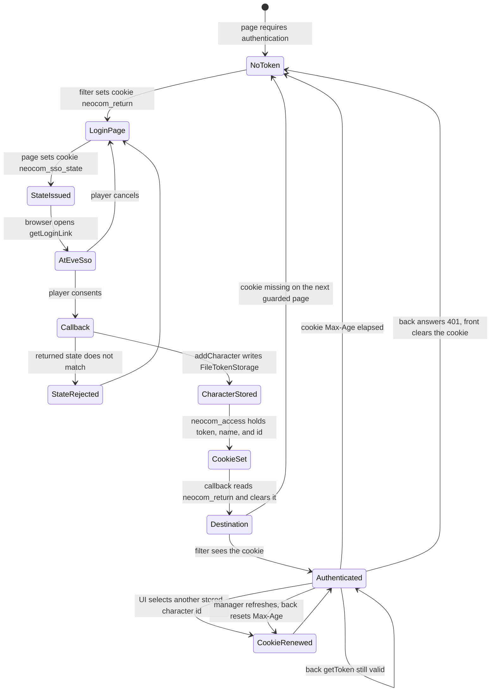

# EPIC-001 - LOGIN PROCEDURE
## Goals
To be able to use the authenticated features of the ESIapi i shoud provide it with some authentication infrmation. The api describes how to get that information and how to use it. Login is composed by a page to initiate the process and a filter that when a page reuires to be authenticated to access its contents if there is no authentication token on the from or it is expired we should return back to the login page and then to the original destination when the login is completed

## Login flow

The front starts this flow when its authentication token is not present, and again when that token is expired. The filter sends the browser to the login page and keeps the original destination. After login completes, the browser returns to that destination.

EVE SSO is the Authorization Code flow documented at https://developers.eveonline.com/docs/services/sso/. The parameters that flow requires are `response_type=code`, `client_id`, `redirect_uri`, `scope`, and `state`. The token request uses `grant_type=authorization_code` and the authorization `code`, authenticated with the client id and the client secret. The access token lasts about 20 minutes. The refresh token is long-lived and must stay on the server. SSO returns `state` unchanged, and the application checks that it matches the value it sent.

The refresh token stays on the back. The client id and the client secret come from the front configuration file for the active environment. The back uses `EsiTokenManager` from `@lgriffin/esi.ts` (many characters) and `FileTokenStorage` with `lock: true`, including when only one back process is running. Writes go to a temporary file, then a rename, mode `0600`. The lock adds `tokens.json.lock` for each write and `tokens.json.<characterId>.lock` for each refresh. `ssoTimeoutMs` stays below the lock `staleMs` (30 seconds), using 10 seconds. The guide is `neocom-back/doc/lgriffin-esi.ts/guides/AUTHENTICATION.md`. The back controls expiration and replacement of the access token. The manager refreshes a token that is near expiry, coalesces concurrent refreshes for one character, and stores the rotated refresh token before it returns the new access token. The front does not run a refresh timer.

## Development registration

Name: New Neocom Infinity. Callback for the dev-watch front: `http://localhost:6001/app/login-callback`. The front `base href` is `/app`. Client id: `4664722d6bd0415683a04519e738a5fc`. The client secret is not written in this epic. Locally it is written in the front configuration file for that environment, in the clear. A deployment takes the client id and the secret from Kubernetes secrets.

Scopes registered for this client:

- esi-location.read_ship_type.v1
- esi-wallet.read_character_wallet.v1
- esi-universe.read_structures.v1
- esi-ui.write_waypoint.v1
- esi-characters.read_fw_stats.v1
- esi-characters.read_freelance_jobs.v1
- esi-activities.read_character.v1
- esi-access.read_lists.v1
- esi.activity.char:read
- esi.cosmetic.char:read
- publicData
- esi-location.read_location.v1
- esi-wallet.read_corporation_wallet.v1
- esi-search.search_structures.v1
- esi-characters.read_contacts.v1
- esi-assets.read_assets.v1
- esi-planets.manage_planets.v1
- esi-ui.open_window.v1
- esi-characters.write_contacts.v1
- esi-markets.structure_markets.v1
- esi-characters.read_loyalty.v1
- esi-characters.read_chat_channels.v1
- esi-characters.read_medals.v1
- esi-characters.read_standings.v1
- esi-characters.read_agents_research.v1
- esi-industry.read_character_jobs.v1
- esi-markets.read_character_orders.v1
- esi-characters.read_blueprints.v1
- esi-characters.read_corporation_roles.v1
- esi-location.read_online.v1
- esi-characters.read_fatigue.v1
- esi-wallet.read_corporation_wallets.v1
- esi-characters.read_notifications.v1
- esi-assets.read_corporation_assets.v1
- esi-industry.read_corporation_jobs.v1
- esi-markets.read_corporation_orders.v1
- esi-industry.read_character_mining.v1
- esi-industry.read_corporation_mining.v1
- esi-planets.read_customs_offices.v1
- esi-characters.read_titles.v1
- esi-alliances.read_contacts.v1

## Environment

The front has one configuration file per environment. That file holds the client id and the client secret. On local development the values are written in the file and are not secured. When deployment is ready, the same entries come from Kubernetes secrets. The back reads those values when it exchanges the authorization code.

| Variable | Where the value is used |
| --- | --- |
| `EVE_SSO_CLIENT_ID` | Front configuration file for the environment. The back reads the same value. |
| `EVE_SSO_CLIENT_SECRET` | Front configuration file for the environment. Local file holds it in the clear. A deployment supplies it from a Kubernetes secret. The back uses it on the token request. |
| `EVE_SSO_CALLBACK_URL` | Back. Must match the registered callback. |
| `EVE_SSO_SCOPES` | Front and back. The registered scope names, separated by spaces. No wildcard. |

## Proposed solution

A cookie on the front is the simpler store to debug and test. The browser devtools show it without a storage-API call. `navigator.storage` stays unused.

Three cookies carry this login. `SameSite=Lax` and `Path=/` so the browser sends them on the top-level redirect back from EVE.

| Cookie | Who sets it | What it holds | Lifetime |
| --- | --- | --- | --- |
| `neocom_return` | Front filter, when the token is missing or expired | Original destination URL | Until the callback redirects, or 20 minutes |
| `neocom_sso_state` | Login page, from the `state` in `getLoginLink()` | The same `state` sent to EVE | Until the callback accepts or rejects it, or 20 minutes |
| `neocom_access` | Back, after `addCharacter`; the UI may replace the character | Access token, character name, and character id | 20 minutes, reset when the token is refreshed or the UI selects another stored character |

`neocom_access` uses `Max-Age=1200` and is readable by the front. It is not `HttpOnly`, so page scripts and a test can read it from `document.cookie`. The back sets it on the login callback, after `EsiTokenManager.addCharacter` has stored the character. The cookie names that character: `characterName` and `characterId` from the stored record, together with the access token. When the manager refreshes the access token, the back sends the cookie again and the 20 minutes start over. The callback then clears `neocom_return` and `neocom_sso_state`.

The UI can change the active character without a new login. It writes another character name and character id into `neocom_access` when that character is already in `tokens.json`. The next call uses `tokens.getToken(characterId)` and reuses the stored token. The back then rewrites the cookie with that character's access token, name, and id.

The refresh token stays in `FileTokenStorage` on the back. The client id and the client secret stay in the front configuration file for the environment.

```typescript
const tokens = new EsiTokenManager({
  clientId: process.env.EVE_SSO_CLIENT_ID!,
  clientSecret: process.env.EVE_SSO_CLIENT_SECRET,
  callbackUrl: process.env.EVE_SSO_CALLBACK_URL!,
  storage: new FileTokenStorage('./tokens.json', { lock: true }),
  ssoTimeoutMs: 10_000,
});

// The login page builds the authorize URL with OAuthEnabledComponent.getLoginLink().
// Callback at http://localhost:6001/app/login-callback, forwarded to the back.
// Reject a state that does not match the neocom_sso_state cookie.
// Then redirect to the neocom_return cookie and clear both.
const stored = await tokens.addCharacter(code);
const accessToken = await tokens.getToken(stored.characterId);
// Set-Cookie: neocom_access=<accessToken>|<characterName>|<characterId>
// Max-Age=1200; Path=/; SameSite=Lax
// Readable by the front. No HttpOnly.
// UI switch: replace name and id, then getToken(characterId) reuses the stored token.
```

The front filter treats a missing cookie as "token not present" and an elapsed `Max-Age` as "expired". Both send the browser to the login page with the original destination. After the callback sets a new cookie, the front navigates to that destination.

The back owns expiration. It replaces `neocom_access` when it refreshes the access token. The front learns that replacement failed only from a `401`, then clears `neocom_access` and returns to the login page. An elapsed `Max-Age` means the back did not replace the cookie in time.

## State flow

Each box is a state of one browser login.



## How the code follows the states

The front filter is the only piece that starts the flow. On a guarded route it looks for `neocom_access`. Absent or older than 20 minutes, the state is `NoToken`. The filter writes the current URL into `neocom_return` and navigates to the login page. The SSO `state` is the cookie `neocom_sso_state`. The login page sets it to the same `state` value `OAuthEnabledComponent` writes into the authorize link. Both cookies use `Path=/` and `SameSite=Lax`, so they are still present when EVE redirects the browser to the callback.

The login page reuses `OAuthEnabledComponent` from `neocom-infinity-frontend/src/app/pages/OauthEnabled.component.ts`. `v1-start-page` already reaches that class through `BackgroundOauthEnabledComponent`. `getLoginLink()` builds the authorize URL from the front environment: host, `response_type`, client id, `state`, encoded callback, and encoded scope. The client id and the secret stay in the front configuration file for the active environment. Locally that file holds both values in the clear. A deployment reads them from Kubernetes secrets. The back still builds `EsiTokenManager` with the client id, the secret, and the callback when it exchanges the code.

The scope list on the authorize link comes from `environment.loginLinkData.scope`, the same `EVE_SSO_SCOPES` value. The [SSO guide](https://developers.eveonline.com/docs/services/sso/) says the authorize request asks for specific scopes, and the `scope` parameter is that list joined with a single space. The application may request only scopes assigned on its registration, and the player must consent to each one. There is no wildcard. The first login sends every name in the Development registration list, including `esi.activity.char:read`, `esi.cosmetic.char:read`, and `publicData`. It does not send `esi-*`.

`AtEveSso` is the browser on EVE. Consent returns the browser to `http://localhost:6001/app/login-callback` with `code` and `state`, and the browser attaches `neocom_sso_state`. Cancel returns the user with no code; the front shows the login page again and leaves `neocom_return` in place so a retry still knows the destination. The callback handler rejects the request when the query `state` differs from the `neocom_sso_state` cookie, and it does not call `addCharacter`. On a match it clears `neocom_sso_state`.

On a matching `state`, the back calls `tokens.addCharacter(code)`. That exchanges the code and writes the character through `FileTokenStorage` constructed with `{ lock: true }` and the path `./tokens.json`. The manager sets `ssoTimeoutMs` to 10 seconds so an SSO call ends before the lock's `staleMs` of 30 seconds. `tokens.json` is gitignored. The lock files sit next to that path.

`addCharacter` returns `characterName` and `characterId`. `getToken(characterId)` returns that character's access token. The back then sets `neocom_access` without `HttpOnly`, so the front filter and a test can read `document.cookie`. The cookie value is the access token, the character name, and the character id. It uses `Path=/`, `SameSite=Lax`, and `Max-Age=1200`.

Several characters can sit in the same token file. The cookie names the active one. A later request calls `getToken` with the character id in the cookie. The UI changes character on the fly by writing another stored character's name and id. That reuses the token already in `FileTokenStorage` and does not start a new SSO login. The back answers with a new `neocom_access` for the selected character.

While the cookie is present, guarded pages stay in `Authenticated`. The back controls expiration and replacement. The front does not refresh the token and does not run a timer. The back calls `tokens.getToken` with the character id from `neocom_access`. The manager refreshes when the access token is inside its skew of expiry and stores the rotated refresh token first. The back then replaces `neocom_access` and the 20 minutes start over. When the back cannot replace the token, it responds `401`, the front deletes `neocom_access`, and the state returns to `NoToken`.

## Login page

The login page follows `neocom-infinity-frontend` `v1-start-page`, with `app-info-panel` from `neocom-front` above that panel.

`app-info-panel` (`src/app/panels/app-info-panel`) reads the front environment. It shows the application name in uppercase, the version, and the copyright. The current development values are `neocom-front`, `0.0.0`, and `© 2019,2024 Dimensinfin Industries`.

Under that panel the page matches the start page. The title is `NeoCom / SSO EVE Online`. While the page is checking the session it shows `VALIDANDO AUTENTICACION DEL PILOTO...`. When there is no session it shows the EVE login button, `cy-name="EVE-login-button"`, using `assets/media/eve-sso-login-white-large.png`. The button href is `getLoginLink()` from `OAuthEnabledComponent`. A footer carries the copyright line.

```html
<app-info-panel id="appinfo-panel" class="neocom-panel"></app-info-panel>
<div class="panel">
  <div cy-field-value="title-message" class="login-message">NeoCom / SSO EVE Online</div>
  <div cy-field-value="validation-message" class="validation-message">VALIDANDO AUTENTICACION DEL PILOTO...</div>
  <a cy-name="EVE-login-button" class="eve-login-request" href="{{getLoginLink()}}">
    
  </a>
</div>
<footer class="footer">© 2019,2024 Dimensinfin Industries</footer>
```

The validation message and the login button are alternatives, as on the start page: the message while the check runs, the button when the player must sign in.

`OAuthEnabledComponent` is reused for this login. It extends `BackgroundEnabledComponent` and exposes `getLoginLink()`, which calls `composeLoginLink()`. That method reads `environment.loginLinkData` and appends `response_type`, `client_id`, `state`, `redirect_uri`, and `scope`. The login page extends `BackgroundOauthEnabledComponent`, the same subclass `v1-start-page` extends, so the button can call `getLoginLink()`. The page writes that `state` into `neocom_sso_state` before the browser leaves for EVE.

## Login progress

When login is complete, EVE SSO calls the registered callback. That callback is a page, and the page is required to finish the login. It lives in `neocom-front/src/app/pages/login-callback-page` and is served at `/login-callback`.

The [SSO guide](https://developers.eveonline.com/docs/services/sso/) returns the browser to the registered `redirect_uri` with the query parameters `code` and `state`. The sample is:

`http://localhost:6001/app/login-callback?code=<authorization_code>&state=<state>`

The page follows `v1-login-validation-page`. It reads `code` and `state`. It keeps `app-info-panel` at the top. The progress region shows `Waiting for code authentication...` and the authorization code, or `-AWAITING-CODE-` when `code` is absent. When `code` is missing or `state` does not match `neocom_sso_state`, the exception region shows `Exception: EXCEPTION` and the message, and the back does not call `addCharacter`. On a match the callback continues as specified above, and the browser then opens `neocom_return`.
