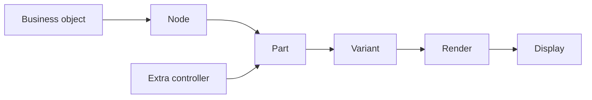
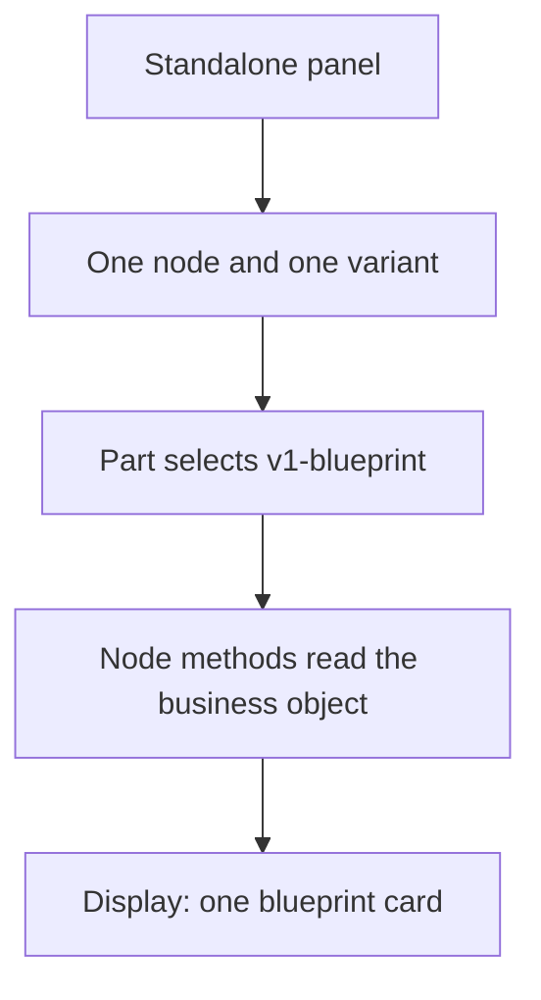
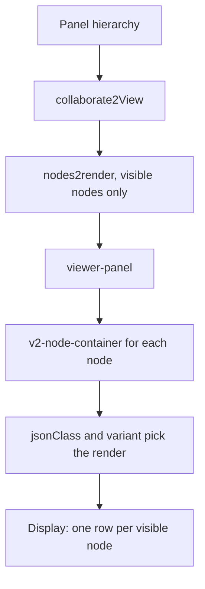

# EPIC-002 - ANGULAR CODIFICATION
## Goals
I follow an special structure when creating compoenent, panels and pages, use the model present on the @neocom-infinity/neocom-infinity-frontend/src/app remplate project to understand the division between app core pages (app/pages) and panels (app/panels) and pages that are tied to application sections that are represented by modules

## Division

The model is `neocom-infinity-frontend/src/app`. A page is a routed screen. A panel is a piece of a page and has no route of its own. A section of the application is an Angular module that owns the pages and panels of that section.

### Core pages

`app/pages` holds the screens of the application shell. `AppRoutingModule` routes them directly:

| Route | Page |
| --- | --- |
| `start` | `v1-start-page` |
| `loginValidation` | `v1-login-validation-page` |
| `exceptionInfo` | `exception-information-page` |
| `dashboard` | `dashboard-home-page` |

`dashboard` is behind `TokenAuthorizationGuard`. The empty path redirects to `start`.

### Core panels

`app/panels` holds panels used by those core pages. They are not routes. The login validation page is built from `login-validation-progress` and `login-validation-exception`.

A core page also hosts panels that belong to a shared module. `dashboard-home-page` places `app-info-panel`, `server-info-panel`, and `v1-pilot-panel` in its template. Those three are declared and exported by `modules/header`, not by `app/panels`.

### Section modules

A section is a feature module under `app/modules`, loaded with `loadChildren` from the root router. The module declares its own pages and panels and registers its routes with `RouterModule.forChild`.

| Section | Module | Root path | Pages live in |
| --- | --- | --- | --- |
| Industry | `modules/industry` | `industry` | `modules/industry/pages` |
| Manufacture | `modules/industry/manufacture` | `industry/manufacture` | `modules/industry/manufacture/pages` |
| Planetary | `modules/planetary` | `planetary` | `modules/planetary/page` |
| Loyalty | `modules/loyalty` | `loyalty` | `modules/loyalty/page` |
| Fittings | `modules/fittings` | not loaded from the root router | `modules/fittings/pages` |

Industry and manufacture use the folder names `pages` and `panels`. Planetary and loyalty use `page` and `panel`. Each section page composes its own panels and can also compose the header panels. `v1-loyalty-recommendations-page` places `app-info-panel` and `server-info-panel` beside `v1-loyalty-corporation-selection-panel` and `v1-loyalty-offer-recommendations-panel`.

Industry also routes one page that sits outside the module folder: `app/industry/pages/v1-mining-operations-page`, at `industry/mining/miningoperations`. Its render pieces sit in `app/industry/renders`, and `app/industry/panels` holds `v1-miningoperations-panel`.

### Modules that are not sections

These modules supply pieces to pages. They do not represent an application section and they do not own a root route:

| Module | What it holds |
| --- | --- |
| `modules/header` | Shared header panels |
| `modules/shared` | Shared panels, renders, and the viewer |
| `modules/renders` | Render components for fittings, planetary, loyalty, and industry |
| `modules/common` | Pipes and small components such as `v1-feature-button` |
| `modules/innovative-core` | Base components and services |

New core screens go in `app/pages`. New core panels go in `app/panels`. A screen that belongs to a section goes in that section module, with that section's panels beside it.

## Node

A node is a renderable item. Its source data lives on a business object. That object usually has methods that shape the values for the UI, such as a display name, an icon URL, or a cost already scaled for the screen. The node does not read the raw source past those methods.

A node, its Part, and its business object are the Model-View-Controller trio.

| Role | What it is |
| --- | --- |
| Model | The business object. It holds the source data and the methods that prepare it for the UI |
| View | The render. One data source can have several variants |
| Controller | The Part. It is the main control for the node |

The Part may have other controllers attached. Those extra controllers extend the same set of nodes sideways. They do not add another level of children.

### Render and variant

The render draws one node. The same node can use more than one variant. A listing variant shows few fields. Another variant can hold its own hierarchical nodes inside the same data source.

`v1-blueprint-render` is the sample. It extends the node container and reads the node as the business object: blueprint name, output name, manufacture cost, output price, and cost index. The variant `-AVAILABLE-BLUEPRINTS-` is the detailed layout. Any other variant is the short layout. `v2-node-container` chooses this render when the node's `jsonClass` is `ProcessedBlueprintSummary` or `ProcessedBlueprint`, and it passes the same `variant` through.

### Hierarchy and the render list

Nodes form a hierarchy. Rendering converts that hierarchy into a list, and the list is rebuilt when visibility or expansion changes.

- An invisible node does not contribute to the render list.
- A collapsed node contributes itself and does not contribute its children.
- An expanded node contributes itself and its visible children.

`collaborate2View` is that conversion. `LookupRegion` returns only itself while it is collapsed, and returns its systems when it is expanded. `AppPanelComponent.notifyDataChanged` walks the root, calls `collaborate2View` with the current variant, and stores the result in `renderNodeList`. Expanding a node calls `toggleExpanded` and then `notifyDataChanged`, so the list is trimmed again immediately.

### Viewer and standalone panels

A container panel owns the nodes it shows. It feeds the viewer `nodes2render` and a `variant`. The viewer walks that list and gives each node to `v2-node-container` with the same variant. The container then renders the node according to its visibility.

`modules/shared/core/viewer-panel` is the same contract, selector `viewer-panel`. `neocom-viewer-panel` repeats it. Both take the list the panel already built, the download state of that panel, the variant, and whether a hover selects the node.

```typescript
@Input() nodes2render: ICollaboration[] = [];
@Input() downloader: AppPanelComponent;
@Input() variant: string = '-DEFAULT-';
@Input() selectOnHover: boolean = false;

getNodes2Render(): ICollaboration[] {
  return this.nodes2render;
}
```

```html
<div *ngFor="let node of getNodes2Render()">
  <v2-node-container
    [container]="downloader"
    [node]="node"
    [variant]="variant"
    [selectOnHover]="selectOnHover">
  </v2-node-container>
</div>
```

The shared viewer uses `ChangeDetectionStrategy.OnPush` and numbers each row with `getNextIndex()`. The list it receives is already flat. The panel rebuilds that list in `notifyDataChanged` before the viewer paints it, so an expand or a hide changes which nodes are in `nodes2render`. The fitting contents panel and the blueprint BOM panel both bind this viewer with `[nodes2render]="getNodes2Render()"` and `[variant]="getVariant()"`.

A standalone panel receives one node and one variant. Its Part uses that pair to select the render and is the controller that reads the business object's data. The render does not fetch the model on its own.

### Relationships

The business object stays behind the node. The display never reads it except through the methods the node exposes. The Part is the only controller that chooses the render and calls those methods. A second controller, when one is attached, works on the same nodes beside the Part.



`jsonClass` on the node picks which render component is used. The variant picks which layout of that render is used. Visibility and expansion decide whether the node is on the list the display walks.

### Use case: one standalone panel

The panel is given a single node and a variant. There is no hierarchy and no viewer list. The Part selects the render for that pair and reads the business object through the node.

A blueprint panel given one `ProcessedBlueprint` and the variant `-AVAILABLE-BLUEPRINTS-` is the sample. The Part selects `v1-blueprint`. That render calls `getBlueprintName`, `getOutputName`, `getManufactureCost`, `getOutputPrice`, and the icon methods. The display is that one detailed card. The same node with any other variant uses the short layout of the same render.



### Use case: a viewer

The panel holds a hierarchy. Before anything is drawn, `notifyDataChanged` turns that hierarchy into `nodes2render`. An invisible node is left out. A collapsed node contributes only itself. An expanded node also contributes its visible children. The viewer does not walk the hierarchy. It walks the list it was given.

The blueprint BOM panel is the sample. It binds `viewer-panel` with that list and the panel's variant. Each row is a `v2-node-container`. The container reads `jsonClass` and mounts the matching render, still with the same variant. The render calls the node's methods, and the display is one row per visible node.


