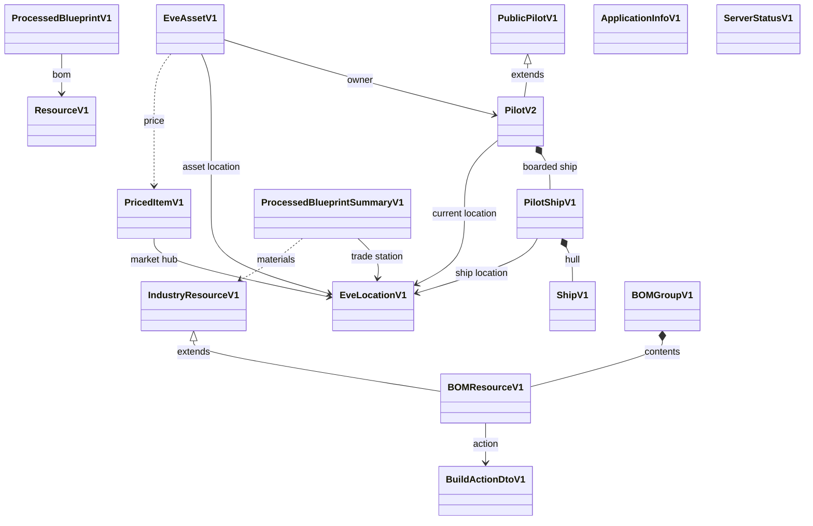
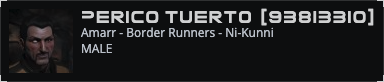
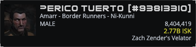
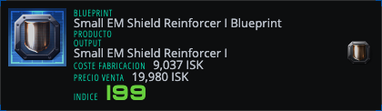
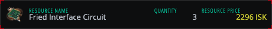
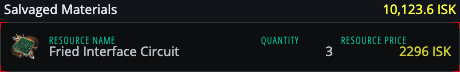
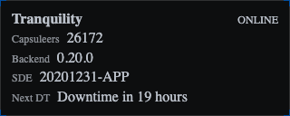

# EPIC-004 - MODELS

## Table of contents

1. [Spec traceability](#spec-traceability)
2. [Goals](#goals)
3. [Section 01 — Versioned business objects](#section-01--versioned-business-objects)
   - [UI inherits model versionability (`vn-` panels and renders)](#ui-inherits-model-versionability-vn--panels-and-renders)
   - [Media from the EVE Image Server](#media-from-the-eve-image-server)
4. [Section 02 — Model register (review under this epic)](#section-02--model-register-review-under-this-epic)
   - [Scope: ESI-matching models are not in this definition](#scope-esi-matching-models-are-not-in-this-definition)
   - [Iterative review](#iterative-review)
   - [Model hierarchy](#model-hierarchy)
5. [Section 03 — PricedItemV1](#section-03--priceditemv1)
6. [Section 04 — EveLocationV1](#section-04--evelocationv1)
   - [PricedItemV1 and market hubs](#priceditemv1-and-market-hubs)
7. [Section 05 — EveAssetV1](#section-05--eveassetv1)
8. [Section 06 — PublicPilotV1](#section-06--publicpilotv1)
   - [Appearance: `v1-public-pilot`](#appearance-v1-public-pilot)
   - [PublicPilotV1 fields](#publicpilotv1-fields-from-publicpilotv1domaints)
9. [Section 07 — PilotV2](#section-07--pilotv2)
   - [Appearance: `v2-pilot`](#appearance-v2-pilot)
   - [Requirements (moved from L2 front pilot)](#requirements-moved-from-l2front01pilot-definitionmd)
   - [Concept (summary)](#concept-summary)
   - [Versioning and inheritance (from infinity)](#versioning-and-inheritance-from-infinity)
   - [PilotV2 fields](#pilotv2-fields-from-pilotv2domaints-extends-publicpilotv1)
   - [Render contract: `v2-pilot` HEADER](#render-contract-v2-pilot-header)
   - [Complements: boarded ship and current location](#complements-boarded-ship-and-current-location)
10. [Section 08 — ShipV1](#section-08--shipv1)
11. [Section 09 — PilotShipV1](#section-09--pilotshipv1)
12. [Section 10 — ProcessedBlueprintSummaryV1](#section-10--processedblueprintsummaryv1)
    - [Appearance: `v1-blueprint`](#appearance-v1-blueprint)
13. [Section 11 — ProcessedBlueprintV1](#section-11--processedblueprintv1)
14. [Section 12 — ResourceV1](#section-12--resourcev1)
15. [Section 13 — IndustryResourceV1](#section-13--industryresourcev1)
    - [Appearance: `v1-bomresource`](#appearance-v1-bomresource)
16. [Section 14 — BOMResourceV1](#section-14--bomresourcev1)
    - [Appearance: `v1-bomresource` with action](#appearance-v1-bomresource-with-action)
17. [Section 15 — BuildActionDtoV1](#section-15--buildactiondtov1)
18. [Section 16 — BOMGroupV1](#section-16--bomgroupv1)
    - [Appearance: `v1-bomgroup`](#appearance-v1-bomgroup)
19. [Section 17 — ApplicationInfoV1](#section-17--applicationinfov1)
    - [Appearance: `v1-application-info-render`](#appearance-v1-application-info-render)
    - [ApplicationInfoV1 requirements](#applicationinfov1-requirements)
20. [Section 18 — ServerStatusV1](#section-18--serverstatusv1)
    - [Appearance: `v1-server-status-render`](#appearance-v1-server-status-render)
    - [Fields](#fields-from-infinity-serverstatusdomaints)
    - [Render contract (header)](#render-contract-header)
    - [ServerStatusV1 requirements](#serverstatusv1-requirements)
21. [Section 19 — SpaceLocationV1](#section-19--spacelocationv1)
22. [Section 20 — Deployment: `neocom-domain`](#section-20--deployment-neocom-domain)

### Section index

| Section | Title |
| --- | --- |
| [01](#section-01--versioned-business-objects) | Versioned business objects |
| [02](#section-02--model-register-review-under-this-epic) | Model register (review under this epic) |
| [03](#section-03--priceditemv1) | PricedItemV1 |
| [04](#section-04--evelocationv1) | EveLocationV1 |
| [05](#section-05--eveassetv1) | EveAssetV1 |
| [06](#section-06--publicpilotv1) | PublicPilotV1 |
| [07](#section-07--pilotv2) | PilotV2 |
| [08](#section-08--shipv1) | ShipV1 |
| [09](#section-09--pilotshipv1) | PilotShipV1 |
| [10](#section-10--processedblueprintsummaryv1) | ProcessedBlueprintSummaryV1 |
| [11](#section-11--processedblueprintv1) | ProcessedBlueprintV1 |
| [12](#section-12--resourcev1) | ResourceV1 |
| [13](#section-13--industryresourcev1) | IndustryResourceV1 |
| [14](#section-14--bomresourcev1) | BOMResourceV1 |
| [15](#section-15--buildactiondtov1) | BuildActionDtoV1 |
| [16](#section-16--bomgroupv1) | BOMGroupV1 |
| [17](#section-17--applicationinfov1) | ApplicationInfoV1 |
| [18](#section-18--serverstatusv1) | ServerStatusV1 |
| [19](#section-19--spacelocationv1) | SpaceLocationV1 |
| [20](#section-20--deployment-neocom-domain) | Deployment: `neocom-domain` |

---

## Spec traceability

| Field | Value |
| --- | --- |
| Status | `none` |
| L2 | Canonical model review lives in this L1 file. Former field lists extracted from `L2/DOMAIN/MODELS/` (now pointers). Pilot front pointer: `L2/FRONT/01.PILOT-DEFINITION.md` |
| OpenSpec changes | |
| Skip | |
| Index | `L1/TRACEABILITY.md` |

## Goals
This will collect the domain elemtns definitions to be used for data rendering

## Section 01 — Versioned business objects

Business objects and data models are versioned so application work can add a new shape without breaking features that still use an older one.

- Published programme type names SHALL use a **version suffix** (`…V1`, `…V2`, …), not an unversioned bare name. Infinity file names that used a `V1` *prefix* (e.g. `V1ProcessedBlueprintSummary.domain.ts`) map to suffix form in `neocom-domain` (`ProcessedBlueprintSummaryV1`).
- The version is part of the type name (`PricedItemV1`, `EveLocationV1`, `EveAssetV1`, `PublicPilotV1`, `PilotV2`, `ShipV1`, `PilotShipV1`, `ProcessedBlueprintV1`, `ApplicationInfoV1`, `ServerStatusV1`).
- A new version is a new type. The old type stays in the domain package.
- A feature depends on the version it was built for. It is not moved onto a later version unless that feature changes.
- Domain model field lists and reviews are owned by this epic. `L2/DOMAIN/MODELS/` holds **pointers only**.
- **Applied / implemented** documentation and the live **model hierarchy diagram** live in [`01.PROGRAMME-DEFINITION/ARCHITECTURE/MODELS.md`](../../01.PROGRAMME-DEFINITION/ARCHITECTURE/MODELS.md) once models are available in the coding systems.

### UI inherits model versionability (`vn-` panels and renders)

Panels and renders that **present** a domain model SHALL inherit that model’s versionability so the application can evolve by adding a new `vn` UI beside the old one.

| Rule | Expectation |
| --- | --- |
| Prefix | Selector, folder, and class names use a lowercase **`v` + version number** prefix: `v1-…`, `v2-…` (e.g. `v1-blueprint-render`, `v2-pilot-render`, `v1-application-info-render`) |
| Match | The `vn` on the panel/render tracks the **domain type version** it was built for (`ApplicationInfoV1` → `v1-application-info-render`; `PilotV2` → `v2-pilot` / `v1-pilot-panel` as that feature’s contract) |
| Coexistence | A new model version gets a new panel/render (new `vn` or new registration). The previous `vn` stays until its feature is deliberately migrated |
| Registry | `jsonClass` on the versioned domain node selects the registered versioned render |
| Exceptions | Shell/orchestration only (e.g. `app-page-header`, generic `standalone-node-panel`, `viewer-panel`) are **not** versioned with `vn-`; they host versioned renders |

Unversioned presentational names (`app-info-panel`, `server-info-panel`) are **transitional / legacy**. New work SHALL use versioned panels or renders.

### Media from the EVE Image Server

Portraits, corporation and alliance logos, and type icons are loaded by the client directly from the [EVE Image Server](https://developers.eveonline.com/docs/services/image-server/). The NeoCom backend does not proxy, store, or return these images. A render builds the URL from the id it already has.

`https://images.evetech.net/{category}/{id}/{variation}?size={size}`

| Need | Category | Id | Variation |
| --- | --- | --- | --- |
| Pilot portrait | `characters` | `pilotId` | `portrait` |
| Corporation logo | `corporations` | corporation id | `logo` |
| Alliance logo | `alliances` | alliance id | `logo` |
| Item / module / resource icon | `types` | type id | `icon` |
| Hull or type render | `types` | type id | `render` |
| Blueprint original | `types` | blueprint type id | `bp` |

`size` is a power of two from 32 to 1024. Omit it only when the original size is acceptable. `tenant` defaults to `tranquility`. When a character, corporation, or alliance id is missing, use id `1` (the documented default portrait or logo). Clients may request the URL as a CDN; they do not cache the bytes through the backend.

## Section 02 — Model register (review under this epic)

**New reviews of domain model requirements are tied to EPIC-004.** Content below includes material extracted and enhanced from `L2/DOMAIN/MODELS/`. Those L2 files are **pointers only**; do not update field lists there.

### Scope: ESI-matching models are not in this definition

Models whose shape **matches ESI payloads** (universe types, character, corporation, alliance, race/ancestry/bloodline, and similar) SHALL **not** be defined as published domain models in this epic. They are **managed internally** inside the server system (ESI adapters / internal enrichment) and are **not always visible** outside that boundary. `neocom-domain` SHALL publish the **programme domain hierarchy** below, not ESI mirror types.

| Model | Role | Review |
| --- | --- | --- |
| [PricedItemV1](#section-03--priceditemv1) | Item identity + buy/sell + hub market place | to review |
| [EveLocationV1](#section-04--evelocationv1) | Multi-kind location | to review |
| [EveAssetV1](#section-05--eveassetv1) | Instanced item + Pilot + location + price | to review |
| [PublicPilotV1](#section-06--publicpilotv1) | Public-only Pilot base (legacy / unauthenticated); kept for compatibility | reviewed |
| [PilotV2](#section-07--pilotv2) | Published Pilot for new development (extends public Pilot slice); header render + PilotShipV1 + EveLocationV1 | reviewed |
| [ShipV1](#section-08--shipv1) | Neutral hull / type | to review |
| [PilotShipV1](#section-09--pilotshipv1) | Boarded instance: hull + location + fit | to review |
| [ProcessedBlueprintSummaryV1](#section-10--processedblueprintsummaryv1) | Blueprint list / cost-index summary (v1-blueprint render) | to review |
| [ProcessedBlueprintV1](#section-11--processedblueprintv1) | Full processed blueprint (type + output + BOM resources) | to review |
| [ResourceV1](#section-12--resourcev1) | Typed BOM line (`EsiType` + quantity) — prefer item identity in new package | to review |
| [IndustryResourceV1](#section-13--industryresourcev1) | BOM material line: type id, name, quantity, price | to review |
| [BOMResourceV1](#section-14--bomresourcev1) | Industry resource plus build/buy action | to review |
| [BuildActionDtoV1](#section-15--buildactiondtov1) | BUY/BUILD action and market context on a BOM line | to review |
| [BOMGroupV1](#section-16--bomgroupv1) | Labelled group of BOM resources and derived cost | to review |
| [ApplicationInfoV1](#section-17--applicationinfov1) | Front application identity for header (name, version, copyright); environment-sourced domain node; `v1-application-info-render` | to review |
| [ServerStatusV1](#section-18--serverstatusv1) | EVE Online server info for header; from ESI status + programme enrichments; `v1-server-status-render` | to review |
| [SpaceLocationV1](#section-19--spacelocationv1) | Superseded by EveLocationV1 | superseded |
| EveItem / ESI type / EsiType mirrors | Internal server only — not published here | out of scope |
| ESI corporation / alliance / universe race structures | Internal server only — not published here | out of scope |
| **neocom-domain** | Deploy target: library holds domain models + hierarchy | to review |

### Iterative review

Specs for this epic move one reviewed batch at a time. The **Review** cell on the register is the switch. `/neo:extract-l2` and `/neo:spec-evolution` take only rows whose Review cell is exactly `reviewed`, and the section that row links to. Every other model stays in this file until a later pass sets that cell to `reviewed`.

| Review | Meaning for the next extract |
| --- | --- |
| `to review` | Pending. Do not copy the section, do not edit it, do not register it. |
| `reviewed` | This iteration. Extract that section into L2, then spec-evolution may register it. |
| `extracted` | Already taken into L2. Leave it until someone sets `reviewed` again for a later change. |
| `superseded` | Do not extract. |
| `out of scope` | Do not extract. |

A requirement table inside a model section (PILOT-*, IND-BP-*, APPINFO-*, SRV-*) follows that model. Pending models keep those rows here. After extract writes the L2 notes for a `reviewed` model, set that register cell to `extracted`. Do not change a `to review` cell or its section.

### Model hierarchy

Published programme types and how they relate. Solid arrows are composition or reference. Open triangles are inheritance. Dotted arrows are alignment (price concepts, inline material lines) rather than a stored subtype. `ApplicationInfoV1` and `ServerStatusV1` are published NeoCom nodes and do not sit in the game-object tree. `SpaceLocationV1` is superseded by `EveLocationV1` and is not in the tree. Item identity and ESI-shaped types stay server-internal; they are not nodes here.

## Section 03 — PricedItemV1

**PricedItemV1** is the first domain model in this epic for data rendering when market prices matter. Item **type** data that matches ESI universe types stays internal to the server; PricedItemV1 SHALL identify the item for rendering without republishing an ESI type mirror.

PricedItemV1 SHALL wrap a domain item identity (type id and name known to the programme) and SHALL add:

| Field | Purpose |
| --- | --- |
| **buy price** | Price when the pilot needs to **buy** the item at the market |
| **sell price** | Price when the pilot **sells** the item at the market |
| **market / place** | Where that pricing applies — the market (location) for which buy and sell prices are valid |

Pricing SHALL use **market information from the main hubs** (not an arbitrary or undocumented market). The model SHALL make the hub/market place explicit so rendered UI can show which market the buy and sell prices belong to.

## Section 04 — EveLocationV1

PricedItemV1’s market place depends on **location control**. Domain models SHALL define **EveLocationV1** as a first-class element because locations have **multiple interpretations** and nesting levels.

EveLocationV1 MAY represent (non-exhaustive) any of:

| Kind | Examples |
| --- | --- |
| Space hierarchy | constellation, solar system, planet |
| Dockable / structure | station, player (user) structure / citadel |
| Asset context | ship, cargo hold on a ship |

The same conceptual “place” MAY appear at different levels of that hierarchy; the model SHALL make the **kind/level** of an EveLocationV1 explicit so adapters and renderers do not treat every location as the same shape.

### PricedItemV1 and market hubs

For **PricedItemV1**, the market place SHALL be at the **planet or station** level where the **market hub** is located (not, for example, a ship cargo hold). Buy and sell prices SHALL be tied to that hub location kind.

Location modelling is therefore **higher complexity** than a single flat id: pricing, rendering, and persistence MUST respect which location interpretation applies in each use (market hub vs asset location vs navigation hierarchy).

## Section 05 — EveAssetV1

The next domain model is **EveAssetV1**. Assets are **instanced** items that **belong to a Pilot** and that are **on an EveLocationV1**. Raw ESI asset/type payloads stay internal to the server; EveAssetV1 is the published domain shape.

EveAssetV1 SHALL therefore bind at least:

| Aspect | Meaning |
| --- | --- |
| **Type / item** | The instanced item identity (type id and name). The icon is `types/{typeId}/icon` on the image server |
| **Owner** | The Pilot who owns the asset |
| **Location** | The EveLocationV1 where the asset is (any valid location kind for assets — e.g. station, structure, ship, cargo hold) |

EveAssetV1 SHALL also carry **price information** (aligned with PricedItemV1 concepts — buy and/or sell context as applicable for rendering), so asset lists and panels can show value without a separate ad-hoc price attachment.

## Section 06 — PublicPilotV1

### Appearance: `v1-public-pilot`

HEADER variant. Labels stay in the markup and are not shown. Fixture **93813310** (Perico Tuerto). Captured from `neocom-front` `/model-strip` with the application panel styles.

**PublicPilotV1** is the public-only Pilot base. Infinity: `neocom-infinity-frontend/src/app/domain/character/PublicPilotV1.domain.ts`. It `extends NeoComDelayed` with `jsonClass = 'PublicPilotV1'`. New work keeps it for compatibility. **PilotV2** extends it.

Shared behaviour from infinity to preserve on this base (or equivalent):

- `getPilotId()` → `pilotId`
- `getCorporationId()` → `corporation.getCorporationId()` or `-1` when missing
- `getPilotIcon()` → `https://images.evetech.net/characters/{pilotId}/portrait?size=64`. When `pilotId` is missing, use character id `1`. A corporation logo, when a render needs one, is `corporations/{corporationId}/logo` the same way.

### PublicPilotV1 fields (from `PublicPilotV1.domain.ts`)

| Field | Type (infinity) | Notes | Used by v2-pilot HEADER |
| --- | --- | --- | --- |
| `pilotId` | `number` | | yes (`[#{{pilotId}}]`) |
| `name` | `string` | | yes |
| `corporation` | `PublicCorporationV1` | Domain corporation summary; not an ESI mirror in this epic | (not in HEADER layout) |
| `birthday` | `string` | | |
| `description` | `string` | | |
| `gender` | `string` | | yes (uppercase) |
| `securityStatus` | `number` | | |
| `url4Icon` | `string` | Infinity stored a portrait URL. New renders ignore it and call `getPilotIcon()` | no |
| `raceData` | `UniverseRaceData` (at least `name`; infinity also `raceId`, `allianceId`, `description`) | Domain summary; ESI-shaped types stay internal to construction | yes (ancestry line) |
| `ancestryData` | `UniverseAncestryData` (`name`) | | yes |
| `bloodlineData` | `UniverseBloodlineData` (`name`) | | yes |

Ancestry display line in HEADER: `raceData.name + ' - ' + ancestryData.name + ' - ' + bloodlineData.name`.

## Section 07 — PilotV2

### Appearance: `v2-pilot`

HEADER variant. Same public lines as `v1-public-pilot`, plus skill points, wallet, and current ship name. Fixture **93813310**.

**Canonical home for the Pilot domain model is this epic.** The published type for **new development** is **`PilotV2`**. Field shape and inheritance SHALL follow the **current infinity model implementations** (not invent a parallel shape):

| Reference | Path |
| --- | --- |
| Public base | `neocom-infinity-frontend/src/app/domain/character/PublicPilotV1.domain.ts` |
| Authenticated Pilot | `neocom-infinity-frontend/src/app/domain/character/PilotV2.domain.ts` |
| HEADER render | `neocom-infinity-frontend/src/app/modules/renders/v2-pilot-render` (`selector: v2-pilot`) |

Specs also retain PILOT-* from `L2/FRONT/01.PILOT-DEFINITION.md`. That front L2 file no longer owns Pilot requirements. Login/SSO and HTTP endpoint behaviour stay in their own features; OpenSpec `front-pilot` tracks front apply against **PilotV2**.

### Requirements (moved from `L2/FRONT/01.PILOT-DEFINITION.md`)

| ID | Status | Requirement |
| --- | --- | --- |
| PILOT-001 | to review | A pilot is the concept of the Eve Online user interaction with the game environment |
| PILOT-002 | to review | A pilot belongs to a game credential, and a credential can have up to 3 pilots |
| PILOT-003 | to review | Server may obtain public character facts from ESI **Get character's public information** (`GetCharactersDetail`); that ESI shape is **internal** and is not a published model in this epic |
| PILOT-004 | cancelled | Inside the Pilot concept the game entity is named Character. Cancelled: ESI models are outside the project; a library encapsulates its own data domain |
| PILOT-005 | to review | Development and standalone testing use ESI sample data supplied for WireMock responses (server-internal). Test character id **93813310** (Perico Tuerto) may seed PilotV2 domain fields for fixtures |
| PILOT-006 | to review | The published Pilot data model for new work is **PilotV2** in this epic, not an ESI character mirror and not an unversioned `Pilot` type name |
| PILOT-007 | to review | The **PilotV2** field model is the canonical model in this file (EPIC-004), not a separate domain MODELS file or the front L2 pilot definition |
| PILOT-008 | to review | The HEADER **v2-pilot** render SHALL bind to **PilotV2** fields listed under Render contract below (infinity reference: `v2-pilot-render`) |
| PILOT-009 | to review | **neocom-domain** Pilot types SHALL be defined from infinity `PublicPilotV1.domain.ts` and `PilotV2.domain.ts` (same public fields, inheritance `PilotV2 extends PublicPilotV1`, and V2-only fields), adapted only where this epic replaces `SpaceLocationV1` with **EveLocationV1** or adds PilotShipV1 complements |

### Concept (summary)

- A **Pilot** is the Eve Online user’s interaction with the game environment (programme name).
- A Pilot belongs to a game credential; a credential can have up to **3** pilots.
- ESI character / corporation / alliance / universe race payloads are **server-internal**; they feed Pilot construction and are not always exposed outside the server.
- Development fixture: character id **93813310** (Perico Tuerto) for WireMock / tests.
- Programme published type is **`PilotV2`** (extends **`PublicPilotV1`** as in infinity). Unversioned `Pilot` in older infinity code is **legacy**; new work SHALL use **PilotV2**.

### Versioning and inheritance (from infinity)

| Type | Infinity role | New package role |
| --- | --- | --- |
| **PilotV2** | `extends PublicPilotV1`; `jsonClass = 'Pilot'` | Authenticated Pilot; **default for new development** |

`PilotV2.getLastKnownLocation()` → string helper over location (infinity still stubbed; new work: derive from **EveLocationV1**). Base accessors `getPilotId()`, `getCorporationId()`, and `getPilotIcon()` stay on **PublicPilotV1**.

### PilotV2 fields (from `PilotV2.domain.ts`, extends PublicPilotV1)

| Field | Type (infinity) | Notes | Used by v2-pilot HEADER |
| --- | --- | --- | --- |
| `totalSkillpoints` | `number` | | yes |
| `walletBalance` | `number` | ISK; scaled display in HEADER | yes |
| `currentShipName` | `string` | Legacy render helper | yes |
| `currentShipTypeName` | `string` | Legacy helper | |
| `lastKnownLocation` | infinity: `SpaceLocationV1` | **Superseded by EveLocationV1** in new work; keep field for compatibility until render/DTO migrate | via `getLastKnownLocation` (not in HEADER template) |

### Render contract: `v2-pilot` HEADER

New front work that shows the Pilot header SHALL consume **PilotV2** and support at least the HEADER fields above (icon, name, id, ancestry line, gender, total skill points, wallet balance, current ship name). Reference: infinity `v2-pilot-render` binding `@Input() node: PilotV2`.

### Complements: boarded ship and current location

Beyond the PilotV2 field set copied from infinity, PilotV2 SHALL be complemented for new work with:

| Element | Meaning |
| --- | --- |
| **ShipV1 being boarded** | Domain **PilotShipV1** (preferred). HEADER MAY keep showing `currentShipName` until the render is updated to read from PilotShipV1. |
| **Current Pilot location** | **EveLocationV1** (kind/level explicit). Replaces `SpaceLocationV1` / opaque `lastKnownLocation`. |

`currentShipName`, `currentShipTypeName`, and `lastKnownLocation` remain on **PilotV2** for **compatibility with infinity domain + HEADER**; structured PilotShipV1 + EveLocationV1 are the forward model.

## Section 08 — ShipV1

The boarded-ship complement on Pilot leads to a neutral hull model and a boarded instance. This section is the neutral hull.

**ShipV1** is a **neutral** hull/type domain model: it carries the ship **type id**, **name**, and **characteristics** of the hull/type, without pilot- or instance-specific state. ESI type payloads for ships stay internal to the server. The hull picture is `types/{typeId}/render` on the image server. Use ShipV1 wherever a render or calculation needs “what kind of ship this is” without ownership, location, or fit.

## Section 09 — PilotShipV1

**PilotShipV1** encapsulates a **ShipV1** and adds more detail for a pilot’s actual vessel:

| Aspect | Meaning |
| --- | --- |
| **ShipV1** | The neutral hull/type (name and characteristics) |
| **Location** | Where that ship is — an **EveLocationV1** |
| **Fitting** | The ship’s fit (modules / charges / related fit data as defined for rendering) |

**PilotV2**’s ship being boarded SHALL be a **PilotShipV1** (or equivalent view of one) for new structured work, not only a neutral ShipV1. Neutral ShipV1 remains available for catalogs, market, and manufacturing contexts that do not need location or fitting.

## Section 10 — ProcessedBlueprintSummaryV1

### Appearance: `v1-blueprint`

Variant `-AVAILABLE-BLUEPRINTS-`. Index is `costIndex × 100`. Sample is Small EM Shield Reinforcer I.

**Reference source for industry models:** `neocom-infinity-frontend/src/app/modules/industry/domain/`. Infinity class names stay for compatibility (file names use a `V1` prefix even when the exported class does not).

`EsiType` / `UniverseType` / `EsiGroup` / `EsiCategory` used by `ResourceV1` and `ProcessedBlueprintV1` are **ESI-shaped** and stay **server-internal**; the published industry models SHALL reference **item identity** (type id and name) or **PricedItemV1** where market price applies — not republish `EsiType`. Icons are built from that type id on the image server.

Source: `V1ProcessedBlueprintSummary.domain.ts`. `jsonClass = 'ProcessedBlueprintSummaryV1'` (infinity used `'ProcessedBlueprintSummary'`). Used by infinity **`v1-blueprint`** render for the manufacture cost-index list.

| Field | Type | Notes |
| --- | --- | --- |
| `uid` | string | Unique id (`getUniqueId`) |
| `blueprintTypeId` | number | Blueprint type |
| `blueprintTypeName` | string | |
| `blueprintTypeIconURL` | string | Infinity stored a URL. New renders use `types/{blueprintTypeId}/bp` |
| `outputTypeId` | number | Manufactured module/type |
| `outputTypeName` | string | |
| `outputTypeIconURL` | string | Infinity stored a URL. New renders use `types/{outputTypeId}/icon` |
| `outputPrice` | number | |
| `tradeStation` | Station → **EveLocationV1** (station kind) in new work | Hub / trade place for pricing |
| `manufactureMaterialCost` | number | |
| `costIndex` | number | |
| `materials` | `{ typeId, name, quantity, price }[]` | Inline BOM summary lines |

| ID | Status | Requirement |
| --- | --- | --- |
| IND-BP-001 | to review | Blueprint list / cost-index UI uses **ProcessedBlueprintSummaryV1** (infinity `v1-blueprint` render contract) |

## Section 11 — ProcessedBlueprintV1

Source: `V1ProcessedBlueprint.domain.ts` (exported class name **`ProcessedBlueprintV1`**). `jsonClass = 'ProcessedBlueprintV1'`. Extends delayed/HAL-capable base in infinity (`NeoComDelayed`).

| Field | Infinity type | Published expectation |
| --- | --- | --- |
| `type` | `EsiType` | Blueprint **item identity** (type id, name). Icon is `types/{typeId}/bp` |
| `output` | `EsiType` | Output **item identity** |
| `bom` | `ResourceV1[]` | Bill of materials |

Helpers from infinity to preserve: `getName()` / `getUniqueId()` from `type`; `getModuleName()` from `output`. `getTypeIconURL()` returns the image-server URL for that type id (`bp` for the blueprint, `icon` for a resource or output).

| ID | Status | Requirement |
| --- | --- | --- |
| IND-BP-002 | to review | Full blueprint detail uses **ProcessedBlueprintV1** with blueprint type, output type, and BOM **ResourceV1** lines |

## Section 12 — ResourceV1

Source: `Resource.domain.ts` (infinity; publish as ResourceV1). Extends `EsiType` in infinity and adds:

| Field | Type | Notes |
| --- | --- | --- |
| `quantity` | number | Required BOM quantity |

In `neocom-domain`, publish **ResourceV1** as item identity (type id and name) + `quantity` (optionally price via **PricedItemV1** / IndustryResourceV1), not as a subclass of an ESI type mirror. The row icon is `types/{typeId}/icon`.

## Section 13 — IndustryResourceV1

### Appearance: `v1-bomresource`

Source: `V1IndustryResource.domain.ts` (class **`IndustryResourceV1`**). `jsonClass = 'IndustryResourceV1'`.

| Field | Type | Default (infinity) |
| --- | --- | --- |
| `typeId` | number | `34` |
| `name` | string | |
| `quantity` | number | `1` |
| `price` | number | |

## Section 14 — BOMResourceV1

### Appearance: `v1-bomresource` with action

Same row as IndustryResourceV1. The action is the extra mark on the line (BUY or BUILD). It is not a separate panel.

Source: `V1BOMResource.domain.ts` (class **`BOMResourceV1`** extends **IndustryResourceV1**). `jsonClass = 'BOMResourceV1'`.

| Field / aspect | Notes |
| --- | --- | --- |
| (inherits IndustryResourceV1) | `typeId`, `name`, `quantity`, `price` |
| `action` | `BuildActionDtoV1` — pilot preference for this type (e.g. BUY vs BUILD); infinity documents Epithal-style BUILD actions |

## Section 15 — BuildActionDtoV1

Supporting DTO for **BOMResourceV1**. Infinity: `domain/industry/dto/BuildActionDto.dto.ts`. At least `actionType` (default `'BUY'`), optional corporation home station, and market order (price / station name). Keep as a small published DTO or embed action type + price context on BOMResourceV1; do not pull full ESI market payloads into the published model.

## Section 16 — BOMGroupV1

### Appearance: `v1-bomgroup`

The group render is the label and the derived total. Resource rows under it are `v1-bomresource`.

Source: `V1BOMGroup.domain.ts` (class **`BOMGroupV1`**). `jsonClass = 'BOMGroupV1'`.

| Field | Notes |
| --- | --- |
| `label` | Group label |
| `contents` | `BOMResourceV1[]` |
| `totalCost` | Sum of `price * quantity` over contents (computed in infinity `collaborate2View`) |

| ID | Status | Requirement |
| --- | --- | --- |
| IND-BP-003 | to review | BOM lines for action-aware manufacturing use **IndustryResourceV1** → **BOMResourceV1** → **BOMGroupV1** as in infinity industry domain |
| IND-BP-004 | to review | `neocom-domain` SHALL publish these industry types from the infinity sources above; replace `Station` with **EveLocationV1** and `EsiType` with item identity / **PricedItemV1** where applicable |

## Section 17 — ApplicationInfoV1

### Appearance: `v1-application-info-render`

**ApplicationInfoV1** is the published domain model for **front application identity** shown in the header (name, version, copyright). It is a NeoCom node (`jsonClass = "ApplicationInfoV1"`) so the header can provide it and **`v1-application-info-render`** can display it the same way other domain data is rendered (EPIC-002 / EPIC-006).

Source of truth for values today: front environment (`appName`, `appVersion`, `copyright`). The provider builds an **ApplicationInfoV1** instance; the `v1` render reads only node methods.

| Field | Access | Notes |
| --- | --- | --- |
| name | `getName()` | Display uppercase in the default header render |
| version | `getVersion()` | Front build / package version |
| copyright | `getCopyright()` | Copyright line |

### ApplicationInfoV1 requirements

| ID | Status | Requirement |
| --- | --- | --- |
| APPINFO-001 | to review | Header consumes published **ApplicationInfoV1** via a data provider → **`v1-application-info-render`** (not by reading `environment` inside an unversioned panel) |
| APPINFO-002 | to review | `neocom-domain` SHALL publish **ApplicationInfoV1** with `jsonClass = "ApplicationInfoV1"` and the accessors above |
| APPINFO-003 | to review | Provider builds ApplicationInfoV1 from the front environment (or equivalent config) until another source is specified |
| APPINFO-004 | to review | UI for this model uses the **`v1-`** prefix on the render (and any dedicated panel); a later **ApplicationInfoV2** gets a new `v2-` UI |

## Section 18 — ServerStatusV1

### Appearance: `v1-server-status-render`

**ServerStatusV1** is the published domain model for **EVE Online server information** shown in the application header. Reference implementations:

| Concern | Path |
| --- | --- |
| Domain | `neocom-infinity-frontend/src/app/domain/esi/ServerStatus.domain.ts` (legacy unversioned class name; programme type is **ServerStatusV1**) |
| Legacy panel | `server-info-panel` — superseded by provider → **`v1-server-status-render`** in EPIC-006 |

Raw ESI **server status** (Tranquility players / start time / server name) is obtained via the backend (infinity: public `apiV1_GetServerStatus` / `/api/v1/neocom/server/datasource/{datasource}`). The **ESI response shape is internal**; the programme model is **ServerStatusV1**, which may include additional NeoCom fields (backend version, SDE version, downtime helpers) that are not part of the ESI payload alone.

`jsonClass = "ServerStatusV1"`.

### Fields (from infinity `ServerStatus.domain.ts`)

| Field | Type | Access / notes | Used by `v1-server-status-render` |
| --- | --- | --- | --- |
| `server` | string | `getServerName()` — e.g. Tranquility | yes (titlecase) |
| `players` | number | `getPlayersCount()` — capsuleer count; default `0` | yes |
| `start_time` | string | `getStartTime()` — ESI server start (ISO) | (available; render may show via helpers) |
| `backendVersion` | string | Programme / NeoCom backend build | yes |
| `SDEVersion` | string | Installed Static Data Export version (aligns with EPIC-005) | yes |
| `startAgo` | string | Human-readable “started ago” (enriched) | yes (`getStartedAgo`) |
| `nextDowntime` | string | Next downtime hint (enriched) | yes |

### Render contract (header)

The header **data provider** locates/obtains a **ServerStatusV1** instance. The registered **`v1-server-status-render`** (lookup by `jsonClass`) shows at least: server name, ONLINE/OFFLINE (ONLINE when a status instance is present), capsuleer count, backend version, SDE version, and next downtime. Loading state while the status request is in flight. Legacy `server-info-panel` is not the long-term target.

ONLINE/OFFLINE is a **UI derivation** in infinity (`getServerStatus()`), not a stored field on the domain object — new work MAY keep that behaviour or add an explicit status enum later without breaking ServerStatusV1 field compatibility.

### ServerStatusV1 requirements

| ID | Status | Requirement |
| --- | --- | --- |
| SRV-001 | to review | Header obtains **ServerStatusV1** from a data provider and injects it into **`v1-server-status-render`** (EPIC-002 standalone / registry pattern) |
| SRV-002 | to review | ServerStatusV1 is built from ESI server status (internal) plus programme enrichments (`backendVersion`, `SDEVersion`, `startAgo`, `nextDowntime`) |
| SRV-003 | to review | `neocom-domain` SHALL publish **ServerStatusV1** from infinity `ServerStatus.domain.ts` field set |
| SRV-004 | to review | UI for this model uses the **`v1-`** prefix; a later **ServerStatusV2** gets a new `v2-` UI |

## Section 19 — SpaceLocationV1

Former `lastKnownLocation` type. Declared no fields. **Superseded by EveLocationV1** in this epic — do not extend SpaceLocationV1.

Historical ESI-matching field lists formerly under `L2/DOMAIN/MODELS/` (`PublicCorporationV1`, `AllianceV1`, `Station`, `UniverseRaceData`, `UniverseAncestryData`, `UniverseBloodlineData`, and ESI type / EveItem mirrors) are **out of scope** for this epic’s published model definition. They remain server-internal where needed; L2 files stay **pointers only**.

Corporation home station and similar location needs SHALL use **EveLocationV1** (station/structure kind), not a separate Station ESI mirror.

## Section 20 — Deployment: `neocom-domain`

All **published** models defined in this epic (PricedItemV1, EveLocationV1, EveAssetV1, **PilotV2** / PublicPilotV1, ShipV1, PilotShipV1, industry blueprint / BOM set, **ApplicationInfoV1**, and **ServerStatusV1**) SHALL be **deployed in the `neocom-domain` Node library**. ESI-matching types SHALL not be required as public exports of that package solely because ESI returns them. Export the type name **`PilotV2`** (not an unversioned `Pilot`) for new consumers.

`neocom-domain` SHALL be **enhanced** with:

| Concern | Expectation |
| --- | --- |
| **Models** | TypeScript types/classes for each **published** domain element named in this epic, including **PilotV2**, industry blueprint / BOM, **ApplicationInfoV1**, and **ServerStatusV1** |
| **Model hierarchy** | Explicit composition relationships (e.g. item identity → PricedItemV1; ShipV1 → PilotShipV1; PublicPilotV1 → PilotV2 + PilotShipV1 + EveLocationV1; EveAssetV1 on PilotV2 + EveLocationV1; ProcessedBlueprintV1 → type/output + ResourceV1[]; IndustryResourceV1 → BOMResourceV1 → BOMGroupV1; ProcessedBlueprintSummaryV1 → materials + EveLocationV1) so front and back share one hierarchy |

Front and back SHALL consume these models via the published `neocom-domain` package dependency (aligned with DOMAIN-002 / DOMAIN-003), not by redefining parallel shapes in application repos. New model review and hierarchy **requirements** stay in EPIC-004 and land in `neocom-domain` on apply. After apply, record implemented models and deploy the hierarchy diagram in [`ARCHITECTURE/MODELS.md`](../../01.PROGRAMME-DEFINITION/ARCHITECTURE/MODELS.md).
