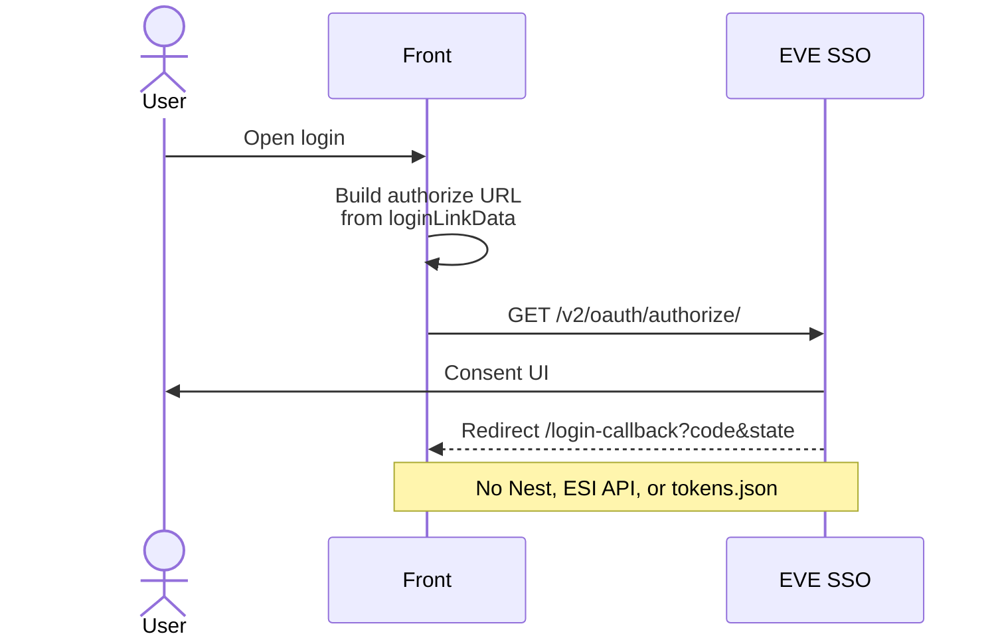
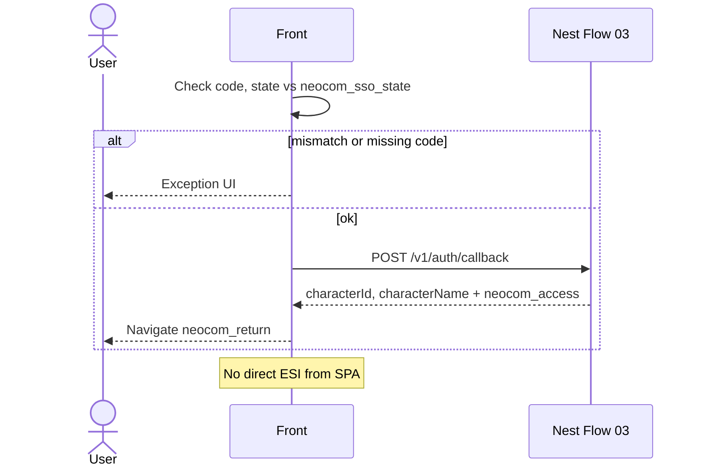
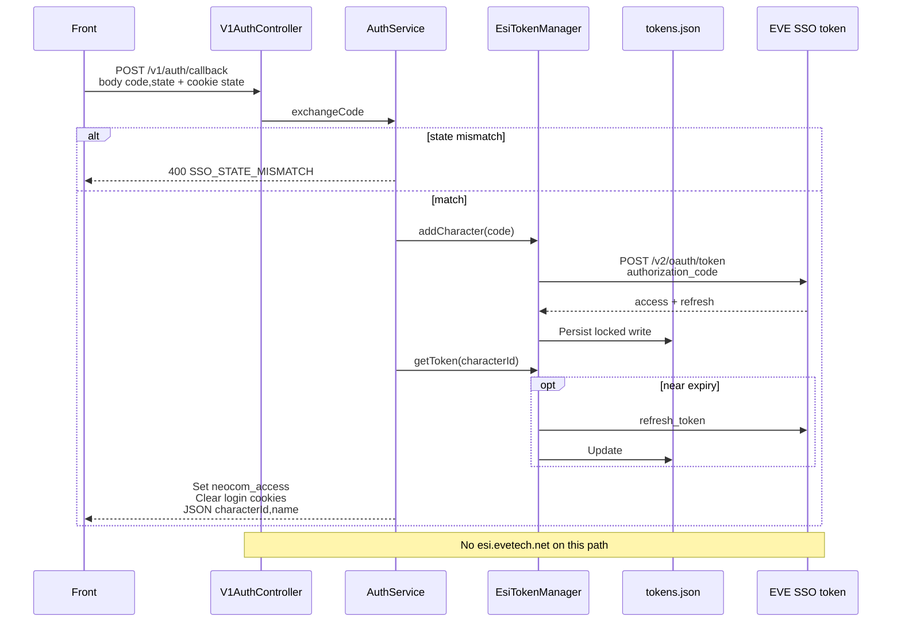
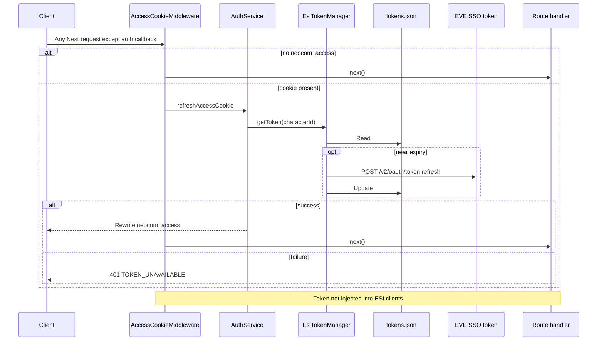
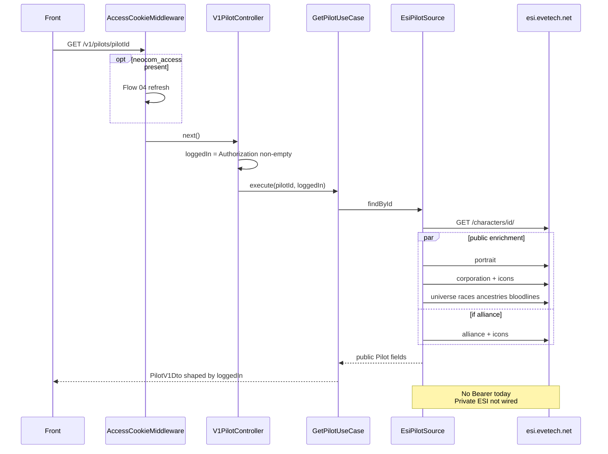
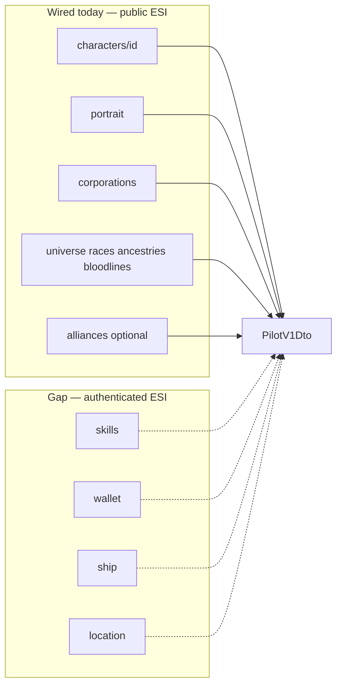
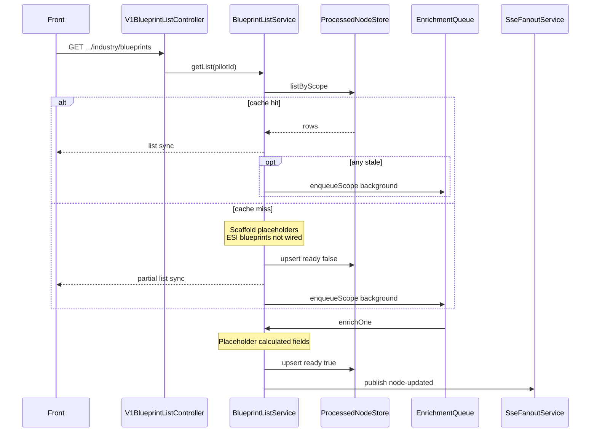
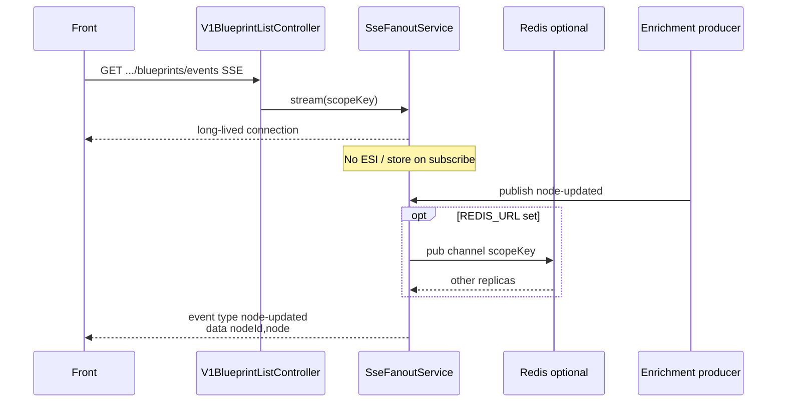

# EPIC-007 - NEOCOM API

## Table of contents

1. [Spec traceability](#spec-traceability)
2. [Goals](#goals)
3. [Inventory of current contracts (baseline)](#inventory-of-current-contracts-baseline)
4. [Authentication (current)](#authentication-current)
   - [Flow 01 — Browser → EVE SSO authorize](#flow-01--browser--eve-sso-authorize-not-nest)
   - [Flow 02 — Front callback page](#flow-02--front-callback-page-spa-not-nest)
   - [Flow 03 — API-AUTH-001 Exchange SSO code](#flow-03--api-auth-001--exchange-sso-code)
   - [Flow 04 — API-AUTH-002 Access cookie refresh](#flow-04--api-auth-002--access-cookie-refresh-middleware)
   - [Shared cookies](#shared-cookies)
   - [Front 401 handling](#front-401-handling)
   - [Nest → EVE (not front↔back)](#nest--eve-not-frontback)
5. [Pilot data access (current)](#pilot-data-access-current)
   - [Flow 05 — API-PILOT-001 Get pilot](#flow-05--api-pilot-001--get-pilot)
6. [Related pilot-scoped industry list (current)](#related-pilot-scoped-industry-list-current-not-identity)
   - [Flow 06 — API-IND-BP-001 List blueprints](#flow-06--api-ind-bp-001--list-blueprints-partial-ok)
   - [Flow 07 — API-IND-BP-002 Blueprint enrichment events](#flow-07--api-ind-bp-002--blueprint-enrichment-events)
7. [Further flows](#further-flows)

### Flow index

| Flow | Id / title | Mode | Path |
| --- | --- | --- | --- |
| [01](#flow-01--browser--eve-sso-authorize-not-nest) | Browser → EVE SSO authorize | sync | `https://login.eveonline.com/v2/oauth/authorize/` |
| [02](#flow-02--front-callback-page-spa-not-nest) | Front callback page | sync → Nest | Front `/login-callback` |
| [03](#flow-03--api-auth-001--exchange-sso-code) | API-AUTH-001 Exchange SSO code | sync | `POST /v1/auth/callback` |
| [04](#flow-04--api-auth-002--access-cookie-refresh-middleware) | API-AUTH-002 Access cookie refresh | sync | Nest middleware (except auth callback) |
| [05](#flow-05--api-pilot-001--get-pilot) | API-PILOT-001 Get pilot | sync | `GET /v1/pilots/{pilotId}` |
| [06](#flow-06--api-ind-bp-001--list-blueprints-partial-ok) | API-IND-BP-001 List blueprints | async | `GET /v1/pilots/{pilotId}/industry/blueprints` |
| [07](#flow-07--api-ind-bp-002--blueprint-enrichment-events) | API-IND-BP-002 Blueprint enrichment events | event | `GET /v1/pilots/{pilotId}/industry/blueprints/events` |

---

## Spec traceability

| Field | Value |
| --- | --- |
| Status | `none` |
| L2 | |
| OpenSpec changes | |
| Skip | |
| Index | `L1/TRACEABILITY.md` |

## Goals
This is the place to define the requirements of the from to be implemented on the back, what requests are synch, asynch or events and the data to be expected to be interchanged, from this place the bach should be able to locate the seri¡vice where to implement the endpoint and configure and create the code to serve that data

## Inventory of current contracts (baseline)

Baseline taken from the **current implementation** and related OpenSpec / OpenAPI. Later sections in this epic add new flows. Mode legend: **sync** = request/response HTTP; **async** = HTTP that may return partial data while work continues; **event** = SSE (or similar push).

**Logical flow (required on every endpoint):** when the back (or front, for browser SSO) touches ESI, EVE SSO, file/DB stores, queues, or other upstreams, the endpoint entry SHALL include (1) a numbered **Flow NN** heading, (2) an ordered **Logical flow** that names each hop (controller → use case/service → outbound adapter → external system → response shaping), and (3) a **mermaid** diagram of that flow. Gaps between the contract and what is wired today are called out in both. New flows continue the sequence (`Flow 08`, …) and are listed in the [Flow index](#flow-index) and [Table of contents](#table-of-contents).

Front proxy (`neocom-front` `config/backends.json`) routes `/v1/auth` and `/v1/pilots` to Nest (`NEST_URL`, default `http://127.0.0.1:3000`).

OpenSpec status at capture (not yet archived to main specs): `login` **applying**; `front-pilot` / `front-pilot-panel` **registered**; `front-async-sse` / `back-async-sse` **applying**.

---

## Authentication (current)

Sources: OpenSpec `openspec/changes/login/` (`front/login`, `back/login`, `esi/sso`, `esi/login`); L1 `01.EPIC-LOGIN-PROCEDURE.md`; back `V1AuthController` / `AuthService` / `AccessCookieMiddleware`; front `AuthService`, login + callback pages.

### Flow 01 — Browser → EVE SSO authorize (not Nest)

| Field | Value |
| --- | --- |
| Mode | sync (top-level browser redirect) |
| Path | `https://login.eveonline.com/v2/oauth/authorize/` |
| Request | Query: `response_type=code`, `client_id`, `state`, `redirect_uri`, `scope` (space-joined). Built by the front from `environment.loginLinkData`. |
| Response | EVE redirects to the front callback with `?code=&state=` (or cancel with no `code`) |
| Back service | none — front only |
| Notes | Dev callback URL shape: `{origin}/app/login-callback` |

#### Logical flow

1. Front builds authorize URL from `environment.loginLinkData` and navigates the browser.
2. Browser → **EVE SSO** `GET https://login.eveonline.com/v2/oauth/authorize/` (user consent).
3. SSO redirects to front callback with `code` + `state` (or cancel without `code`).
4. No Nest, ESI data API, or token file involved.

### Flow 02 — Front callback page (SPA, not Nest)

| Field | Value |
| --- | --- |
| Mode | sync page, then sync HTTP to Nest |
| Path | Front route `/login-callback` |
| Request | Query `code`, `state`. Cookie `neocom_sso_state` must equal query `state`. |
| Response | Progress / exception UI; on success navigate using `neocom_return` (default `/dashboard`) |
| Back service | none — then calls Nest [Flow 03](#flow-03--api-auth-001--exchange-sso-code) |

#### Logical flow

1. Front reads query `code`/`state` and cookie `neocom_sso_state`; fails locally if state mismatches or code missing.
2. Front → Nest `POST /v1/auth/callback` ([Flow 03](#flow-03--api-auth-001--exchange-sso-code)) with credentials/cookies as configured.
3. On success, front navigates using `neocom_return`. No direct ESI call from the SPA.

### Flow 03 — API-AUTH-001 — Exchange SSO code

| Field | Value |
| --- | --- |
| Mode | **sync** |
| Method + path | `POST /v1/auth/callback` |
| Request body | `{ code: string, state: string }` |
| Request cookies | `neocom_sso_state` must match body `state` |
| Response 200 | JSON `{ characterId: number, characterName: string }` |
| Response cookies | Set `neocom_access` = `accessToken\|characterName\|characterId` (`Path=/`, `SameSite=Lax`, `Max-Age=1200`, **not** `HttpOnly`). Clear `neocom_return`, `neocom_sso_state`. |
| Response 400 | `NeocomError` with `errors[].code` `SSO_STATE_MISMATCH` (`field` `state`, `container` `body`) |
| Back locate | `AuthModule` → `V1AuthController` → `AuthService.exchangeCode` → `EsiTokenManager` / `FileTokenStorage` (`./tokens.json`) |
| Spec gap | OpenSpec `back/login` describes cookie lifecycle (BACK-015) but does not name this path; path is the implementation contract. |

#### Logical flow

1. `V1AuthController.callback` reads body `{ code, state }` and cookie `neocom_sso_state`.
2. `AuthService.exchangeCode` rejects on state mismatch (`SSO_STATE_MISMATCH`).
3. `EsiTokenManager.addCharacter(code)` → outbound **EVE SSO** `POST https://login.eveonline.com/v2/oauth/token` (`grant_type=authorization_code`, client id/secret, redirect URI from config).
4. Persist access + refresh tokens via **FileTokenStorage** → `./tokens.json` (locked writes).
5. `EsiTokenManager.getToken(characterId)` may proactive-refresh against the same SSO token URL if near expiry, then rewrite `tokens.json`.
6. Set `neocom_access` on the response; clear `neocom_return` and `neocom_sso_state`.
7. Return `{ characterId, characterName }`. No ESI `esi.evetech.net` character calls on this path.

### Flow 04 — API-AUTH-002 — Access cookie refresh (middleware)

| Field | Value |
| --- | --- |
| Mode | **sync** (middleware on Nest routes) |
| Applies to | Every Nest request **except** `POST /v1/auth/callback` when cookie `neocom_access` is present |
| Request | Cookie `neocom_access` = `accessToken\|characterName\|characterId` |
| Behaviour | Call `tokens.getToken(characterId)`; rewrite `neocom_access` (20 minutes restart on refresh). Failure → **401** `TOKEN_UNAVAILABLE` |
| Back locate | `AccessCookieMiddleware` + `AuthService.refreshAccessCookie` |
| Spec | BACK-016 / BACK-017 |

#### Logical flow

1. `AccessCookieMiddleware` runs before the route handler (skipped for `/v1/auth/callback`).
2. If `neocom_access` missing → continue without refresh.
3. Parse cookie → `characterId` (drives refresh; cookie access token string is not sent to ESI here).
4. `EsiTokenManager.getToken(characterId)` reads **FileTokenStorage** `./tokens.json`.
5. If access token near expiry → **EVE SSO** `POST https://login.eveonline.com/v2/oauth/token` (`grant_type=refresh_token`) → update `tokens.json`.
6. Rewrite `neocom_access` on the response; on failure respond **401** `TOKEN_UNAVAILABLE`.
7. Does **not** attach the access token to later handlers’ ESI clients; other endpoints must obtain tokens themselves if they call authenticated ESI.

### Shared cookies

| Cookie | Writer | Value / role |
| --- | --- | --- |
| `neocom_return` | Front guard | Original URL after login |
| `neocom_sso_state` | Front login page | SSO `state` for CSRF check |
| `neocom_access` | Back callback / refresh; front may rewrite name+id for character switch | Session access token + character identity |

### Front 401 handling

On Nest **401**, front deletes `neocom_access` and returns to login (`auth-error.interceptor`).

### Nest → EVE (not front↔back)

Code exchange uses `grant_type=authorization_code` with client id/secret on the back. Env wiring for SSO is also tracked under OpenSpec `nestjs-sso-config` (registered, not applying).

---

## Pilot data access (current)

Sources: OpenAPI `neocom-back/tools/openapi/pilot-service-v0.1.0.yaml`; back `V1PilotController` / `GetPilotUseCase` / `EsiPilotSource`; front `pilot.service.ts`, `PilotV1`; OpenSpec `front-pilot` (ESI public character + model; does **not** yet register the Nest path), `front-pilot-panel` (UI; backend endpoint out of that change’s scope).

### Flow 05 — API-PILOT-001 — Get pilot

| Field | Value |
| --- | --- |
| Mode | **sync** |
| Method + path | `GET /v1/pilots/{pilotId}` |
| Path params | `pilotId` integer |
| Request headers | Optional `Authorization`: **any non-empty string** means “logged in”; value is **not** validated on this endpoint. Cookie `neocom_access` alone does **not** unlock private fields. |
| Response 200 | `PilotV1Dto` (see fields below) |
| Response 400 | `INVALID_REQUEST` (`pilotId` not integer) |
| Response 404 | `PILOT_NOT_FOUND` |
| Response 500 | `INTERNAL_SERVER_ERROR` |
| Error body | `NeocomError`: `{ errors: [{ code, description, field?, container?, value? }], traceId? }` |
| Back locate | `PilotModule` → `V1PilotController` → `GetPilotUseCase` → `EsiPilotSource` |
| Spec note | OpenSpec `front-pilot` still names ESI `GET https://esi.evetech.net/characters/{character_id}` as the public source (PILOT-003). Nest `GET /v1/pilots/{pilotId}` is the **front↔back** contract in code/OpenAPI. |

#### `PilotV1Dto` interchange

**Public** (when known): `pilotId` (required), `name`, `corporation` (`PublicCorporationV1Dto` + nested alliance), `birthday`, `description`, `gender`, `securityStatus`, `url4Icon`, `raceData`, `ancestryData`, `bloodlineData`.

**Private** (only when `Authorization` is non-empty): `totalSkillpoints`, `walletBalance`, `currentShipName`, `currentShipTypeName`, `lastKnownLocation`.

#### Logical flow

1. Optional: [Flow 04](#flow-04--api-auth-002--access-cookie-refresh-middleware) may refresh `neocom_access` if the cookie is present (independent of privacy).
2. `V1PilotController.getPilot` → `loggedIn` = non-empty `Authorization` header (**not** cookie validation).
3. `GetPilotUseCase.execute` → `EsiPilotSource.findById` → public ESI via `EsiClient` base `https://esi.evetech.net` (**no** Bearer / managed token attached today).
4. Sync ESI reads (public):
   - `GET /characters/{character_id}/`
   - in parallel: `GET /characters/{character_id}/portrait/`, `GET /corporations/{corporation_id}/` (+ icons), `GET /universe/races/`, `/universe/ancestries/`, `/universe/bloodlines/`
   - if alliance present: `GET /alliances/{alliance_id}/` (+ icons)
5. Map to public `PilotV1Dto` fields. No Nest DB/cache for pilots.
6. Response shaping: if not `loggedIn`, omit private keys; if `loggedIn`, copy private keys then drop those still `undefined`.
7. **Gap (current impl):** private DTO fields are **not** loaded from authenticated ESI yet. Intended sources when wired (scopes as registered on the SSO client): skills → `GET /characters/{id}/skills/`; wallet → `…/wallet/`; ship → `…/ship/`; location → `…/location/` — using a managed token from `EsiTokenManager` / `neocom_access`. Until then, logged-in and anonymous responses share the same public payload.

---

## Related pilot-scoped industry list (current, not identity)

Already implemented under the same `/v1/pilots/:pilotId` tree while async/SSE work is applying. Included so later API flows do not redefine these paths by accident.

### Flow 06 — API-IND-BP-001 — List blueprints (partial OK)

| Field | Value |
| --- | --- |
| Mode | **async** (HTTP returns immediately; enrichment may continue) |
| Method + path | `GET /v1/pilots/{pilotId}/industry/blueprints` |
| Response item shape | `{ jsonClass: 'ProcessedBlueprint', blueprintId, name, ready, manufactureIndex, marketCost, manufactureCost }` |
| Back locate | `V1BlueprintListController` → `BlueprintListService` |

#### Logical flow

1. Optional: [Flow 04](#flow-04--api-auth-002--access-cookie-refresh-middleware) may refresh `neocom_access` if present (unused by this service today).
2. `V1BlueprintListController.list` → `BlueprintListService.getList` with scope `pilot:{pilotId}:industry-blueprints`.
3. **Store read (sync):** `ProcessedNodeStore.listByScope` — Postgres `processed_nodes` when `DATABASE_URL` is set, else in-memory store.
4. **Cache hit:** map rows → list response. If any row is past `staleAfter`, enqueue background enrichment (step 6) without blocking.
5. **Cache miss (sync):** build partial scaffold (placeholder blueprint ids today; authenticated ESI `GET /characters/{id}/blueprints/` is the intended source, **not wired**). Upsert rows with `ready: false` and null calculated fields. Return partial list immediately.
6. **Background enrichment:** `EnrichmentQueueService` — BullMQ on Redis when `REDIS_URL` is set, else in-process timer. `enrichOne` currently fills calculated fields with placeholders (no ESI/market source yet), marks `ready: true`, upserts store, then publishes to SSE ([Flow 07](#flow-07--api-ind-bp-002--blueprint-enrichment-events)).

### Flow 07 — API-IND-BP-002 — Blueprint enrichment events

| Field | Value |
| --- | --- |
| Mode | **event** (SSE) |
| Method + path | `GET /v1/pilots/{pilotId}/industry/blueprints/events` |
| Events | `type: node-updated`, `data`: JSON `{ nodeId, node }` |
| Scope key | `pilot:{pilotId}:industry-blueprints` |
| Back locate | `V1BlueprintListController` → `SseFanoutService` |
| Front | `AuthenticatedSseClient` with `credentials: 'include'` |

#### Logical flow

1. `V1BlueprintListController.events` → `SseFanoutService.stream(scopeKey)` — long-lived SSE; no ESI and no store read on subscribe.
2. Process-local `Subject` filters events for `pilot:{pilotId}:industry-blueprints`.
3. When `REDIS_URL` is set, publish/subscribe also crosses replicas via Redis channel `{ASYNC_SSE_CHANNEL_PREFIX}{scopeKey}` (default prefix `neocom:sse:`).
4. Producers are enrichment jobs from [Flow 06](#flow-06--api-ind-bp-001--list-blueprints-partial-ok) (step 6), which emit `{ type: 'node-updated', data: { nodeId, node } }`.

No SSE is defined for login or for [Flow 05](#flow-05--api-pilot-001--get-pilot).

---

## Further flows

*(Append new front↔back contracts here as **Flow 08**, **Flow 09**, …. Each MUST include: numbered flow heading; mode sync/async/event; method + path; request/response data; back service locate; a numbered **Logical flow**; a **mermaid** diagram; and updates to the [Table of contents](#table-of-contents) and [Flow index](#flow-index).)*
