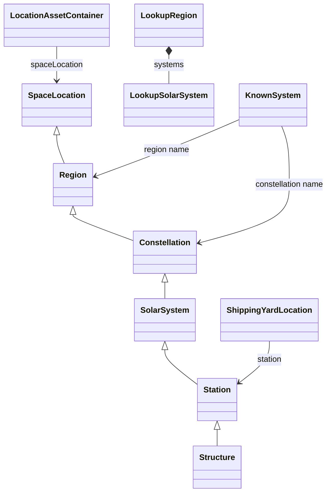

# EPIC-008 - LOCATIONS

## Table of contents

1. [Spec traceability](#spec-traceability)
2. [Goals](#goals)
3. [Section 01 — Location identity](#section-01--location-identity)
4. [Section 02 — Location register (review under this epic)](#section-02--location-register-review-under-this-epic)
   - [Iterative review](#iterative-review)
   - [Location hierarchy](#location-hierarchy)
5. [Section 03 — SpaceLocation](#section-03--spacelocation)
6. [Section 04 — Region](#section-04--region)
7. [Section 05 — Constellation](#section-05--constellation)
8. [Section 06 — Solar system](#section-06--solar-system)
9. [Section 07 — Station](#section-07--station)
10. [Section 08 — Structure](#section-08--structure)
11. [Section 09 — LocationAssetContainer](#section-09--locationassetcontainer)
12. [Section 10 — ShippingYardLocation](#section-10--shippingyardlocation)
13. [Section 11 — LookupRegion](#section-11--lookupregion)
    - [Appearance: `v1-region`](#appearance-v1-region)
14. [Section 12 — LookupSolarSystem](#section-12--lookupsolarsystem)
    - [Appearance: `v1-solar-system`](#appearance-v1-solar-system)
15. [Section 13 — KnownSystem](#section-13--knownsystem)
    - [Appearance: `v1-planetary-system`](#appearance-v1-planetary-system)
16. [Section 14 — Front location stubs](#section-14--front-location-stubs)

### Section index

| Section | Title |
| --- | --- |
| [01](#section-01--location-identity) | Location identity |
| [02](#section-02--location-register-review-under-this-epic) | Location register (review under this epic) |
| [03](#section-03--spacelocation) | SpaceLocation |
| [04](#section-04--region) | Region |
| [05](#section-05--constellation) | Constellation |
| [06](#section-06--solar-system) | Solar system |
| [07](#section-07--station) | Station |
| [08](#section-08--structure) | Structure |
| [09](#section-09--locationassetcontainer) | LocationAssetContainer |
| [10](#section-10--shippingyardlocation) | ShippingYardLocation |
| [11](#section-11--lookupregion) | LookupRegion |
| [12](#section-12--lookupsolarsystem) | LookupSolarSystem |
| [13](#section-13--knownsystem) | KnownSystem |
| [14](#section-14--front-location-stubs) | Front location stubs |

---

## Spec traceability

| Field | Value |
| --- | --- |
| Status | `none` |
| L2 | |
| OpenSpec changes | |
| Skip | |
| Index | `L1/TRACEABILITY.md` |

## Goals
This will collect the specs to hadle all type of locations identifiing also their limitations ans serving as the test place for the development of that complex feature.

Sources for this pass: `neocom-infinity-backend/src` (serializers, lookup endpoint, corporation grouping) and `neocom-infinity-frontend/src` (location domain stubs and renders). The Java types `SpaceLocation`, `Station`, `Structure`, and `LocationCatalogService` live in `neocom-datamanagement`; this epic records the contract the infinity services actually serialize and render. The published programme target remains **EveLocationV1** in [EPIC-004](04.EPIC-MODELS.md).

## Section 01 — Location identity

A location in infinity is one node in a chain. The most specific level that was supplied sets `locationType` and `locationId`. Ancestor levels are copied onto the same object.

`SpaceLocationSerializer` writes that chain with a `switch` that has no `break`. A station payload therefore also contains the solar system, constellation, and region. A structure payload also contains station fields.

| `locationType` | `locationId` is | Also present |
| --- | --- | --- |
| `REGION` | region id | region id and name |
| `CONSTELLATION` | constellation id | constellation, then region |
| `SOLAR_SYSTEM` | solar system id | system, security, then constellation and region |
| `STATION` | station id | station, then system, constellation, and region |
| `STRUCTURE` | structure id | structure and corporation, then station, system, constellation, and region |

Lookup is one call for every kind: `GET /api/v1/universe/spacelocations/{locationId}` (`SpaceLocationControllerV1` → `LocationCatalogService.searchLocation4Id`). The kind is not part of the path.

| ID | Status | Requirement |
| --- | --- | --- |
| LOC-001 | to review | A published location SHALL name its kind. Infinity does this with `locationType` (`LocationIdentifierType`) and uses the most specific id as `locationId` |
| LOC-002 | to review | A deeper location SHALL carry its ancestor place (region, and constellation or system when those levels exist) so a render can show the chain without a second lookup |
| LOC-003 | to review | Planets, ships, and cargo holds are not `locationType` values in this serializer. Planetary bodies use **KnownSystem** / planet renders. Asset grouping uses **LocationAssetContainer** |

### Limitations

- The serializer fall-through makes a structure look like a station: the structure fixture writes `stationId` and `stationName` with the structure’s own id and name (`SpaceLocationSerializerTest.serializeSTRUCTURE`).
- Two JSON names exist for the system. The live serializer writes `solarSystemId` / `solarSystemName`. The acceptance `SpaceLocationJson` and the front `StationDto` use `systemId` / `systemName` and omit `locationType`.
- `StationSerializer` is `@Deprecated` and is not registered as a `JsonComponent`. `ShippingYardLocationSerializer` is `@Deprecated` and is still a `JsonComponent`.

## Section 02 — Location register (review under this epic)

New reviews of location requirements are tied to EPIC-008. Rows stay `to review` until a later pass marks them `reviewed`.

| Model | Role | Review |
| --- | --- | --- |
| [SpaceLocation](#section-03--spacelocation) | Lookup node: kind + id + ancestor chain | to review |
| [Region](#section-04--region) | `REGION` level | to review |
| [Constellation](#section-05--constellation) | `CONSTELLATION` level | to review |
| [Solar system](#section-06--solar-system) | `SOLAR_SYSTEM` level, with security | to review |
| [Station](#section-07--station) | `STATION` level; dockable NPC station | to review |
| [Structure](#section-08--structure) | `STRUCTURE` level; player structure | to review |
| [LocationAssetContainer](#section-09--locationassetcontainer) | Assets grouped under one space location | to review |
| [ShippingYardLocation](#section-10--shippingyardlocation) | Corporation yard: deposit + office + station | to review |
| [LookupRegion](#section-11--lookupregion) | Front region list for system lookup (`v1-region`) | to review |
| [LookupSolarSystem](#section-12--lookupsolarsystem) | Front system row inside a lookup region (`v1-solar-system`) | to review |
| [KnownSystem](#section-13--knownsystem) | Planetary system card (`v1-planetary-system`) | to review |
| [Front stubs](#section-14--front-location-stubs) | Empty `SpaceLocationV1` and `Station`; `StationDto` field names | to review |

### Iterative review

The **Review** cell is the switch, same rule as EPIC-004. `/neo:extract-l2` takes a row only when that cell is exactly `reviewed`, and then the section that row links to.

| Review | Meaning for the next extract |
| --- | --- |
| `to review` | Pending. Leave the section in this file. |
| `reviewed` | This iteration. Extract that section. |
| `extracted` | Already taken into L2. |
| `superseded` | Do not extract. |
| `out of scope` | Do not extract. |

### Location hierarchy

The class diagram is the nesting the serializer encodes. `Structure` is built with `Structure.Builder`, which still runs the station/system/constellation/region chain. Lookup and known-system types are front list models; they are not `locationType` values.

## Section 03 — SpaceLocation

Source: `SpaceLocationSerializer`, `SpaceLocationControllerV1`, `SpaceLocationServiceV1`. Domain type in the library: `org.dimensinfin.eveonline.neocom.domain.space.SpaceLocation` / `SpaceLocationImplementation`.

| Field | Type | Notes |
| --- | --- | --- |
| `locationType` | `LocationIdentifierType` name | `REGION`, `CONSTELLATION`, `SOLAR_SYSTEM`, `STATION`, `STRUCTURE` |
| `locationId` | number | Id of the most specific level |

`IndustryJob` holds two of these: `blueprintLocation` and `jobLocation`. Market lookup resolves a corporation home station id through the same catalog (`MarketServiceV1`).

| ID | Status | Requirement |
| --- | --- | --- |
| LOC-010 | to review | `GET /api/v1/universe/spacelocations/{locationId}` SHALL return one `SpaceLocation` for that id |
| LOC-011 | to review | Callers that need a place (industry job, market hub, pilot last location, asset group) SHALL use this node, not a separate id with no kind |

### Limitations

- The response kind depends on what the catalog stored for that id. The endpoint does not accept a kind.
- The front type `SpaceLocationV1` declares no fields, so a resolved HAL body is not read (Section 14).

## Section 04 — Region

`locationType = REGION`. Builder: `SpaceLocationImplementation.Builder.withRegion`.

| Field | Type | Notes |
| --- | --- | --- |
| `locationType` | string | `REGION` |
| `locationId` | number | Same as `regionId` |
| `regionId` | number | |
| `regionName` | string | |

Fixture from `SpaceLocationSerializerTest`: region **1000043** Domain.

| ID | Status | Requirement |
| --- | --- | --- |
| LOC-020 | to review | A region location SHALL expose `regionId` and `regionName`, and `locationId` SHALL be the region id |

### Limitations

- There is no `v1-region` binding for this space type. `v1-region` renders **LookupRegion** (Section 11).

## Section 05 — Constellation

`locationType = CONSTELLATION`. Builder adds `withConstellation` on top of a region.

| Field | Type | Notes |
| --- | --- | --- |
| `locationType` | string | `CONSTELLATION` |
| `locationId` | number | Same as `constellationId` |
| `constellationId` | number | |
| `constellationName` | string | |
| `regionId` | number | Ancestor |
| `regionName` | string | Ancestor |

Fixture: constellation **20000322** Throne Worlds, inside Domain.

| ID | Status | Requirement |
| --- | --- | --- |
| LOC-030 | to review | A constellation location SHALL expose constellation id and name plus the parent region |

### Limitations

- No dedicated front render. Known-system cards print the constellation name as text inside the location line.

## Section 06 — Solar system

`locationType = SOLAR_SYSTEM`. Builder adds `withSolarSystem`.

| Field | Type | Notes |
| --- | --- | --- |
| `locationType` | string | `SOLAR_SYSTEM` |
| `locationId` | number | Same as `solarSystemId` |
| `solarSystemId` | number | Serializer name. Front `StationDto` calls this `systemId` |
| `solarSystemName` | string | Serializer name. Front `StationDto` calls this `systemName` |
| `securityClass` | string | Example `E1` |
| `securityStatus` | number | Example `0.5623334` |
| `constellationId` | number | Ancestor |
| `constellationName` | string | Ancestor |
| `regionId` | number | Ancestor |
| `regionName` | string | Ancestor |

Fixture: system **30002187** Amarr.

| ID | Status | Requirement |
| --- | --- | --- |
| LOC-040 | to review | A solar-system location SHALL expose system id, name, `securityClass`, and `securityStatus`, plus constellation and region |

### Limitations

- Security is absent from `StationDto` and from `SpaceLocationJson`.
- `v1-solar-system` does not render this type. It renders **LookupSolarSystem** (Section 12).

## Section 07 — Station

`locationType = STATION`. Builder adds `withStation`. A station is the dockable NPC place used as a shipping-yard site and as a market/home station.

| Field | Type | Notes |
| --- | --- | --- |
| `locationType` | string | `STATION` |
| `locationId` | number | Same as `stationId` |
| `stationId` | number | |
| `stationName` | string | |
| (solar system, constellation, region) | | Ancestor fields from Section 06 |

Fixture: station **60008494** Amarr VIII (Oris) - Emperor Family Academy.

Front `StationDto` (`domain/core/dto/StationDto.dto.ts`) stores `locationId`, region, constellation, `systemId`, `systemName`, `stationId`, `stationName`. `getStationName()` is the only accessor. `MarketOrderDto.station` and `BuildActionDto.corporationHome` use this DTO.

| ID | Status | Requirement |
| --- | --- | --- |
| LOC-050 | to review | A station location SHALL expose station id and name plus the system, constellation, and region it sits in |
| LOC-051 | to review | A shipping yard and a corporation home station SHALL resolve to a **Station**, not to a bare id |

### Limitations

- `Station` on the front (`domain/location/Station.domain.ts`) is an empty `NeoCom` subclass. The fields live on `StationDto`.
- `StationDto` has no `locationType` and renames the system fields (Section 01).

## Section 08 — Structure

`locationType = STRUCTURE`. Builder: `Structure.Builder.withStructure(structureId, esiStructure).withCorporation(corporationId, corporationName)`, after the station chain.

| Field | Type | Notes |
| --- | --- | --- |
| `locationType` | string | `STRUCTURE` |
| `locationId` | number | Same as `structureId` |
| `structureId` | number | |
| `structureName` | string | |
| `ownerId` | number | ESI structure owner |
| `structureTypeId` | number | |
| `corporationId` | number | |
| `corporationName` | string | |
| `stationId` | number | Written by fall-through. In the fixture it equals `structureId` |
| `stationName` | string | Written by fall-through. In the fixture it equals `structureName` |
| (solar system, constellation, region) | | Ancestor fields |

| ID | Status | Requirement |
| --- | --- | --- |
| LOC-060 | to review | A structure location SHALL expose structure id, name, type id, owner id, and corporation id and name, plus the system chain |

### Limitations

- Station fields on a structure are not a second place. They repeat the structure id and name.
- A shipping yard ignores a structure: `getCorporationShippingYards` keeps the yard only when `location instanceof Station`.

## Section 09 — LocationAssetContainer

Source: `LocationAssetContainerSerializer`. Groups corporation assets that share one place (`CorporationServiceV1.getCorporationAssetsByLocation`).

| Field | Type | Notes |
| --- | --- | --- |
| `jsonClass` | string | From `getJsonClass()` |
| `spaceLocation` | SpaceLocation | The place for this group |
| `containerType` | string | `getType().name()` |
| `contents` | list | Nested asset containers |

| ID | Status | Requirement |
| --- | --- | --- |
| LOC-070 | to review | Corporation assets grouped by place SHALL carry the **SpaceLocation** of that place, a container type name, and the contents |

### Limitations

- No front render selects this `jsonClass`.
- `containerType` values are defined in the datamanagement library, not in infinity `src`.

## Section 10 — ShippingYardLocation

Source: `infinity.backend.corporation.domain.ShippingYardLocation`. A yard is a corporation asset whose user label starts with `ShipYard`, whose parent office asset exists, and whose office location is a **Station**.

| Field | Type | Notes |
| --- | --- | --- |
| `jsonClass` | string | Serializer field |
| `deposit` | NeoAsset | Required. `withYardDeposit` |
| `officeContainer` | NeoAsset | Required. `withOfficeContainer` |
| `station` | Station | Set by `withStation`. The service only builds a yard when the catalog returns a `Station` |

| ID | Status | Requirement |
| --- | --- | --- |
| LOC-080 | to review | A shipping yard SHALL bind a deposit asset, an office container asset, and the **Station** of that office |

### Limitations

- `withStation(null)` throws. Omitting `withStation` leaves `station` null; `build()` only checks deposit and office.
- Yards are detected by the label prefix `ShipYard`, not by a location kind.
- The serializer is deprecated and still registered.

## Section 11 — LookupRegion

Front list model for picking a region while looking up systems. Source: `modules/planetary/domain/LookupRegion.domain.ts`. `jsonClass = 'LookupRegion'`. Not a `locationType`.

### Appearance: `v1-region`

Selector `v1-region`. Only the variant `-SOLAR-SYSTEM-LOOKUP-` is drawn (`panel-yellow`).

| Shown | Source |
| --- | --- |
| REGION | `getName()` → `name` |
| SISTEMAS | `getSystemsCount()` → `systems.length` |
| Icon | `assets/res-sde/drawable/systems.png` |

`collaborate2View` returns `systems` when expanded, otherwise the region itself. `v2-node-container` mounts this render when `jsonClass === 'LookupRegion'`.

| Field | Type | Notes |
| --- | --- | --- |
| `name` | string | |
| `systems` | `LookupSolarSystem[]` | |

| ID | Status | Requirement |
| --- | --- | --- |
| LOC-090 | to review | The region lookup card SHALL show the region name and how many systems it holds, and SHALL expand into **LookupSolarSystem** rows |

### Limitations

- `getUniqueId()` returns `0` for every region.
- This card is not the space **Region** of Section 04. It has no region id.

## Section 12 — LookupSolarSystem

Source: `modules/planetary/domain/LookupSolarSystem.domain.ts`. `jsonClass = 'LookupSolarSystem'`.

### Appearance: `v1-solar-system`

Selector `v1-solar-system`. Only the variant `-SOLAR-SYSTEM-LOOKUP-` is drawn (`panel-orange`).

| Shown | Source |
| --- | --- |
| SISTEMA | `getName()` → `systemName` |
| SISTEMAS | also `getName()` |
| Icon | `assets/res-sde/drawable/systems.png` |

| Field | Type | Notes |
| --- | --- | --- |
| `systemName` | string | `getName()` |
| `region` | string | `getRegion()`. Not shown on this variant |
| `security` | number | Not shown on this variant |

| ID | Status | Requirement |
| --- | --- | --- |
| LOC-100 | to review | A lookup system row SHALL show the system name. Region and security are on the model for a later variant |

### Limitations

- The SISTEMAS value is the system name again, not a count.
- No system id. This is not the space **Solar system** of Section 06.

## Section 13 — KnownSystem

Source: `domain/planetary/KnownSystem.domain.ts`. `jsonClass = 'KnownSystem'`. Planetary list of systems the pilot works, not the universe catalog node.

### Appearance: `v1-planetary-system`

Selector `v1-planetary-system`. Variant `-COIL-LIST-` (`panel-blue`). Click calls `selectSystem()` on the known-systems panel.

| Shown | Source |
| --- | --- |
| SYSTEM NAME | `systemName` |
| LOCATION | `regionName + ' > ' + constellationName` |
| SECURITY | `securityClass + ' - ' + securityLevel` |
| PLANETS | `planetCount` / `planetInfoCount()` |
| Icon | `assets/res-sde/drawable/systems.png` |

| Field | Type | Notes |
| --- | --- | --- |
| `systemId` | number | `getUniqueId()` |
| `systemName` | string | |
| `constellationId` | number | |
| `constellationName` | string | |
| `regionId` | number | |
| `regionName` | string | |
| `securityLevel` | number | |
| `securityClass` | string | |
| `planetCount` | number | |

`SystemDto` carries the same place and security fields without `planetCount`.

| ID | Status | Requirement |
| --- | --- | --- |
| LOC-110 | to review | A known-system card SHALL show system name, `region > constellation`, security class and level, and planet count |

### Limitations

- `planetInfoCount()` returns the constant `1`, so the second planet figure is not data.
- Planet bodies themselves use `v1-planet-data` (`-KNOWN-PLANETS-`, `-SELECTED-PLANETS-`: name and class). That render is a planetary body, not a `SpaceLocation`.

## Section 14 — Front location stubs

| Type | Path | What the file holds |
| --- | --- | --- |
| `SpaceLocationV1` | `domain/location/SpaceLocationV1.domain.ts` | Empty class |
| `Station` | `domain/location/Station.domain.ts` | Empty `NeoCom` subclass |
| `StationDto` | `domain/core/dto/StationDto.dto.ts` | Station chain with `systemId` / `systemName` |
| `PilotV2.lastKnownLocation` | `domain/character/PilotV2.domain.ts` | Typed as `SpaceLocationV1` |
| `PilotV2Dto.lastKnownLocation` | `domain/dto/PilotV2Dto.dto.ts` | `HALLink<SpaceLocationV1>` resolved by `halResolver` |

| ID | Status | Requirement |
| --- | --- | --- |
| LOC-120 | to review | The front location type that receives `GET /api/v1/universe/spacelocations/{id}` SHALL read `locationType`, `locationId`, and the ancestor fields the serializer writes |
| LOC-121 | to review | `PilotV2.lastKnownLocation` SHALL be that location type, not an empty class |

### Limitations

- `SpaceLocationV1` cannot show a pilot’s last place: the HAL resolve callback assigns a type with no fields.
- `Station` and `StationDto` are two shapes. Renders that need a station today have the DTO fields and not `locationType`.
