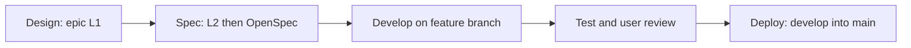
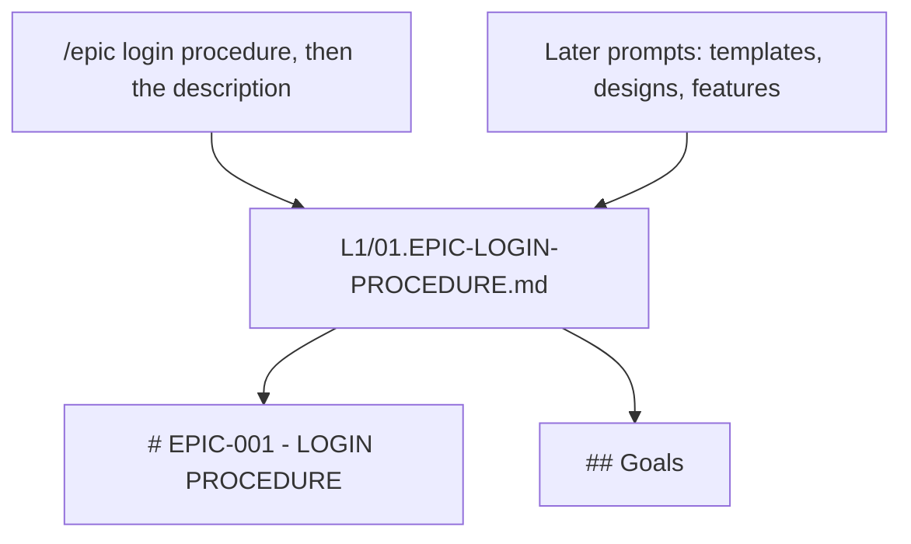
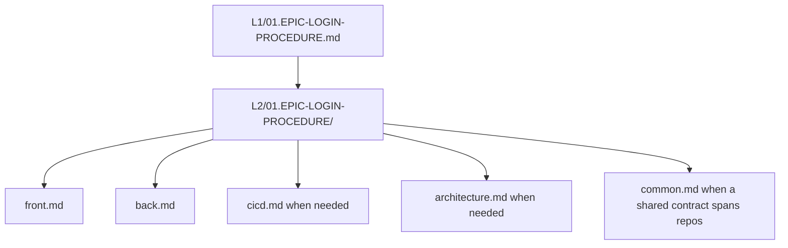
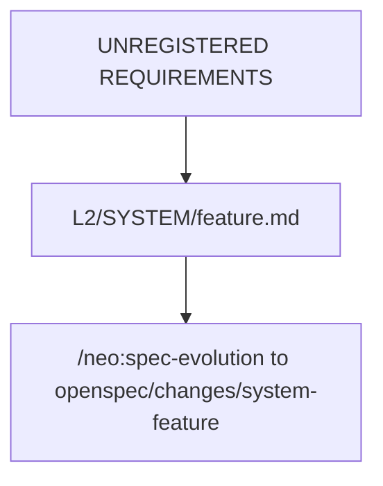
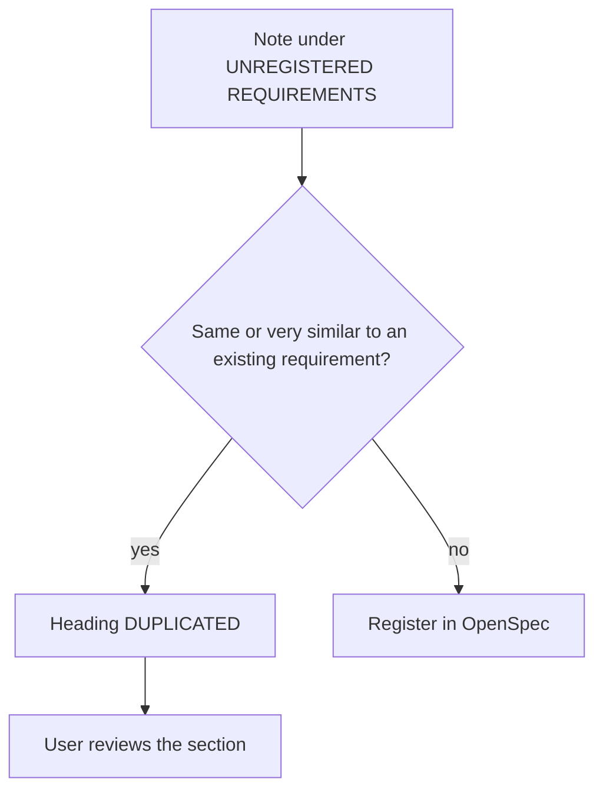
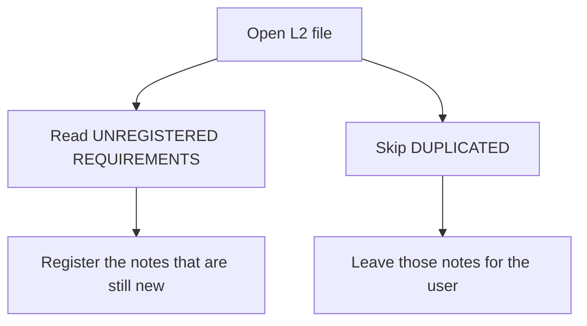
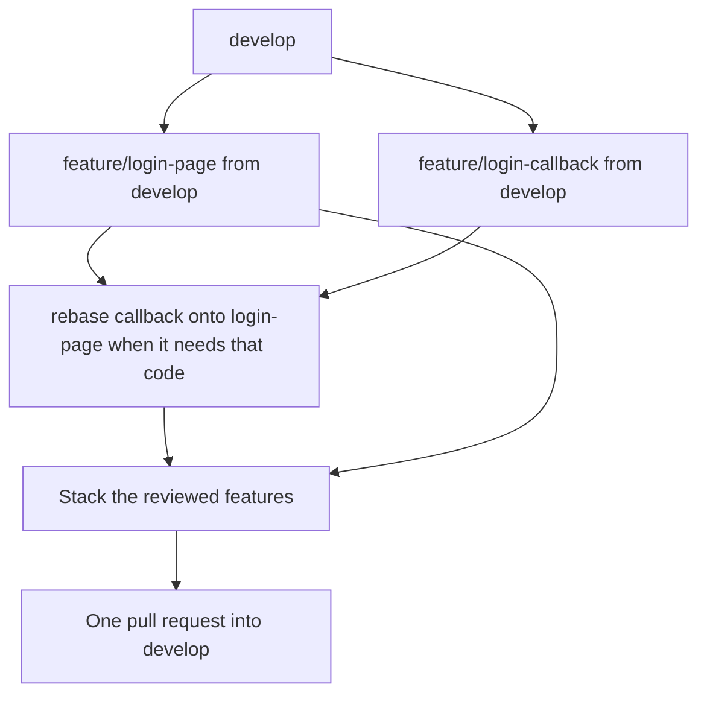

# NEOCOM programme

Onboarding and documentation root for NEOCOM. This repository holds the agent configuration, programme documentation, and specs. The GitHub landing page is the short [README.md](./README.md); this file is the full programme guide.

Each repository is one independent project. The parent `neocom` repository is deprecated.

## Contents

1. [Active projects](#1-active-projects)
2. [Documentation](#2-documentation)
3. [Commands](#3-commands)
4. [Configuration](#4-configuration)
5. [Methodology](#5-methodology)
   1. [Stages](#51-stages)
   2. [Open an epic](#52-open-an-epic)
   3. [Extract an open epic into L2](#53-extract-an-open-epic-into-l2)
   4. [Register L2 notes in OpenSpec](#54-register-l2-notes-in-openspec)
   5. [A duplicate or a very similar requirement](#55-a-duplicate-or-a-very-similar-requirement)
   6. [Processing skips duplicates](#56-processing-skips-duplicates)
   7. [Headings](#57-headings)
   8. [Iteration](#58-iteration)
   9. [Develop several features](#59-develop-several-features)
6. [For developers](#6-for-developers)
   1. [Prerequisites](#61-prerequisites)
   2. [Download the repositories](#62-download-the-repositories)
   3. [Node version](#63-node-version)
   4. [Install](#64-install)
   5. [Start the service chain](#65-start-the-service-chain)
   6. [Tests](#66-tests)
7. [Local Kubernetes](#7-local-kubernetes)

## 1. Active projects

| Repository | Purpose |
| --- | --- |
| [neocom-meta](https://github.com/AdamAntinoo/neocom-meta.git) | This repo: onboarding, programme docs, Cursor agents, OpenSpec, Graphify |
| [neocom-front](https://github.com/AdamAntinoo/neocom-front.git) | Angular frontend. The dev server proxies pilot requests to `neocom-back` |
| [neocom-back](https://github.com/AdamAntinoo/neocom-back.git) | NestJS API. Public pilot data is read from ESI through `@lgriffin/esi.ts` |

Left aside for now: [neocom-domain](https://github.com/AdamAntinoo/neocom-domain.git) and [neocom-esi](https://github.com/AdamAntinoo/neocom-esi.git). They are not required to run or integration-test the service chain.

## 2. Documentation

| Path | What it holds |
| --- | --- |
| `01.PROGRAMME-DEFINITION/` | Architecture and active features |
| `05.REQUIREMENTS-DECOMPOSITION/` | L1 and L2 requirements |
| `openspec/` | Registered and applied OpenSpec changes |
| `.cursor/agents/` | Project agents |
| `.cursor/commands/` | Slash commands |
| `.cursor/skills/` | Workflows those commands follow |

## 3. Commands

Type the command in chat. A name in `<angle brackets>` is the argument you supply.

| Command | Definition | Usage |
| --- | --- | --- |
| `/epic` | Open an epic. The same prompt starts with the name and continues with the purpose, scope, and other details. The L1 file is `NN.EPIC-NAME.md`, from `01.EPIC-LOGIN-PROCEDURE.md` | `/epic login procedure A brief description of the purpose, scope, and other details.` |
| `/neocom-methodology` | Walk design, spec, develop, test, and deploy. Define an epic and extract it from L1 into L2 | `/neocom-methodology` |
| `/spec-collect` | Turn `02.SOURCES` into the L1 requirements list. Does not register OpenSpec | `/spec-collect` |
| `/neo:extract-l2` | Convert L1 epics into `L2/NN.EPIC-NAME/` slice files (`front`, `back`, `cicd`, `architecture`, `common`). Passages already in the L2 tree are left in place | `/neo:extract-l2` |
| `/neo:spec-evolution` | Read L2 only. Review notes under `UNREGISTERED REQUIREMENTS`, place each one on its system and feature, and move it into OpenSpec. Skip `DUPLICATED`. Optional L2 paths limit the run to those files | `/neo:spec-evolution` or `/neo:spec-evolution L2/01.EPIC-LOGIN-PROCEDURE.md` |
| `/opsx-explore` | Think through an idea, a problem, or a requirement before a change exists | `/opsx-explore` |
| `/opsx-propose` | Create one OpenSpec change and its proposal, spec, design, and tasks. Planning only | `/opsx-propose <system>-<feature>` |
| `/opsx-update` | Revise the planning artifacts of an existing change and keep them consistent | `/opsx-update <system>-<feature>` |
| `/opsx-apply` | Implement the tasks of an OpenSpec change. NEOCOM delivery uses `/feature-delivery` so the work lands on `feature/<feature>` | `/opsx-apply <system>-<feature>` |
| `/opsx-sync` | Copy a change's delta specs into the main specs. Leaves the change open | `/opsx-sync <system>-<feature>` |
| `/opsx-archive` | Sync when needed, then move a completed change to `openspec/changes/archive/`. The release pull request is a separate step | `/opsx-archive <system>-<feature>` |
| `/feature-delivery` | Apply a registered feature on `feature/<feature>` from `develop` and commit. Several features can be open. Rebase when one needs another's code. One pull request into `develop` can carry several features. Stop for review first | `/feature-delivery <feature>` |
| `/neocom-code` | Implement product code for a registered change in the repository that owns it | `/neocom-code` |
| `/neocom-meta` | Edit docs, sources, agent configuration, and the spec pipeline in `neocom-meta` | `/neocom-meta` |
| `/verifier` | Read-only check that a claimed change exists in the owning repository and matches the spec | `/verifier` |
| `/neocom-git` | Commits, branches, pull requests, tags, and package versions for one repository | `/neocom-git` |
| `/neocom-git-workflow` | The commit, branch, and pull-request playbook used by `/neocom-git` | `/neocom-git-workflow` |
| `/neo:pr` | Commit pending work and open the pull request. No project means `neocom-meta`, `neocom-front`, and `neocom-back`. A named aside repository is skipped | `/neo:pr` or `/neo:pr neocom-front` |

A pull request into `develop` uses a Conventional Commit title. A pull request from `develop` into `main` is titled `Release-` plus GitVersion `MajorMinorPatch`. Neither pull request is merged unless you ask.

## 4. Configuration

NEOCOM project code is **60**. A service port is that code, then the setup digit, then the service digit.

| Digit | Meaning |
| --- | --- |
| Setup `0` | Dev watch. The process reloads while you edit |
| Setup `1` | Stable. The process stays up for integration testing |
| Service `1` | `neocom-front` |
| Service `2` | `neocom-back` |

| Setup | Front | Back |
| --- | --- | --- |
| Dev watch | **6001** | **6002** |
| Stable testing | **6011** | **6012** |

Use one setup for both services. The front proxy for `/v1/pilots` in `neocom-front/config/backends.json` must target the back port of that same setup.

| Setup | Where the port is set |
| --- | --- |
| Dev watch, back | `PORT=6002` in `neocom-back/.env` (copied from `.env.example`) |
| Dev watch, front | `npm run start:dev -- --port 6001` |
| Stable, back | `PORT=6012` |
| Stable, front | `server.port` in `neocom-front/config/backends.json` is `6011`. The `/v1/pilots` route targets `http://127.0.0.1:6012` |

`neocom-back` also reads `ENVIRONMENT`, `LOGLEVEL`, `VERSION` (from `.env.version`), and an optional `BANNER` file. Those do not change the port.

## 5. Methodology

`/neocom-methodology` follows this section. The workflow is design, spec, develop, test, and deploy, across every code repository. An epic is the first step. An epic collects requirements that usually span more than one repository.

Git stays with `/neocom-git`. Product code stays with `/neocom-code`. Moving L2 specs into OpenSpec stays with `/neo:spec-evolution`. This methodology decides the order and where a requirement sits. Command definitions are in [section 3](#3-commands).

### 5.1 Stages

| Stage | What happens | Who acts |
| --- | --- | --- |
| Design | `/epic` writes the L1 file from the name and the goals | `/neocom-methodology` |
| Spec | `/neo:extract-l2` converts the epic from L1 into L2, then `/neo:spec-evolution` reviews those notes and moves them into OpenSpec | `/neo:extract-l2`, then `/neo:spec-evolution` |
| Develop | Several features can be open. Each starts as `feature/<feature>` from `develop`. Rebase when one needs another's code. One pull request into `develop` can carry several of them | `/neocom-code`, commit by `/neocom-git` |
| Test | Run the tests the change names. The user reviews the branch | `/verifier`, then the user |
| Deploy | After archive, open a pull request from `develop` into `main` titled `Release-` plus GitVersion `MajorMinorPatch` | `/neocom-git` |

Deploy does not invent a host. The release pull request is the promotion. It stays unmerged until the user asks.



### 5.2 Open an epic

`/epic` is the first action. The prompt is one sequence. The name and the description are not placed on separate lines. The name comes first. The rest of the same prompt is a brief description of the purpose, the scope, and the other details. The epic is expected to expand into a set of features.

```text
/epic login procedure A brief description of the purpose, scope, and other details of the epic that will expand into a set of features.
```

The L1 file name is `NN.EPIC-NAME.md`. `NN` is the next two-digit number, starting at `01`. `EPIC-NAME` is `EPIC-` plus the name in uppercase, with words separated by `-`:

`05.REQUIREMENTS-DECOMPOSITION/L1/01.EPIC-LOGIN-PROCEDURE.md`

The file uses this template. The title is the id, then the name in uppercase. `## Goals` is the description from the prompt.

```markdown
# EPIC-001 - LOGIN PROCEDURE
## Goals
The goal of this epic is to define the login procedure for the application.
```

An epic collects requirements that usually span more than one repository. Later prompts add templates, designs, and other material that describes the features inside the epic. That material is appended to the same file.



### 5.3 Extract an open epic into L2

`/neo:extract-l2` reads L1 only. Each open epic has one L2 directory with the same name:

`05.REQUIREMENTS-DECOMPOSITION/L2/NN.EPIC-NAME/`

Inside that directory, write a slice file for each owner that has notes: `front.md`, `back.md`, `cicd.md`, `architecture.md`, and any other repository the L1 text names. Create only the files that have notes.

When a passage affects more than one repository, choose:

- `common.md` when the note is one shared contract both sides must follow
- a note in each owning slice when each repository has a distinct implementable part of the same L1 passage

The extraction leaves every new requirement under the heading `UNREGISTERED REQUIREMENTS`. It does not place them in a system feature file and it does not write OpenSpec.

The current L2 tree is the record of work already generated. Before writing a note, compare the L1 passage with:

- any slice under `L2/NN.EPIC-NAME/`, under `UNREGISTERED REQUIREMENTS` or `DUPLICATED`
- `L2/<SYSTEM>/*.md` (`FRONT`, `BACK`, `DOMAIN`, `ESI`, and later folders)
- `L2/DOMAIN/MODELS/`
- `L2/INFRASTRUCTURE-SPECS.md`

When that passage is already there, report the L2 path and do not write it again. A later run appends only what those files do not already hold.



### 5.4 Register L2 notes in OpenSpec

`/neo:spec-evolution` reads `05.REQUIREMENTS-DECOMPOSITION/L2/` only. Optional arguments after the command are L2 file paths; when given, only those files are processed. With no arguments, every L2 file is processed. It reads `UNREGISTERED REQUIREMENTS`, puts each note in the system and feature file that owns it, and moves that spec into the OpenSpec change `<system>-<feature>`. The note text is the requirement. The processor adds no behavior the note does not state. It does not read L1.



### 5.5 A duplicate or a very similar requirement

The same epic can be extracted again. When a note under `UNREGISTERED REQUIREMENTS` duplicates a requirement already stated, or is very similar to one, that note is not registered in OpenSpec. It moves under the heading `DUPLICATED` in that L2 slice file, for the user to review.



### 5.6 Processing skips duplicates

A later pass over L2 files ignores every note under `DUPLICATED`. Those notes stay where they are until the user moves or rewrites them. They are not registered, not given an id, and not treated as new requirements.



### 5.7 Headings

Both headings are exact:

- `UNREGISTERED REQUIREMENTS` — new notes waiting for registration
- `DUPLICATED` — notes held for user review

```markdown
## UNREGISTERED REQUIREMENTS

- neocom-front: the pilot panel shows the public pilot

## DUPLICATED

- neocom-back: the pilot endpoint returns the public pilot
```

### 5.8 Iteration

Design and spec repeat. A new requirement is added to the epic L1 file. `/neo:extract-l2` writes it into the matching slice under the open epic's L2 directory under `UNREGISTERED REQUIREMENTS` when the L2 tree does not already hold it. `/neo:spec-evolution` then either moves it into OpenSpec or moves it to `DUPLICATED`. Develop, test, and deploy run for the features that were registered. Section 5.9 is how several of those features stay open without colliding.

### 5.9 Develop several features

More than one registered feature can be in progress at the same time. Each one is its own branch, and every one of those branches is created from `develop`.

`/neocom-code` implements that feature's tasks on `feature/<feature>`. `/neocom-git` commits on that branch. A new feature is not created from another feature branch, and it is not created from `main`.

Two open branches in the same repository must not edit the same files while both still start from `develop`. When they would, stop and choose which branch rebases onto the other before either continues.

A feature rebases onto another open feature only when it needs that feature's code. The branch is still the one that was created from `develop`. After the branch it depends on moves, rebase again onto that new tip. Conflicts are resolved on the branch being rebased. The branch underneath is left as it is.

Before a pull request:

- A feature that depends on no other open feature is rebased onto the current `develop`.
- A feature that depends on another is rebased only after that other feature has been rebased onto `develop`.
- A rebase rewrites the feature branch. If that branch is already on the remote, `/neocom-git` asks before a force push. `develop` and `main` are not force-pushed.

Apply still stops for review. It does not open the pull request. After the user accepts the review, several features can go into the same pull request into `develop`. Stack them in dependency order and open the pull request from the tip of that stack. The pull request names every feature it contains. Features that do not depend on each other and do not touch the same files stay in separate pull requests unless the user asks to group them.



## 6. For developers

Local integration runs the whole service chain: the Angular front calls `neocom-back`, and the back reads public ESI data. The pilot panel is the path to exercise: `GET /v1/pilots/93813310`.

WireMock remains available for front routes that are still mocked (`/api`, `/nin/v1`, `/esi/v1`). The pilot chain does not need it.

### 6.1 Prerequisites

- Git
- [nvm](https://github.com/nvm-sh/nvm)
- Network access so `neocom-back` can reach ESI
- Optional: Java or Docker only when you also start WireMock
- Optional: OpenSpec and Graphify when you work on specs or knowledge graphs in this repository

### 6.2 Download the repositories

Clone the active projects as siblings:

```bash
git clone https://github.com/AdamAntinoo/neocom-meta.git
git clone https://github.com/AdamAntinoo/neocom-front.git
git clone https://github.com/AdamAntinoo/neocom-back.git
```

### 6.3 Node version

Every active repository has `.nvmrc` set to the nvm alias `neocom`. Before `node`, `npm`, or `npx`, run `nvm use` in that repository.

```bash
cd neocom-front
nvm use
node -v
```

### 6.4 Install

```bash
cd neocom-back
nvm use
npm install

cd ../neocom-front
nvm use
npm install
```

In `neocom-back`, copy `.env.example` to `.env` when that file is missing. For the dev-watch setup set `PORT=6002`.

### 6.5 Start the service chain

Start the dev-watch setup. Start the back first. It listens on port 6002 and uses `@lgriffin/esi.ts` for public character, corporation, portrait, race, ancestry, and bloodline data.

```bash
cd neocom-back
nvm use
npm run start:dev
```

Start the front on port 6001. Point `/v1/pilots` in `config/backends.json` at `http://127.0.0.1:6002`.

```bash
cd neocom-front
nvm use
npm run start:dev -- --port 6001
```

Open `http://127.0.0.1:6001/app/dashboard`. The pilot panel loads pilot `93813310` from the back.

For a stable integration run, bind the back to `6012` and the front to `6011` instead. Leave the watch processes off those ports.

| Process | Role in the chain |
| --- | --- |
| `neocom-back` dev watch | API on port 6002. Reads public ESI |
| `neocom-front` dev watch | UI on `http://127.0.0.1:6001/app/`. Proxies `/v1/pilots` to port 6002 |
| Stable back / front | Ports 6012 and 6011, for integration testing |
| ESI | Reached by the back through `@lgriffin/esi.ts`. No separate ESI process |
| WireMock on port 8080 | Only for front routes that are still mocked |

### 6.6 Tests

Unit and end-to-end tests stay inside each repository:

```bash
cd neocom-back
nvm use
npm test
npm run test:e2e

cd ../neocom-front
nvm use
npm test
npm run e2e
```

Integration across the chain is the running dashboard: the pilot panel shows the public pilot returned by `neocom-back` from ESI. With the dev-watch processes up, `GET http://127.0.0.1:6001/v1/pilots/93813310` is the same request the panel makes. The stable pair answers that request on port 6011.

## 7. Local Kubernetes

Cluster scripts in this repository start a local Kubernetes cluster. They do not deploy the front, the back, or the ESI client. Use [section 6](#6-for-developers) for integration testing.

```bash
npm run k8s:start       # prefer minikube; else Docker Desktop / kind guidance
npm run k8s:dashboard   # minikube dashboard (Docker Desktop: use Docker UI)
npm run k8s:status      # kubectl cluster-info + nodes
npm run k8s:stop        # minikube stop / kind delete (Docker Desktop: UI)
```

Scripts live under `scripts/k8s/`. No Helm charts or app deploy manifests yet.
