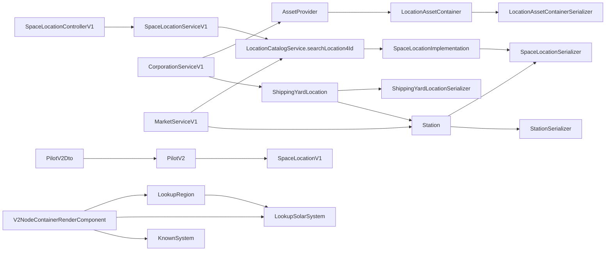

# 08.EPIC-LOCATIONS — code findings

## Search scope

Legacy roots searched: `neocom-infinity-backend/src` (Java/Gradle) and `neocom-infinity-frontend/src` (Angular), under `/Users/adam/IdeaProjects/neocom-infinity`. Library types (`SpaceLocation`, `SpaceLocationImplementation`, `Station`, `Structure`, `LocationCatalogService`, `LocationIdentifierType`) live in `neocom-datamanagement`, which is **outside** the legacy root — only the contract they serialize/render is recorded here.

Graphify was rebuilt on `neocom-infinity` (`graphify update . --force`, 7910 nodes) before the BACK-229 pass. Catalog/factory behaviour that lives outside the infinity tree was read from `neocom-datamanagement` (`LocationCatalogService`, `LocationFactory`) because Guice binds those types into the backend.

The `## Search criteria` are filled; no clarification was needed and no exclusions were recorded. BACK-229 specs were authored into `sources/L1/08.EPIC-LOCATIONS.md` Section 15 (LOC-130…135, `to review`).

## Index

| Element | Kind | Location | Notes |
| --- | --- | --- | --- |
| `SpaceLocationSerializer` | Class (serializer) | `backend/universe/serializer/SpaceLocationSerializer.java` | `@JsonComponent`; fall-through `switch` writes the ancestor chain |
| `SpaceLocationControllerV1` | Class (controller) | `backend/universe/spacelocations/rest/v1/SpaceLocationControllerV1.java` | `GET /api/v1/universe/spacelocations/{locationId}` |
| `SpaceLocationServiceV1` | Class (service) | `backend/universe/spacelocations/rest/v1/SpaceLocationServiceV1.java` | delegates to `LocationCatalogService.searchLocation4Id` |
| `StationSerializer` | Class (serializer) | `core/serializer/StationSerializer.java` | `@Deprecated`, not `@JsonComponent`, no `locationType` |
| `ShippingYardLocationSerializer` | Class (serializer) | `core/serializer/ShippingYardLocationSerializer.java` | `@Deprecated`, still `@JsonComponent` |
| `LocationAssetContainerSerializer` | Class (serializer) | `core/serializer/LocationAssetContainerSerializer.java` | `@JsonComponent` |
| `MarketServiceV1` | Class (service) | `backend/market/rest/v1/MarketServiceV1.java` | home-station → region resolution |
| `CorporationServiceV1` | Class (service) | `backend/corporation/rest/v1/CorporationServiceV1.java` | assets-by-location and shipping-yard flows |
| `ShippingYardLocation` | Class (domain) | `backend/corporation/domain/ShippingYardLocation.java` | `Builder` requires deposit + officeContainer |
| `SpaceLocationV1` | Class (front) | `domain/location/SpaceLocationV1.domain.ts` | empty class |
| `Station` | Class (front) | `domain/location/Station.domain.ts` | empty `NeoCom` subclass |
| `StationDto` | Class (DTO) | `domain/core/dto/StationDto.dto.ts` | `systemId`/`systemName`, no `locationType` |
| `LookupRegion` | Class (front) | `modules/planetary/domain/LookupRegion.domain.ts` | `jsonClass = 'LookupRegion'` |
| `LookupSolarSystem` | Class (front) | `modules/planetary/domain/LookupSolarSystem.domain.ts` | `jsonClass = 'LookupSolarSystem'` |
| `KnownSystem` | Class (front) | `domain/planetary/KnownSystem.domain.ts` | `jsonClass = 'KnownSystem'` |
| `SystemDto` | Class (DTO) | `domain/planetary/dto/System.dto.ts` | place + security fields, no `planetCount` |
| `PilotV2` | Class (front) | `domain/character/PilotV2.domain.ts` | `lastKnownLocation: SpaceLocationV1` |
| `PilotV2Dto` | Class (DTO) | `domain/dto/PilotV2Dto.dto.ts` | `lastKnownLocation: HALLink<SpaceLocationV1>` |
| `V1RegionRenderComponent` | Render | `modules/renders/v1-region-render/` | selector `v1-region` |
| `V1SolarSystemRenderComponent` | Render | `modules/renders/v1-solar-system-render/` | selector `v1-solar-system` |
| `V1PlanetarySystemRenderComponent` | Render | `modules/renders/v1-planetary-system-render/` | selector `v1-planetary-system` |
| `V1PlanetDataRenderComponent` | Render | `modules/renders/v1-planet-data-render/` | selector `v1-planet-data` |
| `V2NodeContainerRenderComponent` | Render (mounter) | `modules/renders/v2-node-container-render/` | selector `v2-node-container`; mounts by `jsonClass` |
| `SpaceLocationImplementation` | Class (library) | `org.dimensinfin.eveonline.neocom.domain.space` | builder `withRegion`/`withConstellation`/`withSolarSystem`/`withStation` |
| `Station` / `Structure` | Class (library) | `org.dimensinfin.eveonline.neocom.domain.space` | `Structure.Builder.withStructure(...).withCorporation(...)` |
| `LocationCatalogService` | Class (library) | `org.dimensinfin.eveonline.neocom.service` | `searchLocation4Id(Long)` |
| `LocationIdentifierType` | Enum (library) | `org.dimensinfin.eveonline.neocom.utility` | `REGION`, `CONSTELLATION`, `SOLAR_SYSTEM`, `STATION`, `STRUCTURE` |
| `SpaceLocationSerializerTest` | Test (fixtures) | `backend/universe/serializer/SpaceLocationSerializerTest.java` | region 1000043, constellation 20000322, system 30002187, station 60008494 |

## Classes

### Back (infinity)

- **`SpaceLocationSerializer`** — `@JsonComponent` over `SpaceLocationImplementation`. Writes `locationType` (name of `LocationIdentifierType`) and `locationId`, then a `switch` on the type **with no `break`**, so each deeper level also emits the ancestors (`STRUCTURE` → station → solar system → constellation → region).
- **`SpaceLocationControllerV1`** — `@RestController`, `@RequestMapping("/api/v1/universe")`. One endpoint `GET /spacelocations/{locationId}` → `SpaceLocationServiceV1.getLocationById`. The location kind is not in the path.
- **`SpaceLocationServiceV1`** — one method `getLocationById(Long)` → `locationCatalogService.searchLocation4Id(locationId)`.
- **`StationSerializer`** — `@Deprecated`, `@JsonComponent` commented out. Writes `locationId`, region, constellation, `solarSystemId`/`solarSystemName`, `stationId`/`stationName`. No `locationType`.
- **`ShippingYardLocationSerializer`** — `@Deprecated`, still `@JsonComponent`. Writes `jsonClass`, `deposit`, `officeContainer`, `station`.
- **`LocationAssetContainerSerializer`** — `@JsonComponent`. Writes `jsonClass`, `spaceLocation`, `containerType` (`getType().name()`), `contents`.
- **`MarketServiceV1`** — authenticated service. `accessCorporationHomeRegionId(Credential)` resolves the home station id via ESI, then `locationCatalogService.searchLocation4Id` and checks `instanceof Station`.
- **`CorporationServiceV1`** — `getCorporationAssetsByLocation`, `getCorporationShippingYards`, `search4AssetId`. Constant `SHIPPING_YARD_PREFIX = "ShipYard"`.
- **`ShippingYardLocation`** — `NeoComNode` with `deposit`, `officeContainer`, `station`; builder `withYardDeposit`/`withOfficeContainer`/`withStation`; `build()` requires deposit and officeContainer (not station).

### Front (infinity)

- **`SpaceLocationV1`** — empty export: `export class SpaceLocationV1{}`.
- **`Station`** — `export class Station extends NeoCom{}`.
- **`StationDto`** — `locationId`, `regionId`, `regionName`, `constellationId`, `constellationName`, `systemId`, `systemName`, `stationId`, `stationName`; only accessor `getStationName()`.
- **`LookupRegion`** — `name`, `systems: LookupSolarSystem[]`; `collaborate2View()` returns `systems` when expanded, else `[this]`; `getSystemsCount()`.
- **`LookupSolarSystem`** — `systemName`, `region`, `security`; `getName()` → `systemName`, `getRegion()`.
- **`KnownSystem`** — `systemId` (`getUniqueId()`), `systemName`, constellation + region, `securityLevel`/`securityClass`, `planetCount`.
- **`SystemDto`** — same place + security fields, no `planetCount`.
- **`PilotV2`** — `lastKnownLocation: SpaceLocationV1`; `getLastKnownLocation()` currently returns a placeholder string.
- **`PilotV2Dto`** — `lastKnownLocation: HALLink<SpaceLocationV1>`, resolved in `transform(halResolver)`.

### Library (contract only, outside legacy root)

- `SpaceLocation` / `SpaceLocationImplementation` (Builder `withRegion`/`withConstellation`/`withSolarSystem`/`withStation`).
- `Station`, `Structure` (`Structure.Builder.withStructure(structureId, esiStructure).withCorporation(corporationId, corporationName)`), `SpaceRegion`, `SpaceConstellation`, `SpaceSystem`.
- `LocationCatalogService.searchLocation4Id(Long)`.
- `LocationIdentifierType`: `REGION`, `CONSTELLATION`, `SOLAR_SYSTEM`, `STATION`, `STRUCTURE`.

## Methods

| Method | Owner | Notes |
| --- | --- | --- |
| `serialize(SpaceLocationImplementation, JsonGenerator, SerializerProvider)` | `SpaceLocationSerializer` | fall-through switch; writes the full ancestor chain |
| `getLocationById(Long)` | `SpaceLocationControllerV1` | `GET /api/v1/universe/spacelocations/{locationId}` |
| `getLocationById(Long)` | `SpaceLocationServiceV1` | → `LocationCatalogService.searchLocation4Id` |
| `searchLocation4Id(Long)` | `LocationCatalogService` (library) | returns the `SpaceLocation` for an id |
| `getCorporationAssetsByLocation(Integer)` | `CorporationServiceV1` | `AssetProvider.classifyCorporationAssetsByLocation` → `LocationAssetContainer` |
| `getCorporationShippingYards(Integer)` | `CorporationServiceV1` | downloads assets, filters `ShipYard` label prefix, binds office container + `Station` |
| `search4AssetId(Long, List<NeoAsset>)` | `CorporationServiceV1` | finds an asset by id in the downloaded list |
| `accessCorporationHomeRegionId(Credential)` | `MarketServiceV1` | home station → `instanceof Station` → region id, else predefined hub |
| `getMarketConsolidated4ItemId(Integer)` | `MarketServiceV1` | market hub region from `PilotPreferencesRepository` |
| `build()` / `withStation(Station)` | `ShippingYardLocation.Builder` | `withStation(null)` throws; `build()` does not check station |
| `transform(HALResolver)` | `PilotV2Dto` | resolves `lastKnownLocation` HAL link into `SpaceLocationV1` |
| `collaborate2View()` | `LookupRegion` | expands into `LookupSolarSystem` rows |
| `getUniqueId()` | `KnownSystem` / `LookupRegion` | system id (KnownSystem); `0` for every region (LookupRegion) |

## Flows

### 1. Location lookup
`GET /api/v1/universe/spacelocations/{locationId}` → `SpaceLocationControllerV1.getLocationById` → `SpaceLocationServiceV1.getLocationById` → `LocationCatalogService.searchLocation4Id` → `SpaceLocationImplementation` → serialized by `SpaceLocationSerializer`.

### 2. Corporation assets grouped by location
`CorporationServiceV1.getCorporationAssetsByLocation` → `AssetProvider.classifyCorporationAssetsByLocation` → `List<LocationAssetContainer>` → serialized by `LocationAssetContainerSerializer` (`spaceLocation` + `containerType` + `contents`).

### 3. Shipping-yard detection
`CorporationServiceV1.getCorporationShippingYards` → `AssetProvider.downloadCorporationAssets` → filter `asset.getUserLabel().startsWith("ShipYard")` → locate office container (`search4AssetId`) → `locationCatalogService.searchLocation4Id(officeContainer.getLocationId())` → only when `location instanceof Station` build `ShippingYardLocation` (deposit + office container + station).

### 4. Market / corporation home-station resolution
`MarketServiceV1.accessCorporationHomeRegionId` → `esiDataService.getCorporationsCorporationId(corporationId).getHomeStationId()` → `locationCatalogService.searchLocation4Id` → if `instanceof Station` return `station.getRegionId()`, else `PREDEFINED_MARKET_HUB_STATION_ID`.

## Connections

