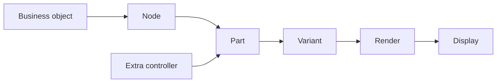
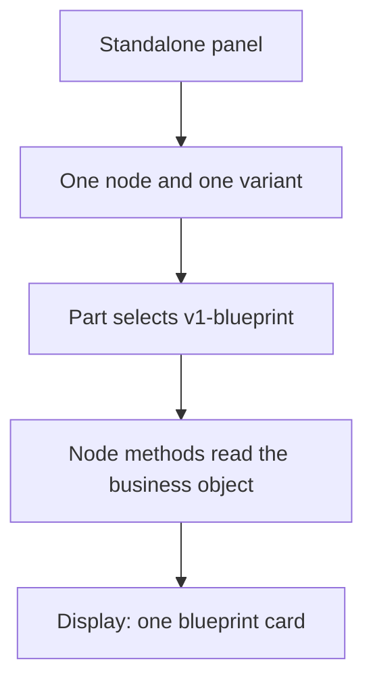
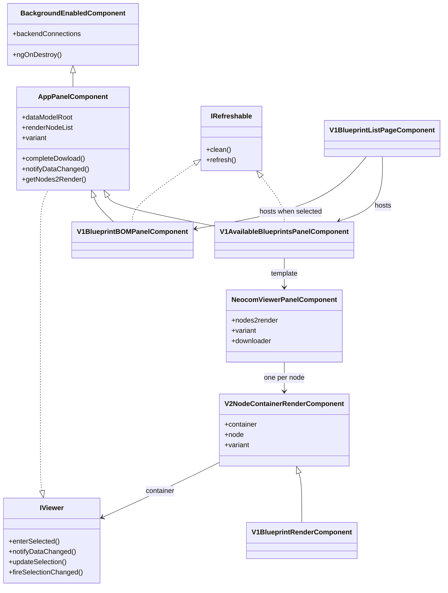
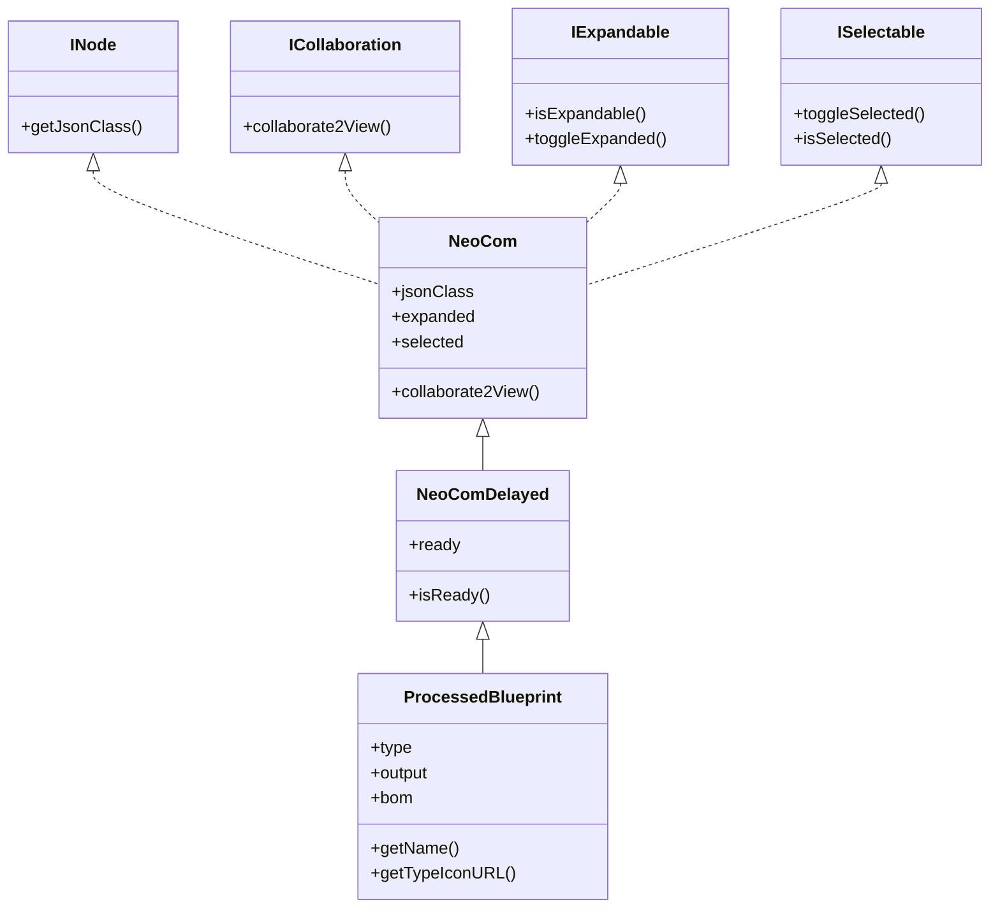
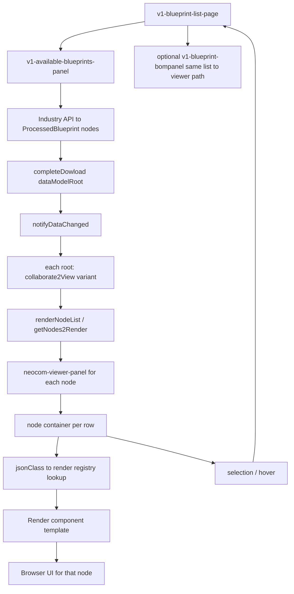
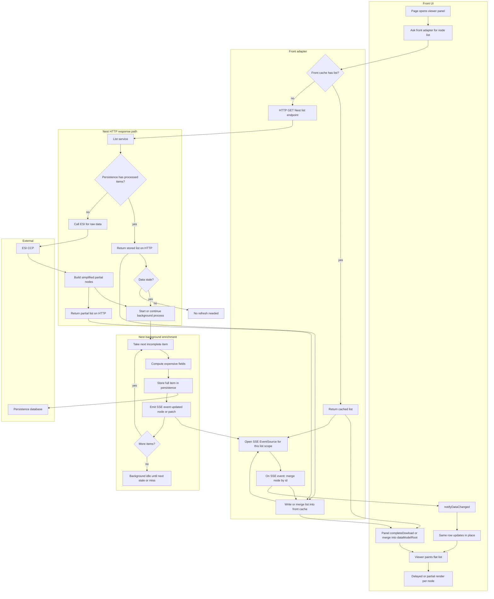
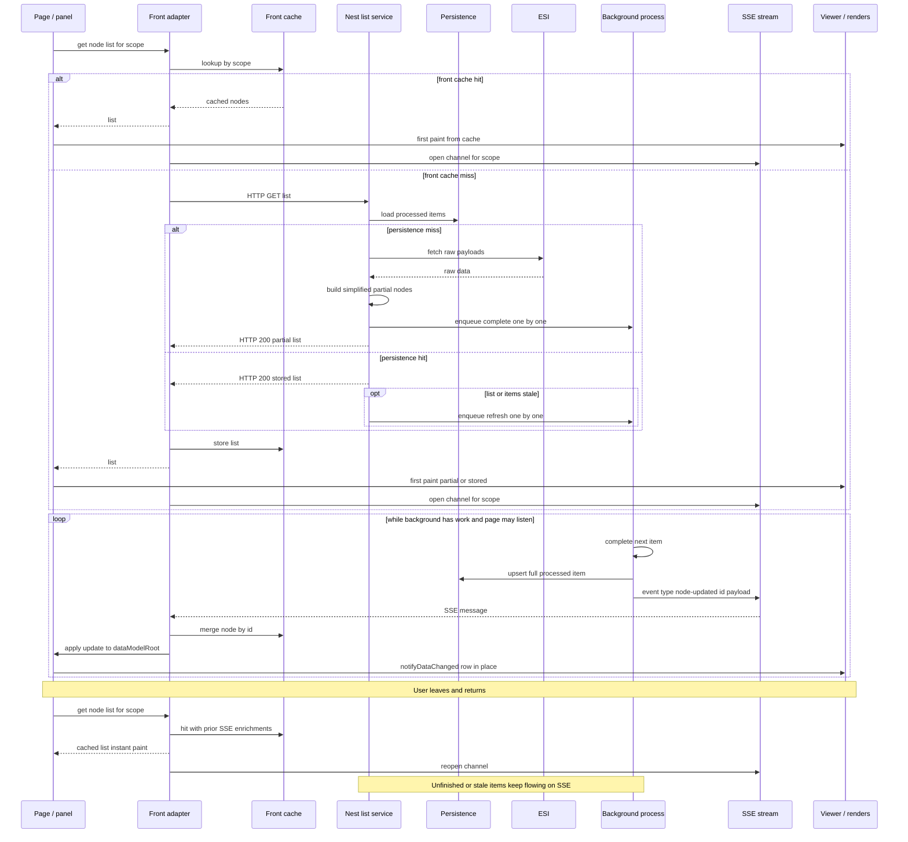
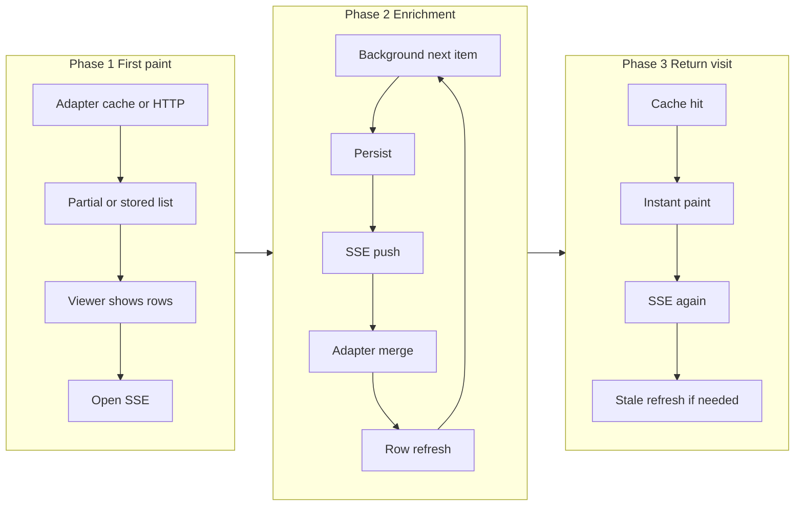
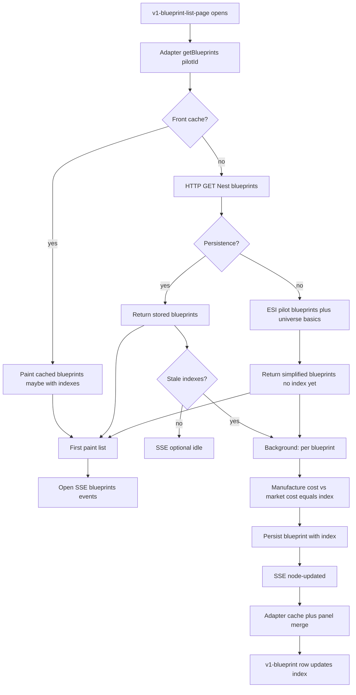
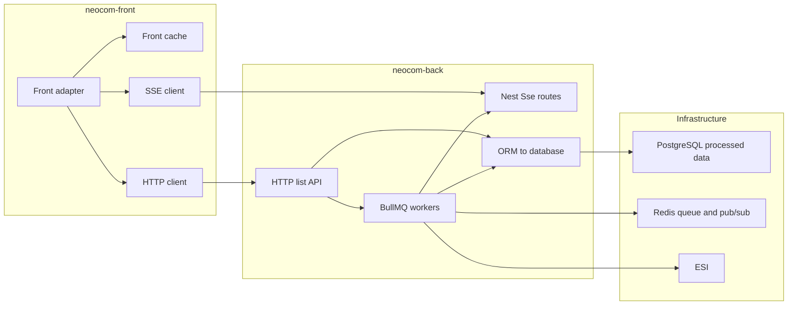

# EPIC-002 - ANGULAR CODIFICATION

## Spec traceability

| Field | Value |
| --- | --- |
| Status | ✅ `applied` |
| L2 | Epic extracts: `L2/02.EPIC-ANGULAR-CODIFICATION.structure.md`, `.nodes.md`, `.async-sse.md`, `.async-infra.md`. Destinations: `L2/FRONT/07.ANGULAR-STRUCTURE.md`, `L2/FRONT/08.NODE-RENDER.md`, `L2/FRONT/09.ASYNC-SSE.md`, `L2/BACK/BACK-ASYNC-SSE.md`, `L2/INFRASTRUCTURE-SPECS.md` §H |
| OpenSpec changes | `front-angular-structure`, `front-node-render`, `front-async-sse`, `front-infrastructure`, `front-pilot`, `front-pilot-panel` validated front `@ e3356db`; `back-async-sse`, `infra-async-persistence` validated back `@ 3317849`. Related still registered: `front-app-shell`, `front-dashboard` |
| Skip | Re-extract only **new** L1 passages. Applied OpenSpec above is skipped on later extract/register. Mermaid diagrams remain in L1 only. |
| Index | `L1/TRACEABILITY.md` |
| Last extract | 2026-10-17 · `/neo:extract-l2 02` |
| Last register | 2026-10-17 · `/neo:spec-evolution` |

## Goals
I follow an special structure when creating components, panels and pages, use the model present on the @neocom-infinity/neocom-infinity-frontend/src/app template project to understand the division between app core pages (app/pages) and panels (app/panels) and pages that are tied to application sections that are represented by modules

## Division

The model is `neocom-infinity-frontend/src/app`. A page is a routed screen. A panel is a piece of a page and has no route of its own. A section of the application is an Angular module that owns the pages and panels of that section.

### Core pages

`app/pages` holds the screens of the application shell. The root routes them directly (current `neocom-front` implementation):

| Route | Page |
| --- | --- |
| `login` | `login-page` |
| `login-callback` | `login-callback-page` |
| `dashboard` | `dashboard-home-page` |

`dashboard` is behind `authGuard`. The empty path redirects to `dashboard`.

### Core panels

`app/panels` holds panels used by those core pages. They are not routes. The login validation page is built from `login-validation-progress` and `login-validation-exception`.

A core page also hosts panels that belong to a shared module. `dashboard-home-page` places `app-info-panel`, `server-info-panel`, and `v1-pilot-panel` in its template. Those three are declared and exported by `modules/header`, not by `app/panels`.

### Section modules

A section is a feature module under `app/modules`, loaded with `loadChildren` from the root router. The module declares its own pages and panels and registers its routes with `RouterModule.forChild`.

For this epic, only the industry section (including manufacture) is in scope to create. Other Infinity sections (planetary, loyalty, fittings, and any later ones) stay deferred and are created when a future requirement needs them.

| Section | Module | Root path | Pages live in |
| --- | --- | --- | --- |
| Industry | `modules/industry` | `industry` | `modules/industry/pages` |
| Manufacture | `modules/industry/manufacture` | `industry/manufacture` | `modules/industry/manufacture/pages` |

Industry and manufacture use the folder names `pages` and `panels`. Each section page composes its own panels and can also compose shared header panels.

### Modules that are not sections

These modules supply pieces to pages. They do not represent an application section and they do not own a root route:

| Module | What it holds |
| --- | --- |
| `modules/header` | Shared header panels |
| `modules/shared` | Shared panels, renders, and the viewer |
| `modules/renders` | Render components for fittings, planetary, loyalty, and industry |
| `modules/common` | Pipes and small components such as `v1-feature-button` |
| `modules/innovative-core` | Base components and services |

New core screens go in `app/pages`. New core panels go in `app/panels`. A screen that belongs to a section goes in that section module, with that section's panels beside it.

## Node

A node is a renderable item. Its source data lives on a business object. That object usually has methods that shape the values for the UI, such as a display name, an icon URL, or a cost already scaled for the screen. The node does not read the raw source past those methods.

A node, its Part, and its business object are the Model-View-Controller trio.

| Role | What it is |
| --- | --- |
| Model | The business object. It holds the source data and the methods that prepare it for the UI |
| View | The render. An Angular component whose template is the HTML sent to the browser for UI presentation. One data source can have several variants |
| Controller | The Part. It is the main control for the node |

The Part may have other controllers attached. Those extra controllers extend the same set of nodes sideways. They do not add another level of children.

### Render and variant

The render is the component that presents one node: its template is the HTML the browser uses for that UI. The same node can use more than one variant. A listing variant shows few fields. Another variant can hold its own hierarchical nodes inside the same data source.

**Variant string convention:** start with `-`, end with `-`, uppercase words separated by `-` (e.g. `-DEFAULT-`, `-AVAILABLE-BLUEPRINTS-`, `-APP-`, `-AUTH-`, `-HEADER-`).

Panels and renders that present domain models **inherit model versionability**: public selectors and paths use a lowercase **`vn-`** prefix (`v1-…`, `v2-…`) matching the domain type version they were built for (EPIC-004). A new model version gets a new `vn` UI; the previous one stays until its feature migrates. Shell hosts (`app-page-header`, generic viewers) stay unversioned.

`v1-blueprint-render` is the sample. It extends the node container and reads the node as the business object: blueprint name, output name, manufacture cost, output price, and cost index. The variant `-AVAILABLE-BLUEPRINTS-` is the detailed layout. Any other variant is the short layout. `v2-node-container` chooses this render when the node's `jsonClass` is `ProcessedBlueprintSummary` or `ProcessedBlueprint`, and it passes the same `variant` through.

### Hierarchy and the render list

Nodes form a hierarchy. Rendering converts that hierarchy into a list, and the list is rebuilt when visibility or expansion changes.

- An invisible node does not contribute to the render list.
- A collapsed node contributes itself and does not contribute its children.
- An expanded node contributes itself and its visible children.

`collaborate2View` is that conversion. `LookupRegion` returns only itself while it is collapsed, and returns its systems when it is expanded. `AppPanelComponent.notifyDataChanged` walks the root, calls `collaborate2View` with the current variant, and stores the result in `renderNodeList`. Expanding a node calls `toggleExpanded` and then `notifyDataChanged`, so the list is trimmed again immediately.

### Viewer and standalone panels

A container panel owns the nodes it shows. It feeds the viewer `nodes2render` and a `variant`. The viewer walks that list and gives each node to a node container with the same variant. Identification of which UI to show for each row comes from the node's `jsonClass`.

When a page (or panel) hosts `neocom-viewer-panel`, that viewer is the way the page processes the flat list of available nodes: it iterates `nodes2render` and places one node container per entry. `modules/shared/core/viewer-panel` (selector `viewer-panel`) is the same contract. Both take the list the panel already built, the download state of that panel, the variant, and whether a hover selects the node.

```typescript
@Input() nodes2render: ICollaboration[] = [];
@Input() downloader: AppPanelComponent;
@Input() variant: string = '-DEFAULT-';
@Input() selectOnHover: boolean = false;

getNodes2Render(): ICollaboration[] {
  return this.nodes2render;
}
```

```html
<div *ngFor="let node of getNodes2Render()">
  <v2-node-container
    [container]="downloader"
    [node]="node"
    [variant]="variant"
    [selectOnHover]="selectOnHover">
  </v2-node-container>
</div>
```

**Current Infinity behaviour (to replace).** `v2-node-container` hard-codes one `*ngIf` per `jsonClass` in its template and mounts the matching render selector. Adding a new node type means editing that template. That mapping must not stay in the container template.

**Target behaviour.** Each render registers in a render registry which `jsonClass` values it accepts (one or more when they share the attribute names the render reads). When a node must be shown, the container looks up the registry for that `jsonClass`, resolves the registered render component, and places that component's template HTML in the row (the browser then presents that UI). The container no longer lists every class-to-render pair.

**Feasibility.** This is possible in Angular. A registry service maps `jsonClass` → render component type. Registration happens when the render is declared (for example at feature provide/bootstrap time, or via an explicit `register` call). At paint time the node container uses dynamic component insertion (`NgComponentOutlet` or `ViewContainerRef.createComponent`) to instantiate the looked-up render and pass `container`, `node`, and `variant` as inputs. No per-class branch in the container HTML is required. Shared attribute names across several `jsonClass` values are handled by registering the same render for each of those classes.

The list the viewer receives is already flat. The panel rebuilds that list in `notifyDataChanged` before the viewer paints it, so an expand or a hide changes which nodes are in `nodes2render`. Panels bind the viewer with `[nodes2render]="getNodes2Render()"` and `[variant]="getVariant()"`.

A standalone panel receives one node and one variant. Its Part uses that pair (and the same registry lookup) to select the render and is the controller that reads the business object's data. The render does not fetch the model on its own.

### Relationships

The business object stays behind the node. The display never reads it except through the methods the node exposes. The Part is the only controller that chooses the render and calls those methods. A second controller, when one is attached, works on the same nodes beside the Part.



`jsonClass` on the node picks which render component is used. The variant picks which layout of that render is used. Visibility and expansion decide whether the node is on the list the display walks.

### Use case: one standalone panel

The panel is given a single node and a variant. There is no hierarchy and no viewer list. The Part selects the render for that pair and reads the business object through the node.

A blueprint panel given one `ProcessedBlueprint` and the variant `-AVAILABLE-BLUEPRINTS-` is the sample. The Part selects `v1-blueprint`. That render calls `getBlueprintName`, `getOutputName`, `getManufactureCost`, `getOutputPrice`, and the icon methods. The display is that one detailed card. The same node with any other variant uses the short layout of the same render.



### Use case: a viewer

The panel holds a hierarchy (or a flat root list). Before anything is drawn, `notifyDataChanged` turns that root into `nodes2render`. An invisible node is left out. A collapsed node contributes only itself. An expanded node also contributes its visible children. The viewer does not walk the hierarchy. It walks the list it was given.

### Rendering class and component structure

The render path is built from three layers: **page / panel / viewer UI**, **node domain types**, and **render components**. Interfaces define the contracts; concrete classes carry the data and behaviour.

#### UI components (page → panel → viewer → container → render)

| Type | Role |
| --- | --- |
| Page (e.g. `V1BlueprintListPageComponent`) | Screen controller. Hosts panels; receives selection signals; does not own `dataModelRoot` or the render list. |
| `BackgroundEnabledComponent` | Base for anything that holds backend `Subscription`s and cleans them on destroy. |
| `AppPanelComponent` | Extends `BackgroundEnabledComponent`, implements `IViewer`. Owns `dataModelRoot`, `renderNodeList`, download flag, variant, and `SingleSelectionManager`. Implements `completeDowload`, `notifyDataChanged`, `getNodes2Render`, `updateSelection`. |
| Feature panel (e.g. `V1AvailableBlueprintsPanelComponent`, `V1BlueprintBOMPanelComponent`) | Extends `AppPanelComponent`, often implements `IRefreshable`. Downloads domain nodes, sets the variant, calls `completeDowload`. Template hosts the viewer. |
| `NeocomViewerPanelComponent` / `ViewerPanelComponent` | Presentational. Inputs: `nodes2render`, `variant`, `downloader` (`AppPanelComponent`), `selectOnHover`. Iterates the flat list; does not own collaboration logic. |
| `V2NodeContainerRenderComponent` (`v2-node-container`) | Row shell. Inputs: `container` (`IViewer`), `node` (`NeoCom`), `variant`. Forwards expand/select/hover to the panel. Today embeds hard-coded render `*ngIf`s; target: registry lookup only. |
| Feature render (e.g. `V1BlueprintRenderComponent`, selector `v1-blueprint`) | Extends the node container. Typed `getNode()` and display helpers that call methods on the domain node. Its template is the HTML for that row. |



#### Domain node types (data that enters the render list)

| Type | Role |
| --- | --- |
| `INode` | Exposes `getJsonClass()` — identity used to pick a render. |
| `ICollaboration` | Exposes `collaborate2View(...)` — turns this node (and children, by expansion/visibility) into the flat contribution for the render list. |
| `IExpandable` | Expand / collapse / toggle; drives whether children enter `collaborate2View`. |
| `ISelectable` | Select / unselect / toggle; used by the panel selection manager. |
| `NeoCom` | Base node. Implements the four interfaces above. Default `collaborate2View` returns `[this]`. Holds `jsonClass`, `expanded`, `selected`. |
| `NeoComDelayed` | Extends `NeoCom` with a `ready` flag for nodes that finish loading asynchronously. |
| Feature node (e.g. `ProcessedBlueprint`) | Extends `NeoCom` or `NeoComDelayed`. Sets `jsonClass` (e.g. `'ProcessedBlueprint'`). Adds getters the render calls (`getName`, `getTypeIconURL`, BOM resources, and so on). |



#### How the layers connect

- The **panel** (`AppPanelComponent` subclass) is both `IViewer` (selection and `notifyDataChanged`) and the owner of the node roots.
- Each **root entry** is an `ICollaboration` (usually a `NeoCom` subclass). Collaboration produces the flat `ICollaboration[]` the viewer receives.
- The **viewer** only loops that array; it does not know domain types.
- The **node container** receives one `NeoCom` and uses `jsonClass` to choose a **render** component. The render subclass narrows the node type and binds template fields to node methods.
- Target: a **render registry** maps `jsonClass` → render component type so the container does not list every mapping in its template.

### Use case: blueprint list page (full render flow)

Concrete sample from Infinity manufacture: `v1-blueprint-list-page`. The page is the screen controller. It hosts panels; it does not itself iterate nodes. Rendering starts when a panel on that page obtains nodes and completes its download.

| Step | Who | What happens |
| --- | --- | --- |
| 1 | `v1-blueprint-list-page` | Hosts `v1-available-blueprints-panel` (and optionally `v1-blueprint-bompanel` when a blueprint is selected). Passes itself as `[container]` so the panel can signal selection back. |
| 2 | `v1-available-blueprints-panel` | Extends `AppPanelComponent`. On init sets variant `-AVAILABLE-BLUEPRINTS-`, starts downloading, and loads blueprints from the industry API. |
| 3 | Panel download | Transforms DTOs into `ProcessedBlueprint` nodes, sorts them, then calls `completeDowload(blueprintList)`. |
| 4 | `AppPanelComponent.completeDowload` | Stores the list as `dataModelRoot` and calls `notifyDataChanged()`. |
| 5 | `notifyDataChanged` | Applies panel policies, then for each root node calls `collaborate2View(variant)` and concatenates the result into `renderNodeList` (what `getNodes2Render()` returns). |
| 6 | Panel template | Binds `<neocom-viewer-panel [nodes2render]="getNodes2Render()" [variant]="getVariant()" [downloader]="self">`. |
| 7 | `neocom-viewer-panel` | Iterates the flat list and places one node container per entry. |
| 8 | Node container | Resolves which render to use from the node's `jsonClass` (today: hard-coded `*ngIf` in `v2-node-container`; target: render registry lookup). Instantiates that render with `container`, `node`, and `variant`. |
| 9 | Render | Template HTML is sent to the browser. The render reads the business object only through node methods (name, costs, icons, and so on). |
| 10 | Interaction | Click/hover on a row goes through the container to the panel (`updateSelection` / `enterSelected`). The panel notifies the page (`signalSelection`), which can show the BOM panel for the selected blueprint. The BOM panel repeats steps 4–9 for its own node list. |



```mermaid
sequenceDiagram
  participant Page as v1-blueprint-list-page
  participant Panel as available-blueprints-panel
  participant App as AppPanelComponent
  participant Viewer as neocom-viewer-panel
  participant Box as node container
  participant Reg as render registry
  participant R as blueprint render

  Page->>Panel: host panel, pass container
  Panel->>Panel: setVariant AVAILABLE_BLUEPRINTS, refresh
  Panel->>Panel: download ProcessedBlueprint list
  Panel->>App: completeDowload nodes
  App->>App: dataModelRoot = nodes
  App->>App: notifyDataChanged then collaborate2View then renderNodeList
  Panel->>Viewer: nodes2render + variant + downloader
  loop each node in list
    Viewer->>Box: node, variant, container
    Box->>Reg: lookup jsonClass
    Reg-->>Box: render component type
    Box->>R: instantiate with node + variant
    R-->>Viewer: HTML for that row
  end
  Box->>Panel: updateSelection / enterSelected
  Panel->>Page: signalSelection blueprint
```

Expand or hide on a row calls `toggleExpanded` on the node, then `container.notifyDataChanged()`, so steps 5–9 run again with a different flat list. The viewer never walks the hierarchy itself.

## Synchronous node processing and asynchronous node rendering

The blueprint-list flow above is the **synchronous** path: the panel waits until the full node list is ready, then calls `completeDowload`, rebuilds `renderNodeList`, and paints once. That is correct when generation is fast. When building or enriching nodes takes too long to block the page on, the UI must not wait for a complete synchronous generation. The page must switch to an **asynchronous** model: return a simplified list as soon as possible, enrich in the background, and push updates to the open page without reload or navigation.

**Push transport for this epic: SSE (Server-Sent Events).** The Nest backend exposes an SSE stream; the front adapter opens that channel and applies each event to the cache and to the panel's node list. The client listens; the server sends. Requests that start work stay on normal HTTP.

### Synchronous processing

| Aspect | Behaviour |
| --- | --- |
| Trigger | User opens the page or refreshes the panel. |
| Data | One request (or a short chain) returns the full set of nodes. |
| Gate | `completeDowload` runs only when the list is ready. |
| Paint | One `notifyDataChanged` then viewer paints the full flat list. |
| Fit for | Small lists, cheap transforms, data already computed on the backend. |

The user sees a download state until the list is complete, then the whole viewer content appears.

### Asynchronous solution (end-to-end)

Heavy pages go through four stores of truth, each with a different role:

| Store | Where | Role |
| --- | --- | --- |
| Front adapter cache | Browser / front service | Fast return when the user leaves and comes back. Holds the latest list the UI has seen (including SSE enrichments). Not durable across devices. |
| Backend persistence | Database on the Nest side | Durable store of **processed and expanded** items (not a short-lived HTTP cache). Survives restarts; source of truth for "we already computed this". |
| ESI | CCP | Authoritative raw game data when persistence has nothing yet. |
| Background process | Nest worker / job | Completes expensive per-item work one by one; writes persistence; emits SSE events. |

#### Request path (page opens)

1. The page asks the **front adapter** for the list of nodes to render in the viewer.
2. The adapter looks in the **front cache**.
   - **Hit:** return the cached list immediately so the UI can paint. Still open (or keep) the SSE channel so the server can refresh incomplete or stale items while the user stays on the page.
   - **Miss:** call the Nest backend for that list.
3. The Nest **service** looks in **persistence**.
   - **Hit:** return what persistence has (may still be partial or stale). Then check **staleness**. If stale, start (or continue) the background refresh without blocking the HTTP response on a full recompute.
   - **Miss:** call **ESI**, build a **simplified / partial** node list from what is available now, start a **background process** that completes items one by one, and return the partial list on the HTTP response.
4. The frontend receives the list, feeds the panel (`completeDowload` / merge into `dataModelRoot`), and paints through the normal viewer path. Nodes that are not fully ready use a delayed model (Infinity seed: `NeoComDelayed` / `isReady()`).
5. In parallel, the adapter **opens an SSE channel** scoped to that list (for example by pilot and resource kind). The UI does not wait for enrichment to finish before first paint.

#### Enrichment path (while the page stays open)

1. The background process takes the result list and completes items **one by one** (expensive calculations, market lookups, index values, and so on).
2. When an item is done, the service **stores** the full result in persistence and **sends an SSE event** with the updated node (or a patch keyed by node id).
3. The front adapter receives the event, **merges** into the adapter cache, and notifies the panel so `dataModelRoot` / node fields update and `notifyDataChanged` re-runs. The viewer refreshes that row in place.
4. If the user **leaves and returns**, the adapter serves the **cache** (including earlier SSE enrichments) for instant paint, while the server may still be refreshing unfinished or stale items over SSE.

#### Repeat request path

Any later request that reaches the Nest service again:

1. Prefer persistence over ESI when data is already stored.
2. Return that data on the HTTP response.
3. Evaluate staleness; if stale, kick the background update again and push fresh fields over SSE as they complete.

#### Detailed SSE workflow







### Example: blueprint list with manufacture index

Concrete case for the manufacture section.

A **blueprint** is a bill of materials used to create an item. Each blueprint row needs:

- ESI universe data (type, icons, BOM materials).
- **Calculated** data: market cost of the output versus cost to manufacture from the BOM. The ratio (or delta) is the **index** value shown on the list.

Index calculation per blueprint is time-consuming, so it must not block the first paint. It runs in the **background process**.

| Step | What happens |
| --- | --- |
| Page open | `v1-blueprint-list-page` (via its panel) asks the front adapter for the pilot's blueprint list. |
| Adapter cache | If present, return cached blueprints (may already include indexes from a previous visit) and open SSE for further updates. |
| Nest + persistence | If not in front cache, Nest loads from persistence when available; otherwise ESI for the pilot's blueprints, returns a **simplified** list (identity and basic fields; index may be missing or placeholder). |
| First paint | Viewer shows blueprints immediately; not-ready rows use the delayed/partial render. |
| Background | For each blueprint, compute manufacture cost, market cost, and index; persist; SSE-push the enriched node. |
| UI update | Adapter merges; panel updates that row; no reload. |
| Return visit | Cache paints last known indexes at once; SSE and/or stale refresh continue for items still incomplete or outdated. |



### Requirements for the async / SSE path

- Opening a heavy page must not block until every node is fully computed. Partial presentation is required.
- The front adapter is the single entry for list fetch: **cache first**, then Nest HTTP, then merge SSE into cache and UI.
- Backend **persistence** stores processed/expanded items and is distinct from the front cache. ESI is used when persistence has nothing yet.
- Expensive per-item work runs in a **background process** that completes items one by one, writes persistence, and emits **SSE** events.
- Updates after first paint change the existing UI in place. No page reload, route change, or leaving the screen.
- Stale persistence data is still returned immediately; refresh continues in the background with SSE updates.
- The same node → collaboration → viewer → registry → render pipeline is reused. Async only changes how and when `dataModelRoot` (and node readiness) is updated.
- A delayed / not-ready node must be renderable in a safe partial state; when it becomes ready via SSE, the same row updates.
- **SSE** is the required server-to-client protocol for this epic (Nest `@Sse()` stream; front `EventSource` or equivalent authenticated stream consumer).

### Infrastructure requirements (async / SSE)

The asynchronous workflow is not only UI behaviour. It needs new front and back libraries (or first-party modules), a durable database for extended and calculated data, and a way to run background enrichment. Current baselines: `neocom-front` (Angular 22, RxJS, no SSE client yet) and `neocom-back` (Nest 12, Express, RxJS, no DB or queue packages yet).

#### Database: processed and calculated data

| Requirement | Detail |
| --- | --- |
| Purpose | Persist **extended and calculated** results that must not be recomputed on every page open (for example blueprint manufacture index, expanded BOM cost fields, enrichment status, timestamps for staleness). |
| Not a cache | This is durable application storage, distinct from the front adapter cache and from any short-lived HTTP/CDN cache. |
| Contents | At least: scope key (e.g. pilot id), node identity, simplified fields, calculated fields, readiness/completion state, `updatedAt` / staleness markers, and enough payload to rebuild a viewer node without calling ESI again when fresh. |
| Operations | Read list for HTTP response; upsert one item when background work finishes; query incomplete or stale items for the worker. |
| Technology | A relational database is required for this epic's persistence store. Prefer **PostgreSQL** unless programme infra already standardises another engine. Access from Nest via an official or Nest-supported ORM/query layer (for example Prisma or TypeORM — exact package chosen at design time). |
| Migrations | Schema and migrations live in `neocom-back` (or a shared infra repo if one is adopted later). |

Without this database, the Nest service cannot return stored processed lists or survive restarts while enrichment is in flight.

#### Backend (`neocom-back`) libraries and capabilities

| Capability | Requirement | Libraries / notes |
| --- | --- | --- |
| SSE endpoints | Expose Nest `@Sse()` routes that stream enrichment events for a list scope. | Built into `@nestjs/common` / platform HTTP — **no extra SSE package required**. Handlers return RxJS `Observable` (already a dependency). |
| HTTP list API | Existing Nest controllers return partial or stored lists. | Current stack. |
| Persistence access | Read/write processed and calculated records. | Add DB driver + ORM/client (e.g. `pg` + Prisma or TypeORM). Config via `@nestjs/config` (already present). |
| Background jobs | Complete items one by one without blocking the HTTP request. | Add a job queue: prefer **BullMQ** (`@nestjs/bullmq`, `bullmq`) with **Redis** as the broker. In-process async is acceptable only for local/dev spikes, not as the production design. |
| Multi-instance SSE | If more than one Nest replica runs, a job on instance A must reach an SSE client on instance B. | Add **Redis pub/sub** (or BullMQ events + Redis) so enrichment completion publishes to all SSE subscribers. |
| ESI | Fetch raw data on persistence miss. | Keep `@lgriffin/esi.ts` (already present); enrichment jobs call domain services that use it. |

New backend infrastructure pieces to provision: **PostgreSQL** (persistence), **Redis** (queue and optional pub/sub for SSE fan-out).

#### Frontend (`neocom-front`) libraries and capabilities

| Capability | Requirement | Libraries / notes |
| --- | --- | --- |
| Front adapter | Single entry for list fetch: cache first, then HTTP, then SSE merge. | First-party Angular services under the front app (industry/manufacture adapters). |
| HTTP | Load partial/stored lists from Nest. | `@angular/common/http` (already available via Angular). |
| SSE client | Open a scoped event stream; apply `node-updated` (and similar) events to cache and panel. | Prefer a client that supports **auth headers/cookies** reliably. Native `EventSource` is enough only if cookie auth on the stream is acceptable; otherwise add a fetch-based SSE helper (for example `@microsoft/fetch-event-source` or an equivalent small wrapper). Bridge events into **RxJS** observables for the panel. |
| Front cache | Survive leave/return on the same browser without waiting for Nest. | First-party cache service; memory for the session plus optional `localStorage` / IndexedDB for longer retention. No mandatory third-party cache library; add one only if design chooses it. |
| Viewer integration | SSE merges call the same `dataModelRoot` / `notifyDataChanged` path. | Existing panel/viewer stack; no new UI library. |

#### Infrastructure checklist

- [ ] PostgreSQL (or approved equivalent) provisioned for processed/calculated node data.
- [ ] Nest persistence module + migrations for list/item records and staleness fields.
- [ ] Redis + BullMQ (or approved queue) for one-by-one background enrichment.
- [ ] Nest `@Sse()` endpoints per list scope; Redis pub/sub if running multiple replicas.
- [ ] Front adapter: HTTP + cache + SSE consumer with authenticated stream support.
- [ ] Front panel wiring: merge SSE payloads into nodes and re-render without navigation.
- [ ] Config/secrets for DB and Redis in back environments; SSE URL/base path in front environments.


