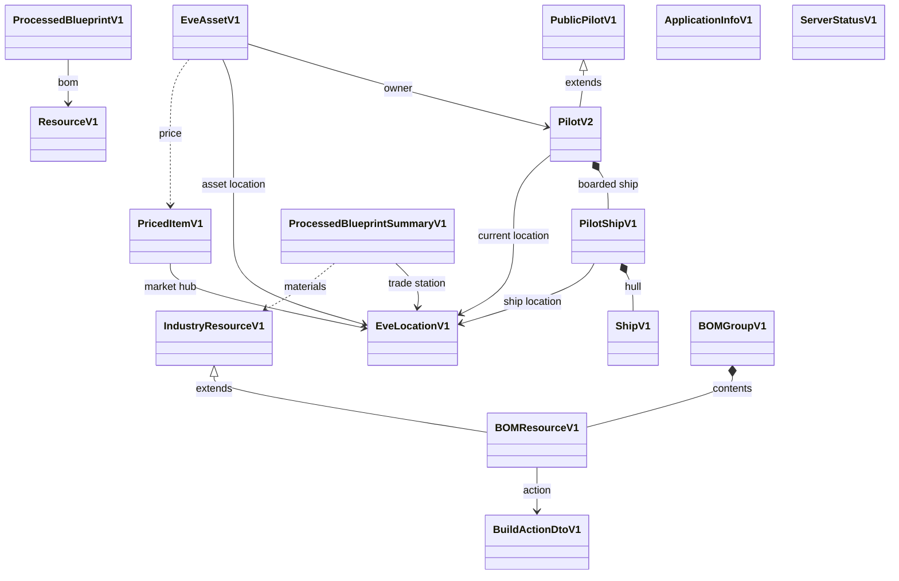
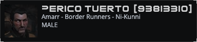
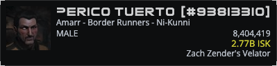
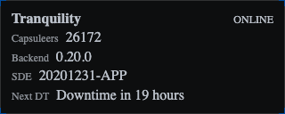

# EPIC-004 - MODELS

## Spec traceability

| Field | Value |
| --- | --- |
| Status | ✅ `applied` |
| OpenSpec changes | `domain-module`, `domain-pilot`, `domain-blueprint`, `domain-application-info`, `domain-server-status`, `domain-spacelocation`, `domain-jsonclass`, `front-pilot` archived 2026-11-06 |
| Skip | Models still `[ ]` / `to review` stay active. ProcessedBlueprint/BOM/EveLocationV1 → [EPIC-012](./12.EPIC-PROCESSED-BLUEPRINT.md). PricedItemV1Dto / EveItemV1Dto → [EPIC-013](./13.EPIC-EVE-ITEMS.md). EveAssetV1 → [EPIC-014](./14.EPIC-ASSETS.md). Archived OpenSpec skipped. Duplicates in `00.DUPLICATES`. |
| Index | `L1/TRACEABILITY.md` ·  |

## Table of contents

- [EPIC-004 - MODELS](#epic-004---models)
  - [Spec traceability](#spec-traceability)
  - [Table of contents](#table-of-contents)
    - [Section index](#section-index)
  - [Goals](#goals)
  - [Section 01 — Versioned business objects](#section-01--versioned-business-objects)
    - [UI inherits model versionability (`vn-` panels and renders)](#ui-inherits-model-versionability-vn--panels-and-renders)
    - [Media from the EVE Image Server](#media-from-the-eve-image-server)
  - [Section 02 — Model register (review under this epic)](#section-02--model-register-review-under-this-epic)
    - [Scope: ESI-matching models are not in this definition](#scope-esi-matching-models-are-not-in-this-definition)
    - [Iterative review](#iterative-review)
    - [Model hierarchy](#model-hierarchy)
  - [Section 03 — PricedItemV1 (moved)](#section-03--priceditemv1-moved)
  - [Section 04 — EveLocationV1 (moved)](#section-04--evelocationv1-moved)
  - [Section 05 — EveAssetV1 (moved)](#section-05--eveassetv1-moved)
  - [Section 06 — PublicPilotV1](#section-06--publicpilotv1)
    - [Appearance: `v1-public-pilot`](#appearance-v1-public-pilot)
    - [PublicPilotV1 fields (from `PublicPilotV1.domain.ts`)](#publicpilotv1-fields-from-publicpilotv1domaints)
  - [Section 07 — PilotV2](#section-07--pilotv2)
    - [Appearance: `v2-pilot`](#appearance-v2-pilot)
    - [Requirements (moved from )](#requirements-moved-from-l2front01pilot-definitionmd)
    - [Concept (summary)](#concept-summary)
    - [Versioning and inheritance (from infinity)](#versioning-and-inheritance-from-infinity)
    - [PilotV2 fields (from `PilotV2.domain.ts`, extends PublicPilotV1)](#pilotv2-fields-from-pilotv2domaints-extends-publicpilotv1)
    - [Render contract: `v2-pilot` HEADER](#render-contract-v2-pilot-header)
    - [Complements: boarded ship and current location](#complements-boarded-ship-and-current-location)
  - [Section 08 — ShipV1](#section-08--shipv1)
  - [Section 09 — PilotShipV1](#section-09--pilotshipv1)
  - [Section 10 — BlueprintV1](#section-10--blueprintv1)
    - [Appearance: `v1-blueprint` (base identity card)](#appearance-v1-blueprint-base-identity-card)
  - [Section 11–17 — Processed blueprint / BOM stack (moved)](#section-1117--processed-blueprint--bom-stack-moved)
  - [Section 18 — ApplicationInfoV1](#section-18--applicationinfov1)
    - [Appearance: `v1-application-info-render`](#appearance-v1-application-info-render)
    - [ApplicationInfoV1 requirements](#applicationinfov1-requirements)
  - [Section 19 — ServerStatusV1](#section-19--serverstatusv1)
    - [Appearance: `v1-server-status-render`](#appearance-v1-server-status-render)
    - [Fields (current — EPIC-006 panel)](#fields-current--epic-006-panel)
    - [Former field set (superseded)](#former-field-set-superseded)
    - [Render contract (header) — current](#render-contract-header--current)
    - [ServerStatusV1 requirements](#serverstatusv1-requirements)
  - [Section 20 — SpaceLocationV1](#section-20--spacelocationv1)
  - [Section 21 — Deployment: `neocom-domain`](#section-21--deployment-neocom-domain)
  - [Section 22 — Interchange: `jsonClass` on domain responses](#section-22--interchange-jsonclass-on-domain-responses)
    - [Rule](#rule)
    - [Requirements](#requirements)

### Section index

| Section | Title |
| --- | --- |
| [01](#section-01--versioned-business-objects) | Versioned business objects |
| [02](#section-02--model-register-review-under-this-epic) | Model register (review under this epic) |
| [03](#section-03--priceditemv1-moved) | PricedItemV1Dto → [EPIC-013 §04](./13.EPIC-EVE-ITEMS.md#section-04--priceditemv1dto-extends-eveitemv1dto) |
| [04](#section-04--evelocationv1-moved) | EveLocationV1 → [EPIC-012 §09](./12.EPIC-PROCESSED-BLUEPRINT.md#section-09--evelocationv1) |
| [05](#section-05--eveassetv1-moved) | EveAssetV1 → [EPIC-014 §02](./14.EPIC-ASSETS.md#section-02--eveassetv1) |
| [06](#section-06--publicpilotv1) | PublicPilotV1 |
| [07](#section-07--pilotv2) | PilotV2 |
| [08](#section-08--shipv1) | ShipV1 |
| [09](#section-09--pilotshipv1) | PilotShipV1 |
| [10](#section-10--blueprintv1) | BlueprintV1 |
| [11–17](#section-1117--processed-blueprint--bom-stack-moved) | Processed blueprint / BOM → [EPIC-012](./12.EPIC-PROCESSED-BLUEPRINT.md) |
| [18](#section-18--applicationinfov1) | ApplicationInfoV1 |
| [19](#section-19--serverstatusv1) | ServerStatusV1 |
| [20](#section-20--spacelocationv1) | SpaceLocationV1 |
| [21](#section-21--deployment-neocom-domain) | Deployment: `neocom-domain` |
| [22](#section-22--interchange-jsonclass-on-domain-responses) | Interchange: `jsonClass` on domain responses |

---

## Goals
This will collect the domain elemtns definitions to be used for data rendering

## Section 01 — Versioned business objects

Business objects and data models are versioned so application work can add a new shape without breaking features that still use an older one.

- Published programme type names SHALL use a **version suffix** (`…V1`, `…V2`, …), not an unversioned bare name. Infinity file names that used a `V1` *prefix* (e.g. `V1ProcessedBlueprintSummary.domain.ts`) map to suffix form in `neocom-domain` (`ProcessedBlueprintSummaryV1`).
- The version is part of the type name (`PricedItemV1`, `EveLocationV1`, `EveAssetV1`, `PublicPilotV1`, `PilotV2`, `ShipV1`, `PilotShipV1`, `ProcessedBlueprintV1`, `ApplicationInfoV1`, `ServerStatusV1`).
- A new version is a new type. The old type stays in the domain package.
- A feature depends on the version it was built for. It is not moved onto a later version unless that feature changes.
- Domain model field lists and reviews are owned by this epic.  holds **pointers only**.
- **Applied / implemented** documentation and the live **model hierarchy diagram** live in [`01.PROGRAMME-DEFINITION/ARCHITECTURE/MODELS.md`](../../01.PROGRAMME-DEFINITION/ARCHITECTURE/MODELS.md) once models are available in the coding systems.

### UI inherits model versionability (`vn-` panels and renders)

Panels and renders that **present** a domain model SHALL inherit that model’s versionability so the application can evolve by adding a new `vn` UI beside the old one.

| Rule | Expectation |
| --- | --- |
| Prefix | Selector, folder, and class names use a lowercase **`v` + version number** prefix: `v1-…`, `v2-…` (e.g. `v1-blueprint-render`, `v2-pilot-render`, `v1-application-info-render`) |
| Match | The `vn` on the panel/render tracks the **domain type version** it was built for (`ApplicationInfoV1` → `v1-application-info-render`; `PilotV2` → `v2-pilot` / `v1-pilot-panel` as that feature’s contract) |
| Coexistence | A new model version gets a new panel/render (new `vn` or new registration). The previous `vn` stays until its feature is deliberately migrated |
| Registry | `jsonClass` on the versioned domain node selects the registered versioned render |
| Exceptions | Shell/orchestration only (e.g. `app-page-header`, generic `standalone-node-panel`, `viewer-panel`) are **not** versioned with `vn-`; they host versioned renders |

Unversioned presentational names (`app-info-panel`, `server-info-panel`) are **transitional / legacy**. New work SHALL use versioned panels or renders.

## Section 02 — Model register (review under this epic)

**New reviews of domain model requirements are tied to EPIC-004.** The register below is the source for these models.

### Scope: ESI-matching models are not in this definition

Models whose shape **matches ESI payloads** (universe types, character, corporation, alliance, race/ancestry/bloodline, and similar) SHALL **not** be defined as published domain models in this epic. They are **managed internally** inside the server system (ESI adapters / internal enrichment) and are **not always visible** outside that boundary. `neocom-domain` SHALL publish the **programme domain hierarchy** below, not ESI mirror types.

| Model | Role | Review |
| --- | --- | --- |
| PricedItemV1Dto | Extends EveItemV1Dto + hub prices — **moved** → [EPIC-013 §04](./13.EPIC-EVE-ITEMS.md#section-04--priceditemv1dto-extends-eveitemv1dto) | moved |
| EveLocationV1Dto | Multi-kind location (back Dto) — **moved** → [EPIC-012 §09](./12.EPIC-PROCESSED-BLUEPRINT.md#section-09--evelocationv1dto) | moved |
| EveAssetV1 | Instanced item + Pilot + location + price — **moved** → [EPIC-014 §02](./14.EPIC-ASSETS.md#section-02--eveassetv1) | moved |
| [PublicPilotV1](#section-06--publicpilotv1) | Public-only Pilot base (legacy / unauthenticated); kept for compatibility | extracted |
| [PilotV2](#section-07--pilotv2) | Published Pilot for new development (extends public Pilot slice); header render + PilotShipV1 + EveLocationV1 | extracted |
| [ShipV1](#section-08--shipv1) | Neutral hull / type | [ ] |
| [PilotShipV1](#section-09--pilotshipv1) | Boarded instance: hull + location + fit | [ ] |
| [BlueprintV1](#section-10--blueprintv1) | Base blueprint model; ESI data (id, type, runs, efficiency) — parent for **ProcessedBlueprintV1** ([EPIC-012](./12.EPIC-PROCESSED-BLUEPRINT.md)) | extracted |
| ProcessedBlueprintV1 | Blueprint + backend profitability (buildable item + Jita sell price); former Summary — **moved** → [EPIC-012 §01](./12.EPIC-PROCESSED-BLUEPRINT.md#section-01--processedblueprintv1) | moved |
| ~~ProcessedBlueprintSummaryV1~~ | Name **retired** — use ProcessedBlueprintV1 (EPIC-012 §01) | discarded |
| Former ProcessedBlueprintV1 (type/output/BOM) | **discarded** in EPIC-012; name reassigned to §01 | discarded |
| ResourceV1 | Typed BOM line — **moved** → [EPIC-012 §03](./12.EPIC-PROCESSED-BLUEPRINT.md#section-03--resourcev1) | moved |
| IndustryResourceV1 | BOM material line — **moved** → [EPIC-012 §04](./12.EPIC-PROCESSED-BLUEPRINT.md#section-04--industryresourcev1) | moved |
| BOMResourceV1 | Industry resource + action — **moved** → [EPIC-012 §05](./12.EPIC-PROCESSED-BLUEPRINT.md#section-05--bomresourcev1) | moved |
| BuildActionDtoV1 | BUY/BUILD action DTO — **moved** → [EPIC-012 §06](./12.EPIC-PROCESSED-BLUEPRINT.md#section-06--buildactiondtov1) | moved |
| BOMGroupV1 | Labelled BOM group — **moved** → [EPIC-012 §07](./12.EPIC-PROCESSED-BLUEPRINT.md#section-07--bomgroupv1) | moved |
| [ApplicationInfoV1](#section-17--applicationinfov1) | Front application identity for header (name, version, copyright); environment-sourced domain node; `v1-application-info-render` | extracted |
| [ServerStatusV1](#section-19--serverstatusv1) | EVE Online server info for header; fields narrowed to EPIC-006 panel (`server`, `players`, `SDEVersion`, `nextDowntime`); `v1-server-status-render` | extracted (field set superseded → SRV-005) |
| [SpaceLocationV1](#section-19--spacelocationv1) | Interface artifact: any kind of location (region, constellation, system, station, structure) as reference | extracted |
| EveItem / ESI type → **EveItemV1Dto** | Back item class from ESI universe type — **owned** → [EPIC-013](./13.EPIC-EVE-ITEMS.md) | moved |
| ESI corporation / alliance / universe race structures | Internal server only — not published here | out of scope |
| **neocom-domain** | Deploy target: library holds domain models + hierarchy | [ ] |
| [`jsonClass` interchange](#section-22--interchange-jsonclass-on-domain-responses) | Back responses for published domain models SHALL set `jsonClass` to the programme type name | extracted |

### Iterative review

Specs for this epic move one reviewed batch at a time. Requirements live under the sections below (and the register). Each row has a **Review** status; new rows start at **`to review`**. That status is **not** registrable. `/epic:extract` takes only rows whose Review cell is exactly `reviewed` (and the section that row links to). There is no `UNREGISTERED REQUIREMENTS` inbox on this epic. Duplicates go to [`00.DUPLICATES.md`](00.DUPLICATES.md).

| Review | Meaning for the next `/epic:extract` |
| --- | --- |
| `to review` | Initial / pending. Do not copy the section, do not edit it, do not register it. |
| `reviewed` | This iteration. Register that section into OpenSpec, then set to `registered`. |
| `registered` | Already in OpenSpec. Leave it until someone sets `reviewed` again for a later change. |
| `extracted` | Legacy, from the removed L2 copy. Leave it until someone sets `reviewed` again. |
| `duplicated` | Near-duplicate; holding copy under `00.DUPLICATES`. Do not register again. |
| `superseded` | Do not register. |
| `out of scope` | Do not register. |

### Model hierarchy

Published programme types and how they relate. Solid arrows are composition or reference. Open triangles are inheritance. Dotted arrows are alignment (price concepts, inline material lines) rather than a stored subtype. `ApplicationInfoV1` and `ServerStatusV1` are published NeoCom nodes and do not sit in the game-object tree. `SpaceLocationV1` is an interface artifact for referencing any location kind (region, constellation, system, station, structure) and is not in the inheritance tree. `EveLocationV1` is the broader model for locations with nested context (structures inside stations, holds inside ships) and will evolve in future epics. Item identity and ESI-shaped types stay server-internal; they are not nodes here.

## Section 03 — PricedItemV1 (moved)

**Moved to [EPIC-013 §04 — PricedItemV1Dto](./13.EPIC-EVE-ITEMS.md#section-04--priceditemv1dto-extends-eveitemv1dto)**. ESI universe type / **EveItemV1Dto** hierarchy: [EPIC-013](./13.EPIC-EVE-ITEMS.md).

## Section 04 — EveLocationV1 (moved)

**Moved to [EPIC-012 §09 — EveLocationV1Dto](./12.EPIC-PROCESSED-BLUEPRINT.md#section-09--evelocationv1dto)** (back `Dto`; front mapper under construction; market-hub kind rule for PricedItemV1Dto / ProcessedBlueprint).

## Section 05 — EveAssetV1 (moved)

**Moved to [EPIC-014 §02 — EveAssetV1](./14.EPIC-ASSETS.md#section-02--eveassetv1)** (concept + proposed back `EveAssetV1Dto` fields).

## Section 06 — PublicPilotV1

### Appearance: `v1-public-pilot`

HEADER variant. Labels stay in the markup and are not shown. Fixture **93813310** (Perico Tuerto). Captured from `neocom-front` `/model-strip` with the application panel styles.

**PublicPilotV1** is the public-only Pilot base. Infinity: `neocom-infinity-frontend/src/app/domain/character/PublicPilotV1.domain.ts`. It `extends NeoComDelayed` with `jsonClass = 'PublicPilotV1'`. New work keeps it for compatibility. **PilotV2** extends it.

Shared behaviour from infinity to preserve on this base (or equivalent):

- `getPilotId` → `pilotId`
- `getCorporationId` → `corporation.getCorporationId` or `-1` when missing
- `getPilotIcon` → `https://images.evetech.net/characters/{pilotId}/portrait?size=64`. When `pilotId` is missing, use character id `1`. A corporation logo, when a render needs one, is `corporations/{corporationId}/logo` the same way.

### PublicPilotV1 fields (from `PublicPilotV1.domain.ts`)

| Field | Type (infinity) | Notes | Used by v2-pilot HEADER |
| --- | --- | --- | --- |
| `pilotId` | `number` | | yes (`[#{{pilotId}}]`) |
| `name` | `string` | | yes |
| `corporation` | `PublicCorporationV1` | Domain corporation summary; not an ESI mirror in this epic | (not in HEADER layout) |
| `birthday` | `string` | | |
| `description` | `string` | | |
| `gender` | `string` | | yes (uppercase) |
| `securityStatus` | `number` | | |
| `url4Icon` | `string` | Infinity stored a portrait URL. New renders ignore it and call `getPilotIcon` | no |
| `raceData` | `UniverseRaceData` (at least `name`; infinity also `raceId`, `allianceId`, `description`) | Domain summary; ESI-shaped types stay internal to construction | yes (ancestry line) |
| `ancestryData` | `UniverseAncestryData` (`name`) | | yes |
| `bloodlineData` | `UniverseBloodlineData` (`name`) | | yes |

Ancestry display line in HEADER: `raceData.name + ' - ' + ancestryData.name + ' - ' + bloodlineData.name`.

## Section 07 — PilotV2

### Appearance: `v2-pilot`

HEADER variant. Same public lines as `v1-public-pilot`, plus skill points, wallet, and current ship name. Fixture **93813310**.

**Canonical home for the Pilot domain model is this epic.** The published type for **new development** is **`PilotV2`**. Field shape and inheritance SHALL follow the **current infinity model implementations** (not invent a parallel shape):

| Reference | Path |
| --- | --- |
| Public base | `neocom-infinity-frontend/src/app/domain/character/PublicPilotV1.domain.ts` |
| Authenticated Pilot | `neocom-infinity-frontend/src/app/domain/character/PilotV2.domain.ts` |
| HEADER render | `neocom-infinity-frontend/src/app/modules/renders/v2-pilot-render` (`selector: v2-pilot`) |

Specs also retain PILOT-* ids. Login/SSO and HTTP endpoint behaviour stay in their own features; OpenSpec `front-pilot` tracks front apply against **PilotV2**.

### Requirements

| ID | Status | Requirement |
| --- | --- | --- |
| PILOT-001 | [ ] | A pilot is the concept of the Eve Online user interaction with the game environment |
| PILOT-002 | [ ] | A pilot belongs to a game credential, and a credential can have up to 3 pilots |
| PILOT-003 | [ ] | Server may obtain public character facts from ESI **Get character's public information** (`GetCharactersDetail`); that ESI shape is **internal** and is not a published model in this epic |
| PILOT-004 | cancelled | Inside the Pilot concept the game entity is named Character. Cancelled: ESI models are outside the project; a library encapsulates its own data domain |
| PILOT-005 | [ ] | Development and standalone testing use ESI sample data supplied for WireMock responses (server-internal). Test character id **93813310** (Perico Tuerto) may seed PilotV2 domain fields for fixtures |
| PILOT-006 | [ ] | The published Pilot data model for new work is **PilotV2** in this epic, not an ESI character mirror and not an unversioned `Pilot` type name |
| PILOT-007 | [ ] | The **PilotV2** field model is the canonical model in this file (EPIC-004), not a separate domain MODELS file or the front L2 pilot definition |
| PILOT-008 | [ ] | The HEADER **v2-pilot** render SHALL bind to **PilotV2** fields listed under Render contract below (infinity reference: `v2-pilot-render`) |
| PILOT-009 | [ ] | **neocom-domain** Pilot types SHALL be defined from infinity `PublicPilotV1.domain.ts` and `PilotV2.domain.ts` (same public fields, inheritance `PilotV2 extends PublicPilotV1`, and V2-only fields), adapted only where this epic replaces `SpaceLocationV1` with **EveLocationV1** or adds PilotShipV1 complements |

### Concept (summary)

- A **Pilot** is the Eve Online user’s interaction with the game environment (programme name).
- A Pilot belongs to a game credential; a credential can have up to **3** pilots.
- ESI character / corporation / alliance / universe race payloads are **server-internal**; they feed Pilot construction and are not always exposed outside the server.
- Development fixture: character id **93813310** (Perico Tuerto) for WireMock / tests.
- Programme published type is **`PilotV2`** (extends **`PublicPilotV1`** as in infinity). Unversioned `Pilot` in older infinity code is **legacy**; new work SHALL use **PilotV2**.

### Versioning and inheritance (from infinity)

| Type | Infinity role | New package role |
| --- | --- | --- |
| **PilotV2** | `extends PublicPilotV1`; `jsonClass = 'Pilot'` | Authenticated Pilot; **default for new development** |

`PilotV2.getLastKnownLocation` → string helper over location (infinity still stubbed; new work: derive from **EveLocationV1**). Base accessors `getPilotId`, `getCorporationId`, and `getPilotIcon` stay on **PublicPilotV1**.

### PilotV2 fields (from `PilotV2.domain.ts`, extends PublicPilotV1)

| Field | Type (infinity) | Notes | Used by v2-pilot HEADER |
| --- | --- | --- | --- |
| `totalSkillpoints` | `number` | | yes |
| `walletBalance` | `number` | ISK; scaled display in HEADER | yes |
| `currentShipName` | `string` | Legacy render helper | yes |
| `currentShipTypeName` | `string` | Legacy helper | |
| `lastKnownLocation` | infinity: `SpaceLocationV1` | **Superseded by EveLocationV1** in new work; keep field for compatibility until render/DTO migrate | via `getLastKnownLocation` (not in HEADER template) |

### Render contract: `v2-pilot` HEADER

New front work that shows the Pilot header SHALL consume **PilotV2** and support at least the HEADER fields above (icon, name, id, ancestry line, gender, total skill points, wallet balance, current ship name). Reference: infinity `v2-pilot-render` binding `@Input node: PilotV2`.

### Complements: boarded ship and current location

Beyond the PilotV2 field set copied from infinity, PilotV2 SHALL be complemented for new work with:

| Element | Meaning |
| --- | --- |
| **ShipV1 being boarded** | Domain **PilotShipV1** (preferred). HEADER MAY keep showing `currentShipName` until the render is updated to read from PilotShipV1. |
| **Current Pilot location** | **EveLocationV1** (kind/level explicit). Replaces `SpaceLocationV1` / opaque `lastKnownLocation`. |

`currentShipName`, `currentShipTypeName`, and `lastKnownLocation` remain on **PilotV2** for **compatibility with infinity domain + HEADER**; structured PilotShipV1 + EveLocationV1 are the forward model.

## Section 08 — ShipV1

The boarded-ship complement on Pilot leads to a neutral hull model and a boarded instance. This section is the neutral hull.

**ShipV1** is a **neutral** hull/type domain model: it carries the ship **type id**, **name**, and **characteristics** of the hull/type, without pilot- or instance-specific state. ESI type payloads for ships stay internal to the server. The hull picture is `types/{typeId}/render` on the image server. Use ShipV1 wherever a render or calculation needs “what kind of ship this is” without ownership, location, or fit.

## Section 09 — PilotShipV1

**PilotShipV1** encapsulates a **ShipV1** and adds more detail for a pilot’s actual vessel:

| Aspect | Meaning |
| --- | --- |
| **ShipV1** | The neutral hull/type (name and characteristics) |
| **Location** | Where that ship is — an **EveLocationV1** |
| **Fitting** | The ship’s fit (modules / charges / related fit data as defined for rendering) |

**PilotV2**’s ship being boarded SHALL be a **PilotShipV1** (or equivalent view of one) for new structured work, not only a neutral ShipV1. Neutral ShipV1 remains available for catalogs, market, and manufacturing contexts that do not need location or fitting.

## Section 10 — BlueprintV1

**Purpose:** Base blueprint model containing raw ESI blueprint data (parent for ProcessedBlueprintSummaryV1 and ProcessedBlueprintV1)

**Render:** `v1-blueprint` (similar renders pattern to other models; generic data display)

### Appearance: `v1-blueprint` (base identity card)

The base **BlueprintV1** render shows blueprint identity (type, output type, runs, efficiency). This is the foundation for **ProcessedBlueprintSummaryV1** (cost-index list variant) and **ProcessedBlueprintV1** (detail with BOM).

Source: ESI blueprint type data, published domain model wrapper

| Field | Type | Notes |
| --- | --- | --- |
| `blueprintId` | number | Unique blueprint id from ESI |
| `blueprintTypeId` | number | Blueprint item type |
| `blueprintTypeName` | string | Blueprint name |
| `blueprintTypeIconURL` | string | Icon URL (or use image server `types/{blueprintTypeId}/bp`) |
| `outputTypeId` | number | Type id of manufactured item |
| `outputTypeName` | string | Name of manufactured item |
| `outputTypeIconURL` | string | Icon URL (or use image server `types/{outputTypeId}/icon`) |
| `runs` | number | Total runs available (from ESI) |
| `materialEfficiency` | number | ME level (0-10) |
| `timeEfficiency` | number | TE level (0-20) |
| `maxRuns` | number | Maximum runs per blueprint copy |

| ID | Status | Requirement |
| --- | --- | --- |
| IND-BP-000 | duplicated | Base blueprint model published as **BlueprintV1** with ESI data (id, type, runs, efficiency) |

**Parent relationship:**
- **ProcessedBlueprintV1** lives in **[EPIC-012 §01](./12.EPIC-PROCESSED-BLUEPRINT.md#section-01--processedblueprintv1)** — extends BlueprintV1 with backend profitability (buildable item + Jita market sell price). Former Summary name retired; former BOM-detail ProcessedBlueprint shape discarded.

---

## Section 11–17 — Processed blueprint / BOM stack (moved)

**Moved to [EPIC-012 - PROCESSED BLUEPRINT](./12.EPIC-PROCESSED-BLUEPRINT.md)** (unreviewed at move time). Authoritative sections:

| Former | Now |
| --- | --- |
| §11 ProcessedBlueprintSummaryV1 | **renamed** → [EPIC-012 §01 ProcessedBlueprintV1](./12.EPIC-PROCESSED-BLUEPRINT.md#section-01--processedblueprintv1) |
| §12 ProcessedBlueprintV1 (BOM detail) | **discarded** in EPIC-012 |
| — | Market / Jita buy–sell → [EPIC-012 §02](./12.EPIC-PROCESSED-BLUEPRINT.md#section-02--market-pricing-jita-buy--sell) |
| §13 ResourceV1 | [EPIC-012 §03](./12.EPIC-PROCESSED-BLUEPRINT.md#section-03--resourcev1) |
| §14 IndustryResourceV1 | [EPIC-012 §04](./12.EPIC-PROCESSED-BLUEPRINT.md#section-04--industryresourcev1) |
| §15 BOMResourceV1 | [EPIC-012 §05](./12.EPIC-PROCESSED-BLUEPRINT.md#section-05--bomresourcev1) |
| §16 BuildActionDtoV1 | [EPIC-012 §06](./12.EPIC-PROCESSED-BLUEPRINT.md#section-06--buildactiondtov1) |
| §17 BOMGroupV1 | [EPIC-012 §07](./12.EPIC-PROCESSED-BLUEPRINT.md#section-07--bomgroupv1) |

Hierarchy diagram above may still show legacy Summary / dual ProcessedBlueprint names; EPIC-012 is authoritative for naming.

## Section 18 — ApplicationInfoV1

### Appearance: `v1-application-info-render`

**ApplicationInfoV1** is the published domain model for **front application identity** shown in the header (name, version, copyright). It is a NeoCom node (`jsonClass = "ApplicationInfoV1"`) so the header can provide it and **`v1-application-info-render`** can display it the same way other domain data is rendered (EPIC-002 / EPIC-006).

Source of truth for values today: front environment (`appName`, `appVersion`, `copyright`). The provider builds an **ApplicationInfoV1** instance; the `v1` render reads only node methods.

| Field | Access | Notes |
| --- | --- | --- |
| name | `getName` | Display uppercase in the default header render |
| version | `getVersion` | Front build / package version |
| copyright | `getCopyright` | Copyright line |

### ApplicationInfoV1 requirements

| ID | Status | Requirement |
| --- | --- | --- |
| APPINFO-001 | [ ] | Header consumes published **ApplicationInfoV1** via a data provider → **`v1-application-info-render`** (not by reading `environment` inside an unversioned panel) |
| APPINFO-002 | [ ] | `neocom-domain` SHALL publish **ApplicationInfoV1** with `jsonClass = "ApplicationInfoV1"` and the accessors above |
| APPINFO-003 | [ ] | Provider builds ApplicationInfoV1 from the front environment (or equivalent config) until another source is specified |
| APPINFO-004 | [ ] | UI for this model uses the **`v1-`** prefix on the render (and any dedicated panel); a later **ApplicationInfoV2** gets a new `v2-` UI |

## Section 19 — ServerStatusV1

**Authoritative UI Appearance / field usage:** EPIC-006 **Server status panel (`v1-server-status-render`)** (UI-SSP-*). The wider infinity-shaped field set and render contract below are **superseded**.

**OpenSpec note:** for an already-registered/applied capability, narrow or replace behaviour with a follow-up change using delta **`## MODIFIED Requirements`** and/or **`## REMOVED Requirements`** (capability retirement uses REMOVED + `retire_capabilities`). On L1, Review cell **`superseded`** means “replaced; do not extract again.”

### Appearance: `v1-server-status-render`

See **EPIC-006** for the live layout (name · ONLINE · CAPSULEERS with SDE + count · NEXT DT). Do not treat the older “backend + startAgo” header card as current.

**ServerStatusV1** is the published domain model for **EVE Online server information** shown in the application header. Reference implementations:

| Concern | Path |
| --- | --- |
| Domain | `neocom-infinity-frontend/src/app/domain/esi/ServerStatus.domain.ts` (legacy unversioned class name; programme type is **ServerStatusV1**) |
| Legacy panel | `server-info-panel` — superseded by provider → **`v1-server-status-render`** in EPIC-006 |

Raw ESI **server status** is obtained via the backend; the **ESI response shape is internal**. `jsonClass = "ServerStatusV1"`.

### Fields (current — EPIC-006 panel)

Published **ServerStatusV1** SHALL expose **only** the data used by the header panel:

| Field | Type | Access | Panel use |
| --- | --- | --- | --- |
| `server` | string | `getServerName` | Line 1 left (titlecase in render) |
| `players` | number | `getPlayersCount` (default `0`) | Line 2 with SDE (`cy-field-value="players-count"`) |
| `SDEVersion` | string | `getSDEVersion` | Line 2 with capsuleers (`cy-field-value="sde-version"`) |
| `nextDowntime` | string | `getNextDowntime` | Line 3 NEXT DT |

ONLINE/OFFLINE remains a **UI derivation** (instance present → ONLINE), not a stored domain field.

### Former field set (superseded)

Infinity-wide enrichments **no longer** part of the published model contract (do not require them on ServerStatusV1 for new work):

| Field | Was | Status |
| --- | --- | --- |
| `start_time` / `getStartTime` | ESI start | **superseded** — not on panel |
| `backendVersion` / `getBackendVersion` | NeoCom backend build | **superseded** — not on panel (UI-SSP-007) |
| `startAgo` / `getStartedAgo` | “started ago” | **superseded** — not on panel |

OpenSpec applied change `domain-server-status` DOM-SRV-002 / render-with-backend contract → mark **superseded**; replace via **MODIFIED** / **REMOVED** on the next domain-server-status (or successor) change.

### Render contract (header) — current

Header provider → **ServerStatusV1** → **`v1-server-status-render`** as specified in **EPIC-006** (UI-SSP). Legacy `server-info-panel` is not the target.

### ServerStatusV1 requirements

| ID | Status | Requirement |
| --- | --- | --- |
| SRV-001 | duplicated | Header obtains **ServerStatusV1** from a data provider and injects it into **`v1-server-status-render`** (EPIC-002 standalone / registry pattern) |
| SRV-002 | superseded | ~~ServerStatusV1 is built from ESI plus enrichments `backendVersion`, `SDEVersion`, `startAgo`, `nextDowntime`~~ — replaced by **SRV-005** (narrow field set; EPIC-006) |
| SRV-003 | superseded | ~~`neocom-domain` SHALL publish ServerStatusV1 from the full infinity `ServerStatus.domain.ts` field set~~ — replaced by **SRV-005** |
| SRV-004 | duplicated | UI for this model uses the **`v1-`** prefix; a later **ServerStatusV2** gets a new `v2-` UI |
| SRV-005 | [ ] | Published **ServerStatusV1** SHALL expose **only** `server`, `players`, `SDEVersion`, `nextDowntime` (accessors as above); SHALL NOT require `backendVersion`, `start_time`, or `startAgo` for the header panel contract |
| SRV-006 | [ ] | **`v1-server-status-render`** field usage SHALL follow **EPIC-006** UI-SSP (not the former backend / startAgo card) |

## Section 20 — SpaceLocationV1

Former `lastKnownLocation` type. Declared no fields. **Superseded by EveLocationV1** in this epic — do not extend SpaceLocationV1.

Historical ESI-matching field lists (`PublicCorporationV1`, `AllianceV1`, `Station`, `UniverseRaceData`, `UniverseAncestryData`, `UniverseBloodlineData`, and ESI type / EveItem mirrors) are **out of scope** for this epic’s published model definition. They remain server-internal where needed.

Corporation home station and similar location needs SHALL use **EveLocationV1** (station/structure kind), not a separate Station ESI mirror.

## Section 21 — Deployment: `neocom-domain`

All **published** models defined in this epic (PricedItemV1, EveLocationV1, EveAssetV1, **PilotV2** / PublicPilotV1, ShipV1, PilotShipV1, industry blueprint / BOM set, **ApplicationInfoV1**, and **ServerStatusV1**) SHALL be **deployed in the `neocom-domain` Node library**. ESI-matching types SHALL not be required as public exports of that package solely because ESI returns them. Export the type name **`PilotV2`** (not an unversioned `Pilot`) for new consumers.

`neocom-domain` SHALL be **enhanced** with:

| Concern | Expectation |
| --- | --- |
| **Models** | TypeScript types/classes for each **published** domain element named in this epic, including **PilotV2**, industry blueprint / BOM, **ApplicationInfoV1**, and **ServerStatusV1** |
| **Model hierarchy** | Explicit composition relationships (e.g. item identity → PricedItemV1; ShipV1 → PilotShipV1; PublicPilotV1 → PilotV2 + PilotShipV1 + EveLocationV1; EveAssetV1 on PilotV2 + EveLocationV1; ProcessedBlueprintV1 → type/output + ResourceV1[]; IndustryResourceV1 → BOMResourceV1 → BOMGroupV1; ProcessedBlueprintSummaryV1 → materials + EveLocationV1) so front and back share one hierarchy |

Front and back SHALL consume these models via the published `neocom-domain` package dependency (aligned with DOMAIN-002 / DOMAIN-003), not by redefining parallel shapes in application repos. New model review and hierarchy **requirements** stay in EPIC-004 and land in `neocom-domain` on apply. After apply, record implemented models and deploy the hierarchy diagram in [`ARCHITECTURE/MODELS.md`](../../01.PROGRAMME-DEFINITION/ARCHITECTURE/MODELS.md).

## Section 22 — Interchange: `jsonClass` on domain responses

Published **domain-implemented** models that the back returns to the front SHALL identify their programme type on the wire so the front can resolve the correct render (EPIC-002 registry / `lookupRender(jsonClass)`).

### Rule

| Field | Requirement |
| --- | --- |
| `jsonClass` | Present on every response body (or each list element) that represents a published domain model. Value is the programme type name (e.g. `PilotV2`, `PublicPilotV1`, `BlueprintV1`, `SpaceLocation`, `ApplicationInfoV1`, `ServerStatusV1`). |

The value of `jsonClass` SHALL match the `jsonClass` / type name published for that model in `neocom-domain` (and the register in this epic). The back SHALL NOT omit `jsonClass` for those payloads, invent a different discriminator name, or use an ESI-only type name when a programme domain type exists.

### Requirements

| ID | Status | Requirement |
| --- | --- | --- |
| DOM-JSONCLASS-001 | duplicated | When the back returns a published domain model (single object or list element), the payload SHALL include a field named **`jsonClass`** whose value is the programme domain type name for that instance |
| DOM-JSONCLASS-002 | duplicated | Front render selection for those payloads SHALL use `jsonClass` (same contract as NeoCom nodes / EPIC-002); consumers MUST NOT guess the type from URL alone when `jsonClass` is present |
| DOM-JSONCLASS-003 | duplicated | `jsonClass` values for published models SHALL align with `neocom-domain` exports and the EPIC-004 register (e.g. **PilotV2**, not an unversioned `Pilot`, when the programme type is PilotV2) |
