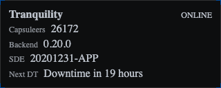

# EPIC-006 - USER INTERFACE

## Spec traceability

| Field | Value |
| --- | --- |
| Status | `none` (leftover units `[ ] to review`; shell/domain OpenSpec already archived) |
| OpenSpec changes | `front-dashboard-shell`, `front-domain-nodes` archived 2026-11-06 |
| Skip | Archived / imported / duplicated / moved units skipped on extract. Process only `[x] reviewed`. Leftover `[ ] to review`: UI-SHELL-001…002, UI-VAR-001…002, UI-STYLE-001…005, UI-MS-001…007, UI-DASH-006 / 011, Page register Model strip. UI-BP-001…003 → EPIC-012. |
| Index | `L1/TRACEABILITY.md` |

## Goals

Where to describe the different panels, pages and their content usage. It will define the visual templates and the field contents and should be related to the available models described in testing/CI under [`17.EPIC-CICD.md`](./17.EPIC-CICD.md) (formerly EPIC-003)

## Search criteria

## Sources

## Table of contents

- [Spec traceability](#spec-traceability)
- [Goals](#goals)
- [Search criteria](#search-criteria)
- [Sources](#sources)
- [Section 01 — Page register](#section-01--page-register)
- [Section 02 — Shell and page header](#section-02--shell-and-page-header)
- [Section 03 — Application info panel (`v1-application-info-render`)](#section-03--application-info-panel-v1-application-info-render)
- [Section 04 — Server status panel (`v1-server-status-render`)](#section-04--server-status-panel-v1-server-status-render)
- [Section 05 — Corporation panel (`v1-corporation-render`)](#section-05--corporation-panel-v1-corporation-render)
- [Section 06 — Blueprint render (`v1-blueprint-render`)](#section-06--blueprint-render-v1-blueprint-render)
- [Section 07 — Style catalog (programme)](#section-07--style-catalog-programme)
- [Section 08 — Model strip (`model-strip-page`)](#section-08--model-strip-model-strip-page)
- [Section 09 — Authentication and login pages (imported)](#section-09--authentication-and-login-pages-imported)
- [Section 10 — Dashboard (landing page)](#section-10--dashboard-landing-page)
- [Version card](#version-card)

### Section index

| Section | Title | Origin |
| --- | --- | --- |
| [01](#section-01--page-register) | Page register | legacy EPIC-006; Review normalized 2026-11-09 |
| [02](#section-02--shell-and-page-header) | Shell and page header (chrome, variants, geometry, versioning, domain nodes, media, header) | legacy EPIC-006 |
| [03](#section-03--application-info-panel-v1-application-info-render) | Application info panel | legacy EPIC-006 |
| [04](#section-04--server-status-panel-v1-server-status-render) | Server status panel | legacy EPIC-006 |
| [05](#section-05--corporation-panel-v1-corporation-render) | Corporation panel | legacy EPIC-006 |
| [06](#section-06--blueprint-render-v1-blueprint-render) | Blueprint render | moved → EPIC-012 §08 |
| [07](#section-07--style-catalog-programme) | Style catalog | legacy EPIC-006 · `[ ] to review` |
| [08](#section-08--model-strip-model-strip-page) | Model strip | legacy EPIC-006 · `[ ] to review` |
| [09](#section-09--authentication-and-login-pages-imported) | Authentication and login pages | imported (not extractable) |
| [10](#section-10--dashboard-landing-page) | Dashboard | legacy EPIC-006 · leftover UI-DASH-006/011 `[ ] to review` |

---

## Section 01 — Page register

| Page                                  | Role                                                                          | Security              | Review                         |
| ------------------------------------- | ----------------------------------------------------------------------------- | --------------------- | ------------------------------ |
| **Login**                             | Start EVE SSO; show validate vs EVE button | Public (entry) | imported — edit for new render |
| **Login callback**                    | Finish SSO (`code` / `state`); progress + exception regions | Public (callback) | imported — edit for new render |
| **Exception info**                    | Show intercepted auth/session exception; retry login | Public / post-failure | imported — edit for new render |
| **Dashboard**                         | Application landing page after login + character selection; root feature list | Secured | duplicated |
| **Feature dashboard** (e.g. Industry) | Secured page for a parent feature; hosts that feature’s **subfeature** list | Secured | duplicated |
| **Model strip**                       | Dev support catalog of render specimens (stable vs on-construction columns) | Public (no auth) | [ ] to review |

## Section 02 — Shell and page header

### Route trees (nested layouts)

Do **not** place the application header outside the root `router-outlet` so that every route inherits it. Auth and core entry pages must stay free of full product chrome.

| Tree              | Routes (examples)                             | Chrome                                                                                                                                                                      |
| ----------------- | --------------------------------------------- | --------------------------------------------------------------------------------------------------------------------------------------------------------------------------- |
| **Public / core** | `login`, `login-callback`, exception info     | No secured shell. Page MAY start with the shared header in `-AUTH-` variant (app info only)                                                                                 |
| **Secured app**   | `dashboard`, feature sections (`industry`, …) | Page (or a secured layout that wraps a child outlet) starts with `<app-page-header />` (`-APP-`), then the **pilot & corporation** row (same as Dashboard), then page body |

Root `app.html` stays a thin `router-outlet` (SHELL-001). Visibility of the header is decided by **which tree / page inserts it**, not by a global flag toggled from each page.

### Secured page chrome (pilot & corporation)

Every **authenticated** (secured) page SHALL place the **pilot information** and **corporation information** panels in a row **immediately below** `<app-page-header />`, matching the Dashboard **Pilot & corporation** row (see [Pilot and corporation row](#pilot-and-corporation-row)).

```text
secured page
├── app-page-header (-APP-)
├── row: pilot panel | corporation panel     ← required on all authenticated pages
└── page body (breadcrumb, feature list, …)
```

Public / core pages (`login`, `login-callback`, exception info, `model-strip`, …) SHALL **not** show this row.

| ID          | Review        | Requirement                                                                                                                                                                                                                          |
| ----------- | ------------- | ------------------------------------------------------------------------------------------------------------------------------------------------------------------------------------------------------------------------------------ |
| UI-SHELL-001 | [ ] to review | Every **authenticated** page SHALL show the **pilot & corporation** row (pilot panel left, corporation panel right) **immediately below** `<app-page-header />`, same composition as the Dashboard|
| UI-SHELL-002 | [ ] to review | Public / unauthenticated pages SHALL **not** include the pilot & corporation row|

### Variant naming

Render / panel / header **variants** use this string convention (same as EPIC-002 node variants such as `-DEFAULT-`, `-AVAILABLE-BLUEPRINTS-`):

- Start with `-`
- End with `-`
- Uppercase letters only
- Words separated by `-`

Examples: `-APP-`, `-AUTH-`, `-HEADER-`, `-DEFAULT-`.

### Render variant templates

A **render** owns its variants. The render template SHALL place **distinct HTML under `@if` (or equivalent) for each specific variant**. When the host does **not** pass a variant (or passes none / empty), the render SHALL use the **default** variant (`NeoComVariant.DEFAULT` / `-DEFAULT-`) and that branch’s HTML.

```text
render template
├── @if (variant === SPECIFIC-A) → HTML for SPECIFIC-A
├── @else if (variant === SPECIFIC-B) → HTML for SPECIFIC-B
└── @else (DEFAULT / unset) → HTML for default variant
```

| ID         | Review        | Requirement                                                                                                                                                                                                 |
| ---------- | ------------- | ----------------------------------------------------------------------------------------------------------------------------------------------------------------------------------------------------------- |
| UI-VAR-001 | [ ] to review | Each render SHALL select its template markup with **per-variant** branches (`@if` / `@else if` on the variant); one branch per named variant the render supports|
| UI-VAR-002 | [ ] to review | When no variant is defined (unset / empty / omitted input), the render SHALL use the **default** variant (`NeoComVariant.DEFAULT` / `-DEFAULT-`) and render that branch’s HTML|

### Page geometry (shared styles)

Secured and core pages use the common geometry classes from `neocom-front/src/styles/geometry.scss` (zero margin / padding / border / gap by default):

| Class      | Role                                                                    |
| ---------- | ----------------------------------------------------------------------- |
| `neo-page` | Page host (`host: { class: 'neo-page' }`) — full available space, flush |
| `section`  | Page band; stacks rows/columns with no chrome                           |
| `column`   | Vertical flex; may contain rows                                         |
| `row`      | Horizontal flex                                                         |

Optional modifiers (`row--wrap`, `section--grow`, `column--fill`) are opt-in only. Panel colour frames stay on `.panel-*` / `.neocom-panel`, not on geometry classes.

**Default panel gap** (programme token in `neocom-front` `styles/_tokens.scss`): `$panel-margin` / `$panel-padding` (today `2px`). Geometry classes stay flush (`gap: 0`); panel-to-panel and panel-to-border separation SHALL use that token (not ad-hoc rem gutters). Source: defect [DEF-IB-006](../../defects/INDUSTRY-BLUEPRINTS_DEFECTS.md#def-ib-006--pilot-row-spacing-must-use-default-panel-gap).

| ID         | Review | Requirement |
| ---------- | ------ | ----------- |
| UI-GEO-001 | archived | Secured chrome that places NeoCom panels side by side or stacked SHALL separate them (and inset from the page/band border) using the programme **default panel gap** (`$panel-margin` / `$panel-padding`, today `2px`) — not a larger page-local spacing scale|
| UI-GEO-002 | archived | Gap between **rows** or **sections** SHALL use the default **`$section-padding`**; that token’s default SHALL equal **`$panel-padding`** (**DEF-BLP-005**)|

### Versioned panels and renders (`vn-`)

Any **panel** or **render** that presents a domain model SHALL inherit that model’s versionability (EPIC-004). Use a lowercase `vn-` prefix on the selector / folder / class (`v1-…`, `v2-…`) matching the domain type version it was built for. A new model version gets a new `vn` UI; the previous one stays until its feature migrates. Shell-only hosts (`app-page-header`, generic viewers) stay unversioned.

**Pages** do **not** use the `vn-` prefix (defect [DEF-IB-004](../../defects/INDUSTRY-BLUEPRINTS_DEFECTS.md#def-ib-004--pages-must-not-use-vn--version-prefix)): every `*-page` host stays unversioned (e.g. `dashboard-home-page`, `blueprint-by-location-page`). Versionability applies to panels/renders only. Migrate any page that already has a `vn-` name (e.g. `v1-blueprint-by-location-page` → `blueprint-by-location-page`). Route **URL paths** stay stable unless a later requirement says otherwise (e.g. `/dashboard` remains).

| ID         | Review    | Requirement                                                                                                                                                                                                                                                                                                                               |
| ---------- | --------- | ----------------------------------------------------------------------------------------------------------------------------------------------------------------------------------------------------------------------------------------------------------------------------------------------------------------------------------------- |
| UI-VER-001 | archived | Panels/renders bound to domain models use `vn-` in their public selector and path names|
| UI-VER-002 | archived | The `vn` tracks the domain type version (`ApplicationInfoV1` → `v1-application-info-render`; `ServerStatusV1` → `v1-server-status-render`; `PilotV2` → `v2-pilot` / versioned pilot panel as specified)|
| UI-VER-003 | archived | Unversioned legacy panels (`app-info-panel`, `server-info-panel`) are not used for new work|
| UI-VER-004 | archived | **Page** hosts (`*-page` selectors, folders, classes) SHALL **not** use a `vn-` prefix (e.g. `dashboard-home-page`, `character-selection-page`, `login-page`, `model-strip-page`, `blueprint-by-location-page`); versionability stays on panels/renders (UI-VER-001…003); migrate existing versioned page names (e.g. `v1-blueprint-by-location-page` → `blueprint-by-location-page`); keep route URL paths stable unless specified|

### Front domain NeoCom nodes (file, alias, render key)

Norms for front NeoCom classes that represent domain objects in the UI tree (DEF-BLP-007…013). Selecting defect “Register the spec” assumes Review accepted → `[x] reviewed`.

| ID         | Review    | Requirement                                                                                                                                                                                                                                |
| ---------- | --------- | ------------------------------------------------------------------------------------------------------------------------------------------------------------------------------------------------------------------------------------------ |
| UI-DOM-001 | archived | Front NeoCom domain object files SHALL be named `<object>-v<n>.node.ts` under a `domain` module folder (example: Blueprint → `blueprint-v1.node.ts`)|
| UI-DOM-002 | archived | TypeScript / Angular SHALL expose path alias **`@domain`** to that domain nodes root|
| UI-DOM-003 | archived | The **render registration name** SHALL be **exactly** the representing NeoCom class’s `jsonClass` (no parallel alias key)|
| UI-DOM-004 | archived | Hierarchy (e.g. Region → SolarSystem → Blueprint) SHALL use domain Region / SolarSystem / Blueprint NeoCom nodes and `NeoCom` **children** (`addChild` / `getChildren`); SHALL NOT invent Lookup* or require Listing subclasses for counts|
| UI-DOM-005 | archived | Front Blueprint NeoCom SHALL NOT require published npm `neocom-domain` `BlueprintV1`; DTO/wire MAY use an internal `BlueprintV1DtoWire` (or successor) mapped into the front NeoCom node|

### Media from the EVE Image Server

Portraits, corporation and alliance logos, and type icons are loaded by the client directly from the [EVE Image Server](https://developers.eveonline.com/docs/services/image-server/). The NeoCom backend does not proxy, store, or return these images. A render builds the URL from the id it already has.

Same contract as EPIC-004 (domain / media); restated here so UI panels and renders have a local reference.

`https://images.evetech.net/{category}/{id}/{variation}?size={size}`

| Need | Category | Id | Variation |
| --- | --- | --- | --- |
| Pilot portrait | `characters` | `pilotId` | `portrait` |
| Corporation logo | `corporations` | corporation id | `logo` |
| Alliance logo | `alliances` | alliance id | `logo` |
| Item / module / resource icon | `types` | type id | `icon` |
| Hull or type render | `types` | type id | `render` |
| Blueprint original | `types` | blueprint type id | `bp` |

`size` is a power of two from 32 to 1024. Omit it only when the original size is acceptable. `tenant` defaults to `tranquility`. When a character, corporation, or alliance id is missing, use id `1` (the documented default portrait or logo). Clients may request the URL as a CDN; they do not cache the bytes through the backend.

| ID         | Review    | Requirement                                                                                                                                                                                                                                                                                                    |
| ---------- | --------- | -------------------------------------------------------------------------------------------------------------------------------------------------------------------------------------------------------------------------------------------------------------------------------------------------------------- |
| UI-MED-001 | archived | Portraits, corporation/alliance logos, and type icons SHALL be loaded by the **client** directly from the [EVE Image Server](https://developers.eveonline.com/docs/services/image-server/)|
| UI-MED-002 | archived | The NeoCom **backend** SHALL NOT proxy, store, or return these image bytes|
| UI-MED-003 | archived | A render SHALL build the image URL from the id it already has — pattern `https://images.evetech.net/{category}/{id}/{variation}?size={size}`|
| UI-MED-004 | archived | URL categories / variations SHALL follow this table: pilot portrait → `characters` / `portrait`; corporation logo → `corporations` / `logo`; alliance logo → `alliances` / `logo`; item/module/resource icon → `types` / `icon`; hull or type render → `types` / `render`; blueprint original → `types` / `bp`|
| UI-MED-005 | archived | When `size` is supplied it SHALL be a power of two from **32** to **1024**; omit `size` only when the original size is acceptable|
| UI-MED-006 | archived | Image `tenant` defaults to `tranquility`|
| UI-MED-007 | archived | When a character, corporation, or alliance id is missing, the URL SHALL use id `1` (documented default portrait or logo)|
| UI-MED-008 | archived | Clients MAY request the URL as a CDN; they SHALL NOT cache the image bytes through the backend|

### Common header element (`app-page-header`)

The header is one reusable element. Every page that needs it inserts **only** that element as the **first** child of the page template. Page HTML does not name inner panels, domain types, or renders.

`app-page-header` is the **header controller** (EPIC-002 page/panel role for this chrome; unversioned shell). It SHALL obtain domain instances the same way other data is provided for rendering, then inject those nodes into the registered **versioned renders**. It SHALL NOT keep presentation logic that reads `environment` or HTTP responses directly inside legacy presentational panels as the long-term design.

| ID         | Status        | Requirement                                                                                                                                                                                                                                                                                                                                                                                                                                                                                                                |
| ---------- | ------------- | -------------------------------------------------------------------------------------------------------------------------------------------------------------------------------------------------------------------------------------------------------------------------------------------------------------------------------------------------------------------------------------------------------------------------------------------------------------------------------------------------------------------------- |
| UI-HDR-001 | archived | Selector `app-page-header`. Pages that need a header put `<app-page-header …>` as the first element in the page HTML|
| UI-HDR-002 | archived | Page templates SHALL NOT compose header renders or legacy `app-info-panel` / `server-info-panel` directly; those live inside `app-page-header`|
| UI-HDR-003 | archived | Variant `-APP-` (default, secured pages): provide **ApplicationInfoV1** + **ServerStatusV1** (+ application menu when specified) to their `v1` renders|
| UI-HDR-004 | archived | Variant `-AUTH-` (login, login-callback, similar): provide **ApplicationInfoV1** only — no ServerStatusV1, no application menu|
| UI-HDR-005 | archived | `app-page-header` owns `cy-section-name="header"` and hosts the render slots (layout / colour of each render)|
| UI-HDR-006 | archived | Exception region stays **under** the header, owned by the page (or a later shared exception slot), not inside `app-page-header`|
| UI-HDR-007 | archived | Header controller locates **ApplicationInfoV1** and **ServerStatusV1** via **data providers** (same pattern as other feature data providers)|
| UI-HDR-008 | archived | Header controller injects each obtained domain node into the render resolved by `jsonClass` (render registry / standalone-node path from EPIC-002). Renders call node accessors only|
| UI-HDR-009 | archived | Domain models: **ApplicationInfoV1** / **ServerStatusV1** (EPIC-004). Renders: `v1-application-info-render`, `v1-server-status-render`. Legacy unversioned panels are transitional|
| UI-HDR-010 | archived | The header host SHALL be named consistently `app-page-header` across selector, folder/file basename, component class, and primary CSS class (defect [DEF-IB-002](../../defects/INDUSTRY-BLUEPRINTS_DEFECTS.md#def-ib-002--header-host-named-page-header-instead-of-app-page-header)); do not leave source artefacts named only `page-header` while the programme name is `app-page-header`|
| UI-HDR-011 | archived | On `-APP-`, the header first line (application-info + server-info) SHALL span the **full page width**; **server-info** sits on the **right**, sized to its **content**; **app-info** uses the **remaining** width; when horizontal space is insufficient, stack **app-info above server-info** (each full width of the band). On `-AUTH-`, app-info alone still spans the band (defect [DEF-IB-005](../../defects/INDUSTRY-BLUEPRINTS_DEFECTS.md#def-ib-005--header-app-info--server-info-row-width-and-responsive-stack))|

Flow (complies with EPIC-002 standalone / registry behaviour):

```text
page → <app-page-header>
         → ApplicationInfo provider → ApplicationInfoV1 → v1-application-info-render
         → ServerStatus provider    → ServerStatusV1    → v1-server-status-render   (-APP- variant)
```

Page insert sketches:

```html
<!-- Secured page -->
<app-page-header />
<!-- or explicit: <app-page-header variant="-APP-" /> -->
<!-- page body rows … -->

<!-- Auth / core page -->
<app-page-header variant="-AUTH-" />
<!-- login or callback body … -->
```

Nodes provided by the header controller (not composed by pages):

| Variant  | Domain nodes → renders                                                                                                                  |
| -------- | --------------------------------------------------------------------------------------------------------------------------------------- |
| `-AUTH-` | **ApplicationInfoV1** → `v1-application-info-render`                                                                                    |
| `-APP-`  | **ApplicationInfoV1** → `v1-application-info-render`; **ServerStatusV1** → `v1-server-status-render`; application menu (when specified) |

Panel / shell pieces used across auth pages (imported; prefer `app-page-header` over raw panels):

| Piece                                | Usage on auth pages                                                                                       |
| ------------------------------------ | --------------------------------------------------------------------------------------------------------- |
| `app-page-header` **(**`-AUTH-`**)** | First element on login and login-callback; provides **ApplicationInfoV1** to `v1-application-info-render` |
| **Login validation progress**        | Callback / validation: waiting for code authentication                                                    |
| **Login validation exception**       | Callback / validation: missing code or state mismatch                                                     |
| **Exception region**                 | Under header on pages when an exception is present (DASH-007 pattern)                                     |

**Sources imported below (UI surface only):**  (LOGIN-001…008), `L1/01.EPIC-LOGIN-PROCEDURE.md` (Login page / Login progress),  (DASH-001…009 legacy layout),  (STRUCT-002 routes), OpenSpec `openspec/changes/login/specs/front/login/spec.md`. SSO protocol, cookies, and back token exchange remain owned by **EPIC-001** / OpenSpec `login`; this epic holds **pages, panels, templates, and field contents** so they can be rewritten for the new listing/render model (related domain models: **EPIC-004**).

## Section 03 — Application info panel (`v1-application-info-render`) (`v1-application-info-render`)

This section is the **UI Appearance** for the application-info content of `app-page-header` (and any other host that shows **ApplicationInfoV1**). Domain model and accessors: EPIC-004 **ApplicationInfoV1**. Wiring (provider → render): **UI-HDR-*** above. Authoritative visual is the **model-strip** specimen named `v1-application-info-render`.

Legacy unversioned `app-info-panel` is transitional only (UI-VER-003); new work SHALL NOT compose that panel from pages. The versioned render owns the panel chrome and field layout.

### Host and content panels

| Piece                        | Role                                                                                                                      |
| ---------------------------- | ------------------------------------------------------------------------------------------------------------------------- |
| `app-page-header`            | Header controller; obtains **ApplicationInfoV1** and injects it into the registered render (UI-HDR-007…009)               |
| `v1-application-info-render` | Content panel for application identity — panel frame + fields below. Selector / render name: `v1-application-info-render` |
| `v1-server-status-render`    | Sibling content panel on `-APP-` only — Appearance in **Server status panel** below                                       |

On `-AUTH-`, the header hosts only the application-info content panel. On `-APP-`, it hosts application-info and server-status content panels (plus application menu when specified).

### Appearance: `v1-application-info-render`

As shown on **model-strip** (`data-specimen="v1-application-info-render"` / render-ref `v1-application-info-render`).


Programme path: `neocom-front` `modules/renders/v1-application-info-render`.

**Panel chrome:** `neocom-panel` `panel-white`; section marker `cy-section-name="app-info"` (id `appinfo-panel` MAY remain for legacy selectors).

**Layout:** one content panel —

| Area             | Content                                                 |
| ---------------- | ------------------------------------------------------- |
| Top row          | Application **name** (left) · **version** (beside name) |
| Below / trailing | **Copyright** line                                      |

**Fields (contents):**

| Field            | Source                        | Display                                                                   |
| ---------------- | ----------------------------- | ------------------------------------------------------------------------- |
| Application name | `ApplicationInfoV1.getName` | **Uppercase**; Elemental; large white title (`cy-field-value="app-name"`) |
| Version          | `getVersion`                | Elemental; smaller; yellow (`cy-field-value="app-version"`)               |
| Copyright        | `getCopyright`              | Open Sans; small; white / muted (`cy-field-value="app-copyright"`)        |

| ID         | Review        | Requirement                                                                                                                                                                                                                                                                                                                                                                                              |
| ---------- | ------------- | -------------------------------------------------------------------------------------------------------------------------------------------------------------------------------------------------------------------------------------------------------------------------------------------------------------------------------------------------------------------------------------------------------- |
| UI-AIP-001 | archived | Application info in the header SHALL be painted by `v1-application-info-render` (model-strip name / selector), not by composing legacy `app-info-panel` from pages|
| UI-AIP-002 | archived | The render SHALL use `neocom-panel panel-white` chrome and `cy-section-name="app-info"`|
| UI-AIP-003 | archived | The panel contents SHALL show **name** (uppercase), **version**, and **copyright** from **ApplicationInfoV1** as on the model-strip Appearance|
| UI-AIP-004 | archived | Name uses **Elemental** (large, white); version uses **Elemental** (smaller, yellow); copyright uses **Open Sans** (small)|
| UI-AIP-005 | archived | On `-AUTH-`, `app-page-header` hosts this content panel only; on `-APP-`, it hosts this panel together with the server-status content panel|
| UI-AIP-006 | archived | When the user **activates the application name** control (`cy-field-value="app-name"`) in `v1-application-info-render`, the app SHALL navigate to the **character selection** route (`/character-selection`); activation is the **name** only (not version, not copyright) (defect [DEF-IB-001](../../defects/INDUSTRY-BLUEPRINTS_DEFECTS.md#def-ib-001--app-name-click-returns-to-character-selection))|

## Section 04 — Server status panel (`v1-server-status-render`) (`v1-server-status-render`)

This section is the **UI Appearance** for the server-status content of `app-page-header` (`-APP-` only). It also defines the **published field set** consumed from **ServerStatusV1** (EPIC-004 Section 19). Wiring: **UI-HDR-***. Authoritative visual is the **model-strip** specimen named `v1-server-status-render`.

The former wider ServerStatusV1 field/render contract (infinity full enrichments including Backend / `startAgo` / `start_time`) is **superseded** — L1 Review=`superseded`; OpenSpec follow-up uses `MODIFIED` **/** `REMOVED` against `domain-server-status` (see EPIC-004 §19). Published domain fields for this panel: `server`, `players`, `SDEVersion`, `nextDowntime` only.

Legacy unversioned `server-info-panel` is transitional only (UI-VER-003). The versioned render owns panel chrome and field layout.

### Appearance: `v1-server-status-render`

Captured from **model-strip** (`data-specimen="v1-server-status-render"` / render-ref `v1-server-status-render`).



Programme path: `neocom-front` `modules/renders/v1-server-status-render`.

**Panel chrome:** `neocom-panel` `panel-blue`; section marker `cy-section-name="server-info"` (id `server-info-panel` MAY remain for legacy selectors).

**Height:** the panel **SHALL match** the application-info panel height (`v1-application-info-render`). Prefer tighter line gaps / padding first; reduce body font size only if needed to fit.

**Layout:**

| Line               | Content                                                                                                          |
| ------------------ | ---------------------------------------------------------------------------------------------------------------- |
| 1                  | **Server name** left · **server status** (ONLINE / OFFLINE) right — both **Elemental 14px**                      |
| 2–3 (metric lines) | All **Open Sans**: label left · **values right**. Labels use programme field-label size and **orange** `#ffa500` |

Metric lines, in order:

| Line | Label        | Values (right)                                                                            |
| ---- | ------------ | ----------------------------------------------------------------------------------------- |
| 2    | `CAPSULEERS` | **SDE version** and **players count** on the **same line** (no separate SDE VERSION line) |
| 3    | `NEXT DT`    | next downtime text. **No** Backend (or other) fields                                      |

**Fields (contents):**

| Field           | Source                                                           | Display                                                                                                                                              |
| --------------- | ---------------------------------------------------------------- | ---------------------------------------------------------------------------------------------------------------------------------------------------- |
| Server name     | `ServerStatusV1` server name                                     | Elemental **14px**, left (`cy-field-value="server-name"`)                                                                                            |
| Server status   | UI derivation ONLINE when a status node is present, else OFFLINE | Elemental **14px**, right on the same line (`cy-field-value="server-online"`)                                                                        |
| Capsuleers line | `getSDEVersion` + `getPlayersCount`                          | Label `CAPSULEERS`; Open Sans **SDE version** then **players count** on the right (`cy-field-value="sde-version"`, `cy-field-value="players-count"`) |
| Next downtime   | `getNextDowntime`                                              | Label `NEXT DT` + Open Sans value **right** (`cy-field-value="next-downtime"`)                                                                       |

| ID         | Review    | Requirement                                                                                                                                                            |
| ---------- | --------- | ---------------------------------------------------------------------------------------------------------------------------------------------------------------------- |
| UI-SSP-001 | archived | Server status in the header (`-APP-`) SHALL be painted by `v1-server-status-render`, not by composing legacy `server-info-panel` from pages|
| UI-SSP-002 | archived | The render SHALL use `neocom-panel panel-blue` chrome and `cy-section-name="server-info"`|
| UI-SSP-003 | archived | Line 1: server name **left** and status **right**, both **Elemental 14px**|
| UI-SSP-004 | archived | Metric lines SHALL use **Open Sans**, with labels left and **values right**|
| UI-SSP-005 | archived | Metric labels SHALL use colour **orange** `#ffa500` (programme field-label orange), not red / `panel-red` / `#ff3300`|
| UI-SSP-006 | archived | Panel height SHALL **match** the application-info panel; adjust line separation / padding (or reduce font size) to fit|
| UI-SSP-007 | archived | Line 2 (`CAPSULEERS`) SHALL show **SDE version** and **players count** on that same line; line 3 is **NEXT DT**; SHALL NOT show Backend or a separate SDE VERSION line|

## Section 05 — Corporation panel (`v1-corporation-render`) (`v1-corporation-render`)

This section is the **UI Appearance** and **data contract** for the **corporation information** panel that complements the pilot panel on **every authenticated page** (UI-SHELL-001). It sits to the **right** of the pilot panel, in the row **immediately below** `app-page-header`. It is **not** part of `app-page-header`.

Infinity reference: `corporation-public-data-panel` + `corporation-render` (`-HEADER-`) under `neocom-infinity-frontend` `modules/header/corporation-public-data-panel` and `modules/shared/renders/corporation-render`. New work uses a **versioned** render name (`v1-corporation-render`) per UI-VER-*; legacy unversioned panel/selector names are transitional only.

**Model-strip:** specimen `v1-corporation-render` on `model-strip-page` (pilot-like HEADER card). Capture `sources/L1/media/v1-corporation-render.png` from the live strip after the seed matches this Appearance.

### Placement

| Piece                         | Role                                                                                  |
| ----------------------------- | ------------------------------------------------------------------------------------- |
| **Pilot panel** (left)        | Selected Character / **PilotV2** — identity of the active pilot                       |
| **Corporation panel** (right) | Public corporation context for that pilot’s corporation — complements the pilot panel |

Row host: secured-page **Pilot & corporation** row (**UI-SHELL-001**; Dashboard: UI-DASH-007). The corporation panel receives the corporation identified by the selected pilot (`PublicPilotV1.getCorporationId` / PilotV2 corporation link), not a free-standing corporation picker.

### First task — obtain corporation public data (ESI)

Before Appearance / model-strip work, the programme SHALL obtain **public corporation information** from the ESI **Corporation** route:

| Item                | Value                                                                     |
| ------------------- | ------------------------------------------------------------------------- |
| Operation           | **Get corporation information**                                           |
| Method / path       | `GET /corporations/{corporation_id}/`                                     |
| Documented versions | `latest` / `v5` (also `v4`, `legacy`, `dev` alternates)                   |
| Auth                | **None** (public)                                                         |
| Cache               | Up to **3600** seconds                                                    |
| Path parameter      | `corporation_id` (integer ≥ 1) — from the selected pilot’s corporation id |
| Query               | `datasource` optional (`tranquility` default)                             |

ESI **200** payload fields (public corporation object). Required vs optional follows the ESI schema (`required` array); optional properties MAY be omitted:

| ESI field         | Type      | Notes                                                                                            |
| ----------------- | --------- | ------------------------------------------------------------------------------------------------ |
| `name`            | string    | Full corporation name (**required**)                                                             |
| `ticker`          | string    | Short name (**required**)                                                                        |
| `member_count`    | integer   | Member count (**required**)                                                                      |
| `ceo_id`          | integer   | CEO character id (**required**) — used to resolve the CEO column                                 |
| `creator_id`      | integer   | Creator character id (**required**)                                                              |
| `tax_rate`        | number    | 0…1 (**required**)                                                                               |
| `alliance_id`     | integer   | Alliance id when the corp is in an alliance (**optional**) — used to resolve the Alliance column |
| `date_founded`    | date-time | (**optional**)                                                                                   |
| `description`     | string    | (**optional**)                                                                                   |
| `faction_id`      | integer   | (**optional**)                                                                                   |
| `home_station_id` | integer   | (**optional**)                                                                                   |
| `shares`          | integer   | (**optional**)                                                                                   |
| `url`             | string    | (**optional**)                                                                                   |
| `war_eligible`    | boolean   | (**optional**)                                                                                   |

Example live payload shape (fixture corp **98384726** Industrias Machaque — no `alliance_id` on this corp):

```json
{
  "name": "Industrias Machaque",
  "ticker": "IN.MA",
  "member_count": 3,
  "ceo_id": 92223647,
  "creator_id": 92223647,
  "tax_rate": 0.05,
  "date_founded": "2015-03-16T09:28:02Z",
  "description": "…",
  "home_station_id": 60006220,
  "shares": 1000,
  "url": "http://www.eveonline.com",
  "war_eligible": false
}
```

**Server boundary (EPIC-004):** the ESI corporation payload is **server-internal**. The front does not call ESI directly for this panel. Infinity path to preserve as the programme contract until OpenSpec names the back endpoint: back `GET /api/v1/public/corporations/{corporationId}` (`getCorporationPublicData`) returns the NeoCom adaptation (`PublicCorporationV1` / infinity `Corporation` + nested public data); front uses the public corporation data provider (infinity: `BackendService.apiGetCorporationPublicData_v1` / `AppStoreService.accessCorporation`). CEO and Alliance columns are enriched from `ceo_id` and `alliance_id` (character / alliance public lookups), not invented on the client.

**Image:** corporation logo is built on the client from the image server (`corporations/{corporationId}/logo`) as in EPIC-004 — the backend does not proxy logo bytes.

### Enrichment — alliance name and home location path

| Need               | Source                                                           | How                                                                                                       |
| ------------------ | ---------------------------------------------------------------- | --------------------------------------------------------------------------------------------------------- |
| Alliance **name**  | ESI **Get alliance information** `GET /alliances/{alliance_id}/` | When corporation public data includes `alliance_id`; omit the alliance line when `alliance_id` is absent  |
| Home location path | Space location / **EveLocationV1** for ESI `home_station_id`     | Format `{station name} >> {system} >> {constellation} >> {region}`; omit when `home_station_id` is absent |

Front receives these as enriched fields on the corporation node (infinity: alliance object + home-station link resolved server-side). Renders call node accessors only.

### Appearance: `v1-corporation-render`

Pilot-like **HEADER** card (same structure language as `v1-public-pilot`: logo left + identity column). Chrome: `neocom-panel panel-orange`.

Authoritative visual: **model-strip** (`data-specimen="v1-corporation-render"` / render-ref `v1-corporation-render`).


Programme path: `neocom-front` `modules/renders/v1-corporation-render`.

**Layout:** one horizontal row — **logo 64px** | identity column:

| Line | Content                                                                                                                      |
| ---- | ---------------------------------------------------------------------------------------------------------------------------- |
| 1    | Corporation **name** + **ticker in brackets** beside the name — `Name [TICKER]` (Elemental; same name-line pattern as pilot) |
| 2    | **member_count** (Open Sans meta)                                                                                            |
| 3    | **tax_rate** as a **percent** of ESI’s 0…1 value (e.g. `0.05` → `5%`) (Open Sans meta)                                       |
| 4    | **Alliance name** when `alliance_id` is present (Open Sans meta); otherwise omit                                             |
| 5    | Home location `name >> system >> constellation >> region` when `home_station_id` is present (Open Sans meta); otherwise omit |

**Fields (contents):**

| Field | Source | Display |
| --- | --- | --- |
| Logo | Image server `corporations/{corporationId}/logo` | 64px (`cy-field-value="corporation-icon"`) |
| Name | ESI `name` | Elemental on name line (`cy-field-value="corporation-name"`) |
| Ticker | ESI `ticker` | `[TICKER]` beside name (`cy-field-value="corporation-ticker"`) |
| Members | ESI `member_count` | Open Sans meta (`cy-field-value="corporation-members"`) |
| Tax | ESI `tax_rate` | Percent string (`cy-field-value="corporation-tax"`) |
| Alliance | ESI alliance `name` via `alliance_id` | Open Sans meta (`cy-field-value="alliance-name"`); omit if no alliance |
| Home | EveLocation / space-location chain for `home_station_id` | `name >> system >> constellation >> region` (`cy-field-value="home-location"`); omit if no home |

**Strip fixture (enriched; alliance present):** corporation **98477920** Nobody in Local — ticker `SA.FE`, members `117`, tax `1%`, alliance **Of Sound Mind**, home `LSC4-P I - Quafe Company Warehouse >> LSC4-P >> 49A-BZ >> Syndicate`.

Dashboard host: corporation card sits to the **right** of the pilot panel. Infinity’s three-column CEO/Alliance host is transitional; CEO MAY remain a sibling column later — alliance **name** belongs on this corporation render.

| ID          | Review    | Requirement                                                                                                                                                                                                                                                |
| ----------- | --------- | ---------------------------------------------------------------------------------------------------------------------------------------------------------------------------------------------------------------------------------------------------------- |
| UI-CORP-001 | archived | Corporation information panel SHALL sit to the **right** of the pilot panel on the Pilot & corporation row (complements the pilot; not inside `app-page-header`)|
| UI-CORP-002 | archived | **First implementation task:** obtain **public corporation data** for the selected pilot’s `corporation_id` from ESI `GET /corporations/{corporation_id}/` (via the NeoCom public corporation back endpoint / provider — front does not call ESI directly)|
| UI-CORP-003 | archived | Corporation id SHALL come from the **selected Pilot** (`getCorporationId` / PilotV2 corporation link)|
| UI-CORP-004 | archived | The ESI public corporation field set consumed for this render is at least `name`, `ticker`, `member_count`, `tax_rate`, `ceo_id`, `home_station_id`, and `alliance_id` when present; the back MAY retain the full public payload listed in this section|
| UI-CORP-005 | archived | `model-strip-page` SHALL host a `v1-corporation-render` specimen (render name + variant); Appearance PNG is captured from that specimen — see **Model strip**|
| UI-CORP-006 | archived | New work SHALL paint corporation content with versioned `v1-corporation-render` (UI-VER-*); legacy `corporation-public-data-panel` / unversioned `corporation-render` are transitional only|
| UI-CORP-007 | archived | Panel chrome SHALL use `neocom-panel panel-orange`|
| UI-CORP-008 | archived | Corporation HEADER SHALL show **logo**, **name**, **ticker in brackets beside the name** (`Name [TICKER]`), **member_count**, and **tax_rate** (percent from ESI 0…1)|
| UI-CORP-009 | archived | When `alliance_id` is present, the render SHALL show the **alliance name** from ESI **Get alliance information** (`GET /alliances/{alliance_id}/`); when absent, omit the alliance line|
| UI-CORP-010 | archived | Corporation logo URL SHALL use the EVE Image Server `corporations/{corporationId}/logo` pattern (**Media from the EVE Image Server** / EPIC-004); missing id → documented default logo id `1`|
| UI-CORP-011 | archived | When `home_station_id` is present, the render SHALL show the home location as `name >> system >> constellation >> region` from the space-location / EveLocation chain for that id; when absent, omit the home line|
| UI-CORP-012 | archived | Front SHALL NOT call ESI for corporation, alliance, or location enrichment — NeoCom back / providers supply the enriched node (alliance name + home path) to the render|
| UI-CORP-013 | archived | Dashboard panel host MAY still show a **CEO** column from `ceo_id` (pilot HEADER); the long-term corporation **card** is `v1-corporation-render` (alliance name on the card, not a separate alliance render column)|
| UI-CORP-014 | archived | On `v1-corporation-render` HEADER, identity lines **1** (name/ticker), **2** (members), and **3** (tax) SHALL sit on **one flex row** in content order **3 → 2 → 1** (left to right); column gap on that row SHALL be **double** the common panel column gap (**DEF-BLP-004**)|

## Section 06 — Blueprint render (`v1-blueprint-render`) (`v1-blueprint-render`)

**Moved to [EPIC-012 §08](./12.EPIC-PROCESSED-BLUEPRINT.md#section-08--blueprint-render-runs-v1-blueprint-render)** (UI-BP-001…003, unreviewed at move). RUNS / master ∞ display for DEFAULT identity lives under Processed Blueprint.

## Section 07 — Style catalog (programme) (programme)

Programme-wide **visual tokens and classes**. Renders and pages **cite** this catalog; they SHALL NOT invent a new face, label style, icon size, or panel colour class for each Appearance. Source styles: `neocom-front` `src/styles/` (`fonts.scss`, `icons.scss`, `panel-styles.scss`, `geometry.scss`, `_tokens.scss`, `_palette.scss`). Prior shared UI text: archived EPIC-010 **Section 07**.

Live samples of this catalog SHALL appear on **model-strip** (on-construction column, **below** the font sample) — see [Model strip](#section-08--model-strip-model-strip-page).

### Catalog discipline

New renders compose from **existing** catalog entries. Adding a catalogue entry is a deliberate programme change (update this section + model-strip specimen), not a side effect of one render.

### Faces

| Name | Class / helper | Typical use | Strip sample |
| ---- | -------------- | ----------- | ------------ |
| **Elemental** | `.elemental-ff` | Names, titles, numeric emphasis | Font sample line |
| **Open Sans** | `.opensans-ff` | Body / meta; field labels | Font sample line |
| **Open Sans Condensed** | `.opensans-condensed-ff` | Dense meta (optional; prefer Open Sans first) | When catalogued on strip |

Baseline size for the strip font sample: **14px** (`$default-text-size`).

### Field labels

| Name | Classes | Face / size / colour |
| ---- | ------- | -------------------- |
| Field label | `.label` · `.neo-label` · `.strip-label` | **Open Sans**, **9px** (`$label-size`), **orange `#ffa500`** |

Not `panel-red` / not accent `#ff3300` for labels.

### Icon sizes

| Token class | Size | Typical use |
| ----------- | ---- | ----------- |
| `neo-icon` + `neo-icon-sm` | **16px** | Inline / dense chrome; expand toggle default |
| `neo-icon` + `neo-icon-md` | **24px** | Cards beside a label+name stack (Region / System) |
| `neo-icon` + `neo-icon-lg` | **32px** | Type / media tiles in list rows (Blueprint) |

Prefer these over ad-hoc pixel widths on ``.

### Panel colour frames

Host chrome: `neocom-panel` plus one **`panel-<colour>`** frame. Catalogue colours (from `panel-styles.scss`):

| Class | Example use in programme |
| ----- | ------------------------ |
| `panel-white` | Application info; breadcrumb |
| `panel-blue` | Server status |
| `panel-orange` | Corporation; System hierarchy card |
| `panel-yellow` | Region hierarchy card |
| `panel-green` | Pilot (legacy / when specified) |
| `panel-red` | BOM / resource risk accents (when specified) |
| `panel-pink` | Catalogued; assign when Appearance needs it |
| `panel-lime` | Catalogued; assign when Appearance needs it |
| `panel-lightblue` | Catalogued; assign when Appearance needs it |
| `panel-violet` | Catalogued; assign when Appearance needs it |

Modifiers already in the stylesheet (reuse, do not rename per render): `panel-<colour>-expanded`, `panel-<colour>-selected`, `panel-<colour>-draggable`, `panel-inset`.

### Geometry (shared)

| Class | Role |
| ----- | ---- |
| `neo-page` | Page host |
| `section` | Page band |
| `column` | Vertical flex |
| `row` | Horizontal flex |

Spacing tokens: `$panel-padding` / `$panel-margin` / `$section-padding` (UI-GEO-*). See [Page geometry](#page-geometry-shared-styles).

### Style catalog requirements

| ID           | Review        | Requirement                                                                                                                                                                                                 |
| ------------ | ------------- | ----------------------------------------------------------------------------------------------------------------------------------------------------------------------------------------------------------- |
| UI-STYLE-001 | [ ] to review | Renders and pages SHALL use the **Style catalog** faces, field-label classes, icon size tokens, and `panel-<colour>` frames; they SHALL NOT introduce one-off CSS classes for the same concerns|
| UI-STYLE-002 | [ ] to review | The set of catalogued styles SHALL **not** grow with every new render; a new catalog entry requires updating this section **and** a model-strip specimen|
| UI-STYLE-003 | [ ] to review | Field labels SHALL use **Open Sans 9px orange `#ffa500`** via `.label` / `.neo-label` / `.strip-label`|
| UI-STYLE-004 | [ ] to review | Icons SHALL use `neo-icon-sm` / `neo-icon-md` / `neo-icon-lg` rather than ad-hoc pixel sizes|
| UI-STYLE-005 | [ ] to review | Panel colour frames SHALL be chosen from the catalogued `panel-*` set (`white` · `blue` · `orange` · `yellow` · `green` · `red` · `pink` · `lime` · `lightblue` · `violet`)|

## Section 08 — Model strip (`model-strip-page`) (`model-strip-page`)

Support / documentation page that catalogues **render specimens** and the **Style catalog** so Appearances can be inspected and PNGs captured. Prior page seed and IND-BP-001…007 live under archived EPIC-010 / `front-industry-blueprints`; this section is the **EPIC-006 layout** for the strip.

**Short name:** `model-strip`  
**Selector / page:** `model-strip-page` (unversioned page host — UI-VER-004)  
**Route:** `/model-strip`  
**Chrome:** no `authGuard` (dev support). Geometry: `neo-page` + shared `section` / `column` / `row` (Page geometry).

### Layout — two columns

The page body is a **section with two columns**. The columns are **identical panels** (same chrome and row stacking); only the specimen set differs.

| Column | Role |
| ------ | ---- |
| **Left — stable** | Specimens of **stable** application renders. Each specimen uses **preset-up fixture data** and the **real** application render component (not a mock stand-in). Each row SHALL show the **render name** and the **variant** in use (or **DEFAULT** when the specimen does not set one — see **Render variant templates**). |
| **Right — on construction** | Specimens of renders **still under construction**, plus **catalog samples**. Order: **(1) font sample**, **(2) Style catalog specimens** (faces already in the font sample; then field-label sample, icon-size row, `panel-*` colour swatches with class name), **(3) WIP renders**. |

```text
section
├── column (panel) — stable
│     row: [real render + preset data] · render name · variant
│     row: …
└── column (panel) — on construction
      row: font sample (Elemental + Open Sans 14px)     ← first
      row: style catalog — field label sample
      row: style catalog — neo-icon-sm / md / lg
      row: style catalog — panel-* colour swatches (+ class name)
      row: WIP render …
```

### Model strip requirements

| ID        | Review        | Requirement                                                                                                                                                                                                 |
| --------- | ------------- | ----------------------------------------------------------------------------------------------------------------------------------------------------------------------------------------------------------- |
| UI-MS-001 | [ ] to review | Provide support page **model-strip** (`model-strip-page`) at `/model-strip` without authentication|
| UI-MS-002 | [ ] to review | The page body SHALL be a **section with two columns**; the columns are **identical panels** that stack **rows** of specimens|
| UI-MS-003 | [ ] to review | The **left** column SHALL list **stable** renders only: each specimen uses **preset-up data** and the **real** application render component|
| UI-MS-004 | [ ] to review | Each **stable** specimen row SHALL show the **render name** and the **variant** being used (`NeoComVariant` / Variant naming); when the specimen omits a variant, label it **DEFAULT** (UI-VAR-002)|
| UI-MS-005 | [ ] to review | The **right** column SHALL list renders **on construction** (WIP specimens), using the same panel/row structure as the left column|
| UI-MS-006 | [ ] to review | The **first** row of the **on-construction** column SHALL be the **font sample** (14px Elemental + Open Sans sizing baseline)|
| UI-MS-007 | [ ] to review | **Below the font sample**, the on-construction column SHALL show **Style catalog** specimens: field-label sample, icon-size tokens (`sm`/`md`/`lg`), and each catalogued `panel-*` colour with its **class name**|

## Section 09 — Authentication and login pages (imported) (imported)

Editable copies of already-defined authentication UI. Prefer changing requirements here for the new rendering way; keep EPIC-001 / OpenSpec `login` as the SSO behaviour register until deliberately synced.

### Routes (STRUCT-002)

| Route            | Page component        | Notes                                          |
| ---------------- | --------------------- | ---------------------------------------------- |
| `login`          | `login-page`          | Authorize / start SSO                          |
| `login-callback` | `login-callback-page` | `/login-callback`; EVE returns `?code=&state=` |
| `dashboard`      | `dashboard-home-page` | Behind `authGuard`; empty path → `dashboard`   |

### Guard and navigation (UI implications of LOGIN-001, LOGIN-005)

| ID          | Status   | Spec (imported)                                                                                                                                                                                                                                            |
| ----------- | -------- | ---------------------------------------------------------------------------------------------------------------------------------------------------------------------------------------------------------------------------------------------------------- |
| UI-AUTH-001 | imported | A guarded page starts login when `neocom_access` is missing or its `Max-Age` has elapsed. The front filter writes the current URL into `neocom_return` and sends the browser to the **login page**. After login completes, the browser returns to that URL|
| UI-AUTH-002 | imported | On back `401`, the front deletes `neocom_access` and returns to the **login page**|

### Login page (LOGIN-007 / EPIC-001 Login page)

| ID           | Status   | Spec (imported)                                                                                                                                                                      |
| ------------ | -------- | ------------------------------------------------------------------------------------------------------------------------------------------------------------------------------------ |
| UI-LOGIN-001 | imported | The login page follows infinity `v1-start-page`, with `<app-page-header variant="-AUTH-">` as the first element above the login panel|
| UI-LOGIN-002 | imported | Header provides **ApplicationInfoV1** (from environment via provider) to `v1-application-info-render`; shows name (uppercase), version, and copyright|
| UI-LOGIN-003 | imported | Title message: `NeoCom / SSO EVE Online`|
| UI-LOGIN-004 | imported | While checking the session, show `VALIDANDO AUTENTICACION DEL PILOTO...`|
| UI-LOGIN-005 | imported | When there is no session, show the EVE login button (`cy-name="EVE-login-button"`, image `assets/media/eve-sso-login-white-large.png`, href `getLoginLink`)|
| UI-LOGIN-006 | imported | Validation message and EVE button are **alternatives** (not both active as the primary CTA)|
| UI-LOGIN-007 | imported | Footer carries the copyright line|
| UI-LOGIN-008 | imported | Page uses `OAuthEnabledComponent` / `BackgroundOauthEnabledComponent`; `getLoginLink` builds the authorize URL; page writes `state` into `neocom_sso_state` before leaving for EVE|

Imported template sketch (from EPIC-001; edit freely for new render):

```html
<app-page-header variant="-AUTH-" />
<div class="panel">
  <div cy-field-value="title-message" class="login-message">NeoCom / SSO EVE Online</div>
  <div cy-field-value="validation-message" class="validation-message">VALIDANDO AUTENTICACION DEL PILOTO...</div>
  <a cy-name="EVE-login-button" class="eve-login-request" href="{{getLoginLink}}">
    
  </a>
</div>
<footer class="footer">© 2019,2024 Dimensinfin Industries</footer>
```

### Login callback page (LOGIN-008 / EPIC-001 Login progress)

| ID        | Status   | Spec (imported)                                                                                                                                                       |
| --------- | -------- | --------------------------------------------------------------------------------------------------------------------------------------------------------------------- |
| UI-CB-001 | imported | Callback page is required to finish login; served at `/login-callback` (`login-callback-page`)|
| UI-CB-002 | imported | Page follows infinity `v1-login-validation-page`; first element is `<app-page-header variant="-AUTH-">`|
| UI-CB-003 | imported | Progress region shows `Waiting for code authentication...` and the authorization code, or `-AWAITING-CODE-` when `code` is absent|
| UI-CB-004 | imported | When `code` is missing or `state` does not match `neocom_sso_state`, exception region shows `Exception: EXCEPTION` and the message; back does not call `addCharacter`|
| UI-CB-005 | imported | On match, callback continues and the browser opens `neocom_return`|
| UI-CB-006 | imported | Panels: login-validation-progress and login-validation-exception compose the validation UI (EPIC-002 note)|

### Character selection (LOGIN-006 — UI)

| ID          | Status    | Spec (imported)                                                                                                                                                                        |
| ----------- | --------- | -------------------------------------------------------------------------------------------------------------------------------------------------------------------------------------- |
| UI-CHAR-001 | imported | The UI can change the active character without a new SSO login when that character is already stored (updates `neocom_access` name/id)|
| UI-CHAR-002 | archived | Character selection UI (page or panel) is part of the auth experience before Dashboard; **visual template to be aligned** with EPIC-006 listing/render patterns and PilotV2 (EPIC-004)|

### Exception information page / region

| ID         | Status   | Spec (imported)                                                                                                                                               |
| ---------- | -------- | ------------------------------------------------------------------------------------------------------------------------------------------------------------- |
| UI-EXC-001 | imported | Every page may show exception data under the header section when an exception is present (DASH-007); how the exception is passed may still be refined|
| UI-EXC-002 | imported | Infinity `exceptionInfo` / login-validation-exception surfaces auth failures (state mismatch, missing code, JWT invalid); editable here for new render layout|

### Legacy dashboard layout register (DASH-001…009)

Imported for comparison with the **new** Dashboard section below. Prefer the new Dashboard rows (header / pilot+corp / breadcrumb / feature list) when they conflict.

| ID       | Status   | Spec (imported)                                                                                                      |
| -------- | -------- | -------------------------------------------------------------------------------------------------------------------- |
| DASH-001 | imported | After `index.html`, go to the initial landing page under the authentication protocol |
| DASH-002 | imported | Initial landing page is the dashboard under `app/pages` |
| DASH-003 | imported | Dashboard receives a Pilot identifier via cookie (proposed `neocom-pilot-id`; fixture `93813310` until login worked) |
| DASH-004 | imported | Legacy: dashboard had 2 rows / 2 sections / 3 components — **superseded by new Dashboard layout in this epic** |
| DASH-005 | imported | Top row `header`: `app-info-panel` and `server-info-panel` |
| DASH-006 | imported | Second row `pilot-dashboard` with pilot panel |
| DASH-007 | imported | Exception component under header when present |
| DASH-008 | imported | Panels use `panel-` + colour; sections use row/column gaps |
| DASH-009 | imported | Colour: app-info white, server-info blue, pilot green |

## Section 10 — Dashboard (landing page) (landing page)

The **landing page** of the application is the **Dashboard**.

### Access

- The Dashboard is **secured**.
- It **requires login** and the **selection of a Character** (Pilot).
- Only when the user has logged in **and** selected the character SHALL this page be displayed.

Reference implementation: infinity `dashboard-home-page` (`neocom-infinity-frontend/src/app/pages/dashboard-home-page/`).

### Layout: rows

The Dashboard page has these rows, in order:

| Row                         | Content                                                                           | Usage                                   |
| --------------------------- | --------------------------------------------------------------------------------- | --------------------------------------- |
| **1 — Header**              | Application info, EVE Online server status, and application menu                  | See **Header row** below                |
| **2 — Pilot & corporation** | Pilot information and corporation information panels                              | See **Pilot and corporation row** below |
| **3 — Breadcrumb**          | Navigation structure breadcrumb, **starting at the Dashboard**                    | See **Breadcrumb row** below            |
| **4 — Feature list**        | Available functionalities as a **listing panel** (data provider + feature render) | See **Feature list row** below          |

### Header row

The Dashboard (and other secured pages) start with `<app-page-header />` (`-APP-` variant). The page does not wire providers or renders.

| Part             | Domain (EPIC-004)     | How it is shown                                             |
| ---------------- | --------------------- | ----------------------------------------------------------- |
| Application info | **ApplicationInfoV1** | Header controller → provider → `v1-application-info-render` |
| Server status    | **ServerStatusV1**    | Header controller → provider → `v1-server-status-render`    |
| Application menu | (later)               | Navigation / menu — **to be defined later** in this epic    |

Infinity dashboard inlined presentational panels; new NEOCOM work uses domain providers and renders (EPIC-002). The application menu is added inside `app-page-header` once specified.

### Pilot and corporation row

The next row contains the **pilot information** and the **corporation information** panels. This row is **not Dashboard-only**: **UI-SHELL-001** requires it on **every authenticated page**, always **just below** `app-page-header`.

| Panel                           | Component                                                                | Content                                                                                |
| ------------------------------- | ------------------------------------------------------------------------ | -------------------------------------------------------------------------------------- |
| Pilot information (left)        | `v1-pilot-panel` (or successor Pilot panel)                              | Selected Character / **PilotV2** (EPIC-004); identifier from the authenticated session |
| Corporation information (right) | `v1-corporation-render` host (infinity: `corporation-public-data-panel`) | Public corporation data for the pilot’s corporation — see **Corporation panel** above  |

Infinity dashboard sample currently shows `v1-pilot-panel` in this row; corporation context is part of the intended layout (Pilot → Corporation → CEO / Alliance). New NEOCOM secured pages SHALL present **both** panels in this row, corporation to the **right** of pilot. First corporation work is **ESI public data acquisition** (UI-CORP-002); model-strip specimen: UI-CORP-005.

### Breadcrumb row

The next row is the **breadcrumb** of the **navigation structure**.

- The trail **starts at the Dashboard** (root of the secured post-login navigation).
- As the user moves to other pages, the breadcrumb SHALL reflect the path under that structure (Dashboard → …).
- Each crumb SHALL be a **link to the page it references**, so the user can navigate by activating a crumb (route / page reference for that step in the structure).
- On the Dashboard, the trail shows at least the Dashboard root crumb. That root crumb links to the Dashboard page.
- Detailed breadcrumb component behaviour (separators, current-page styling, `vn-` naming when it becomes a shared panel) MAY be refined later in this epic; navigable links are required from the start.

### Feature list row

The next row is the **feature list**: available functionalities used to navigate to other pages (and to **feature dashboards** that expose further features).

This row is composed **exactly as other listing panels** in the programme (node-render / listing pattern from EPIC-002):

| Part              | Role                                                                                                                                                             |
| ----------------- | ---------------------------------------------------------------------------------------------------------------------------------------------------------------- |
| **Listing panel** | Hosts the feature list (same structural pattern as other data listing panels)                                                                                    |
| **Data provider** | Supplies the list of **domain data related to features** for the **current navigation context** (feature domain entries — infinity reference: `NeoComFeature`)   |
| **Render**        | Renders each feature node **as other renders do** (feature render / variant; infinity references: `v2-feature-render`, `v1-feature-button` as a transitional UI) |

#### Features and subfeatures

Features form a **hierarchy of navigation contexts**, not a single flat global list.

| Concept               | Meaning                                                                                                                                                    |
| --------------------- | ---------------------------------------------------------------------------------------------------------------------------------------------------------- |
| **Root feature list** | Features shown on the application **Dashboard** (e.g. planetary, industry, loyalty)                                                                        |
| **Parent feature**    | A feature the user selects; navigation opens that feature’s page / dashboard                                                                               |
| **Subfeature list**   | A **new list of features** bound to the selected parent — same listing + provider + render pattern, different provider context                             |
| **Feature dashboard** | Secured page for a parent feature that hosts header / breadcrumb / its own feature list row (same row roles as the application Dashboard where applicable) |

Example:

```text
Dashboard feature list
  → select Industry
      → Industry dashboard (breadcrumb: Dashboard → Industry)
          → Industry feature list (subfeatures, e.g. Manufacture, …)
              → select Manufacture → manufacture page / further context
```

- Selecting a parent feature SHALL navigate to that feature’s page reference (route).
- The destination page’s feature list provider SHALL supply the **subfeatures of that parent**, not the root Dashboard set.
- The breadcrumb SHALL advance with the parent (Dashboard → Industry → …) and remain navigable (UI-DASH-008 / UI-DASH-010).
- Nesting MAY continue (subfeature opens another dashboard with its own list); depth is defined by the navigation structure, not by a different UI mechanism.
- Subfeature lists reuse the same listing panel and feature render path; only the **provider context** (parent feature / route) changes.

The page SHALL **not** hard-wire individual feature buttons as the long-term design (infinity dashboard currently indexes `features[0]…[2]` in the template). New work SHALL feed the listing panel from the data provider and let the render pipeline display each feature domain node.

Infinity still seeds sample features in the page component (planetary, industry, loyalty); that data SHOULD move behind the feature **data provider** while keeping **NeoComFeature**-compatible domain shape until EPIC-004 formally registers a Feature model (including parent/child or context linkage for subfeatures) if needed.

### Dashboard requirements

| ID          | Review           | Requirement                                                                                                                                                                                                                                                                                                                                                                                                                                                                                         |
| ----------- | ---------------- | --------------------------------------------------------------------------------------------------------------------------------------------------------------------------------------------------------------------------------------------------------------------------------------------------------------------------------------------------------------------------------------------------------------------------------------------------------------------------------------------------- |
| UI-DASH-001 | archived | Dashboard is the application landing page after successful login and character selection |
| UI-DASH-002 | archived | Dashboard is secured; unauthenticated users or users without a selected character SHALL not see it as the post-login home |
| UI-DASH-003 | archived | Dashboard layout rows, in order: `app-page-header`; pilot & corporation; breadcrumb (from Dashboard); feature list listing panel |
| UI-DASH-004 | archived | The feature list row is a listing panel: **data provider** supplies feature domain data; each item is shown with a **feature render** like other renders |
| UI-DASH-005 | archived | Dashboard starts with `<app-page-header />` (`-APP-` variant); header controller provides **ApplicationInfoV1** and **ServerStatusV1** to their `v1` renders |
| UI-DASH-006 | [ ] to review | `app-page-header` (`app`) includes an **application menu**; detailed behaviour is **defined later** in this epic |
| UI-DASH-007 | archived | Second row includes the **pilot information** panel and the **corporation information** panel (Dashboard instance of **UI-SHELL-001** — required on all authenticated pages) |
| UI-DASH-008 | archived | Third row is the navigation **breadcrumb**, starting at the Dashboard; each crumb is a **link** to its page reference so the trail is usable for navigation |
| UI-DASH-010 | archived | Breadcrumb trail on non-Dashboard secured pages reflects Dashboard → … and each step remains a navigable link to that page |
| UI-DASH-009 | archived | Feature list does not permanently hard-code feature slots in the page template; it consumes the provider list through the standard listing + render path |
| UI-DASH-011 | [ ] to review | Features MAY have **subfeatures**: a list of features linked to the selection of a **parent** feature (same listing + render pattern, provider scoped to that parent) |
| UI-DASH-012 | archived | Selecting a parent feature (e.g. Industry) navigates to that feature’s dashboard/page; that page shows a **new** feature list for Industry subfeatures |
| UI-DASH-013 | archived | Feature dashboards reuse the secured page chrome pattern (**header**, **pilot & corporation** per UI-SHELL-001, breadcrumb reflecting Dashboard → parent → …, feature list row) as applicable |
| UI-DASH-014 | archived | Subfeature nesting follows the navigation structure; each level’s provider supplies only the features for the current parent context |
| UI-DASH-015 | archived | On the Dashboard (and secured pages that reuse the same chrome), separations between **header first line** and **pilot & corporation** row, between **pilot** and **corporation**, between **app-info** and **server-info**, and the **border inset** of those panels SHALL use **UI-GEO-001** (default panel gap) — no larger page-local padding/gap on the pilot row (defect [DEF-IB-006](../../defects/INDUSTRY-BLUEPRINTS_DEFECTS.md#def-ib-006--pilot-row-spacing-must-use-default-panel-gap)) |

---

## Version card

| Field | Value |
| --- | --- |
| Epic | `EPIC-006 - USER INTERFACE` |
| Updated | `2026-11-09` |
| Status | leftover units `[ ] to review`; prior OpenSpec archived |
