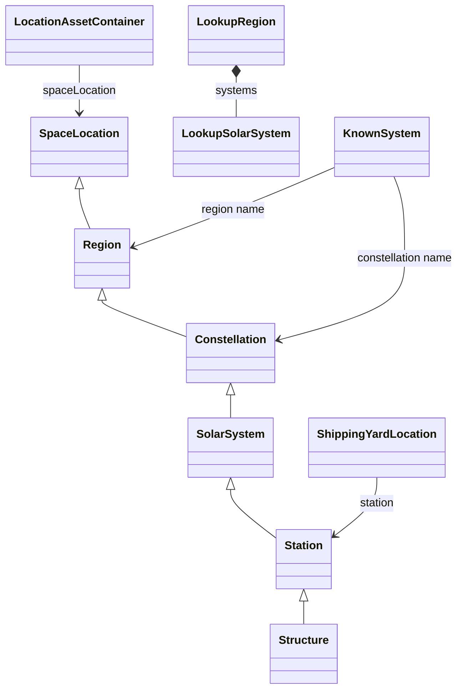
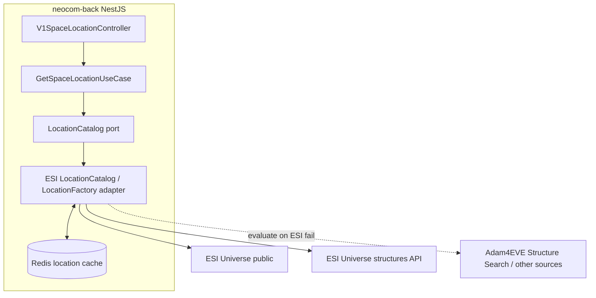

# EPIC-008 - LOCATIONS

## Spec traceability

| Field | Value |
| --- | --- |
| Status | 📤 `extracted` (prior OpenSpec still ✅ applied: `domain-locations`, `back-spacelocations`) |
| L2 | 📥 `L2/08.EPIC-LOCATIONS.md` (LOC-110); 📥 `L2/08.EPIC-LOCATIONS.space-location-service.md` (LOC-130…142). Placed (prior): `L2/DOMAIN/06.LOCATIONS.md`, `L2/BACK/BACK-SPACELOCATIONS.md` |
| OpenSpec changes | Applied: `domain-locations` `@ 477ee33`; `back-spacelocations` `@ 3317849`. New pending extract awaiting `/neo:spec-evolution` |
| Skip | Applied identity/lookup OpenSpec (LOC-001…060 / LOC-010) skipped. Still `to review`: LookupRegion, LookupSolarSystem, front stubs register, Section 15 register row. Re-extract only rows set back to `[x] reviewed` |
| Index | `L1/TRACEABILITY.md` · `L2/INDEX.md` |

## Table of contents

- [EPIC-008 - LOCATIONS](#epic-008---locations)
  - [Spec traceability](#spec-traceability)
  - [Table of contents](#table-of-contents)
    - [Section index](#section-index)
  - [Goals](#goals)
  - [Search criteria](#search-criteria)
    - [Card search (executive cards)](#card-search-executive-cards)
    - [Code search (legacy)](#code-search-legacy)
  - [Sources](#sources)
    - [FRONT](#front)
    - [BACK](#back)
    - [DATAMANAGEMENT](#datamanagement)
    - [TESTING](#testing)
  - [Section 01 — Location identity](#section-01--location-identity)
    - [Limitations](#limitations)
  - [Section 02 — Location register (review under this epic)](#section-02--location-register-review-under-this-epic)
    - [Iterative review](#iterative-review)
    - [Location hierarchy](#location-hierarchy)
  - [Section 03 — SpaceLocation](#section-03--spacelocation)
    - [Limitations](#limitations-1)
  - [Section 04 — Region](#section-04--region)
    - [Limitations](#limitations-2)
  - [Section 05 — Constellation](#section-05--constellation)
    - [Limitations](#limitations-3)
  - [Section 06 — Solar system](#section-06--solar-system)
    - [Limitations](#limitations-4)
  - [Section 07 — Station](#section-07--station)
    - [Limitations](#limitations-5)
  - [Section 08 — Structure](#section-08--structure)
    - [Limitations](#limitations-6)
  - [Section 09 — LocationAssetContainer](#section-09--locationassetcontainer)
    - [Limitations](#limitations-7)
  - [Section 10 — ShippingYardLocation](#section-10--shippingyardlocation)
    - [Limitations](#limitations-8)
  - [Section 11 — LookupRegion](#section-11--lookupregion)
    - [Appearance:](#appearance-v1-region) `v1-region`
    - [Limitations](#limitations-9)
  - [Section 12 — LookupSolarSystem](#section-12--lookupsolarsystem)
    - [Appearance:](#appearance-v1-solar-system) `v1-solar-system`
    - [Limitations](#limitations-10)
  - [Section 13 — KnownSystem](#section-13--knownsystem)
    - [Appearance:](#appearance-v1-planetary-system) `v1-planetary-system`
    - [Limitations](#limitations-11)
  - [Section 14 — Front location stubs](#section-14--front-location-stubs)
    - [Limitations](#limitations-12)
    - [Decision](#decision)
  - [Section 15 — Space location service (BACK-229)](#section-15--space-location-service-back-229)
    - [NestJS port (target)](#nestjs-port-target)
    - [Infinity facade (legacy source)](#infinity-facade-legacy-source)
    - [Catalog and factory (library)](#catalog-and-factory-library)
    - [ESI id ranges](#esi-id-ranges)
    - [Cache configuration (infinity)](#cache-configuration-infinity)
    - [Limitations](#limitations-13)
  - [Version card](#version-card)

### Section index

| Section                                                     | Title                                      |
| ----------------------------------------------------------- | ------------------------------------------ |
| [01](#section-01--location-identity)                        | Location identity                          |
| [02](#section-02--location-register-review-under-this-epic) | Location register (review under this epic) |
| [03](#section-03--spacelocation)                            | SpaceLocation                              |
| [04](#section-04--region)                                   | Region                                     |
| [05](#section-05--constellation)                            | Constellation                              |
| [06](#section-06--solar-system)                             | Solar system                               |
| [07](#section-07--station)                                  | Station                                    |
| [08](#section-08--structure)                                | Structure                                  |
| [09](#section-09--locationassetcontainer)                   | LocationAssetContainer                     |
| [10](#section-10--shippingyardlocation)                     | ShippingYardLocation                       |
| [11](#section-11--lookupregion)                             | LookupRegion                               |
| [12](#section-12--lookupsolarsystem)                        | LookupSolarSystem                          |
| [13](#section-13--knownsystem)                              | KnownSystem                                |
| [14](#section-14--front-location-stubs)                     | Front location stubs                       |
| [15](#section-15--space-location-service-back-229)          | Space location service (BACK-229)          |

---

## Goals

This will collect the specs to hadle all type of locations identifiing also their limitations ans serving as the test place for the development of that complex feature.

Sources for this pass: `neocom-infinity-backend/src` (serializers, lookup endpoint, corporation grouping, Guice wiring, location-cache properties) and `neocom-infinity-frontend/src` (location domain stubs and renders). Graphify on `neocom-infinity` was rebuilt before the BACK-229 search (`graphify update . --force` → 7910 nodes). The Java types `SpaceLocation`, `Station`, `Structure`, `LocationCatalogService`, and `LocationFactory` live in `neocom-datamanagement` (Guice dependency `com.github.AdamAntinoo:neocom-datamanagement`); Section 15 records that catalog/factory contract as used by the infinity facade. The published programme target remains **EveLocationV1** in [EPIC-004](04.EPIC-MODELS.md).

## Search criteria

Criteria for card collection and legacy-code backtracking, extracted from this epic.

### Card search (executive cards)

- Feature groups to match: `Universe & locations`, `ESI integration`, `Data & persistence`.
- Keywords: `location`, `region`, `constellation`, `solar system`, `station`, `structure`, `shipping yard`, `asset container`, `known system`, `lookup`, `market`, `corporation home`.
- Labels to prefer: `FRONTEND`, `BACKEND`, `STORY`, `NIF`, `INFINITY`.
- Assets are a **secondary** search: include asset cards only where they relate to a location (an asset container grouped under one place). Do **not** include asset definitions that are not location-related.

### Code search (legacy)

- Roots: `neocom-infinity-backend/src`, `neocom-infinity-frontend/src`. Library types are referenced from `neocom-datamanagement` (outside the legacy root; record the contract only).
- Classes (back): `SpaceLocationSerializer`, `SpaceLocationControllerV1`, `SpaceLocationServiceV1`, `NeoComDependencyConfig`, `LocationCatalogService`, `LocationFactory`, `ILocationFactoryPort`, `ILocationCatalogPort`, `SpaceLocationImplementation` (and its `Builder`), `StationSerializer`, `ShippingYardLocationSerializer`, `LocationAssetContainerSerializer`, `MarketServiceV1`, `CorporationServiceV1`, `Structure` (and its `Builder`).
- Config keys: `P.cache.locationscache.filename`, `P.cache.locationscache.activestate`, `P.cache.locationscache.writedown`.
- Classes (front): `SpaceLocationV1`, `Station`, `StationDto`, `LookupRegion`, `LookupSolarSystem`, `KnownSystem`, `SystemDto`, `PilotV2`, `PilotV2Dto`.
- Renders/selectors: `v1-region`, `v1-solar-system`, `v1-planetary-system`, `v2-node-container`, `v1-planet-data`.
- Flows: location lookup `GET /api/v1/universe/spacelocations/{locationId}`; corporation assets grouped by location (`CorporationServiceV1.getCorporationAssetsByLocation`); market / corporation home-station resolution (`MarketServiceV1`); shipping-yard detection (asset label prefix `ShipYard`, office location is a `Station`).
- `locationType` values: `REGION`, `CONSTELLATION`, `SOLAR_SYSTEM`, `STATION`, `STRUCTURE`.
- Fixtures: region `1000043`, constellation `20000322`, system `30002187`, station `60008494`.

## Sources

> Only `[selected]` cards stay here. A card that is `returned`, `out of scope`, or `deleted` is removed from this file and tracked by its state in `sources/L0/executive/INDEX.md`.

### FRONT

- [selected] `FRONT-298` [When entering the page there is a single panel with the list of Regions and a field to filter the systems by name.](https://trello.com/c/aWyS05zK/858-nif0801-when-entering-the-page-there-is-a-single-panel-with-the-list-of-regions-and-a-field-to-filter-the-systems-by-name) · _NIF08.01_ · `BACKLOG`
- [selected] `FRONT-299` [If the length of the search field reaches the the list of regions is replaced by a list of systems matching that filter in their names.](https://trello.com/c/qhfrWyJf/859-nif0802-if-the-length-of-the-search-field-reaches-the-the-list-of-regions-is-replaced-by-a-list-of-systems-matching-that-filter) · _NIF08.02_ · `BACKLOG`
- [selected] `FRONT-300` [System information should provide the Region->Constellation->System. The hover over each of the localtion path names should provide the location unique identifier.](https://trello.com/c/YkE6PeOP/1113-story-nif-system-information-should-provide-the-region-constellation-system-the-hover-over-each-of-the-localtion-path-names-shou) · _STORY-NIF_ · `MPV-Prepare`
- [selected] `FRONT-301` [When data in entered on the selection field then systems matching that selection are listed on the second panel.](https://trello.com/c/UDmM09wz/854-story-when-data-in-entered-on-the-selection-field-then-systems-matching-that-selection-are-listed-on-the-second-panel) · _STORY_ · `BACKLOG`
- [selected] `FRONT-132` [Get the list of clones, their locations, the type of the location and the Region they are located.](https://trello.com/c/qMmo8oxc/500-character-get-the-list-of-clones-their-locations-the-type-of-the-location-and-the-region-they-are-located) · _CHARACTER_ · `BACKLOG`

### BACK

- [selected] `BACK-229` [Create a new space location service to manage the location list and the location storage.](https://trello.com/c/CvD7LwY8/87-backend-create-a-new-space-location-service-to-manage-the-location-list-and-the-location-storage) · _BACKEND_ · `BACKLOG` → developed in [Section 15](#section-15--space-location-service-back-229)
- [selected] `BACK-230` [If during initialization we detect that there are no Locations pre-loaded we should launch the jobs to process the Citadel and Outpost locations.](https://trello.com/c/scNCdO6a/110-backend-if-during-initialization-we-detect-that-there-are-no-locations-pre-loaded-we-should-launch-the-jobs-to-process-the-citad) · _BACKEND_ · `BACKLOG`
- [selected] `BACK-238` [Locations require additional endpoints to aggregate the location path.](https://trello.com/c/ENp6ojZc/1111-story-nin-locations-require-additional-endpoints-to-aggregate-the-location-path) · _STORY-NIN_ · `to TEST`
- [selected] `BACK-217` [Generate the serialization for a corporation location home station and add this to the corporation record.](https://trello.com/c/XvRXUeJp/243-backend-generate-the-serialization-for-a-corporation-location-home-station-and-add-this-to-the-corporation-record) · _BACKEND_ · `BACKLOG`
- [selected] `BACK-188` [Add the current pilot location to the Pilot data. This is a secured endpoint so it should be provided through the backend api.](https://trello.com/c/uD8kPV6p/85-backendrefactor-add-the-current-pilot-location-to-the-pilot-data-this-is-a-secured-endpoint-so-it-should-be-provided-through-the) · _BACKEND · REFACTOR_ · `BACKLOG`

### DATAMANAGEMENT

- [selected] `DATAMANAGEMENT-087` [Decide what is the right result when a location is not found on request.](https://trello.com/c/5vxxv5NA/245-datamanagement-decide-what-is-the-right-result-when-a-location-is-not-found-on-request) · _DATAMANAGEMENT_ · `BACKLOG`
- [selected] `DATAMANAGEMENT-092` [Replace the method 'locationProcessing' by one that does not complete the functionality by implementing side effects.](https://trello.com/c/DaYgLOgQ/297-datamanagement-replace-the-method-locationprocessing-by-one-that-does-not-complete-the-functionality-by-implementing-side-effect) · _DATAMANAGEMENT_ · `BACKLOG`

### TESTING

None.

## Section 01 — Location identity

A location in infinity is one node in a chain. The most specific level that was supplied sets `locationType` and `locationId`. Ancestor levels are copied onto the same object.

`SpaceLocationSerializer` writes that chain with a `switch` that has no `break`. A station payload therefore also contains the solar system, constellation, and region. A structure payload also contains station fields.

| `locationType`  | `locationId` is  | Also present                                                               |
| --------------- | ---------------- | -------------------------------------------------------------------------- |
| `REGION`        | region id        | region id and name                                                         |
| `CONSTELLATION` | constellation id | constellation, then region                                                 |
| `SOLAR_SYSTEM`  | solar system id  | system, security, then constellation and region                            |
| `STATION`       | station id       | station, then system, constellation, and region                            |
| `STRUCTURE`     | structure id     | structure and corporation, then station, system, constellation, and region |

Lookup is one call for every kind: `GET /api/v1/universe/spacelocations/{locationId}` (`SpaceLocationControllerV1` → `LocationCatalogService.searchLocation4Id`). The kind is not part of the path.

| ID      | Status       | Requirement                                                                                                                                                                             |
| ------- | ------------ | --------------------------------------------------------------------------------------------------------------------------------------------------------------------------------------- |
| LOC-001 | [x]     | A published location SHALL name its kind. Infinity does this with `locationType` (`LocationIdentifierType`) and uses the most specific id as `locationId`                               |
| LOC-002 | [x]     | A deeper location SHALL carry its ancestor place (region, and constellation or system when those levels exist) so a render can show the chain without a second lookup                   |
| LOC-003 | out of scope | Planets, ships, and cargo holds are not `locationType` values in this serializer. Planetary bodies use **KnownSystem** / planet renders. Asset grouping uses **LocationAssetContainer** |

### Limitations

- The serializer fall-through makes a structure look like a station: the structure fixture writes `stationId` and `stationName` with the structure’s own id and name (`SpaceLocationSerializerTest.serializeSTRUCTURE`).
- Two JSON names exist for the system. The live serializer writes `solarSystemId` / `solarSystemName`. The acceptance `SpaceLocationJson` and the front `StationDto` use `systemId` / `systemName` and omit `locationType`.
- `StationSerializer` is `@Deprecated` and is not registered as a `JsonComponent`. `ShippingYardLocationSerializer` is `@Deprecated` and is still a `JsonComponent`.

## Section 02 — Location register (review under this epic)

New reviews of location requirements are tied to EPIC-008. Rows stay `to review` until a later pass marks them `reviewed`.

The two special-location models — **LocationAssetContainer** (assets grouped under one space location) and **ShippingYardLocation** (corporation yard: deposit + office + station) — are **out of scope** for this pure-locations epic. They will be reused when the assets or ships epics are treated.

| Model                                                         | Role                                                            | Review       |
| ------------------------------------------------------------- | --------------------------------------------------------------- | ------------ |
| [SpaceLocation](#section-03--spacelocation)                   | Lookup node: kind + id + ancestor chain                         | extracted    |
| [Region](#section-04--region)                                 | `REGION` level                                                  | extracted    |
| [Constellation](#section-05--constellation)                   | `CONSTELLATION` level                                           | extracted    |
| [Solar system](#section-06--solar-system)                     | `SOLAR_SYSTEM` level, with security                             | extracted    |
| [Station](#section-07--station)                               | `STATION` level; dockable NPC station                           | extracted    |
| [Structure](#section-08--structure)                           | `STRUCTURE` level; player structure                             | extracted    |
| [LocationAssetContainer](#section-09--locationassetcontainer) | Assets grouped under one space location                         | out of scope |
| [ShippingYardLocation](#section-10--shippingyardlocation)     | Corporation yard: deposit + office + station                    | out of scope |
| [LookupRegion](#section-11--lookupregion)                     | Front region list for system lookup (`v1-region`)               | [ ]    |
| [LookupSolarSystem](#section-12--lookupsolarsystem)           | Front system row inside a lookup region (`v1-solar-system`)     | [ ]    |
| [KnownSystem](#section-13--knownsystem)                       | Planetary system card (`v1-planetary-system`)                   | [ ]    |
| [Front stubs](#section-14--front-location-stubs)              | Empty `SpaceLocationV1` and `Station`; `StationDto` field names | out of scope |
| [Space location service](#section-15--space-location-service-back-229) | Java → NestJS hexagonal port of catalog/factory (BACK-229) | [ ]    |

### Iterative review

| Review         | Meaning for the next extract                                                                   |
| -------------- | ---------------------------------------------------------------------------------------------- |
| `to review`    | Pending. Leave the section in this file.                                                       |
| `reviewed`     | This iteration. Extract that section.                                                          |
| `extracted`    | Already extracted to L2.                                                                       |
| `out of scope` | Not part of this epic. Leave the section here; it is reused by another epic (assets or ships). |
| `superseded`   | Do not extract.                                                                                |
| `out of scope` | Do not extract.                                                                                |

### Location hierarchy

The class diagram is the nesting the serializer encodes. `Structure` is built with `Structure.Builder`, which still runs the station/system/constellation/region chain. Lookup and known-system types are front list models; they are not `locationType` values.

## Section 03 — SpaceLocation

Source: `SpaceLocationSerializer`, `SpaceLocationControllerV1`, `SpaceLocationServiceV1`. Domain type in the library: `org.dimensinfin.eveonline.neocom.domain.space.SpaceLocation` / `SpaceLocationImplementation`.

| Field          | Type                          | Notes                                                             |
| -------------- | ----------------------------- | ----------------------------------------------------------------- |
| `locationType` | `LocationIdentifierType` name | `REGION`, `CONSTELLATION`, `SOLAR_SYSTEM`, `STATION`, `STRUCTURE` |
| `locationId`   | number                        | Id of the most specific level                                     |

`IndustryJob` holds two of these: `blueprintLocation` and `jobLocation`. Market lookup resolves a corporation home station id through the same catalog (`MarketServiceV1`).

| ID      | Status       | Requirement                                                                                                                                |
| ------- | ------------ | ------------------------------------------------------------------------------------------------------------------------------------------ |
| LOC-010 | [x]     | `GET /api/v1/universe/spacelocations/{locationId}` SHALL return one `SpaceLocation` for that id                                            |
| LOC-011 | out of scope | Callers that need a place (industry job, market hub, pilot last location, asset group) SHALL use this node, not a separate id with no kind |

### Limitations

- The response kind depends on what the catalog stored for that id. The endpoint does not accept a kind.
- The front type `SpaceLocationV1` declares no fields, so a resolved HAL body is not read (Section 14).

## Section 04 — Region

`locationType = REGION`. Builder: `SpaceLocationImplementation.Builder.withRegion`.

| Field          | Type   | Notes              |
| -------------- | ------ | ------------------ |
| `locationType` | string | `REGION`           |
| `locationId`   | number | Same as `regionId` |
| `regionId`     | number |                    |
| `regionName`   | string |                    |

Fixture from `SpaceLocationSerializerTest`: region **1000043** Domain.

| ID      | Status   | Requirement                                                                                         |
| ------- | -------- | --------------------------------------------------------------------------------------------------- |
| LOC-020 | [x] | A region location SHALL expose `regionId` and `regionName`, and `locationId` SHALL be the region id |

### Render: v1-region (seed available)

Seed render: `neocom-infinity-frontend/src/app/modules/renders/v1-region-render/`

**RegionV1 Render Specification:**

- **Render selector:** `v1-region`
- **Variant:** `-SOLAR-SYSTEM-LOOKUP-` (yellow panel)
- **Style class:** `panel-yellow`
- **Icon:** Systems icon (40px, `assets/res-sde/drawable/systems.png`)
- **Display fields:**
  - Label: `REGION` → Value: Region name (uppercase)
  - Label: `SISTEMAS` → Value: System count
- **Cy-tags:** `cy-field-label`, `cy-field-value` (for Cypress testing)

**Source image:** To be captured from seed render: `media/v1-region-lookup.png`

### Limitations

- There is no `v1-region` binding for the space **Region** type. The application uses **LookupRegion** (Section 11) for the lookup list.
- RegionV1 is the domain model; the frontend uses it for location references and ancestor chains.

## Section 05 — Constellation

`locationType = CONSTELLATION`. Builder adds `withConstellation` on top of a region.

| Field               | Type   | Notes                     |
| ------------------- | ------ | ------------------------- |
| `locationType`      | string | `CONSTELLATION`           |
| `locationId`        | number | Same as `constellationId` |
| `constellationId`   | number |                           |
| `constellationName` | string |                           |
| `regionId`          | number | Ancestor                  |
| `regionName`        | string | Ancestor                  |

Fixture: constellation **20000322** Throne Worlds, inside Domain.

| ID      | Status   | Requirement                                                                            |
| ------- | -------- | -------------------------------------------------------------------------------------- |
| LOC-030 | [x] | A constellation location SHALL expose constellation id and name plus the parent region |

### Limitations

- No dedicated front render. Known-system cards print the constellation name as text inside the location line.

## Section 06 — Solar system

`locationType = SOLAR_SYSTEM`. Builder adds `withSolarSystem`.

| Field               | Type   | Notes                                                       |
| ------------------- | ------ | ----------------------------------------------------------- |
| `locationType`      | string | `SOLAR_SYSTEM`                                              |
| `locationId`        | number | Same as `solarSystemId`                                     |
| `solarSystemId`     | number | Serializer name. Front `StationDto` calls this `systemId`   |
| `solarSystemName`   | string | Serializer name. Front `StationDto` calls this `systemName` |
| `securityClass`     | string | Example `E1`                                                |
| `securityStatus`    | number | Example `0.5623334`                                         |
| `constellationId`   | number | Ancestor                                                    |
| `constellationName` | string | Ancestor                                                    |
| `regionId`          | number | Ancestor                                                    |
| `regionName`        | string | Ancestor                                                    |

Fixture: system **30002187** Amarr.

| ID      | Status   | Requirement                                                                                                                |
| ------- | -------- | -------------------------------------------------------------------------------------------------------------------------- |
| LOC-040 | [x] | A solar-system location SHALL expose system id, name, `securityClass`, and `securityStatus`, plus constellation and region |

### Render: v1-solar-system (seed available)

Seed render: `neocom-infinity-frontend/src/app/modules/renders/v1-solar-system-render/`

**SolarSystemV1 Render Specification:**

- **Render selector:** `v1-solar-system`
- **Variant:** `-SOLAR-SYSTEM-LOOKUP-` (orange panel)
- **Style class:** `panel-orange`
- **Icon:** Systems icon (40px, `assets/res-sde/drawable/systems.png`)
- **Display fields:**
  - Label: `SISTEMA` → Value: System name (uppercase)
  - Label: `SISTEMAS` → Value: System info (future: security status)
- **Cy-tags:** `cy-field-label`, `cy-field-value` (for Cypress testing)
- **Note:** Security class and security status are on the model but not shown in the lookup variant; reserved for future detail variant

**Source image:** To be captured from seed render: `media/v1-solar-system-lookup.png`

### Limitations

- Security is absent from `StationDto` and from `SpaceLocationJson`.
- The lookup variant (`-SOLAR-SYSTEM-LOOKUP-`) does not show security; a future variant will expose it for detail views.
- `v1-solar-system` in the lookup context renders **LookupSolarSystem** (Section 12), not the full SolarSystemV1.

## Section 07 — Station

`locationType = STATION`. Builder adds `withStation`. A station is the dockable NPC place used as a shipping-yard site and as a market/home station.

| Field                                 | Type   | Notes                           |
| ------------------------------------- | ------ | ------------------------------- |
| `locationType`                        | string | `STATION`                       |
| `locationId`                          | number | Same as `stationId`             |
| `stationId`                           | number |                                 |
| `stationName`                         | string |                                 |
| (solar system, constellation, region) |        | Ancestor fields from Section 06 |

Fixture: station **60008494** Amarr VIII (Oris) - Emperor Family Academy.

Front `StationDto` (`domain/core/dto/StationDto.dto.ts`) stores `locationId`, region, constellation, `systemId`, `systemName`, `stationId`, `stationName`. `getStationName()` is the only accessor. `MarketOrderDto.station` and `BuildActionDto.corporationHome` use this DTO.

| ID      | Status   | Requirement                                                                                               |
| ------- | -------- | --------------------------------------------------------------------------------------------------------- |
| LOC-050 | [x] | A station location SHALL expose station id and name plus the system, constellation, and region it sits in |
| LOC-051 | [x] | A shipping yard and a corporation home station SHALL resolve to a **Station**, not to a bare id           |

### Limitations

- `Station` on the front (`domain/location/Station.domain.ts`) is an empty `NeoCom` subclass. The fields live on `StationDto`.
- `StationDto` has no `locationType` and renames the system fields (Section 01).

## Section 08 — Structure

`locationType = STRUCTURE`. Builder: `Structure.Builder.withStructure(structureId, esiStructure).withCorporation(corporationId, corporationName)`, after the station chain.

| Field                                 | Type   | Notes                                                             |
| ------------------------------------- | ------ | ----------------------------------------------------------------- |
| `locationType`                        | string | `STRUCTURE`                                                       |
| `locationId`                          | number | Same as `structureId`                                             |
| `structureId`                         | number |                                                                   |
| `structureName`                       | string |                                                                   |
| `ownerId`                             | number | ESI structure owner                                               |
| `structureTypeId`                     | number |                                                                   |
| `corporationId`                       | number |                                                                   |
| `corporationName`                     | string |                                                                   |
| `stationId`                           | number | Written by fall-through. In the fixture it equals `structureId`   |
| `stationName`                         | string | Written by fall-through. In the fixture it equals `structureName` |
| (solar system, constellation, region) |        | Ancestor fields                                                   |

| ID      | Status   | Requirement                                                                                                                 |
| ------- | -------- | --------------------------------------------------------------------------------------------------------------------------- |
| LOC-060 | [x] | A structure location SHALL expose structure id, name, type id, owner id, and corporation id and name, plus the system chain |

### Limitations

- Station fields on a structure are not a second place. They repeat the structure id and name.
- A shipping yard ignores a structure: `getCorporationShippingYards` keeps the yard only when `location instanceof Station`.

## Section 09 — LocationAssetContainer

Source: `LocationAssetContainerSerializer`. Groups corporation assets that share one place (`CorporationServiceV1.getCorporationAssetsByLocation`).

| Field           | Type          | Notes                    |
| --------------- | ------------- | ------------------------ |
| `jsonClass`     | string        | From `getJsonClass()`    |
| `spaceLocation` | SpaceLocation | The place for this group |
| `containerType` | string        | `getType().name()`       |
| `contents`      | list          | Nested asset containers  |

| ID      | Status       | Requirement                                                                                                                  |
| ------- | ------------ | ---------------------------------------------------------------------------------------------------------------------------- |
| LOC-070 | out of scope | Corporation assets grouped by place SHALL carry the **SpaceLocation** of that place, a container type name, and the contents |

### Limitations

- No front render selects this `jsonClass`.
- `containerType` values are defined in the datamanagement library, not in infinity `src`.

## Section 10 — ShippingYardLocation

Source: `infinity.backend.corporation.domain.ShippingYardLocation`. A yard is a corporation asset whose user label starts with `ShipYard`, whose parent office asset exists, and whose office location is a **Station**.

| Field             | Type     | Notes                                                                                     |
| ----------------- | -------- | ----------------------------------------------------------------------------------------- |
| `jsonClass`       | string   | Serializer field                                                                          |
| `deposit`         | NeoAsset | Required. `withYardDeposit`                                                               |
| `officeContainer` | NeoAsset | Required. `withOfficeContainer`                                                           |
| `station`         | Station  | Set by `withStation`. The service only builds a yard when the catalog returns a `Station` |

| ID      | Status       | Requirement                                                                                               |
| ------- | ------------ | --------------------------------------------------------------------------------------------------------- |
| LOC-080 | out of scope | A shipping yard SHALL bind a deposit asset, an office container asset, and the **Station** of that office |

### Limitations

- `withStation(null)` throws. Omitting `withStation` leaves `station` null; `build()` only checks deposit and office.
- Yards are detected by the label prefix `ShipYard`, not by a location kind.
- The serializer is deprecated and still registered.

## Section 11 — LookupRegion

Front list model for picking a region while looking up systems. Source: `modules/planetary/domain/LookupRegion.domain.ts`. `jsonClass = 'LookupRegion'`. Not a `locationType`.

### Appearance: `v1-region`

Selector `v1-region`. Only the variant `-SOLAR-SYSTEM-LOOKUP-` is drawn (`panel-yellow`).

| Shown    | Source                                 |
| -------- | -------------------------------------- |
| REGION   | `getName()` → `name`                   |
| SISTEMAS | `getSystemsCount()` → `systems.length` |
| Icon     | `assets/res-sde/drawable/systems.png`  |

`collaborate2View` returns `systems` when expanded, otherwise the region itself. `v2-node-container` mounts this render when `jsonClass === 'LookupRegion'`.

| Field     | Type                  | Notes |
| --------- | --------------------- | ----- |
| `name`    | string                |       |
| `systems` | `LookupSolarSystem[]` |       |

| ID      | Status       | Requirement                                                                                                                       |
| ------- | ------------ | --------------------------------------------------------------------------------------------------------------------------------- |
| LOC-090 | out of scope | The region lookup card SHALL show the region name and how many systems it holds, and SHALL expand into **LookupSolarSystem** rows |

### Limitations

- `getUniqueId()` returns `0` for every region.
- This card is not the space **Region** of Section 04. It has no region id.

## Section 12 — LookupSolarSystem

Source: `modules/planetary/domain/LookupSolarSystem.domain.ts`. `jsonClass = 'LookupSolarSystem'`.

### Appearance: `v1-solar-system`

Selector `v1-solar-system`. Only the variant `-SOLAR-SYSTEM-LOOKUP-` is drawn (`panel-orange`).

| Shown    | Source                                |
| -------- | ------------------------------------- |
| SISTEMA  | `getName()` → `systemName`            |
| SISTEMAS | also `getName()`                      |
| Icon     | `assets/res-sde/drawable/systems.png` |

| Field        | Type   | Notes                                    |
| ------------ | ------ | ---------------------------------------- |
| `systemName` | string | `getName()`                              |
| `region`     | string | `getRegion()`. Not shown on this variant |
| `security`   | number | Not shown on this variant                |

| ID      | Status    | Requirement                                                                                              |
| ------- | --------- | -------------------------------------------------------------------------------------------------------- |
| LOC-100 | [ ] | A lookup system row SHALL show the system name. Region and security are on the model for a later variant |

### Limitations

- The SISTEMAS value is the system name again, not a count.
- No system id. This is not the space **Solar system** of Section 06.

## Section 13 — KnownSystem

Source: `domain/planetary/KnownSystem.domain.ts`. `jsonClass = 'KnownSystem'`. Planetary list of systems the pilot works, not the universe catalog node.

### Appearance: `v1-planetary-system`

Selector `v1-planetary-system`. Variant `-COIL-LIST-` (`panel-blue`). Click calls `selectSystem()` on the known-systems panel.

| Shown       | Source                                   |
| ----------- | ---------------------------------------- |
| SYSTEM NAME | `systemName`                             |
| LOCATION    | `regionName + ' > ' + constellationName` |
| SECURITY    | `securityClass + ' - ' + securityLevel`  |
| PLANETS     | `planetCount` / `planetInfoCount()`      |
| Icon        | `assets/res-sde/drawable/systems.png`    |

| Field               | Type   | Notes           |
| ------------------- | ------ | --------------- |
| `systemId`          | number | `getUniqueId()` |
| `systemName`        | string |                 |
| `constellationId`   | number |                 |
| `constellationName` | string |                 |
| `regionId`          | number |                 |
| `regionName`        | string |                 |
| `securityLevel`     | number |                 |
| `securityClass`     | string |                 |
| `planetCount`       | number |                 |

`SystemDto` carries the same place and security fields without `planetCount`.

| ID      | Status | Requirement                                                                                                      |
| ------- | ------ | ---------------------------------------------------------------------------------------------------------------- |
| LOC-110 | extracted    | A known-system card SHALL show system name, `region > constellation`, security class and level, and planet count |

### Limitations

- `planetInfoCount()` returns the constant `1`, so the second planet figure is not data.
- Planet bodies themselves use `v1-planet-data` (`-KNOWN-PLANETS-`, `-SELECTED-PLANETS-`: name and class). That render is a planetary body, not a `SpaceLocation`.

## Section 14 — Front location stubs

| Type                           | Path                                        | What the file holds                                  |
| ------------------------------ | ------------------------------------------- | ---------------------------------------------------- |
| `SpaceLocationV1`              | `domain/location/SpaceLocationV1.domain.ts` | Empty class                                          |
| `Station`                      | `domain/location/Station.domain.ts`         | Empty `NeoCom` subclass                              |
| `StationDto`                   | `domain/core/dto/StationDto.dto.ts`         | Station chain with `systemId` / `systemName`         |
| `PilotV2.lastKnownLocation`    | `domain/character/PilotV2.domain.ts`        | Typed as `SpaceLocationV1`                           |
| `PilotV2Dto.lastKnownLocation` | `domain/dto/PilotV2Dto.dto.ts`              | `HALLink<SpaceLocationV1>` resolved by `halResolver` |

| ID      | Status    | Requirement                                                                                                                                                             |
| ------- | --------- | ----------------------------------------------------------------------------------------------------------------------------------------------------------------------- |
| LOC-120 | [ ] | The front location type that receives `GET /api/v1/universe/spacelocations/{id}` SHALL read `locationType`, `locationId`, and the ancestor fields the serializer writes |
| LOC-121 | [ ] | `PilotV2.lastKnownLocation` SHALL be that location type, not an empty class                                                                                             |

### Limitations

- `SpaceLocationV1` cannot show a pilot’s last place: the HAL resolve callback assigns a type with no fields.
- `Station` and `StationDto` are two shapes. Renders that need a station today have the DTO fields and not `locationType`.

### Decision

- **Do not use HAL to implement any of the data structures.** HAL adds excessive complexity for the location types. `SpaceLocationV1` declares no fields, so a resolved HAL body is not read anyway (`PilotV2Dto.lastKnownLocation` is typed `HALLink<SpaceLocationV1>` but resolves to an empty class).

## Section 15 — Space location service (BACK-229)

Card: `BACK-229` — create a space location service that manages the location list and location storage.

**Intent:** keep the **overall architecture** proven in infinity / `neocom-datamanagement` (HTTP facade → catalog → factory → ESI Universe, with injectable storage), and **port that behaviour into NestJS `neocom-back`** under the programme’s hexagonal rules. Legacy Java is the behavioural source; Nest types below are the coding targets. Do not invent ESI fields or id bands beyond what the Java factory already uses.

Already on `neocom-back` (applied `back-spacelocations`): `V1SpaceLocationController` → `GetSpaceLocationUseCase` → `LocationCatalog` port, currently still bound to `**InMemoryLocationCatalog**` (Amarr fixture only). That in-memory adapter is **not** the target: BACK-229 / DEF-BLP-001 / LOC-137 require ESI + **Redis** persistence; tests preload Redis (or the same cache adapter) instead of a separate memory catalog.

Legacy shape: thin Spring facade over Guice `LocationCatalogService`; factory builds from public (or authenticated) ESI by id range; cache keys `Locations.cache.store` / `writedown=citadelupdate`.

Graphify path (legacy): `SpaceLocationControllerV1` → `SpaceLocationServiceV1.getLocationById` → `LocationCatalogService` via `NeoComDependencyConfig.dependency_12_LocationCatalogService`. Consumers: `MarketServiceV1`, `CorporationServiceV1`, `FittingBuildConfigurationServiceV1`, `SupportMiningRepository`, `IndustryBuildProcessor`, `JobServicePackager`.

### NestJS port (target)

Destination: `**neocom-back**`. Domain field contract stays aligned with `neocom-domain` / Sections 01–08. No HAL. No Guice — Nest modules + `@Inject` tokens.

#### Layer mapping (same responsibilities)

| Legacy (Java) | NestJS / hexagonal target | Notes |
| --- | --- | --- |
| `SpaceLocationControllerV1` | `V1SpaceLocationController` (`infrastructure/adapters/inbound/universe/`) | `GET /api/v1/universe/spacelocations/:locationId`; kind not in path (LOC-010) |
| `SpaceLocationServiceV1` | `GetSpaceLocationUseCase` (`application/use-cases/`) | Application entry; other use cases **compose** this one (BLP-030) — do **not** reimplement catalog logic |
| `LocationCatalogService` / `ILocationCatalogPort` | `LocationCatalog` port (`domain/ports/location-catalog.port.ts`, token `LOCATION_CATALOG`) | Resolve-by-id; signal absence without throwing |
| `LocationFactory` / `ILocationFactoryPort` | Outbound ESI location factory/adapter under `infrastructure/adapters/outbound/spacelocation/` | Same id-range build as Java; may live inside the ESI catalog adapter |
| Guice + Spring `@Bean` | `SpaceLocationModule` binding for `LOCATION_CATALOG` | Runtime: ESI + Redis; tests preload Redis — **no** `InMemoryLocationCatalog` |
| `SpaceLocation` / `SpaceLocationImplementation` | Domain `SpaceLocation` (+ `SpaceLocationV1Dto` on the wire where needed) | `jsonClass: 'SpaceLocation'` |
| Retrofit `UniverseApi` | Nest ESI client / `@lgriffin/esi.ts` (or current universe outbound) | Public vs authenticated structure split unchanged |
| `Locations.cache.store` / injectable storage | **Redis** location-cache adapter behind the catalog port (`REDIS_URL`, same Redis already used for BullMQ/SSE on `neocom-back`) | Store **complete** `SpaceLocation` by id; also cache resolved hierarchy ancestors under their ids (LOC-141); ESI remains the miss path |

#### Project-specific rules

- **Hexagonal only:** controllers and ESI HTTP in infrastructure; use cases and ports in application/domain.
- **Compose use cases:** blueprint list (and later consumers) call `GetSpaceLocationUseCase`, not copied factory/id-range code (BLP-030).
- **Miss handling:** use case maps catalog miss → `NeocomBackendError` `LOCATION_NOT_FOUND` (HTTP 404); port may use `undefined`/empty for absence.
- **ESI + Redis only:** runtime resolves via ESI and persists in Redis (DEF-BLP-001 / LOC-137 / LOC-140). Do **not** keep an `InMemoryLocationCatalog`; tests preload known ids into Redis (same persistence path).
- **Complete location + Redis:** resolution returns a full `SpaceLocation` (all kind fields + ancestor chain). That same complete payload is what Redis stores; on write-through, hierarchy dependencies (region / constellation / system / station as applicable) are resolved and also cached under their own ids (LOC-140 / LOC-141).
- **Structures via ESI:** game and public structures resolve through the ESI Universe **structures** API (LOC-132); cookie auth applies when ESI requires it (LOC-135).
- **External structure fallback (evaluate):** if official ESI structure calls fail, evaluate third-party sources such as **Adam4EVE Structure Search** before giving up (LOC-142) — decision and adapter design stay open until that evaluation.
- **No HAL** for location bodies (Section 14). Keep EPIC-008 field names (`solarSystemId` / `solarSystemName`, `locationType`).

### Infinity facade (legacy source)

| Element | Path | Role |
| --- | --- | --- |
| `SpaceLocationControllerV1` | `backend/universe/spacelocations/rest/v1/` | `GET /api/v1/universe/spacelocations/{locationId}` → HTTP 200 + `SpaceLocation` |
| `SpaceLocationServiceV1` | same package | `@Service`; one method `getLocationById(Long)` → `locationCatalogService.searchLocation4Id(locationId)` |
| `NeoComDependencyConfig` | `config/NeoComDependencyConfig.java` | Guice injector (`DMServicesDependenciesModule` + `NeoComInfinityBackendDependenciesModule`); `@Bean` exposes `LocationCatalogService` to Spring |

Legacy Java did not pass a `Credential` on the public path. Nest **does** resolve authenticated structure bands using the pilot session already carried by the front’s access **cookie** (`neocom_access` / `AccessCookieMiddleware`) — auth is implicit on the request, not a path/query parameter (LOC-135).

### Catalog and factory (library)

`LocationCatalogService` (javadoc): locations should be cached, with a scheduled dump of the current location list, and storage injectable per environment; Heroku-style targets may skip persistence; **by default the location list is not persisted**. Current class body: constructor injects `ILocationFactoryPort` only; no list add/remove/persist methods. Nest SHALL preserve this **architecture** (catalog + factory + optional store), not the Java class names.

| Method | Status | Behaviour observed |
| --- | --- | --- |
| `lookupLocation4Id(Long, Credential)` | preferred | id `> 64e6` → `buildUpStructure4Pilot`; else `buildUpLocation4LocationId`; returns `Optional` (empty on failure) |
| `searchLocation4Id(Long)` | `@Deprecated` | same public-location factory path; returns `location.orElse(null)` |
| `searchStructure4Id(Long, Credential)` | `@Deprecated` | wraps `lookupLocation4Id` |
| `searchLocation4Id(LocationIdentifier, Credential)` | `@Deprecated` | structure vs public branch on `spaceIdentifier > 64e6` |

`ILocationCatalogPort` only declares `lookupLocation4Id`. `ILocationFactoryPort` declares `buildUpLocation4LocationId` and `buildUpStructure4Pilot`.

`LocationFactory` uses `RetrofitService` + ESI `UniverseApi` only (no SDE repository in this class). Public calls use `accessUniverseConnector()`; structure calls use `accessAuthenticatedConnector(credential)`.

### ESI id ranges

`LocationFactory.buildUpLocation4LocationId` selects the ESI resource from the numeric id. The Nest ESI factory/adapter SHALL use the **same** bands and ancestor assembly:

| Condition | Kind built | ESI calls |
| --- | --- | --- |
| `locationId < 20_000_000` | Region | `getUniverseRegionsRegionId` |
| `locationId < 30_000_000` | Constellation | constellation + parent region |
| `locationId < 40_000_000` | Solar system | system + constellation + region |
| `locationId < 61_000_000` | Station | station + system + constellation + region |
| else (in this method) | — | returns empty (no structure build here) |

`buildUpStructure4Pilot`: `getUniverseStructuresStructureId` (authenticated) + system + constellation + region; `Structure.Builder` sets corporation name placeholder `"-TO-DE-DEFINED-"`. Runtime failures log and return empty.

Catalog tests name the factory path `*_not_cached` and verify one factory call per lookup (no hit path asserted).

### Cache configuration (infinity)

Present in every environment `cache.properties` under the backend:

| Key | Typical value | Notes |
| --- | --- | --- |
| `P.cache.locationscache.filename` | `Locations.cache.store` | Also `PropertiesDefinitionsConstants.LOCATIONS_CACHE_LOCATION` in the library |
| `P.cache.locationscache.activestate` | `true` | `LOCATIONS_CACHE_STATE` |
| `P.cache.locationscache.writedown` | `citadelupdate` | Ties to citadel/outpost preload intent (see BACK-230); no writer located in the infinity `src/main` tree for this pass |

Library constant `GlobalWideConstants.SPACE_LOCATIONS_CACHE_TTL = 12` exists; this pass did not find a call site that applies it inside the current `LocationCatalogService` / `LocationFactory`. Nest replaces the file-store concept with **Redis** (LOC-140); it is not required to copy the Java property names.

### Consumers (infinity → Nest reuse rule)

| Consumer (legacy) | Use of catalog | Nest direction |
| --- | --- | --- |
| `SpaceLocationServiceV1` | public lookup endpoint | `GetSpaceLocationUseCase` |
| `MarketServiceV1.accessCorporationHomeRegionId` | home station → `Station` | later: compose space-location use case |
| `CorporationServiceV1.getCorporationShippingYards` | office → `Station` only | later / out of scope here |
| `GetMarketsRegionIdOrdersToMarketOrderConverter` | market order → `Station` | later |
| `FittingBuildConfigurationServiceV1` / `IndustryBuildProcessor` | home station / region | later |
| `SupportMiningRepository` / `JobServicePackager` | extractions / jobs | later |
| Blueprint list processing (Nest) | embed location on blueprint | **already** → `GetSpaceLocationUseCase` (BLP-015 / BLP-030); needs ESI catalog (DEF-BLP-001) |

| ID      | Status | Requirement                                                                                                                                                                                                                                                                                                                                                                                                                                                                                                                                                        |
| ------- | ------ | ------------------------------------------------------------------------------------------------------------------------------------------------------------------------------------------------------------------------------------------------------------------------------------------------------------------------------------------------------------------------------------------------------------------------------------------------------------------------------------------------------------------------------------------------------------------ |
| LOC-130 | extracted    | The NestJS backend SHALL expose a space-location application service that resolves a location id to a `SpaceLocation` (`GetSpaceLocationUseCase` over the `LocationCatalog` port), preserving the infinity facade → catalog split                                                                                                                                                                                                                                                                                                                                  |
| LOC-131 | extracted    | Public (non-structure) resolution SHALL build the ancestor chain from ESI Universe endpoints selected by id range (region < 20M, constellation < 30M, system < 40M, station < 61M), matching `LocationFactory`                                                                                                                                                                                                                                                                                                                                                     |
| LOC-132 | extracted    | **Game and public structures** SHALL resolve via the official ESI Universe **structures** API (`getUniverseStructuresStructureId` / equivalent), then the system → constellation → region chain. When ESI requires authentication, use the request access cookie (LOC-135). Structure results follow LOC-141 (complete payload + Redis hierarchy write-through)                                                                                                                                                                                                    |
| LOC-133 | extracted    | The catalog port SHALL signal absence without throwing; the use case SHALL map absence to `LOCATION_NOT_FOUND` (HTTP 404). Do not propagate Java `null` from the Nest use case                                                                                                                                                                                                                                                                                                                                                                                     |
| LOC-134 | extracted    | Location storage/cache SHALL be an injectable adapter behind the catalog; when Redis is inactive or unavailable, lookups SHALL still build from ESI and SHALL NOT require a preloaded list                                                                                                                                                                                                                                                                                                                                                                         |
| LOC-135 | extracted    | Front requests carry authentication in the access **cookie** (implicit on the request — not a separate API parameter). When the location id range requires authenticated ESI (LOC-132) and the cookie is missing or invalid, the backend SHALL return standard **HTTP 401 UNAUTHORIZED**; the front SHALL treat that as a signal to return to login and obtain a new valid authentication. Public (unauthenticated) id ranges (LOC-131) do not require a valid cookie for resolution                                                                               |
| LOC-136 | extracted    | Nest implementation SHALL follow hexagonal layout: inbound controller, use case, domain port, outbound ESI and Redis cache adapters under `neocom-back`; no Guice / `neocom-datamanagement` runtime dependency                                                                                                                                                                                                                                                                                                                                                     |
| LOC-137 | extracted    | Catalog runtime SHALL use ESI resolve + Redis persistence only. `**InMemoryLocationCatalog` SHALL be removed** — it is not usable for real ids and is prone to silent misses. Tests SHALL preload locations into Redis (or the Redis-backed adapter) rather than a separate in-memory map (closes DEF-BLP-001)                                                                                                                                                                                                                                                     |
| LOC-138 | extracted    | Other Nest use cases that need a place SHALL compose `GetSpaceLocationUseCase` (or the shared catalog port) and SHALL NOT copy id-range / ESI factory logic                                                                                                                                                                                                                                                                                                                                                                                                        |
| LOC-139 | extracted    | Wire and domain shapes SHALL keep EPIC-008 / `domain-locations` field names (`solarSystemId` / `solarSystemName`, `locationType`, `jsonClass`); no HAL links for the location body                                                                                                                                                                                                                                                                                                                                                                                 |
| LOC-140 | extracted    | Resolved space locations SHALL be stored in a **Redis** database keyed by location id: on hit return the cached complete `SpaceLocation` (LOC-141); on miss build from ESI (LOC-131/132), then write through to Redis. Public region/constellation/system/station entries are treated as long-lived (most never change). Redis uses the existing `neocom-back` `REDIS_URL` (tools/docker Redis). Cache miss path and Redis downtime MUST still satisfy LOC-134                                                                                                     |
| LOC-141 | extracted    | Location resolution SHALL return a **complete** `SpaceLocation`: `locationType`, `locationId`, `jsonClass`, and every ancestor/kind field required for that type (Sections 01–08 / LOC-001–002). The Redis entry for that id SHALL be that same complete payload. When writing through after a resolve, hierarchy dependencies SHALL also be resolved and stored under their own location ids (e.g. resolving a station also caches the solar system, constellation, and region entries), so later lookups by ancestor id can hit Redis without a second ESI build |
| LOC-142 | extracted    | When the official ESI structures API fails for a structure id (error, empty, or inaccessible), the programme SHALL **evaluate** external structure information sources — at minimum **Adam4EVE Structure Search** — as a fallback. Evaluation SHALL cover access method, ToS/licensing, data completeness vs ESI, mapping into `SpaceLocation` (LOC-141), and whether a Nest outbound adapter is justified. Do **not** wire a third-party source into production until that evaluation is recorded; ESI remains the primary path (LOC-132)                         |

### Limitations

- BACK-229’s “location list” and durable storage are stated in `LocationCatalogService` javadoc and cache property keys, but the current catalog class has no list CRUD or dump scheduler in its source body — only per-id factory builds. Nest stores complete per-id entries in Redis and cascades hierarchy ids on write (LOC-140 / LOC-141); bulk preload remains BACK-230.
- Infinity’s REST facade still calls the deprecated `searchLocation4Id(Long)` path (null on miss), not `lookupLocation4Id`. Nest already prefers explicit miss → 404.
- Station band stops at `< 61_000_000`; ids at or above that that are not treated as structures by the `> 64e6` branch fall through to empty in `buildUpLocation4LocationId`.
- Structure corporation name is hard-coded `"-TO-DE-DEFINED-"` in `LocationFactory.buildUpStructure4Pilot`. Authenticated structure cache policy (TTL / invalidation) is not fixed here beyond “may be stored in Redis”; public places are the primary long-lived set.
- Adam4EVE Structure Search (and similar tools) are **evaluation targets** only (LOC-142); no integration contract is specified until that review lands.
- Related card BACK-230 (citadel/outpost preload when no locations are pre-loaded) is not specified in this section; only the `writedown=citadelupdate` config link is noted.
- Applied OpenSpec `back-spacelocations` covers LOC-010 only; LOC-130…142 extracted to `L2/08.EPIC-LOCATIONS.space-location-service.md` (pending `/neo:spec-evolution`).

---

## Version card

| Field   | Value                  |
| ------- | ---------------------- |
| Epic    | `EPIC-008 - LOCATIONS` |
| Created | `2026-10-19`           |
| Status  | `none`                 |
