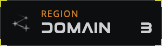
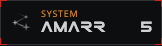
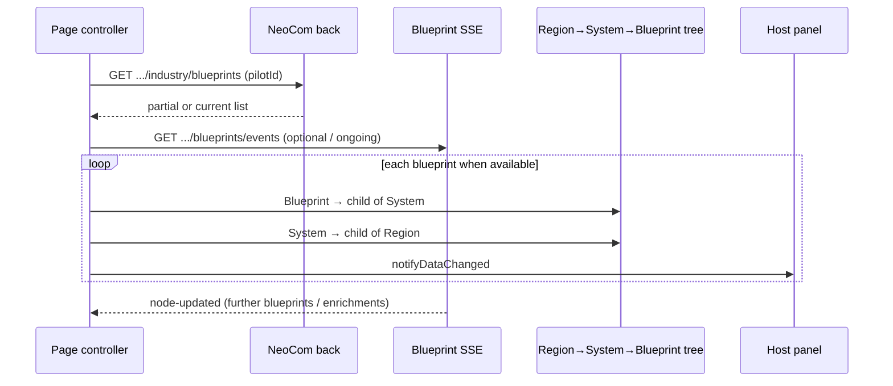

# EPIC-010 - INDUSTRY BLUEPRINTS

## Spec traceability

| Field | Value |
| --- | --- |
| Status | 📝 `registered` |
| OpenSpec changes | [`front-industry-blueprints`](../../openspec/changes/front-industry-blueprints/) |
| Skip | IND-BP-084…087 → [`00.DUPLICATES`](./00.DUPLICATES.md) ; re-extract only rows set back to `reviewed` |
| Index | [`TRACEABILITY`](./TRACEABILITY.md#10epic-industry-blueprintsmd) ·  |

## Goals

This epic will contain all the specs needed to add a new feature to the application to list the pilot blueprints classified by location. It will make use of most of the current specs, so during the development of this epic related specs on other epics that are not applied to OpenSpec will be moved to this epic for review and spec processing.

## Search criteria

<!-- Filled by the developer before any card or code search. Write here the
     axis data and the rules for what to search for: on the executive cards,
     and on the legacy code. Empty until the developer completes it. -->

## Sources

<!-- Filled later by this agent from the executive cards matched by the
     Search criteria. Empty at creation. -->

---

## Section 01 — Spec: **model-strip** page

This section is a **new L1 spec** for the support / documentation **page** that catalogues render specimens (route, chrome, strip layout). Other sections put their Appearance specimens here and follow these **page** rules (not render-specific behaviour). Shared fonts / labels / icons / expandables: **Section 07**. Authoritative requirements are the Review rows below.

**Early front seed (leave as-is):** `neocom-front` already has a working `model-strip-page` so specimens can be inspected and Appearance PNGs captured. That seed is **not** a substitute for OpenSpec registration; do not rip it out.

**Short name:** `model-strip`  
**Selector / page:** `model-strip-page`  
**Route:** `/model-strip`  
**Chrome:** no `authGuard` (dev support). Programme path: `neocom-front` `pages/model-strip-page/`.

### Catalog and validated markers

Improve the catalog of available model previews. Validated model previews are recorded in a **new index file** under `neocom-front/docs/` (name fixed when this section is reviewed). Specimens listed as validated in that index SHALL show a **green check-mark icon** at the **top-right** of their preview frame.

### Specimen layout and ordering

Each strip row is **[specimen visual] · [meta to the right]**:

| Meta | Content |
| --- | --- |
| Render name | Identifier of the render that produced the specimen (e.g. `v1-region-render`) |
| Style reference | Font / icon sizes in use on that specimen (when useful) |

**New specimens go at the top** of the strip; older specimens stay below.

### Font baseline sample

The strip SHALL include a **14px** sample of the two primary faces (**Elemental** and **Open Sans**) as a sizing reference (faces defined in Section 07).

### Appearance capture (agent authorization)

When registering (or authoring for registration) a visual Appearance, agents **MAY** add a specimen on `model-strip-page` and capture that live render into `sources/L1/media/*.png`. Prefer a real strip capture over a generated stand-in. Scope of that front edit is the specimen / render needed for the PNG — not unrelated product work.

| ID | Review | Requirement |
| --- | --- | --- |
| IND-BP-001 | extracted | Provide support page **model-strip** (`model-strip-page`) at `/model-strip` without authentication |
| IND-BP-002 | extracted | Add a new index file under `neocom-front/docs/` that lists which model previews are validated |
| IND-BP-003 | extracted | Each specimen listed as validated in that docs index SHALL show a green check-mark icon at the top-right of its preview |
| IND-BP-004 | extracted | New specimens added to `model-strip-page` SHALL be placed at the **top** of the strip |
| IND-BP-005 | extracted | Each specimen row SHALL show the **render name** to the right of the visual; style/font-size reference MAY appear with it |
| IND-BP-006 | extracted | The strip SHALL show a **14px** Elemental + Open Sans font baseline sample |
| IND-BP-007 | extracted | Agents MAY add a strip specimen and capture PNG into `sources/L1/media/` when documenting a visual Appearance |

---

## Section 02 — Spec: **FeatureV1** display element

Add a new display element named **Feature**. Behaviour contract: a control with a representative **icon** and/or **name**, that navigates to a **page** (or feature-group landing page that is itself a page — never a non-page destination for this element).

**Selection (IND-BP-012):** candidate **B** — icon button. Programme versioning starts at **v1**: domain **`FeatureV1`** + render **`v1-feature-button`**. Candidate **A** (label strip / `v2-feature-render`) is **discarded** (do not promote; strip comparison specimen MAY remain only as historical reference until cleaned up). Strip placement / capture / meta: Section 01.

| Candidate | Result | Infinity path | Strip specimen key | Notes |
| --- | --- | --- | --- | --- |
| A — label strip | **discarded** | `modules/renders/v2-feature-render` | `legacy-v2-feature-render` | Compact bordered label; corner marks; PAGEROUTE click |
| B — icon button | **selected → v1** | `modules/common/components/v1-feature-button` | `legacy-v1-feature-button` → promote to `v1-feature-button` | Image (`imageRef`) + label under it; PAGEROUTE click |

Legacy domain shape (infinity `NeoComFeature`): at least `label` (name), `imageRef` (icon), `route` (page path), plus enable/active flags used by the renders.

### Appearance: `v1-feature-button` (selected)


Discarded comparison (A): `media/v1-feature-render.png` (`legacy-v2-feature-render`) — not the programme Feature render.

| ID | Review | Requirement |
| --- | --- | --- |
| IND-BP-010 | extracted | Introduce display element **Feature** (`FeatureV1`) with name and/or icon, navigating to a page (including a feature-group landing page) |
| IND-BP-011 | extracted | Comparison specimens for both infinity Feature UIs were placed on `model-strip-page` (Section 01) so the developer could choose |
| IND-BP-012 | extracted | **Selected B** — programme Feature is **`FeatureV1`** + **`v1-feature-button`** (infinity `v1-feature-button`); discard candidate A (`v2-feature-render`) |

---

## Section 03 — Dashboard Feature panel: procedural population

Feature items are added to the presentation layer by the **page controller** with a **procedural creation** process. Reference: infinity `industry-dashboard-page` (`neocom-infinity-frontend/src/app/modules/industry/pages/industry-dashboard-page/industry-dashboard-page.component.ts`), which builds `NeoComFeature` instances in the constructor and pushes them onto a `features` array that the template renders.

For the **new application** page that hosts the Feature panel (application Dashboard and/or Industry feature dashboard — same population mechanism), that controller SHALL include equivalent procedural construction to populate the panel with the **declared Features** below. Each Feature uses `interaction: PAGEROUTE` and a `route` that targets a real page.

Relation to EPIC-006 (Dashboard feature list / data provider): this epic **requires** the infinity-style procedural seeding in the page controller for these declared Features. A later move behind a data provider MAY follow EPIC-006 once reviewed; it does not remove the need for the declared Feature set and page targets here.

### Declared Features (Industry panel)

| id | label | route (legacy reference) | imageRef (legacy) | Target page (this epic) |
| --- | --- | --- | --- | --- |
| `blueprint-by-location` | Blueprint Availability | `/industry/blueprints-by-location` | `assets/media/blueprints-feature.jpeg` | Section 04 — **v1-blueprint-by-location** page |

Programme routes MAY be remapped under the new front router; the Feature `route` MUST resolve to the programme page that Section 04 (or the mining shell) specifies.

| ID | Review | Requirement |
| --- | --- | --- |
| IND-BP-020 | extracted | The page controller that hosts the Feature panel SHALL populate Features by **procedural creation** of Feature domain instances (infinity `industry-dashboard-page` pattern), not by hard-wiring unrelated one-off buttons outside the Feature model |
| IND-BP-021 | extracted | The Industry Feature panel SHALL include Feature `blueprint-by-location` — label **Blueprint Availability**, `PAGEROUTE` to the **v1-blueprint-by-location** page (Section 04), with a representative `imageRef` |
| IND-BP-023 | extracted | Selecting an enabled Feature SHALL navigate to that Feature’s `route` page |

---

## Section 04 — Spec: **v1-blueprint-by-location** page

This section is a **new L1 spec** for the Blueprint Management **page** only (route, chrome, host panel). Region render: **Section 05**. System render: **Section 09**. Blueprint render: **Section 08**. Authoritative requirements are the Review rows below. Normal delivery is `reviewed` → `/epic:extract` → apply — not “implement from epic prose during authoring.”

**Early front seed (leave as-is):** `neocom-front` already has a working `v1-blueprint-by-location-page` (header, Region panel, no auth) so the page shell can be inspected. That seed is **not** a substitute for OpenSpec registration; do not rip it out. Later apply aligns or extends it from the registered change.

**Short name:** `v1-blueprint-by-location`  
**Selector / page:** `v1-blueprint-by-location-page`  
**Route:** `/industry/blueprints-by-location` (under the industry → manufacture module)  
**Feature entry:** Blueprint Availability → `v1-blueprint-by-location`

Lists the pilot’s blueprints classified by location. Legacy reference: infinity `v1-blueprint-list-page` (renamed in programme to match by-location behaviour). Programme path: `neocom-front` `modules/industry/manufacture/pages/v1-blueprint-by-location-page/`.

### Page chrome

Standard page with the common **`<app-page-header />`**. For UI development the route SHALL be reachable **without authentication** (no `authGuard`), same class of access as `/model-strip`. Securing the page MAY follow once login wiring is required for live pilot data.

### Host panel and hierarchy shape

The page hosts a panel that presents the location hierarchy:

```text
Region  (distinct regions that hold the pilot’s blueprints)
  └─ System  (distinct solar systems in that region that hold blueprints)
       └─ Blueprint  (pilot blueprints in that system)
```

How Region rows look is specified in **Section 05**. How System rows look is specified in **Section 09**. How Blueprint rows look is specified in **Section 08**. Shared expand / collaborate / label / icon rules are **Section 07**. How the page **loads** pilot blueprints and **aggregates** them into this tree is **Section 10**. The page SHALL use the programme node-render / panel collaboration path (EPIC-002) so expand rebuilds `nodes2render` via `notifyDataChanged`.

| ID | Review | Requirement |
| --- | --- | --- |
| IND-BP-030 | extracted | Provide page **v1-blueprint-by-location** (`v1-blueprint-by-location-page`) at `/industry/blueprints-by-location`, reachable from Feature `blueprint-analysis` |
| IND-BP-031 | extracted | The page SHALL use the common `<app-page-header />` |
| IND-BP-032 | extracted | The page SHALL be reachable **with authentication**  |
| IND-BP-033 | extracted | The page SHALL host a panel whose hierarchy is **Region → System → Blueprint** (distinct regions → distinct systems in that region with blueprints → pilot blueprints in that system) |
| IND-BP-034 | extracted | The panel SHALL paint Region nodes with **`v1-region-render`** as defined in Section 05 |
| IND-BP-035 | extracted | The panel SHALL paint Blueprint nodes with **`v1-blueprint-render`** as defined in Section 08 |
| IND-BP-036 | extracted | The panel SHALL paint System nodes with **`v1-system-render`** as defined in Section 09 |

---

## Section 05 — Spec: **v1-region** render

This section is a **new L1 spec** for **Region** presentation and its place in the **v1-blueprint-by-location** hierarchy. Page shell: Section 04. Shared fonts, labels, icon tokens, and expandable/collaborate rules: **Section 07**.

### Hierarchy role

**Region** is the first level of the blueprint-by-location tree. Region children are the distinct **Systems** in that region that contain pilot blueprints. System children are the **Blueprints** in that system (Region → System → Blueprint).

Region rows are **expandable** under Section 07 (toggle icon + `collaborate2View`). Toggle glyphs: **collapsed `arrowright` / expanded `arrowdownred`** (Section 07 expand-chevron set).

### Appearance: `v1-region`

Captured from `neocom-front` `/model-strip` specimen `data-specimen="v1-region"` (fixture **Domain**, systems count **3**).



Infinity reference: `modules/renders/v1-region-render`, variant `-BY-LOCATION-`, `panel-yellow` frame.

Programme path: `neocom-front` `modules/renders/v1-region-render`. Specimen on **model-strip** per **Section 01** (render name + style reference to the right).

**Layout:** one horizontal row — **`neo-icon-md` (24px)** systems icon | **label + name column** | systems count on the **same row as the region name**. Data: icon, name, systems count.

**Typography (as on strip; labels/faces per Section 07):**

| Element | Face / size / colour |
| --- | --- |
| Label `REGION` | Open Sans **9px** orange `#ffa500` — Section 07 |
| Region name | Elemental **14px**, uppercase white |
| Systems count | Elemental **14px** white (same row as name) |

**Icon size rule:** icon ≤ sum of label height + name height; Region uses **`neo-icon-md` (24px)** (token set in Section 07).

| ID | Review | Requirement |
| --- | --- | --- |
| IND-BP-060 | extracted | Each Region node SHALL be rendered with **`v1-region-render`** (infinity `v1-region-render` / `-BY-LOCATION-`) |
| IND-BP-061 | extracted | Add a `v1-region` specimen to `model-strip-page` per Section 01 (render name + style reference) |
| IND-BP-062 | extracted | Region card shows icon, uppercase region name, and systems count; name and count share **Elemental 14px**; systems count on the **same row** as the region name |
| IND-BP-063 | extracted | Region icon uses a standard size token; size SHALL be ≤ label height + name height; default **`neo-icon-md` (24px)** |
| IND-BP-070 | extracted | Region children SHALL be the distinct **Systems** in that region that contain pilot blueprints |
| IND-BP-071 | extracted | System children SHALL be the **Blueprints** located in that system (hierarchy Region → System → Blueprint) |
| IND-BP-072 | extracted | Region SHALL follow the shared **expandable** contract in Section 07 |

---

## Section 06 — Spec: **color-table** support page

Support / documentation page that lists the **application colour table**: each colour currently in use from `neocom-front` `src/styles/_palette.scss` (`$neo-colors`), with a **visual sample (swatch)** and the associated **style name** (palette key + CSS custom property `--neo-color-<key>`).

**Short name:** `color-table`  
**Selector / page:** `color-table-page`  
**Route:** `/color-table`  
**Chrome:** common `<app-page-header />`; **no `authGuard`** (dev support, same class as `/model-strip`).

When palette keys are added or renamed in `_palette.scss`, update this page’s catalogue in the same change.

| ID | Review | Requirement |
| --- | --- | --- |
| IND-BP-040 | extracted | Provide support page **color-table** (`color-table-page`) at `/color-table` with `<app-page-header />` and no authentication |
| IND-BP-041 | extracted | The page SHALL list every colour currently defined in the application palette (`$neo-colors` / `--neo-color-*`) |
| IND-BP-042 | extracted | Each row SHALL show a colour **sample (swatch)** and the associated **style name** (palette key and CSS variable) |

---

## Section 07 — Spec: shared UI definitions

Programme-wide UI rules **not** tied to one page or one render. Pages and renders cite this section. Source styles: `neocom-front` `src/styles/fonts.scss`, `icons.scss`, `_palette.scss`; node expand: EPIC-002 / `NeoCom.collaborate2View`.

### Primary faces

| Face | Helper | Typical use |
| --- | --- | --- |
| **Elemental** | `.elemental-ff` | Names, titles, numeric emphasis |
| **Open Sans** | `.opensans-ff` | Body / meta; field labels |

The **14px** Elemental + Open Sans baseline sample lives on **model-strip** (Section 01); faces themselves are defined here.

### Field labels

Always **Open Sans**, **9px**, colour **orange `#ffa500`** (field-label orange; not `panel-red` / not accent `#ff3300`). Global classes: `.label`, `.neo-label`, `.strip-label`.

### Standard icon sizes

Tokens in `src/styles/icons.scss` (`neo-icon-sm` / `neo-icon-md` / `neo-icon-lg`):

| Token | Size | Typical use |
| --- | --- | --- |
| `sm` | **16px** | Inline / dense chrome |
| `md` | **24px** | Cards beside a label+name stack |
| `lg` | **32px** | Type / media tiles in list rows |

Prefer these tokens over ad-hoc pixel sizes on renders.

### Expandable items

Any expandable row (Region and later System, etc.):

| Concern | Rule |
| --- | --- |
| Toggle control | A **special toggle icon** on the row; appearance **changes with expand status** |
| Interaction | **Clicking that icon** toggles expand state (`toggleExpanded` / `IExpandable`) |
| Collapsed | Does **not** collaborate children — `collaborate2View` → **self only** |
| Expanded | Collaborates children into `nodes2render`; they **show on the panel** |
| Rebuild | After toggle, panel `notifyDataChanged` rebuilds the render list |

#### Expand / collapse toggle icons

Visual source: infinity `neocom-infinity-frontend/src/assets/res-ui/drawable/` chevron set. Programme SHALL **reuse these PNGs** (early front seed under `neocom-front/public/res-ui/drawable/`) **or ship regenerated equivalents** that keep the same shapes and colours — do not invent a different toggle glyph family for Region expand/collapse.

| Asset | Appearance | Expand state (Region / shared expandable) |
| --- | --- | --- |
| `arrowright.png` | White right chevron | **Collapsed** (children hidden) |
| `arrowdownred.png` | Red down chevron | **Expanded** (children on the panel) |
| `arrowleft.png` | White left chevron | Same family — keep in programme assets (pair with right) |
| `arrowupgreen.png` | Green up chevron | Same family — keep in programme assets (pair with down) |

Infinity reference behaviour: `node-container-render` showed only `arrowright.png` and rotated it 90° when expanded. Programme **replaces that rotate-only trick** with the explicit **collapsed = `arrowright` / expanded = `arrowdownred`** pair so the open state is a distinct red-down affordance. Toggle size: prefer **`neo-icon-sm` (16px)** unless a render specifies another standard token.

Public URLs (front seed): `/res-ui/drawable/arrowright.png`, `/res-ui/drawable/arrowdownred.png`, `/res-ui/drawable/arrowleft.png`, `/res-ui/drawable/arrowupgreen.png`.

| ID | Review | Requirement |
| --- | --- | --- |
| IND-BP-080 | extracted | Primary faces are **Elemental** and **Open Sans**; prefer them unless a render specifies another face |
| IND-BP-081 | extracted | Field labels SHALL always use **Open Sans**, **9px**, colour **orange `#ffa500`** |
| IND-BP-082 | extracted | Programme styles define three standard icon sizes: **16 / 24 / 32** (`sm` / `md` / `lg`) |
| IND-BP-083 | extracted | Expandable items SHALL show a **toggle icon** whose appearance depends on expand status: **collapsed → `arrowright.png`**, **expanded → `arrowdownred.png`** (or regenerated equivalents of that pair) |
| IND-BP-084 | duplicated | Clicking the toggle icon SHALL **toggle** the item’s expand state |
| IND-BP-085 | duplicated | When **collapsed**, the expandable SHALL **not** collaborate children (`collaborate2View` → self only) |
| IND-BP-086 | duplicated | When **expanded**, the expandable SHALL collaborate its children so they appear on the panel |
| IND-BP-087 | duplicated | After an expand toggle, the hosting panel SHALL rebuild the render list (`notifyDataChanged`) |
| IND-BP-088 | extracted | Programme SHALL ship the infinity expand-chevron set under `public/res-ui/drawable/` — `arrowright`, `arrowdownred`, `arrowleft`, `arrowupgreen` — as copies or regenerated equivalents; Region expand/collapse SHALL use that set (not a one-off icon) |

---

## Section 08 — Spec: **v1-blueprint** render

This section is a **new L1 spec** for **Blueprint** presentation in the **v1-blueprint-by-location** hierarchy (and its **model-strip** specimen). Domain fields: EPIC-004 **BlueprintV1**. Page shell: Section 04. Shared fonts, labels, icon tokens: **Section 07**.

**Early front seed (leave as-is / extend):** `neocom-front` `modules/renders/v1-blueprint-render` already paints `BlueprintV1`; reshape the base-identity layout to this section. That seed is **not** a substitute for OpenSpec registration.

### Hierarchy role

**Blueprint** is the leaf of the blueprint-by-location tree (Region → System → Blueprint). Blueprint rows are **not** expandable under Section 07.

### Appearance: `v1-blueprint`

Modified from the existing `model-strip` `v1-blueprint` specimen so it follows the same render conventions as Region (icon left + declared size token + labelled name stack + trailing Elemental metrics). Refresh `media/v1-blueprint.png` from the live strip specimen once the seed matches this layout (Section 01 capture).


Programme path: `neocom-front` `modules/renders/v1-blueprint-render`. Specimen on **model-strip** per **Section 01** (render name + style reference to the right).

**Layout:** one horizontal row —

1. **Icon** left — blueprint type icon using a declared size token (**`neo-icon-lg` (32px)** — type / media tile; Section 07)
2. **Name column** — field label **`BLUEPRINT NAME`** (Section 07 label rules) over the blueprint type name in **Open Sans bold**
3. **Material / time efficiency** — `materialEfficiency`/`timeEfficiency` as **`ME/TE`** (e.g. `10/20`) in **Elemental**, **no label**
4. **Runs** — only when the blueprint is **not** a master (original): `runs`/`maxRuns` (e.g. `300/300`) in **Elemental**, **no label**. Master (original) blueprints **omit** this metric

**Master vs copy:** a **master** blueprint is an original (BPO). Legacy signal: ESI `runs < 0` (unlimited) → original (see deprecated domain DTO `original`). Until BlueprintV1 exposes an explicit master flag, treat **`runs < 0`** as master for this render.

**Typography:**

| Element | Face / size / colour |
| --- | --- |
| Label `BLUEPRINT NAME` | Open Sans **9px** orange — Section 07 |
| Blueprint type name | Open Sans **bold**, white |
| `ME/TE` | Elemental, white; no label |
| `runs/maxRuns` (copy only) | Elemental, white; no label |

| ID | Review | Requirement |
| --- | --- | --- |
| IND-BP-090 | extracted | Each Blueprint node SHALL be rendered with **`v1-blueprint-render`** for base **BlueprintV1** identity |
| IND-BP-091 | extracted | Add/keep a `v1-blueprint` specimen on `model-strip-page` per Section 01 (render name + style reference) |
| IND-BP-092 | extracted | Blueprint row layout SHALL be: declared-size **icon left** · **`BLUEPRINT NAME`** label + name (**Open Sans bold**) · **`ME/TE`** in **Elemental** with **no label** · optional **`runs/maxRuns`** in **Elemental** |
| IND-BP-093 | extracted | Blueprint icon SHALL use a standard size token; default **`neo-icon-lg` (32px)** |
| IND-BP-094 | extracted | Material and time efficiency SHALL display as **`materialEfficiency`/`timeEfficiency`** in Elemental with no field label |
| IND-BP-095 | extracted | When the blueprint is **not** a master (original), SHALL show **`runs`/`maxRuns`** in Elemental with no field label; master blueprints SHALL omit runs/maxRuns |

---

## Section 09 — Spec: **v1-system** render

This section is a **new L1 spec** for **System** (solar system) presentation in the **v1-blueprint-by-location** hierarchy (and its **model-strip** specimen). Page shell: Section 04. Shared fonts, labels, icon tokens, and expandable/collaborate rules: **Section 07**.

**Early front seed (leave as-is / extend):** `neocom-front` `modules/renders/v1-system-render` paints `LookupSolarSystem` / `SystemLookupNode`. That seed is **not** a substitute for OpenSpec registration.

### Hierarchy role

**System** is the second level of the blueprint-by-location tree (Region → System → Blueprint). System children are the **Blueprints** located in that system. System rows are **expandable** under Section 07 (same toggle glyphs as Region).

### Appearance: `v1-system`

Same visual language as **`v1-region`** (Section 05): icon left + declared size token + labelled name stack + trailing Elemental count on the name row. Panel frame is **`panel-orange`** (Region uses `panel-yellow`) so hierarchy levels stay distinct. Infinity reference: `v1-solar-system-render` / `-SOLAR-SYSTEM-LOOKUP-` (layout reshaped to match Region).

Captured from `neocom-front` `/model-strip` specimen `data-specimen="v1-system"` (fixture **Amarr**, blueprints count **5**).



Programme path: `neocom-front` `modules/renders/v1-system-render`. Specimen on **model-strip** per **Section 01** (new specimens at the **top**; render name + style reference to the right).

**Layout:** one horizontal row — **`neo-icon-md` (24px)** systems icon | **label + name column** | blueprints count on the **same row as the system name**. Data: icon, name, blueprints count.

**Typography (as on strip; labels/faces per Section 07):**

| Element | Face / size / colour |
| --- | --- |
| Label `SYSTEM` | Open Sans **9px** orange `#ffa500` — Section 07 |
| System name | Elemental **14px**, uppercase white |
| Blueprints count | Elemental **14px** white (same row as name) |

**Icon size rule:** icon ≤ sum of label height + name height; System uses **`neo-icon-md` (24px)** (same token as Region; Section 07).

| ID | Review | Requirement |
| --- | --- | --- |
| IND-BP-100 | extracted | Each System node SHALL be rendered with **`v1-system-render`** (infinity `v1-solar-system-render` / `-SOLAR-SYSTEM-LOOKUP-`, layout aligned to Region) |
| IND-BP-101 | extracted | Add a `v1-system` specimen to `model-strip-page` per Section 01 (render name + style reference; new specimens at top) |
| IND-BP-102 | extracted | System card SHALL follow the same visual structure as Region: icon, uppercase system name, and blueprints count; name and count share **Elemental 14px**; count on the **same row** as the system name |
| IND-BP-103 | extracted | System icon uses a standard size token; size SHALL be ≤ label height + name height; default **`neo-icon-md` (24px)** |
| IND-BP-104 | extracted | System panel frame SHALL use **`panel-orange`** (Region remains `panel-yellow`) |
| IND-BP-105 | extracted | System SHALL follow the shared **expandable** contract in Section 07 |

---

## Section 10 — Spec: process blueprints into the location hierarchy

This section is a **new L1 spec** for how the **v1-blueprint-by-location** page (Section 04) obtains the pilot’s blueprints and builds the **Region → System → Blueprint** tree for rendering. Render Appearance: Sections 05 / 09 / 08. Expand / collaborate: Section 07. Back contracts: EPIC-007 **Flow 06** (list blueprints) and **Flow 07** (blueprint enrichment SSE).

### Page start — request pilot blueprints

When the page starts, the **page controller** SHALL ask the NeoCom back for the **selected pilot’s** industry blueprints (EPIC-007 **API-IND-BP-001** — `GET /v1/pilots/{pilotId}/industry/blueprints`). The front does not call ESI for this list.

That response MAY be **partial** while enrichment continues (Flow 06 async). The same pilot scope MAY be **fed further over SSE** (EPIC-007 **API-IND-BP-002** — `GET /v1/pilots/{pilotId}/industry/blueprints/events`, events `node-updated`). The controller SHALL process blueprints **when they become available** — from the initial list and from later SSE updates — not only after a single complete batch.

### Processing and aggregation

While processing each available blueprint, the controller (or the hierarchy builder it owns) SHALL **aggregate** into the render tree:

```text
for each blueprint (initial list and/or SSE update):
  resolve its System (solar system that holds the blueprint)
  attach the Blueprint as a **child** of that System node
  resolve the Region that contains that System
  attach / keep the System as a **child** of that Region node
panel roots for rendering = Region nodes
```

| Level | Role in aggregation |
| --- | --- |
| **Blueprint** | Leaf — one processed pilot blueprint node |
| **System** | Parent of blueprints in that solar system; children are Blueprint nodes |
| **Region** | Parent of systems in that region that hold blueprints; children are System nodes; panel roots |

Distinct Systems and Regions: create a System node when the first blueprint for that system arrives; create a Region node when the first System for that region is attached. Subsequent blueprints for an existing system append as children. Counts shown on Region / System renders (Sections 05 / 09) SHALL reflect the aggregated children.

Location identity for grouping comes from each blueprint’s location chain (system → region) as supplied or resolved for that blueprint. Exact field names on **BlueprintV1** / list DTO stay with EPIC-004 / EPIC-007; this section requires the aggregation behaviour, not a new ESI mirror.

### Rendering

The host panel (Section 04) paints **Region** roots with **`v1-region-render`**. Expanding a Region collaborates its **System** children (`v1-system-render`); expanding a System collaborates its **Blueprint** children (`v1-blueprint-render`) — Section 07. After aggregation updates (including SSE), the panel SHALL rebuild the render list (`notifyDataChanged` / EPIC-002) so the hierarchy stays current while the feed is still open.



| ID | Review | Requirement |
| --- | --- | --- |
| IND-BP-110 | extracted | On page start, the **v1-blueprint-by-location** page controller SHALL request the selected pilot’s industry blueprints from the NeoCom back (EPIC-007 Flow 06 / `GET /v1/pilots/{pilotId}/industry/blueprints`) |
| IND-BP-111 | extracted | The blueprint list MAY arrive **partially** and MAY continue to be **fed over SSE** (EPIC-007 Flow 07 / `.../blueprints/events`); the front SHALL process blueprints **when available**, not only after a final complete list |
| IND-BP-112 | extracted | While processing each available blueprint, the controller SHALL **aggregate** it as a **child of its System** node (create the System node if missing) |
| IND-BP-113 | extracted | System nodes SHALL be **aggregated as children of their Region** nodes (create the Region node if missing) |
| IND-BP-114 | extracted | The host panel’s root nodes for rendering SHALL be the aggregated **Region** nodes (hierarchy Region → System → Blueprint per Section 04) |
| IND-BP-115 | extracted | Region and System child counts used by **`v1-region-render`** / **`v1-system-render`** SHALL follow the aggregated children |
| IND-BP-116 | extracted | After aggregation changes (including SSE updates), the panel SHALL rebuild the render list so expanded/collapsed views stay consistent with the tree (EPIC-002 `notifyDataChanged`) |
| IND-BP-117 | extracted | Grouping uses each blueprint’s **location chain** (system → region); the front does not invent regions/systems without a blueprint that maps to them |
| IND-BP-118 | extracted | Front SHALL NOT call ESI to obtain the pilot blueprint list or to build the hierarchy — NeoCom back / SSE supply the blueprint feed |

---

## Version card

| Field | Value |
| --- | --- |
| Epic | `EPIC-010 - INDUSTRY BLUEPRINTS` |
| Created | `2026-11-03` |
| Status | `none` |
