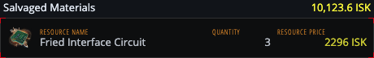
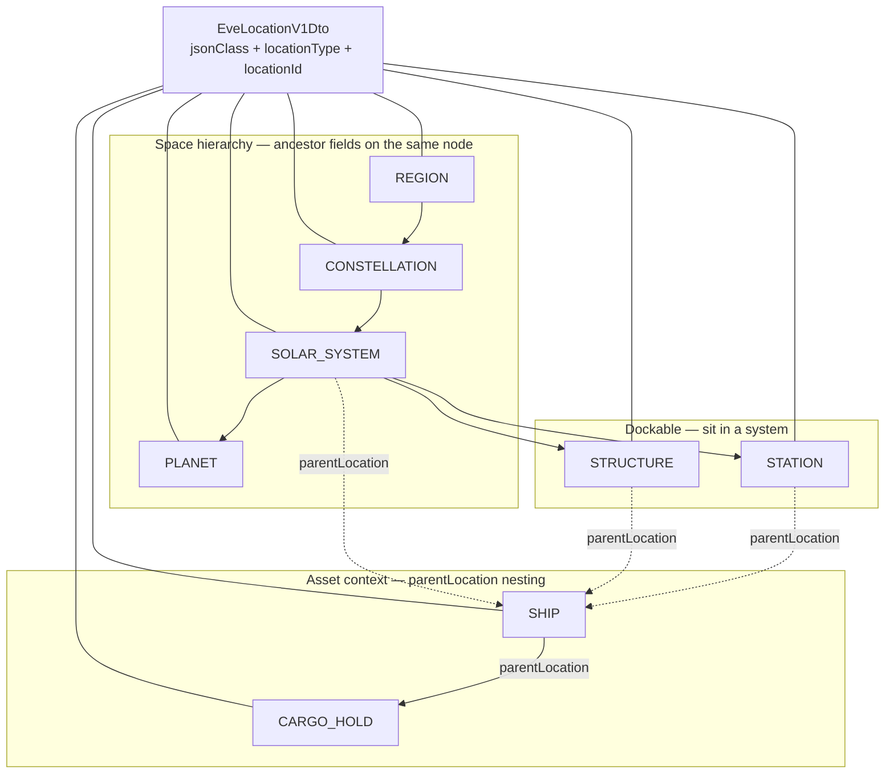
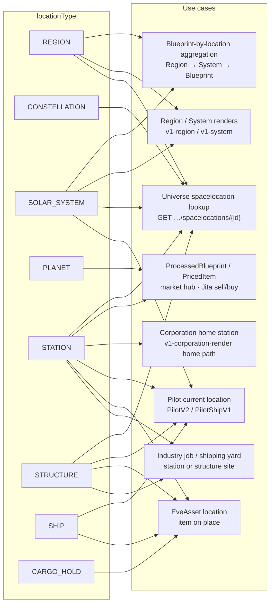

# EPIC-012 - PROCESSED BLUEPRINT

## Spec traceability

| Field | Value |
| --- | --- |
| Status | `none` |
| OpenSpec changes | |
| Skip | |
| Index | `L1/TRACEABILITY.md` |

## Goals

first you should get other specs on the L1 files related to processed blueprints and move them to this epic if they are not reviewed already, for reviewed findins check with the developer one by one it to move or not

## Search criteria

## Sources

## Table of contents

- [Spec traceability](#spec-traceability)
- [Goals](#goals)
- [Search criteria](#search-criteria)
- [Sources](#sources)
- [Intake — moved / pending](#intake--moved--pending)
- [Section 01 — ProcessedBlueprintV1](#section-01--processedblueprintv1)
  - [Appearance:](#appearance-v1-processed-blueprint-render) `v1-processed-blueprint-render`
- [Section 02 — Market pricing (Jita buy / sell)](#section-02--market-pricing-jita-buy--sell)
- [Section 03 — ResourceV1](#section-03--resourcev1)
- [Section 04 — IndustryResourceV1](#section-04--industryresourcev1)
- [Section 05 — BOMResourceV1](#section-05--bomresourcev1)
- [Section 06 — BuildActionDtoV1](#section-06--buildactiondtov1)
- [Section 07 — BOMGroupV1](#section-07--bomgroupv1)
- [Section 08 — Blueprint render RUNS (](#section-08--blueprint-render-runs-v1-blueprint-render)`v1-blueprint-render`[)](#section-08--blueprint-render-runs-v1-blueprint-render)
- [Section 09 — EveLocationV1Dto](#section-09--evelocationv1dto)
  - [Types, dependencies, and use cases](#types-dependencies-and-use-cases)
  - [Inheritance: SpaceLocation parent fields](#inheritance-spacelocation-parent-fields)
  - [EveLocationV1Dto — new / extended fields](#evelocationv1dto--new--extended-fields)
  - [PricedItemV1Dto and market hubs](#priceditemv1dto-and-market-hubs)
- [Discarded — former ProcessedBlueprintV1 (BOM detail)](#discarded--former-processedblueprintv1-bom-detail)
- [Version card](#version-card)

### Section index

| Section | Title | Origin |
| --- | --- | --- |
| [01](#section-01--processedblueprintv1) | ProcessedBlueprintV1 | renamed from former Summary (EPIC-004 §11); old §02 discarded |
| [02](#section-02--market-pricing-jita-buy--sell) | Market pricing (Jita buy / sell) | authored 2026-11-06 |
| [03](#section-03--resourcev1) | ResourceV1 | moved from EPIC-004 §13 (`[ ] to review`) |
| [04](#section-04--industryresourcev1) | IndustryResourceV1 | moved from EPIC-004 §14 (`[ ] to review`) |
| [05](#section-05--bomresourcev1) | BOMResourceV1 | moved from EPIC-004 §15 (`[ ] to review`) |
| [06](#section-06--buildactiondtov1) | BuildActionDtoV1 | moved from EPIC-004 §16 (`[ ] to review`) |
| [07](#section-07--bomgroupv1) | BOMGroupV1 | moved from EPIC-004 §17 (`[ ] to review`) |
| [08](#section-08--blueprint-render-runs-v1-blueprint-render) | Blueprint render RUNS | moved from EPIC-006 UI-BP-001…003 (`[ ] to review`) |
| [09](#section-09--evelocationv1dto) | EveLocationV1Dto (back; front mapper WIP) | moved from EPIC-004 §04 (`[ ] to review`) |

---

## Intake — moved / pending

Unreviewed related L1 material is **moved** into this epic on creation. Reviewed (or applied narrative) material stays in its home epic until the developer confirms each item.

| Item | Home | Review | Action |
| --- | --- | --- | --- |
| ProcessedBlueprintV1 (was Summary) | was EPIC-004 §11 | `[ ] to review` | **moved** → §01; renamed from `ProcessedBlueprintSummaryV1` |
| Former ProcessedBlueprintV1 (type/output/BOM) | was EPIC-004 §12 | — | **discarded** (see [Discarded](#discarded--former-processedblueprintv1-bom-detail)) |
| Market pricing / Jita buy–sell | this epic | `[ ] to review` | **authored** → §02 |
| ResourceV1 … BOMGroupV1 (+ IND-BP-003…004) | was EPIC-004 §13–17 | `[ ] to review` | **moved** → §03–07 |
| UI-BP-001…003 RUNS on `v1-blueprint-render` | was EPIC-006 | `[ ] to review` | **moved** → §08 |
| EveLocationV1Dto (+ market-hub kind rule) | was EPIC-004 §04 | `[ ] to review` | **moved** → §09 |
| PricedItemV1Dto (buy/sell + hub place) | was EPIC-004 §03 | `[ ] to review` | **moved** → [EPIC-013 §04](./13.EPIC-EVE-ITEMS.md#section-04--priceditemv1dto-extends-eveitemv1dto) |
| EPIC-008 location hierarchy / LOC-* | EPIC-008 | mostly archived / leftover Lookup* | **stay** (catalog / SpaceLocation; pointer updated to §09) |
| BlueprintV1 (parent identity) | EPIC-004 §10 | `extracted` / applied | **stay** unless developer says otherwise |
| Flow 06 — API-IND-BP-001 List blueprints | EPIC-007 | `reviewed` | **ask** developer |
| Flow 07 — API-IND-BP-002 Blueprint enrichment SSE | EPIC-007 | `reviewed` | **ask** developer |
| EPIC-002 manufacture / ProcessedBlueprint render flow prose | EPIC-002 | applied epic narrative | **ask** developer |
| Archived EPIC-010 / EPIC-011 industry + list processing | `sources/L1/archive/` | archived | **stay** (reference only) |

Parent model **BlueprintV1** remains in EPIC-004 §10. **ProcessedBlueprintV1** extends it here.

---

## Section 01 — ProcessedBlueprintV1

### Concept

A **ProcessedBlueprintV1** is an **extension of BlueprintV1**. The backend adds information that reports the **profitability** of that blueprint when used to **build new items to sell at the market**.

The additional processed information includes at least:

1. The **item that can be built** with the blueprint (output / manufactured type).
2. The **price that item will sell at** on the market (market **sell** price).

Market prices themselves are a **separate model** (not fully defined yet). Until that model is complete, ProcessedBlueprint profitability **SHALL use the Jita price** of the item — see [Section 02](#section-02--market-pricing-jita-buy--sell).

Former name `ProcessedBlueprintSummaryV1` is **retired**. Programme type name and `jsonClass` for this shape is `ProcessedBlueprintV1`.

### Appearance: `v1-processed-blueprint-render`

**New render** for ProcessedBlueprintV1 profitability fields (not the base Blueprint identity card `v1-blueprint-render`).

| Concern | Value |
| --- | --- |
| Selector / render name | `v1-processed-blueprint-render` |
| `jsonClass` / registry | `ProcessedBlueprintV1` |
| Model-strip specimen | `data-specimen="v1-processed-blueprint-render"` on `/model-strip` (near top; new specimens first) |
| Appearance PNG | Capture from that specimen → `sources/L1/media/v1-processed-blueprint-render.png` |
| Sample fixture | Small EM Shield Reinforcer I Blueprint → builds Small EM Shield Reinforcer I; Jita sell + mat cost + index |

**Painted fields (DEFAULT):**

| UI | Source |
| --- | --- |
| Blueprint icon + name | blueprint type (`types/{id}/bp`) |
| INDEX | `costIndex × 100` (rounded) when present |
| BUILDS icon + name | output / buildable item (`types/{id}/icon`) |
| SELL · hub | output **market sell price** (hub label **Jita** until market model says otherwise) |
| MAT COST | `manufactureMaterialCost` when present |

*(PNG pending capture from model-strip specimen* `v1-processed-blueprint-render`*.)*

Base Blueprint identity (runs / ME/TE only) stays on `v1-blueprint-render` ([§08](#section-08--blueprint-render-runs-v1-blueprint-render) / EPIC-004 BlueprintV1). Do not overload that render with processed sell-price fields.

**Reference source (infinity):** `neocom-infinity-frontend/src/app/modules/industry/domain/` (`V1ProcessedBlueprintSummary.domain.ts` historically). Infinity `jsonClass` values such as `'ProcessedBlueprintSummary'` / `'ProcessedBlueprint'` map to programme `ProcessedBlueprintV1`.

`EsiType` / universe type mirrors stay **server-internal**. Published processed blueprints reference **item identity** (type id and name) and market prices via the market model / Jita rule — not republished ESI types. Icons: `types/{blueprintTypeId}/bp`, `types/{outputTypeId}/icon`.

### Fields (programme)

| Field | Type | Notes |
| --- | --- | --- |
| (inherits BlueprintV1 identity) | — | Blueprint type, runs, ME/TE, and related ESI-backed identity from [BlueprintV1](./04.EPIC-MODELS.md#section-10--blueprintv1) |
| `uid` | string | Unique id (`getUniqueId`) when listed |
| `blueprintTypeId` / name / icon | number / string | Blueprint type identity |
| `outputTypeId` / name / icon | number / string | **Buildable item** (module/type manufactured from the blueprint) |
| `outputSellPrice` | number | **Market sell price** of the buildable item (Jita until market model says otherwise) |
| `tradeStation` / market place | **EveLocationV1Dto** (hub) | Pricing place; for this epic’s profitability path → **Jita** (Section 02) |
| `manufactureMaterialCost` | number | Cost to manufacture from materials (when backend supplies it) |
| `costIndex` | number | Profitability index vs market (when backend supplies it) |
| `materials` | `{ typeId, name, quantity, price }[]` | Optional inline BOM summary lines when the list carries them |

| ID         | Review        | Requirement                                                                                                                                                                                                                                              |
| ---------- | ------------- | -------------------------------------------------------------------------------------------------------------------------------------------------------------------------------------------------------------------------------------------------------- |
| IND-BP-001 | [ ] to review | Blueprint list / cost-index UI uses **ProcessedBlueprintV1** (infinity `v1-blueprint` / `-AVAILABLE-BLUEPRINTS-` contract; former Summary name retired)                                                                                                  |
| IND-BP-005 | [ ] to review | **ProcessedBlueprintV1** SHALL extend **BlueprintV1** with backend-enriched data that supports **profitability** of building the output item to sell on the market                                                                                       |
| IND-BP-006 | [ ] to review | Processed enrichment SHALL include the **buildable output item** (type identity) and that item’s **market sell price**                                                                                                                                   |
| IND-BP-007 | [ ] to review | Until the dedicated market-price model is defined and wired, the sell price used on **ProcessedBlueprintV1** SHALL be the **Jita** market sell price of the output item (Section 02)                                                                     |
| IND-BP-008 | [ ] to review | `jsonClass` / published type name for this shape SHALL be `ProcessedBlueprintV1` (not `ProcessedBlueprintSummaryV1` / unversioned `ProcessedBlueprint`)                                                                                                  |
| IND-BP-009 | [ ] to review | ProcessedBlueprint profitability SHALL be painted by a dedicated render `v1-processed-blueprint-render` registered to `jsonClass` `ProcessedBlueprintV1` (separate from `v1-blueprint-render` / BlueprintV1)                                             |
| IND-BP-010 | [ ] to review | `v1-processed-blueprint-render` SHALL show at least: blueprint identity, **buildable output** (icon + name), **market sell price** with hub (**Jita**), and profitability **index** (`costIndex × 100` when present); MAY show manufacture material cost |
| IND-BP-011 | [ ] to review | `model-strip-page` SHALL host a `v1-processed-blueprint-render` specimen (`data-specimen="v1-processed-blueprint-render"`) with preset ProcessedBlueprintV1 fixture data so the Appearance PNG can be captured                                           |
| IND-BP-012 | [ ] to review | Appearance documentation SHALL use PNG captured from that model-strip specimen at `sources/L1/media/v1-processed-blueprint-render.png`                                                                                                                   |

**Parent:** [BlueprintV1](./04.EPIC-MODELS.md#section-10--blueprintv1) (EPIC-004 §10).

---

## Section 02 — Market pricing (Jita buy / sell)

Market pricing is a **separate model concern** from Blueprint / ProcessedBlueprint. It is **not fully defined** as a published type yet. This section states the programme rules that ProcessedBlueprint (and later PricedItem / market consumers) depend on.

### Concepts

| Concept | Meaning |
| --- | --- |
| **Market sell price** | The price at which the pilot **sells** the item on that market (what a buyer pays to acquire it from sell orders / the sell side used for “what will it sell for”) |
| **Market buy price** | The price at which the pilot **buys** the item on that market (what the pilot pays to acquire it from buy-side / buy orders used for “what does it cost to buy”) |
| **Market / hub** | The place those buy and sell prices apply. Prices are not meaningful without a hub |

These concepts align with EPIC-013 **PricedItemV1Dto** (buy price, sell price, market place). This epic does **not** replace PricedItemV1Dto; it states how **ProcessedBlueprint** chooses prices until a dedicated market-price model lands.

### Jita as default trading hub

**Jita** is the **predefined trading hub** for ProcessedBlueprint profitability:

- When enriching a ProcessedBlueprint with an output **sell** price, the backend SHALL use **Jita** market data for that item type.
- Material / buy-side costing that feeds manufacture cost (when present) SHALL also use **Jita** **buy** prices for those types unless a later requirement names another hub.

Exact station/system id for “Jita hub” and the persistence of hub selectors remain a **gap** if not already fixed elsewhere; until named, “Jita” means the programme’s Jita market-hub location used for trade pricing (same default as other Jita hub stories in L0). Hub shape is **EveLocationV1Dto** at planet/station market-hub kind — [Section 09](#section-09--evelocationv1dto).

### Obtaining price data

| Step | Expectation |
| --- | --- |
| Owner | The **backend** obtains market price data (front does not scrape ESI market for ProcessedBlueprint enrichment). |
| Scope | Per **item type id**, for the **Jita** hub: at least **market sell price** and **market buy price**. |
| Use on ProcessedBlueprint | Output item → **sell** price on the processed row; materials → **buy** prices when computing manufacture material cost. |
| Freshness | Backend MAY cache prices; staleness / refresh policy is **not specified** yet (gap — do not invent TTL). |
| Source API | Concrete ESI (or other) market endpoint and order aggregation rule (e.g. best sell / best buy) are **not specified** yet (gap — mark when known; do not invent). |

A future **market price model** (name TBD; may refine or sit beside **PricedItemV1Dto**) SHALL carry item identity, buy price, sell price, and market place (Jita for this epic’s path). Until that model is registered, ProcessedBlueprint fields MAY hold numeric sell/buy-derived values sourced under the Jita rule above.

| ID | Review | Requirement |
| --- | --- | --- |
| MKT-001 | [ ] to review | Programme market pricing SHALL distinguish **market sell price** (sell the item) from **market buy price** (buy the item) for a given hub |
| MKT-002 | [ ] to review | For **ProcessedBlueprintV1** profitability, the market hub SHALL be **Jita** (predefined trading hub) |
| MKT-003 | [ ] to review | The **backend** SHALL obtain Jita market buy and sell prices per item type used in processed-blueprint enrichment; the front SHALL consume enriched values, not fetch raw market orders for that path |
| MKT-004 | [ ] to review | ProcessedBlueprint **output** pricing SHALL use the Jita **market sell price** of the buildable item |
| MKT-005 | [ ] to review | When manufacture material cost is computed for ProcessedBlueprint, material unit prices SHALL use Jita **market buy prices** unless a later requirement names another hub |
| MKT-006 | [ ] to review | A dedicated **market price** published model (buy, sell, hub/place, item identity) remains **to define**; until then numeric prices on ProcessedBlueprint follow MKT-001…005 and MAY align with EPIC-013 **PricedItemV1Dto** field meanings |
| MKT-007 | [ ] to review | Exact market data source (ESI path / aggregation of orders) and cache TTL are **gaps** — record when decided; do not invent in apply |

---

## Section 03 — ResourceV1

Source: `Resource.domain.ts` (infinity; publish as ResourceV1). Extends `EsiType` in infinity and adds:

| Field | Type | Notes |
| --- | --- | --- |
| `quantity` | number | Required BOM quantity |

In `neocom-domain`, publish **ResourceV1** as item identity (type id and name) + `quantity` (optionally price via **PricedItemV1Dto** / IndustryResourceV1 / Jita buy price per Section 02), not as a subclass of an ESI type mirror. The row icon is `types/{typeId}/icon`.

---

## Section 04 — IndustryResourceV1

### Appearance: `v1-bomresource`

Source: `V1IndustryResource.domain.ts` (class `IndustryResourceV1`). `jsonClass = 'IndustryResourceV1'`.

| Field | Type | Default (infinity) |
| --- | --- | --- |
| `typeId` | number | `34` |
| `name` | string | |
| `quantity` | number | `1` |
| `price` | number | |

---

## Section 05 — BOMResourceV1

### Appearance: `v1-bomresource` with action

Same row as IndustryResourceV1. The action is the extra mark on the line (BUY or BUILD). It is not a separate panel.

Source: `V1BOMResource.domain.ts` (class `BOMResourceV1` extends **IndustryResourceV1`**).` jsonClass = 'BOMResourceV1'`.

| Field / aspect | Notes |
| --- | --- |
| (inherits IndustryResourceV1) | `typeId`, `name`, `quantity`, `price` |
| `action` | `BuildActionDtoV1` — pilot preference for this type (e.g. BUY vs BUILD); infinity documents Epithal-style BUILD actions |

---

## Section 06 — BuildActionDtoV1

Supporting DTO for **BOMResourceV1**. Infinity: `domain/industry/dto/BuildActionDto.dto.ts`. At least `actionType` (default `'BUY'`), optional corporation home station, and market order (price / station name). Keep as a small published DTO or embed action type + price context on BOMResourceV1; do not pull full ESI market payloads into the published model.

---

## Section 07 — BOMGroupV1

### Appearance: `v1-bomgroup`

The group render is the label and the derived total. Resource rows under it are `v1-bomresource`.

Source: `V1BOMGroup.domain.ts` (class `BOMGroupV1`). `jsonClass = 'BOMGroupV1'`.

| Field | Notes |
| --- | --- |
| `label` | Group label |
| `contents` | `BOMResourceV1[]` |
| `totalCost` | Sum of `price * quantity` over contents (computed in infinity `collaborate2View`) |

| ID | Review | Requirement |
| --- | --- | --- |
| IND-BP-003 | [ ] to review | BOM lines for action-aware manufacturing use **IndustryResourceV1** → **BOMResourceV1** → **BOMGroupV1** as in infinity industry domain |
| IND-BP-004 | [ ] to review | `neocom-domain` SHALL publish these industry types from the infinity sources above; replace `Station` with **EveLocationV1Dto** and `EsiType` with item identity / **PricedItemV1Dto** where applicable |

---

## Section 08 — Blueprint render RUNS (`v1-blueprint-render`)

Moved from EPIC-006. Amend / supersede archived EPIC-010 **IND-BP-095** (masters omitted runs). The **DEFAULT** identity variant of `v1-blueprint-render` SHALL always show the **RUNS** metric for both copies and **master (original / BPO)** blueprints.

**Master signal:** ESI / BlueprintV1 `runs < 0` (unlimited) → master / original. The render SHALL **not** paint the raw `-1`.

**Field access:** the render SHALL read `runs` and `maxRuns` **as separate fields** (separate accessors / `cy-field-value`s). It SHALL **not** concatenate the raw source values into one string that would surface `-1`.

| Case | `runs` display | `maxRuns` display |
| ---- | -------------- | ----------------- |
| Copy (`runs ≥ 0`) | numeric `runs` | numeric `maxRuns` |
| Master (`runs < 0`) | **∞** (infinity symbol) | numeric `maxRuns` (raw `runs` omitted — replaced by ∞) |

Typical paint: `runsDisplay`/`maxRuns` (e.g. copy `300/300`, master `∞/300`).

| ID        | Review        | Requirement                                                                                                                                                                                                            |
| --------- | ------------- | ---------------------------------------------------------------------------------------------------------------------------------------------------------------------------------------------------------------------- |
| UI-BP-001 | [ ] to review | `v1-blueprint-render` (DEFAULT identity) SHALL show the **RUNS** metric for **both** copy and **master (original)** blueprints                                                                                         |
| UI-BP-002 | [ ] to review | When `runs < 0` (master / original), the render SHALL display the infinity symbol **∞** in place of the runs value and SHALL **not** show the raw `-1`                                                                 |
| UI-BP-003 | [ ] to review | The render SHALL access `runs` and `maxRuns` **as separate fields** (separate accessors / field values) and compose the RUNS display from those; it SHALL NOT dump a single raw `runs/maxRuns` string from source `-1` |

---

## Section 09 — EveLocationV1Dto

Moved from EPIC-004 §04. Used here as the location model for **market hub / trade place** on ProcessedBlueprint and for PricedItem market place (pricing model is **PricedItemV1Dto** on EPIC-013).

**Back ownership:** the authoritative class for this epic is **`EveLocationV1Dto`** on `neocom-back` (`Dto` suffix — same interchange convention as `EveItemV1Dto` / `BlueprintV1Dto`).

**Front:** NeoCom / domain node classes that map this wire shape are **still under construction**. Until they land, front MAY keep transitional mappers (e.g. legacy `SpaceLocationNodeV1`); do not treat a finished front `EveLocationV1` node as required by these rows yet.

**EveLocationV1Dto** supersedes the empty EPIC-004 **SpaceLocationV1** stub and **extends** the published **SpaceLocation** field family from EPIC-008 (catalog lookup / ancestor chain). Back / wire type name: **`EveLocationV1Dto`**. `jsonClass` on interchange SHALL be `EveLocationV1Dto` until a published non-Dto domain type is specified.

PricedItemV1Dto’s market place depends on **location control**. Domain models SHALL define **EveLocationV1Dto** as a first-class element because locations have **multiple interpretations** and nesting levels.

EveLocationV1Dto MAY represent (non-exhaustive) any of:

| Kind | Examples | `locationType` (draft) |
| --- | --- | --- |
| Space hierarchy | region, constellation, solar system, planet | `REGION`, `CONSTELLATION`, `SOLAR_SYSTEM`, `PLANET` |
| Dockable / structure | station, player structure / citadel | `STATION`, `STRUCTURE` |
| Asset context | ship, cargo hold on a ship | `SHIP`, `CARGO_HOLD` |

The same conceptual “place” MAY appear at different levels of that hierarchy; the model SHALL make the **kind/level** of an EveLocationV1Dto explicit so adapters and renderers do not treat every location as the same shape. A deeper location SHALL carry its **ancestor** place fields (EPIC-008 LOC-002) so a render can show the chain without a second lookup.

### Types, dependencies, and use cases

#### Type dependency (ancestor / nest chain)

Deeper kinds **depend on** shallower ancestors (fields filled on the same EveLocationV1Dto). Asset kinds **nest** via `parentLocation` rather than only flat ancestor ids.

#### Use cases affected by each type

| `locationType` | Depends on | Primary use cases affected |
| --- | --- | --- |
| `REGION` | — | Blueprint-by-location roots; `v1-region`; catalog lookup |
| `CONSTELLATION` | region | Catalog lookup; ancestor of system/station |
| `SOLAR_SYSTEM` | constellation → region | Blueprint-by-location systems; `v1-system`; pilot/asset “in space”; catalog |
| `PLANET` | system chain | **Market hub** (with `marketHub`); planetary contexts |
| `STATION` | system chain | **Market hub** (Jita / PricedItem / ProcessedBlueprint); corp home; assets; industry site |
| `STRUCTURE` | system chain | Dockable citadel; assets; industry site; pilot location |
| `SHIP` | `parentLocation` → dockable or system | Pilot boarded ship location; assets on ship |
| `CARGO_HOLD` | `parentLocation` → ship | EveAsset in a hold |

Market-hub pricing (**ProcessedBlueprintV1**, **PricedItemV1Dto**) is affected only by `**PLANET`** and `**STATION**` with `marketHub = true` — not by ship or cargo-hold kinds (ELOC-002).

### Inheritance: SpaceLocation parent fields

From infinity / EPIC-008 **SpaceLocation** (serializer + level builders). EveLocationV1Dto **SHALL include** these fields (presence depends on `locationType` / depth; ancestors fill in on deeper kinds).

#### Identity (always)

| Field | Type | Notes |
| --- | --- | --- |
| `locationType` | string | Kind: SpaceLocation set `REGION` \| `CONSTELLATION` \| `SOLAR_SYSTEM` \| `STATION` \| `STRUCTURE`; EveLocation extends with `PLANET` \| `SHIP` \| `CARGO_HOLD` |
| `locationId` | number | Id of the **most specific** level (same rule as SpaceLocation) |

#### Region level (+ ancestors on deeper kinds)

| Field | Type | Notes |
| --- | --- | --- |
| `regionId` | number | |
| `regionName` | string | |

#### Constellation level

| Field | Type | Notes |
| --- | --- | --- |
| `constellationId` | number | |
| `constellationName` | string | |

#### Solar system level

| Field | Type | Notes |
| --- | --- | --- |
| `solarSystemId` | number | Prefer this name (not `systemId`) on EveLocationV1Dto |
| `solarSystemName` | string | Prefer this name (not `systemName`) |
| `securityClass` | string | e.g. `E1` (LOC-040) |
| `securityStatus` | number | e.g. `0.5623334` |

#### Station level

| Field | Type | Notes |
| --- | --- | --- |
| `stationId` | number | When `locationType = STATION`, equals `locationId` |
| `stationName` | string | |

#### Structure level (SpaceLocation parent)

| Field | Type | Notes |
| --- | --- | --- |
| `structureId` | number | When `locationType = STRUCTURE`, equals `locationId` |
| `structureName` | string | |
| `ownerId` | number | ESI structure owner |
| `structureTypeId` | number | |
| `corporationId` | number | Owning corp when known |
| `corporationName` | string | |

### EveLocationV1Dto — new / extended fields

Beyond SpaceLocation. Support nested context (structures in space, assets in ships/holds) and market-hub use.

| Field | Type | Notes |
| --- | --- | --- |
| `jsonClass` | string | Always `EveLocationV1Dto` on back / wire interchange instances |
| `planetId` | number | When kind is **planet** (or ancestor of a more specific place on a planet); not a SpaceLocation `locationType` today |
| `planetName` | string | |
| `shipId` | number | When kind is **ship** (asset / boarded context) |
| `shipName` | string | |
| `shipTypeId` | number | Hull type when known |
| `cargoHoldId` | string \| number | Hold / flag identity when kind is **cargo hold** (exact ESI flag mapping is a **gap** until named) |
| `cargoHoldName` | string | Display label for the hold when known |
| `parentLocation` | EveLocationV1Dto \| null | Optional nested **parent** place (e.g. hold → ship → station/system). Do not require infinite depth on every payload; at least one parent link when nesting applies |
| `marketHub` | boolean | When `true`, this place is usable as a **market hub** for PricedItem / ProcessedBlueprint pricing (planet or station kind only — ELOC-002) |

**Draft kind matrix (which identity fields are primary):**

| `locationType` | `locationId` equals | Typical filled ancestors / complements |
| --- | --- | --- |
| `REGION` | `regionId` | region name |
| `CONSTELLATION` | `constellationId` | constellation + region |
| `SOLAR_SYSTEM` | `solarSystemId` | system + security + constellation + region |
| `PLANET` | `planetId` | planet + system chain |
| `STATION` | `stationId` | station + system chain |
| `STRUCTURE` | `structureId` | structure (+ corp/owner) + system chain |
| `SHIP` | `shipId` | ship (+ type) + `parentLocation` often station/system |
| `CARGO_HOLD` | hold id | hold + `parentLocation` ship (then dockable chain) |

### PricedItemV1Dto and market hubs

For **PricedItemV1Dto**, the market place SHALL be at the **planet or station** level where the **market hub** is located (not, for example, a ship cargo hold). Buy and sell prices SHALL be tied to that hub location kind (`marketHub = true` when marked).

Location modelling is therefore **higher complexity** than a single flat id: pricing, rendering, and persistence MUST respect which location interpretation applies in each use (market hub vs asset location vs navigation hierarchy).

For **ProcessedBlueprintV1** / [Section 02](#section-02--market-pricing-jita-buy--sell), the hub EveLocation used for profitability pricing is **Jita** (station/planet market-hub kind).

| ID       | Review        | Requirement                                                                                                                                                                                                                                                        |
| -------- | ------------- | ------------------------------------------------------------------------------------------------------------------------------------------------------------------------------------------------------------------------------------------------------------------ |
| ELOC-001 | [x] to review | Backend SHALL define **`EveLocationV1Dto`** as the multi-kind location interchange class (hierarchy / dockable / asset context) with explicit kind/level |
| ELOC-002 | [x] to review | Market-hub use of EveLocationV1Dto (PricedItemV1Dto / ProcessedBlueprint trade place) SHALL be at **planet or station** hub level — not ship / cargo-hold kinds |
| ELOC-003 | [x] to review | ProcessedBlueprint profitability pricing place SHALL be an EveLocationV1Dto of market-hub kind for **Jita** (Section 02) until another hub is specified |
| ELOC-004 | [x] to review | **EveLocationV1Dto** SHALL inherit the SpaceLocation identity and ancestor field family: `locationType`, `locationId`, region / constellation / solar system (incl. `securityClass` / `securityStatus`), station, and structure (+ owner/corp) fields as listed above |
| ELOC-005 | [x] to review | **EveLocationV1Dto** SHALL add planet, ship, and cargo-hold identity fields, optional `parentLocation` nesting, `jsonClass = EveLocationV1Dto`, and optional `marketHub` as listed above |
| ELOC-006 | [x] to review | `locationType` on EveLocationV1Dto SHALL extend the SpaceLocation set with at least `PLANET`, `SHIP`, and `CARGO_HOLD` for asset / nested contexts |
| ELOC-007 | [ ] to review | Back interchange for this model SHALL use **`EveLocationV1Dto`** (not empty SpaceLocationV1); legacy SpaceLocation field names MAY map into EveLocationV1Dto during migration |
| ELOC-008 | [ ] to review | Front NeoCom / domain classes that **map EveLocationV1Dto** are **under construction**; until delivered, front MAY use transitional nodes (e.g. `SpaceLocationNodeV1`); a finished front EveLocation mapper is **not** required by current extract |

**Related:** **PricedItemV1Dto** → [EPIC-013 §04](./13.EPIC-EVE-ITEMS.md#section-04--priceditemv1dto-extends-eveitemv1dto); EPIC-008 catalog / SpaceLocation / LOC-* (mostly archived — field source for the inheritance table). SpaceLocationV1 remains superseded by EveLocationV1Dto (EPIC-004 §20 note).

---

## Discarded — former ProcessedBlueprintV1 (BOM detail)

The former EPIC-004 §12 / epic §02 shape (`type` **+** `output` **+** `bom: ResourceV1[]`, infinity `V1ProcessedBlueprint.domain.ts`, IND-BP-002) is **discarded**. That name `ProcessedBlueprintV1` is reassigned to [Section 01](#section-01--processedblueprintv1) (former Summary).

| ID | Review | Requirement |
| --- | --- | --- |
| IND-BP-002 | discarded | ~~Full blueprint detail uses ProcessedBlueprintV1 with type, output, and BOM ResourceV1 lines~~ — model shape discarded; BOM types remain in §03–07 if needed later |

Do not register IND-BP-002. Do not reintroduce a second ProcessedBlueprint type under the Summary name.

---

## Version card

| Field | Value |
| --- | --- |
| Epic | `EPIC-012 - PROCESSED BLUEPRINT` |
| Created | `2026-11-06` |
| Status | `none` |
