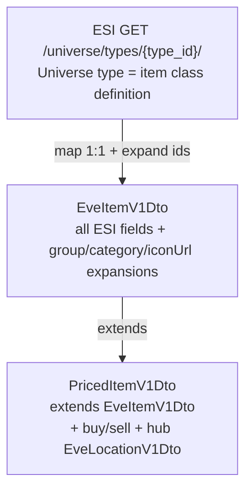
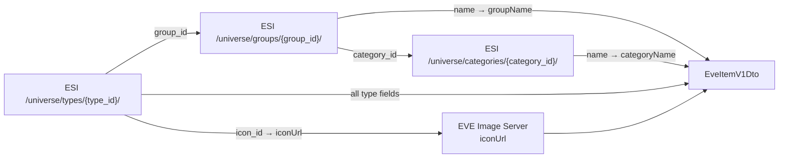
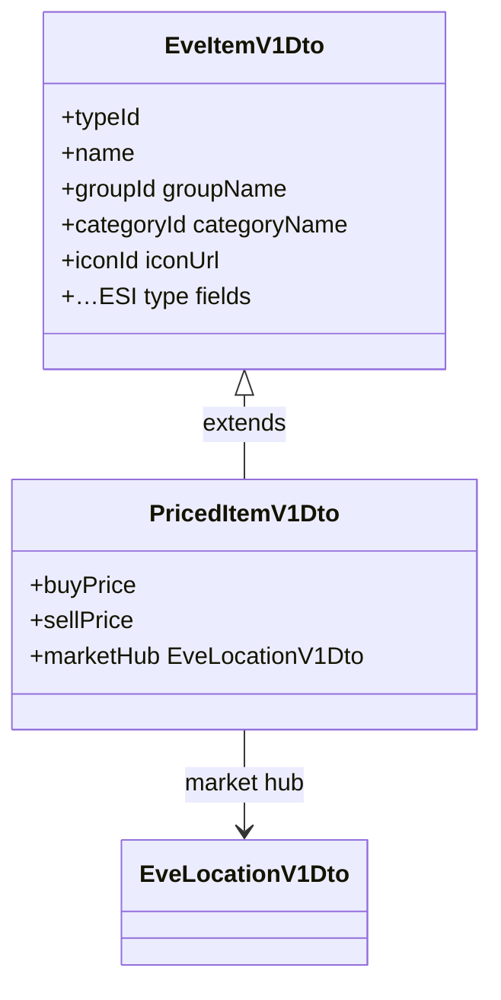
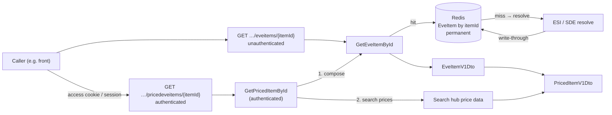

# EPIC-013 - EVE ITEMS

## Spec traceability

| Field | Value |
| --- | --- |
| Status | `applying` |
| OpenSpec changes | `back-eve-items` (ITEM-001…007, ITEM-010…026) |
| Skip | none pending for §01–§05 registered rows; re-register only if set back to `[x] reviewed` |
| Index | `L1/TRACEABILITY.md` |

## Goals

this new epic should first collect all definition on other epics related to the concept of item, eveitem or pricedeveitem. The hierarchy starts at the ESI **universe type** (`GET /universe/types/{type_id}/`) — a single **item class** definition — not an ESI “eve item” resource. Search that types operation for the field list; map it 1:1 into backend `EveItemV1Dto`, then expand selected ids (group → category, icon URL). Programme HTTP may still expose `…/eveitems/{itemId}`; the ESI source remains **types** only (DEF-EI-001).

## Search criteria

## Sources

## Table of contents

- [Spec traceability](#spec-traceability)
- [Goals](#goals)
- [Search criteria](#search-criteria)
- [Sources](#sources)
- [Intake — related L1 definitions](#intake--related-l1-definitions)
- [Section 01 — Hierarchy: ESI type → EveItemV1Dto → PricedItemV1Dto](#section-01--hierarchy-esi-type--eveitemv1dto--priceditemv1dto)
- [Section 02 — ESI universe type fields](#section-02--esi-universe-type-fields)
- [Section 03 — EveItemV1Dto (back interchange)](#section-03--eveitemv1dto-back-interchange)
- [Section 04 — PricedItemV1Dto (extends EveItemV1Dto)](#section-04--priceditemv1dto-extends-eveitemv1dto)
- [Section 05 — Back use cases: get by item id](#section-05--back-use-cases-get-by-item-id)
- [Version card](#version-card)

### Section index

| Section | Title | Origin |
| --- | --- | --- |
| [01](#section-01--hierarchy-esi-type--eveitemv1dto--priceditemv1dto) | Hierarchy ESI → EveItemV1Dto → PricedItemV1Dto | authored 2026-11-06 |
| [02](#section-02--esi-universe-type-fields) | ESI `GET /universe/types/{type_id}/` fields | ESI latest (sample type 34) |
| [03](#section-03--eveitemv1dto-back-interchange) | EveItemV1Dto | authored 2026-11-06 |
| [04](#section-04--priceditemv1dto-extends-eveitemv1dto) | PricedItemV1Dto extends EveItemV1Dto | moved from EPIC-004 §03; inheritance clarified |
| [05](#section-05--back-use-cases-get-by-item-id) | Get EveItem / PricedItem by item id (EveItem HTTP authenticated) | authored 2026-11-06 |

---

## Intake — related L1 definitions

| Item | Home | Review | Action |
| --- | --- | --- | --- |
| **PricedItemV1Dto** (extends EveItemV1Dto + hub prices) | was EPIC-004 §03 | `[ ] to review` | **moved** → §04 |
| **EveItem / ESI type / EsiType mirrors** | EPIC-004 register | was `out of scope` (not published in MODELS) | **owned here** as back `EveItemV1Dto` + ESI type (§01–03); published domain packaging TBD |
| Item identity (type id + name) references | EPIC-012 (ProcessedBlueprint, ResourceV1, IND-BP-004) | `[ ] to review` | **stay** as consumers; point at this epic for item/DTO definition |
| EPIC-012 market / Jita / PricedItem hub rules | EPIC-012 §02 / §09 | `[ ] to review` | **stay** (pricing + EveLocation); PricedItem model body now §04 here |
| EveAssetV1 (instanced item + location + price) | EPIC-004 §05 | `[ ] to review` | **stay** for now (instance ≠ type definition); ask if move later |
| ShipV1 (hull type id/name) | EPIC-004 §08 | `[ ] to review` | **stay** (ship-specific; may compose EveItem later) |
| EPIC-005 ESI universe / SDE | EPIC-005 | `none` | **stay** (SDE install); type payload fields live in §02 here |

---

## Section 01 — Hierarchy: ESI type → EveItemV1Dto → PricedItemV1Dto



| Layer | Name                  | Role                                                                                                                     |
| ----- | --------------------- | ------------------------------------------------------------------------------------------------------------------------ |
| 1     | ESI universe **type** | Single **item class** definition (`type_id`). Source of truth for static type attributes.                                |
| 2     | `**EveItemV1Dto**`    | Back interchange: full ESI type fields + expansions (§03).                                                               |
| 3     | `**PricedItemV1Dto**` | **Extends** `EveItemV1Dto`: same item payload, plus **buy/sell prices** for a given **market hub** (`EveLocationV1Dto`). |

### Outbound adapter packages (hexagonal)

Back outbound adapters for this feature SHALL be grouped by **function**, not by the DTO/result type they help produce (DEF-EI-002):

| Package under `adapters/outbound` | Role |
| --- | --- |
| `universe` | ESI universe API (types / groups / categories / locations) |
| `persistence` | Redis and other persistence databases / stores (not a result-type folder) |
| `market` | Market hub price adapters (ESI region orders → Jita 4-4) |
| `industry` | Industry / blueprint-list outbound services (ESI industry + list processing) |

| ID       | Review     | Requirement                                                                                                                                                                                                                                                                  |
| -------- | ---------- | ---------------------------------------------------------------------------------------------------------------------------------------------------------------------------------------------------------------------------------------------------------------------------- |
| ITEM-023 | registered | Back hexagonal outbound adapters SHALL be packaged by **function** (`universe`, `persistence`, `market`, `industry`, …) — not under a result-type folder such as `outbound/eveitem/` or `outbound/blueprint-list/`; **Redis** adapters live under `persistence` (DEF-EI-002) |

---

## Section 02 — ESI universe type fields

**Endpoint:** `GET /universe/types/{type_id}/` (ESI Universe — “Get type information”).  
**Docs:** [ESI Swagger UI](https://esi.evetech.net/ui/?version=latest) · operation `get_universe_types_type_id`.  
**Required in ESI schema:** `type_id`, `name`, `description`, `published`, `group_id`.

| Field | Type (ESI) | Required | Notes |
| --- | --- | --- | --- |
| `type_id` | integer | yes | Item type id |
| `name` | string | yes | Localized name |
| `description` | string | yes | Localized description (may contain HTML) |
| `published` | boolean | yes | Whether the type is published |
| `group_id` | integer | yes | Universe group id → expand on DTO |
| `capacity` | number | no | e.g. cargo capacity |
| `dogma_attributes` | array `{ attribute_id, value }` | no | Dogma attributes |
| `dogma_effects` | array `{ effect_id, is_default }` | no | Dogma effects |
| `graphic_id` | integer | no | Graphic |
| `icon_id` | integer | no | Icon id (image server also uses `type_id` for type icons) |
| `market_group_id` | integer | no | Market group → expand on DTO |
| `mass` | number | no | |
| `packaged_volume` | number | no | |
| `portion_size` | integer | no | |
| `radius` | number | no | |
| `volume` | number | no | |

Sample (Tritanium `type_id=34`, ESI latest): `capacity`, `description`, `group_id`, `icon_id`, `market_group_id`, `mass`, `name`, `packaged_volume`, `portion_size`, `published`, `radius`, `type_id`, `volume` (dogma arrays absent on that type).  
Also validated: Kernite `type_id=20` (includes `dogma_attributes`) — DEF-EI-001 types pairing.

| ID       | Review        | Requirement                                                                                                     |
| -------- | ------------- | --------------------------------------------------------------------------------------------------------------- |
| ITEM-001 | registered | The programme item **class** definition SHALL start from ESI `GET /universe/types/{type_id}/` (universe type)   |
| ITEM-002 | registered | Back mapping SHALL treat the ESI field set above as the baseline type payload (required + optional as returned) |
| ITEM-022 | registered | EveItem miss-path / ESI source SHALL pair to **universe types** only (`GET /universe/types/{type_id}/` + group/category expansions); back SHALL NOT use or name an ESI “eve item” resource adapter — programme HTTP `eveitems` remains the public NeoCom path (DEF-EI-001) |

---

## Section 03 — EveItemV1Dto (back interchange)

**Owner:** `neocom-back` interchange class `EveItemV1Dto` (`Dto` suffix — same convention as `BlueprintV1Dto` / industry list processing).

**EveItemV1Dto SHALL:**

1. Carry **all** ESI universe-type fields from [Section 02](#section-02--esi-universe-type-fields) (camelCase or programme naming on the DTO is allowed if the mapping from snake_case ESI is explicit).
2. **Expand** selected id fields into resolved data (names / nested refs / media URLs) as below.

### Expansion: `group_id` → group → category (ESI Universe)

When building `EveItemV1Dto` from a type, the back SHALL resolve classification via ESI Universe (cached/SDE equivalent MAY supply the same fields):

```text
GET /universe/types/{type_id}/              → group_id
GET /universe/groups/{group_id}/            → name, category_id, …
GET /universe/categories/{category_id}/     → name, …
```

| Step | ESI                                       | Yields                                                                         |
| ---- | ----------------------------------------- | ------------------------------------------------------------------------------ |
| 1    | Type already has `group_id`               | e.g. Tritanium `group_id=18`                                                   |
| 2    | `GET /universe/groups/{group_id}/`        | `group_id`, `**name**` (group name), `**category_id**`, `published`, `types[]` |
| 3    | `GET /universe/categories/{category_id}/` | `category_id`, `**name**` (category name), `published`, `groups[]`             |

Example (type 34 Tritanium): group **18** “Mineral” → category **4** “Material”.

**DTO fields added / filled by this expansion:**

| Field on `EveItemV1Dto` | Source |
| --- | --- |
| `groupId` | ESI type `group_id` |
| `groupName` | ESI group `name` |
| `categoryId` | ESI group `category_id` |
| `categoryName` | ESI category `name` |

### Expansion: `icon_id` → `iconUrl` (EVE Image Server)

Keep the raw ESI `icon_id` on the DTO. When `icon_id` is present, the back SHALL also set a new field with the **resolved icon URL** on the EVE Image Server (URL string only — not image bytes; aligns with EPIC-006 UI-MED-002).

| Field on `EveItemV1Dto` | Source |
| --- | --- |
| `iconId` | ESI type `icon_id` (when returned) |
| `iconUrl` | Image Server URL derived when that icon is resolved for media display |

URL construction SHALL follow the programme Image Server pattern (EPIC-006 UI-MED): `https://images.evetech.net/…`. Prefer the programme type-icon form `types/{type_id}/icon` (optional `?size=…`) when that is the documented resolution for item icons associated with this type; if a dedicated Image Server path keyed by `icon_id` is later confirmed, use that for `iconUrl` and record it here. Clients load the image from `iconUrl` directly.

### Other expansions

| ESI id field | Expansion |
| --- | --- |
| `market_group_id` | Market group name when present (`GET /markets/groups/{market_group_id}/` or equivalent) |
| `graphic_id` | Keep id; graphic URL expansion is a **gap** unless a later requirement names it |



| ID       | Review        | Requirement                                                                                                                                                                                                         |
| -------- | ------------- | ------------------------------------------------------------------------------------------------------------------------------------------------------------------------------------------------------------------- |
| ITEM-003 | registered | Backend SHALL define `EveItemV1Dto` containing the full ESI universe-type field set for one `type_id`                                                                                                               |
| ITEM-004 | registered | From type `group_id`, the back SHALL call ESI `GET /universe/groups/{group_id}/` (or equivalent) and set `**groupName**` on `EveItemV1Dto`                                                                          |
| ITEM-005 | registered | From that group’s `category_id`, the back SHALL call ESI `GET /universe/categories/{category_id}/` (or equivalent) and set `**categoryId**` and `**categoryName**` on `EveItemV1Dto`                                |
| ITEM-006 | registered | When ESI type returns `icon_id`, `EveItemV1Dto` SHALL keep `iconId` and SHALL add `**iconUrl**` — the resolved EVE Image Server URL for that icon (URL string only; client loads the image)                         |
| ITEM-007 | registered | Front / other consumers that need a full type definition SHALL obtain it via back `EveItemV1Dto` (or a later published domain type mapped from it), not by calling ESI types / groups / categories from the browser |

---

## Section 04 — PricedItemV1Dto (extends EveItemV1Dto)

Moved from EPIC-004 §03 (`[ ] to review`). **PricedItemV1Dto** is **not** a thin identity wrapper: it **extends** `EveItemV1Dto`, inheriting the full type payload (ESI fields + group/category/`iconUrl` expansions), and **adds** price information for a **market hub**.

### Inheritance



| Layer | Content |
| --- | --- |
| From **EveItemV1Dto** | All fields defined in [Section 03](#section-03--eveitemv1dto-back-interchange) |
| Added on **PricedItemV1Dto** | Hub-scoped market prices below |

### Added fields (hub pricing)

| Field | Type | Purpose |
| --- | --- | --- |
| `buyPrice` | number | Price when the pilot **buys** this item at the hub |
| `sellPrice` | number | Price when the pilot **sells** this item at the hub |
| `marketHub` | **EveLocationV1Dto** | Market / place those prices apply to (planet or station hub — EPIC-012 §09; Jita rules EPIC-012 §02). Front mapper for EveLocation still under construction. On the wire this is a **nested JSON object**, not a flat id-only field. |

Pricing SHALL use **market information from the main hubs** (not an arbitrary or undocumented market). The hub SHALL be explicit on the model so UI can show which market the buy and sell prices belong to. A `PricedItemV1Dto` instance is always an `EveItemV1Dto` **plus** prices for **one** hub (re-price at another hub → another priced instance or updated hub+prices).

### Serialisation (JSON)

When serialised, **PricedItemV1Dto** SHALL expose:

1. Inherited **EveItemV1Dto** fields (same shape as §03), and
2. Hub-price fields `buyPrice`, `sellPrice`, and
3. `**marketHub` as a nested JSON object** whose properties are the serialised **EveLocationV1Dto** for that hub (EPIC-012 §09) — not a bare location id string / number in place of the object.

Illustrative shape (field names only; not a full schema):

```json
{
  "typeId": 34,
  "name": "…",
  "buyPrice": 0,
  "sellPrice": 0,
  "marketHub": {
    "locationId": 0,
    "locationType": "…"
  }
}
```

Back interchange name is `**PricedItemV1Dto**` (`Dto` suffix while owned on `neocom-back`). `jsonClass` / published domain name MAY drop `Dto` only when a later requirement publishes the type outside the back.

| ID       | Review     | Requirement                                                                                                                                                                                                                                                |
| -------- | ---------- | ---------------------------------------------------------------------------------------------------------------------------------------------------------------------------------------------------------------------------------------------------------- |
| ITEM-010 | registered | **PricedItemV1Dto** SHALL **extend EveItemV1Dto** (inherit full type + expansions); it SHALL NOT be only type id/name without the EveItem payload                                                                                                          |
| ITEM-011 | registered | **PricedItemV1Dto** SHALL add `**buyPrice`**,** `**sellPrice`, and `**marketHub`** (**EveLocationV1Dto**) for the hub those prices apply to                                                                                                                |
| ITEM-012 | registered | Buy/sell on PricedItemV1Dto SHALL be interpreted only together with `**marketHub**` (same hub semantics as EPIC-012 market / Jita rules)                                                                                                                   |
| ITEM-013 | registered | When serialised, PricedItemV1Dto SHALL expose inherited EveItemV1Dto fields plus `buyPrice`, `sellPrice`, and `**marketHub` as a nested JSON object** (EveLocationV1Dto properties); location SHALL NOT be serialised as a bare id in place of that object |

---

## Section 05 — Back use cases: get by item id

**Owner:** `neocom-back` application use cases (and the HTTP adapters that expose them).

The back SHALL expose use cases to resolve item definitions by **item id** (ESI / DTO `typeId` — the universe type id for that item class):

| Use case | Input | Output |
| --- | --- | --- |
| Get **EveItem** (`GetEveItemById`) | item id (`typeId`) | `EveItemV1Dto` (§03) |
| Get **Priced EveItem** (`GetPricedItemById`) | item id (`typeId`) | `PricedItemV1Dto` (§04) — **composes** GetEveItemById, then attaches hub buy/sell + nested `marketHub` |



There are **two** HTTP endpoints (separate resources):

| Use case | Endpoint | HTTP auth |
| --- | --- | --- |
| **GetEveItemById** | `GET /api/v1/universe/eveitems/{itemId}` | **Unauthenticated** (public) |
| **GetPricedItemById** | `GET /api/v1/universe/pricedeveitems/{itemId}` | **Authenticated** |

**Authentication (HTTP vs use case):**

| Surface | Auth |
| --- | --- |
| **HTTP** `…/eveitems/{itemId}` | **Unauthenticated** — no pilot session / access cookie required |
| **HTTP** `…/pricedeveitems/{itemId}` | **Authenticated** — pilot session / access cookie required |
| **GetPricedItemById** use case | **Authenticated** — SHALL require a pilot session / access identity; callers without auth SHALL be rejected (HTTP adapter enforces; use case also treats auth as required) |
| **GetEveItemById** use case | Callable by its **public** HTTP adapter **and** by an already-authenticated **GetPricedItemById** (composition) without a second HTTP auth check |

### HTTP endpoint — GetEveItemById → eveitems (unauthenticated)

**GetEveItemById** SHALL have **its own** HTTP endpoint under **eveitems**. That endpoint SHALL be **unauthenticated** (public universe type facts).

|               |                                                                         |
| ------------- | ----------------------------------------------------------------------- |
| Method / path | `GET /api/v1/universe/eveitems/{itemId}`                                |
| Path param    | `itemId` — universe type id (`typeId`)                                  |
| Auth          | **None** — no access cookie / session required                          |
| Success body  | serialised `**EveItemV1Dto**` (§03)                                     |
| Not found     | programme not-found error (e.g. HTTP 404) when that item id has no type |

### HTTP endpoint — GetPricedItemById → pricedeveitems (authenticated)

**GetPricedItemById** SHALL have **its own** HTTP endpoint under **pricedeveitems** (not the eveitems path). **Only** this priced endpoint SHALL be **authenticated** (eveitems stays public).

|               |                                                                                                                                                          |
| ------------- | -------------------------------------------------------------------------------------------------------------------------------------------------------- |
| Method / path | `GET /api/v1/universe/pricedeveitems/{itemId}`                                                                                                           |
| Path param    | `itemId` — universe type id (`typeId`)                                                                                                                   |
| Auth          | **Required** (pilot access cookie / session) — unauthenticated callers SHALL be rejected                                                                 |
| Success body  | serialised `**PricedItemV1Dto**` (§04) — EveItem fields + buy/sell + nested `marketHub`                                                                  |
| Not found     | programme not-found error (e.g. HTTP 404) when that item id has no type (or cannot be priced — exact miss rule is a **gap** if prices-only miss differs) |

Both paths align with the existing universe adapter style (`…/universe/spacelocations/{locationId}`). Exact Nest controller/file naming is implementation detail.

### Redis cache — EveItem by item id

**EveItemV1Dto** instances SHALL be cacheable in the **Redis** database already used by `neocom-back` (`REDIS_URL`), keyed by **item id** (`typeId` / path `itemId`).

| Rule     | Detail                                                                                                           |
| -------- | ---------------------------------------------------------------------------------------------------------------- |
| Key      | Item id (universe type id)                                                                                       |
| Value    | Complete serialisable `**EveItemV1Dto**` for that id                                                             |
| Lifetime | **Permanent** (no TTL / no scheduled expiry) — type definitions are treated as long-lived                        |
| Hit      | Return the cached EveItem without re-calling ESI                                                                 |
| Miss     | Resolve via ESI / SDE equivalent (§02–§03), then **write through** to Redis under that item id                   |
| Downtime | If Redis is unavailable, resolve still MUST succeed from ESI/SDE; cache write MAY be skipped until Redis is back |

This cache applies to **EveItem** (static type definition). **PricedItem** hub prices are market data and **SHALL NOT** share this permanent EveItem Redis entry — they use the **market price caches** below (ITEM-025 / ITEM-026).

### Market price caches (volatile)

Market order data is **volatile**. Price processing SHALL use a **write-through cache with TTL 5 minutes** for the ESI market-order payload used to compute hub prices (ITEM-025). After buy/sell are calculated for an item type from that data, the **calculated** `buyPrice` **/** `sellPrice` **(and hub identity)** SHALL be **write-through cached in Redis** keyed by item type id (ITEM-026), so repeated priced lookups do not recompute or re-hit ESI within the window. TTL for calculated hub quotes SHALL be **5 minutes** (same volatility window). If Redis is unavailable, price search MUST still succeed from ESI; cache writes MAY be skipped until Redis is back.

### GetPricedItemById composition

**GetPricedItemById** is an **authenticated** use case. It SHALL **not** re-resolve the type payload itself. It SHALL:

1. Call **GetEveItemById** for the same item id (so Redis / ESI path for EveItem is reused), then
2. **Search for price data** for that item at the programme **market hub** (buy/sell + nested `marketHub` EveLocationV1Dto — EPIC-012 §02 / §09), then
3. Return `**PricedItemV1Dto**`: the EveItem fields from step 1 plus the price/hub fields from step 2.

Programme **market hub price search** for GetPricedItemById SHALL use ESI region market orders for **The Forge**, filtered to **Jita 4-4** (DEF-EI-003 / ITEM-024):

| Id | Value |
| --- | --- |
| Region (The Forge) | `10000002` |
| Solar system (Jita) | `30000142` |
| Station (Jita IV - Moon 4 - Caldari Navy Assembly Plant) | `60003760` |
| ESI | `GET /markets/{region_id}/orders` → `GET /markets/10000002/orders` |

Orders at the hub are those with `location_id = 60003760`. `buyPrice` comes from buy orders (`is_buy_order: true`) — best bid (max price); `sellPrice` from sell orders (`is_buy_order: false`) — best ask (min price). `marketHub` is the EveLocation for that station (region / system / station ids above). An optional hub selector on the priced endpoint remains a **gap** until named.

| ID       | Review        | Requirement                                                                                                                                                                                                                                                                                                                                                           |
| -------- | ------------- | --------------------------------------------------------------------------------------------------------------------------------------------------------------------------------------------------------------------------------------------------------------------------------------------------------------------------------------------------------------------- |
| ITEM-014 | registered    | Backend SHALL provide a use case `GetEveItemById` returning `EveItemV1Dto` **by item id** (`typeId`)                                                                                                                                                                                                                                                                  |
| ITEM-015 | registered    | Backend SHALL provide a use case `GetPricedItemById` returning `PricedItemV1Dto` **by item id** (`typeId`), including nested `marketHub` location JSON                                                                                                                                                                                                                |
| ITEM-016 | registered    | HTTP endpoint for **pricedeveitems** SHALL be **authenticated** (access cookie / session); **eveitems** SHALL remain **unauthenticated**                                                                                                                                                                                                                              |
| ITEM-021 | registered    | **GetPricedItemById** use case SHALL be **authenticated** (pilot session / access identity required); unauthenticated invocation SHALL be rejected                                                                                                                                                                                                                    |
| ITEM-017 | registered    | Backend SHALL expose **GetEveItemById** on **unauthenticated** `GET /api/v1/universe/eveitems/{itemId}` returning `EveItemV1Dto`                                                                                                                                                                                                                                      |
| ITEM-018 | registered    | Backend SHALL cache `EveItemV1Dto` in **Redis** keyed by **item id**, **permanently** (no TTL): hit returns cache; miss resolves then write-through                                                                                                                                                                                                                   |
| ITEM-019 | registered    | **GetPricedItemById** SHALL **compose GetEveItemById** for the type payload, then **search hub price data** and attach buy/sell + `marketHub` — it SHALL NOT duplicate EveItem resolve/cache logic                                                                                                                                                                    |
| ITEM-020 | registered    | Backend SHALL expose **GetPricedItemById** on its **own** authenticated endpoint `GET /api/v1/universe/pricedeveitems/{itemId}` returning `PricedItemV1Dto` (separate from eveitems)                                                                                                                                                                                  |
| ITEM-024 | registered    | Hub price search SHALL use ESI `GET /markets/10000002/orders` (The Forge), filter orders to `location_id` **60003760** (Jita 4-4); set `buyPrice` / `sellPrice` from `is_buy_order` (best bid / best ask) and `marketHub` for station `60003760` / system `30000142` / region `10000002` — SHALL NOT use seedable hub price tables as the primary source (DEF-EI-003) |
| ITEM-025 | registered | ESI market-order data used for hub price processing SHALL be **write-through cached** with **TTL 5 minutes** (market volatility); miss fetches ESI then writes cache                                                                                                                                                                                                  |
| ITEM-026 | registered | After buy/sell are calculated for a type, the back SHALL **write-through cache** those **calculated hub prices** (`buyPrice`, `sellPrice`, hub identity) in **Redis** keyed by **item type id**, TTL **5 minutes**; hit returns cached quote without recomputing / re-fetching orders                                                                                 |

---

## Version card

| Field | Value |
| --- | --- |
| Epic | `EPIC-013 - EVE ITEMS` |
| Created | `2026-11-06` |
| Status | `none` |
