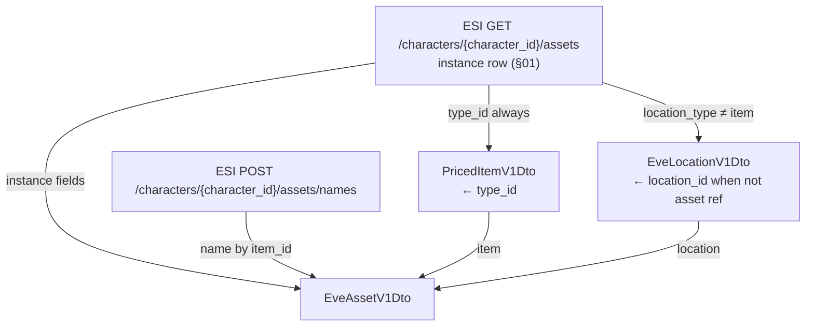
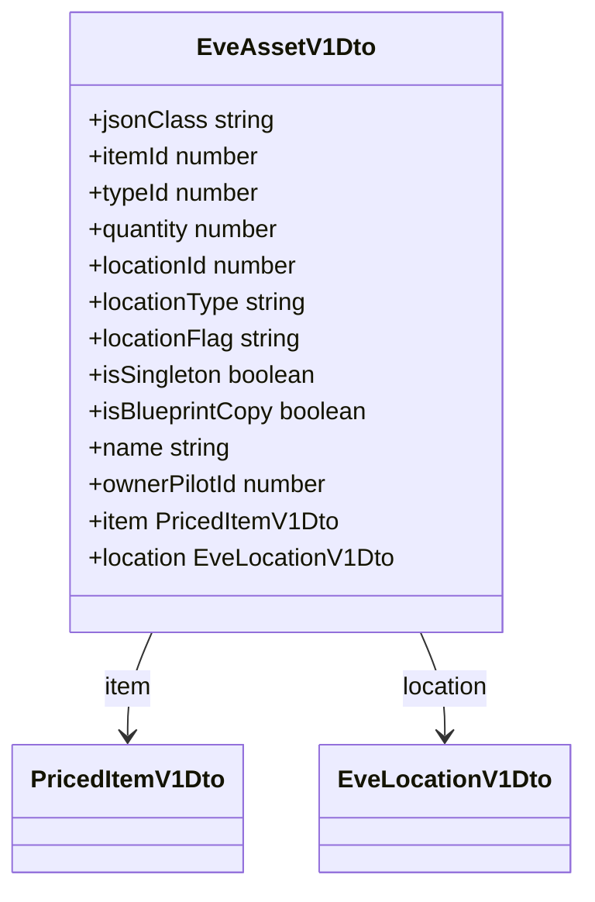
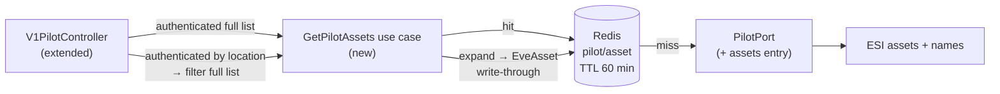
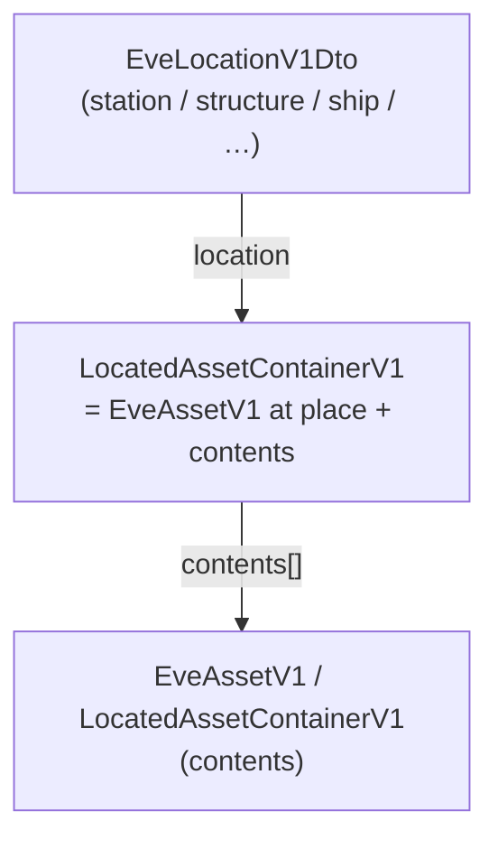
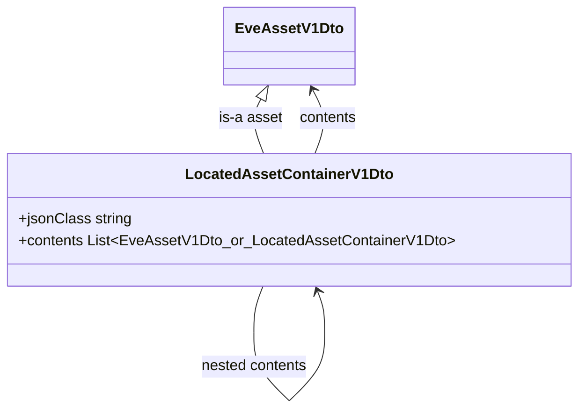

# EPIC-014 - ASSETS

## Spec traceability

| Field | Value |
| --- | --- |
| Status | `applied` |
| OpenSpec changes | `back-assets` (AST-001…014; merged [neocom-back#9](https://github.com/AdamAntinoo/neocom-back/pull/9); develop @ `63a2098`; openspec validate passed) |
| Skip | LOC-080 still `[ ] to review` (§04); §01 specimen has no Review gate; intake rows still `[ ] to review`; re-register only rows set back to `[x] reviewed` |
| Index | `L1/TRACEABILITY.md` |

## Goals

Assets are the belongings of a ilot. They are packs of identical eve types on a location. There are two ESI outputs used here: (1) character asset rows from `https://esi.evetech.net/characters/{character_id}/assets` (see §01); (2) asset personal names from `https://esi.evetech.net/characters/{character_id}/assets/names` (see §01 / §02).

## Search criteria

## Sources

## Table of contents

- [Spec traceability](#spec-traceability)
- [Goals](#goals)
- [Search criteria](#search-criteria)
- [Sources](#sources)
- [Intake — related L1 definitions](#intake--related-l1-definitions)
- [Section 01 — ESI character assets (specimen)](#section-01--esi-character-assets-specimen)
- [Section 02 — EveAssetV1](#section-02--eveassetv1)
- [Section 03 — LocatedAssetContainerV1](#section-03--locatedassetcontainerv1)
- [Section 04 — ShippingYardLocation](#section-04--shippingyardlocation)
- [Version card](#version-card)

### Section index

| Section | Title | Origin |
| --- | --- | --- |
| [01](#section-01--esi-character-assets-specimen) | ESI `GET /characters/{character_id}/assets` specimen + related ESI outputs | authored 2026-11-07 from `/epic assets` |
| [02](#section-02--eveassetv1) | EveAssetV1 (+ proposed back `EveAssetV1Dto` fields) | moved from EPIC-004 §05; back fields authored 2026-11-07 |
| [03](#section-03--locatedassetcontainerv1) | LocatedAssetContainerV1 (was LocationAssetContainer) | renamed / reframed from EPIC-008 §09 |
| [04](#section-04--shippingyardlocation) | ShippingYardLocation | moved from EPIC-008 §10 (was `out of scope`) |

---

## Intake — related L1 definitions

| Item | Home | Review | Action |
| --- | --- | --- | --- |
| **EveAssetV1** (+ back `EveAssetV1Dto` fields) | was EPIC-004 §05 | `[ ] to review` | **owned here** → §02 |
| **LocatedAssetContainerV1** (was LocationAssetContainer) | was EPIC-008 §09 | `[ ] to review` | **owned here** → §03 |
| **ShippingYardLocation** | was EPIC-008 §10 | `[ ] to review` | **moved** → §04 |
| Eve type / EveItemV1Dto / PricedItemV1Dto | EPIC-013 | applied | **compose** into asset as nested item (+ price) |
| EveLocationV1Dto | EPIC-012 §09 | `[ ] to review` | **compose** as nested asset place |

---

## Section 01 — ESI character assets (specimen)

**Endpoint (assets list):** `GET /characters/{character_id}/assets`  
**Docs base:** `https://esi.evetech.net/` (latest / character assets).

### Related ESI outputs named in Goals

| Output | Endpoint | Role (as stated) | Status |
| --- | --- | --- | --- |
| Character assets list | `GET /characters/{character_id}/assets` · `https://esi.evetech.net/characters/{character_id}/assets` | Rows of packs / singletons of a `type_id` at a `location_id` | specimen below |
| Asset personal name | `POST /characters/{character_id}/assets/names` · `https://esi.evetech.net/characters/{character_id}/assets/names` | Returns the asset’s **personal name** for given instance `item_id`s | response specimen below; join by `item_id` → DTO `name` (§02). Request body still confirm at apply (POST + auth verified) |

ESI allows **POST** on the names path (verified `Allow: POST`). Auth token required.

### Observed fields on asset rows

| Field | Seen | Notes from specimen |
| --- | --- | --- |
| `item_id` | always | Unique instance id |
| `type_id` | always | EVE universe type (item class) — packs of identical types |
| `quantity` | always | Stack size; often `1` when `is_singleton` |
| `location_id` | always | Station id or containing item id |
| `location_type` | always | e.g. `station`, `item` |
| `location_flag` | always | e.g. `Hangar`, `Cargo`, `AutoFit`, slot names, `Unlocked`, `AssetSafety`, `FleetHangar`, `DroneBay` |
| `is_singleton` | always | `true` / `false` |
| `is_blueprint_copy` | optional | Present and `true` on BPC rows |

### Representative rows (from developer specimen)

Station hangar pack:

```json
{
  "is_singleton": false,
  "item_id": 1034894844738,
  "location_flag": "Hangar",
  "location_id": 60002284,
  "location_type": "station",
  "quantity": 208,
  "type_id": 3554
}
```

Contained stack (`location_type` = `item`):

```json
{
  "is_singleton": false,
  "item_id": 1011917342715,
  "location_flag": "AutoFit",
  "location_id": 1019725660401,
  "location_type": "item",
  "quantity": 200,
  "type_id": 38
}
```

Fitted singleton:

```json
{
  "is_singleton": true,
  "item_id": 1019758915045,
  "location_flag": "LoSlot3",
  "location_id": 1019758942036,
  "location_type": "item",
  "quantity": 1,
  "type_id": 519
}
```

Blueprint copy:

```json
{
  "is_blueprint_copy": true,
  "is_singleton": true,
  "item_id": 1022891152936,
  "location_flag": "AutoFit",
  "location_id": 1035078758754,
  "location_type": "item",
  "quantity": 1,
  "type_id": 21964
}
```

Asset safety (station):

```json
{
  "is_singleton": true,
  "item_id": 1042227754735,
  "location_flag": "AssetSafety",
  "location_id": 60008875,
  "location_type": "station",
  "quantity": 1,
  "type_id": 60
}
```

Jita 4-4 station hangar (known market hub station id `60003760`):

```json
{
  "is_singleton": true,
  "item_id": 1023655636930,
  "location_flag": "Hangar",
  "location_id": 60003760,
  "location_type": "station",
  "quantity": 1,
  "type_id": 620
}
```

The developer prompt included a large live assets dump; the rows above are the shape variants used for intake. Full dumps stay out of the epic body.

### Observed fields on asset names response

`POST /characters/{character_id}/assets/names` returns a JSON **array** of objects. Observed fields:

| Field | Seen | Notes from specimen |
| --- | --- | --- |
| `item_id` | always | Same instance id as on the assets list row |
| `name` | always | Personal name string; specimen also shows the literal `"None"` when no personal name is set |

### Representative names rows (from developer specimen)

```json
[
  {
    "item_id": 1008971274936,
    "name": "None"
  },
  {
    "item_id": 1011782980178,
    "name": "Prisas"
  }
]
```

Join onto the asset row / `EveAssetV1Dto` by `item_id`. Whether the literal ESI string `"None"` is stored on `EveAssetV1Dto.name` or treated as absent is decided at apply (do not invent here).

---

## Section 02 — EveAssetV1

Moved from [EPIC-004 §05](./04.EPIC-MODELS.md#section-05--eveassetv1-moved). Review `[ ] to review` on this epic.

**EveAssetV1** is the programme name for an **instanced** item that **belongs to a Pilot** and is **on a location**. Packs (or singletons) of an EVE type at a place. Raw ESI asset / type / location payloads stay server-internal.

EveAssetV1 SHALL bind at least:

| Aspect          | Meaning                                                                                                         |
| --------------- | --------------------------------------------------------------------------------------------------------------- |
| **Type / item** | Instanced item identity (type id + name; icon `types/{typeId}/icon`) — composed from EPIC-013 item DTOs         |
| **Owner**       | The Pilot who owns the asset — represented only as `**ownerPilotId`** (no nested Pilot object on the asset DTO) |
| **Location**    | The place where the asset is (EveLocation kinds allowed for assets — e.g. station, structure, ship, cargo hold) |
| **Price**       | Buy and/or sell context aligned with PricedItemV1 so lists can show value without an ad-hoc price attachment    |

### Back model: `EveAssetV1Dto` (proposed fields)

**Owner:** `neocom-back` interchange class `EveAssetV1Dto` (`Dto` suffix — same convention as `EveItemV1Dto` / `BlueprintV1Dto`). Published domain packaging of EveAssetV1 is **later**; define the back field set here first.

### Expansions (ids → nested objects)

| ESI key                                  | When                                                                                   | Expand to                                                                                                                                                    |
| ---------------------------------------- | -------------------------------------------------------------------------------------- | ------------------------------------------------------------------------------------------------------------------------------------------------------------ |
| `type_id`                                | always                                                                                 | Nested `item` as `PricedItemV1Dto` (EPIC-013 §04) — type payload + hub prices                                                                                |
| `location_id` (+ `location_type` / flag) | when location is **not** an asset reference (`location_type` ≠ `item`, e.g. `station`) | Nested `location` as `EveLocationV1Dto` (EPIC-012 §09)                                                                                                       |
| `location_id`                            | when location **is** an asset reference (`location_type` = `item`)                     | **Do not** expand into `EveLocationV1Dto`; keep `locationId` as the parent asset’s `item_id` and hang the child under that **LocatedAssetContainerV1** (§03) |



Proposed fields on `EveAssetV1Dto` (camelCase on the wire; ESI snake_case mapping SHALL be explicit):

| Field             | Type                         | Source / notes                                                                                                                                                       |
| ----------------- | ---------------------------- | -------------------------------------------------------------------------------------------------------------------------------------------------------------------- |
| `jsonClass`       | string                       | `"EveAssetV1Dto"` (interchange discriminator)                                                                                                                        |
| `itemId`          | number                       | ESI `item_id` — unique **instance** id (not expanded)                                                                                                                |
| `typeId`          | number                       | ESI `type_id` — kept as key; **expanded** into nested `item`                                                                                                         |
| `quantity`        | number                       | ESI `quantity` — stack size                                                                                                                                          |
| `locationId`      | number                       | ESI `location_id` — kept as key; **expanded** into nested `location` only when not an asset reference                                                                |
| `locationType`    | string                       | ESI `location_type` (`station`, `item`, …) — **not** the same enum as `EveLocationV1Dto.locationType`; drives whether `location` is expanded                         |
| `locationFlag`    | string                       | ESI `location_flag` (e.g. `Hangar`, `Cargo`, `AutoFit`, slots, `AssetSafety`)                                                                                        |
| `isSingleton`     | boolean                      | ESI `is_singleton`                                                                                                                                                   |
| `isBlueprintCopy` | boolean | omitted            | ESI `is_blueprint_copy` when present (BPC)                                                                                                                           |
| `name`            | string | omitted             | Personal name from ESI names response `name`, joined by `item_id` (§01 specimen). ESI may return the literal `"None"` — mapping to omit vs store as-is is apply-time |
| `ownerPilotId`    | number                       | Pilot / character id — **only** owner field; no nested Pilot                                                                                                         |
| `item`            | `PricedItemV1Dto`            | **Required expansion** of `typeId` — nested JSON object (EPIC-013 §04)                                                                                               |
| `location`        | `EveLocationV1Dto` | omitted | **Expansion** of `locationId` when `locationType` is **not** an asset reference; omit (or leave unset) when `locationType` = `item`                                  |

When expanded, `item` and `location` SHALL be full nested JSON objects, not bare ids in place of those objects. `typeId` / `locationId` MAY remain alongside the nests.



### Back: get assets (ESI source)

| Step | Endpoint |
| --- | --- |
| Asset list | `GET /characters/{character_id}/assets` · `https://esi.evetech.net/characters/{character_id}/assets` (§01) |
| Personal names (join) | `POST /characters/{character_id}/assets/names` · `https://esi.evetech.net/characters/{character_id}/assets/names` (§01) |

### Back: programme inbound — authenticated list assets

**Owner:** `neocom-back` — extend the existing pilot inbound path (`V1PilotController`), application use case, and `PilotPort` (domain port).

The programme SHALL expose a **new authenticated** HTTP endpoint that returns the **list of assets** for a pilot (mapped `EveAssetV1Dto` / `LocatedAssetContainerV1Dto` as defined above). Unauthenticated callers SHALL be rejected.

A **secondary authenticated** endpoint SHALL return assets **for one location only**: take the full pilot asset list and **filter** it to the assets that match that location (by the asset’s location identity — e.g. `locationId` / place as mapped on the DTO). Same auth rule as the full list.

Wiring (required shape — same hexagonal style as get-pilot):

| Layer        | Change                                                                                                                                                                            |
| ------------ | --------------------------------------------------------------------------------------------------------------------------------------------------------------------------------- |
| **HTTP**     | Extend `**V1PilotController`** with the authenticated full-list and by-location assets routes under the pilot tree (parallel to `GET /v1/pilots/{pilotId}` / industry blueprints) |
| **Use case** | Add a **new use case** that retrieves the pilot’s assets (maps ESI via the port into the asset DTO / located-container list); by-location MAY reuse that retrieval then filter    |
| **Port**     | Add a **new entry on `PilotPort`** for retrieving that pilot’s assets; the outbound adapter implements it (ESI character assets + names join per AST-005…006)                     |

Suggested paths (apply MAY refine OpenAPI names only):

| Endpoint | Behaviour |
| --- | --- |
| `GET /v1/pilots/{pilotId}/assets` | Full authenticated list of assets |
| `GET /v1/pilots/{pilotId}/assets/locations/{locationId}` | Authenticated list **filtered** to assets that match that location |



### Redis cache — expanded EveAsset by pilot

Once assets are **obtained** (ESI + map/expand per AST-003…006), they SHALL be expanded into **EveAsset** interchange (`EveAssetV1Dto` / `LocatedAssetContainerV1Dto` as applicable) and **write-through cached in Redis** for fast retrieval.

| Aspect   | Rule                                                                                                                  |
| -------- | --------------------------------------------------------------------------------------------------------------------- |
| Store    | Redis already used by `neocom-back` (`REDIS_URL`); outbound under `**persistence**`                                   |
| Key      | `**pilot/asset**` key space for that pilot’s cached assets (exact key string apply-time; MUST be under pilot + asset) |
| Payload  | Expanded EveAsset list (not raw ESI rows)                                                                             |
| Lifetime | **TTL 60 minutes**                                                                                                    |
| Hit      | Return cached expanded assets without re-calling ESI                                                                  |
| Miss     | Obtain + expand from ESI path, then **write through** with TTL 60 minutes                                             |
| Downtime | If Redis is unavailable, obtain/expand MUST still succeed from ESI; cache write MAY be skipped until Redis is back    |

By-location (AST-013) MAY filter from the cached full list when the cache is warm.

### Gaps (do not invent)

| Topic | Status |
| --- | --- |
| When ESI `location_type = item` | No `EveLocationV1Dto` expansion; parent is **LocatedAssetContainerV1** (§03); child keeps `locationId` = parent `item_id` |
| Names request body | Confirm item-id list shape at apply (response specimen recorded in §01) |
| ESI name literal `"None"` | Store on DTO vs treat as absent — decide at apply |
| Exact `PilotPort` method name / OpenAPI operationId | Apply-time — behaviour fixed by AST-007…009, AST-013…014 |
| Match rule for nested contents under a location | Apply-time — filter is “assets that match that location” on the full list (AST-013) |
| Exact Redis key string under `pilot/asset` | Apply-time — key space is pilot + asset (AST-014) |

| ID      | Review        | Requirement                                                                                                                                                                                                                                                                        |
| ------- | ------------- | ---------------------------------------------------------------------------------------------------------------------------------------------------------------------------------------------------------------------------------------------------------------------------------- |
| AST-001 | registered    | **EveAssetV1** SHALL represent an **instanced** item that belongs to a **Pilot** and is on a location; raw ESI asset/type/location payloads stay server-internal                                                                                                                   |
| AST-002 | registered    | Backend SHALL define `EveAssetV1Dto` with the proposed instance fields: `jsonClass`, `itemId`, `typeId`, `quantity`, `locationId`, `locationType`, `locationFlag`, `isSingleton`, optional `isBlueprintCopy`, optional `name`, and `ownerPilotId`                                  |
| AST-003 | registered    | ESI `type_id` SHALL be **expanded** into nested `EveAssetV1Dto.item` as `PricedItemV1Dto` (EPIC-013) — a JSON object, not a bare type id alone                                                                                                                                     |
| AST-004 | registered    | When ESI `location_type` is **not** an asset reference (`item`), ESI `location_id` SHALL be **expanded** into nested `EveAssetV1Dto.location` as `EveLocationV1Dto` (EPIC-012 §09); when `location_type` is `item`, do **not** expand location — use LocatedAssetContainerV1 (§03) |
| AST-005 | registered    | Personal name for an asset instance SHALL come from ESI `POST /characters/{character_id}/assets/names` response objects `{ item_id, name }` (§01 specimen) joined by `item_id`, and SHALL populate `EveAssetV1Dto.name` from that `name`                                           |
| AST-006 | registered    | Back **get assets** SHALL obtain the character asset list from ESI `GET /characters/{character_id}/assets` and map rows into `EveAssetV1Dto` / located containers                                                                                                                  |
| AST-007 | registered | Backend SHALL expose a **new authenticated** programme HTTP endpoint that returns the **list of assets** for the pilot (`EveAssetV1Dto` / `LocatedAssetContainerV1Dto`); unauthenticated callers SHALL be rejected                                                                 |
| AST-008 | registered | Backend SHALL add a **new use case** to retrieve the pilot’s assets (ESI → mapped asset / located-container list)                                                                                                                                                                  |
| AST-009 | registered | Backend SHALL add a **new entry on `PilotPort`** for retrieving that pilot’s assets, and SHALL **extend `V1PilotController`** to expose the authenticated list-assets endpoint                                                                                                     |
| AST-013 | registered | Backend SHALL expose a **secondary authenticated** programme HTTP endpoint that returns **only assets from a given location**: the full pilot asset list SHALL be **filtered** to assets that match that location                                                                  |
| AST-014 | registered | Once assets are obtained they SHALL be **expanded into EveAsset** and **write-through cached in Redis** under the `**pilot/asset`** key space for fast retrieval; asset cache **TTL SHALL be 60 minutes**                                                                          |

---

## Section 03 — LocatedAssetContainerV1

Former **LocationAssetContainer** (EPIC-008 §09 / infinity `LocationAssetContainerSerializer`). Renamed and reframed here as **LocatedAssetContainerV1**. Review `[ ] to review`.

**LocatedAssetContainerV1** is an **asset in a location that contains other assets inside**. It is itself an EveAssetV1 (instance + place + type/price), and it exposes the nested assets that ESI places under it (`location_type = item` and `location_id` = this container’s `item_id` — see §01 specimen “Contained stack” / fitted rows).



Legacy infinity grouped corporation assets by shared `SpaceLocation` (`CorporationServiceV1.getCorporationAssetsByLocation` → `LocationAssetContainer` with `spaceLocation`, `containerType`, `contents`). That shape is **superseded** for new work by LocatedAssetContainerV1: the **container is the asset**, not a bare place-bucket. Historical serializer / `containerType` notes stay as limitations only.

### Back model: `LocatedAssetContainerV1Dto` (proposed fields)

**Owner:** `neocom-back` interchange class `LocatedAssetContainerV1Dto` (`Dto` suffix).

| Field                    | Type                                                            | Source / notes                                                                                                                            |
| ------------------------ | --------------------------------------------------------------- | ----------------------------------------------------------------------------------------------------------------------------------------- |
| `jsonClass`              | string                                                          | `"LocatedAssetContainerV1Dto"`                                                                                                            |
| *(EveAssetV1Dto fields)* | —                                                               | All proposed fields from [§02](#section-02--eveassetv1) — the container **is** an asset at a location                                     |
| `contents`               | list of `**EveAssetV1Dto**` or `**LocatedAssetContainerV1Dto**` | Assets located inside this container (ESI children whose `location_id` = this `itemId`); nested containers when a child also has contents |

On the wire, `contents` SHALL be a JSON array of nested asset (or located-container) objects, not bare `item_id`s alone.



### Limitations (legacy)

- Infinity `LocationAssetContainerSerializer` used `spaceLocation` + `containerType` + `contents`; no front render selected that `jsonClass`.
- `containerType` values lived in the datamanagement library, not infinity `src` — not carried forward unless a later requirement names them.

| ID      | Review        | Requirement                                                                                                                                                                                                        |
| ------- | ------------- | ------------------------------------------------------------------------------------------------------------------------------------------------------------------------------------------------------------------ |
| AST-010 | registered | **LocatedAssetContainerV1** SHALL be an **EveAssetV1** that is **in a location** and **contains other assets** inside it (former LocationAssetContainer concept, renamed)                                          |
| AST-011 | registered | Backend SHALL define `LocatedAssetContainerV1Dto` that includes the EveAssetV1Dto field set plus a `**contents**` array of nested `EveAssetV1Dto` / `LocatedAssetContainerV1Dto` objects                           |
| AST-012 | registered | When ESI `location_type` is `item`, the child’s `location_id` SHALL identify the parent container asset’s `itemId`; that parent SHALL be represented as a **LocatedAssetContainerV1** with the child in `contents` |
| LOC-070 | superseded    | Former “corporation assets grouped by SpaceLocation + containerType + contents” — replaced by AST-010…012 for new work                                                                                             |

---

## Section 04 — ShippingYardLocation

Moved from [EPIC-008 §10](./08.EPIC-LOCATIONS.md#section-10--shippingyardlocation-moved) (was `out of scope` there). Review set to `[ ] to review` on this epic.

Source: `infinity.backend.corporation.domain.ShippingYardLocation`. A yard is a corporation asset whose user label starts with `ShipYard`, whose parent office asset exists, and whose office location is a **Station**.

| Field | Type | Notes |
| --- | --- | --- |
| `jsonClass` | string | Serializer field |
| `deposit` | NeoAsset | Required. `withYardDeposit` |
| `officeContainer` | NeoAsset | Required. `withOfficeContainer` |
| `station` | Station | Set by `withStation`. The service only builds a yard when the catalog returns a `Station` |

| ID | Review | Requirement |
| --- | --- | --- |
| LOC-080 | [ ] to review | A shipping yard SHALL bind a deposit asset, an office container asset, and the **Station** of that office |

### Limitations

- `withStation(null)` throws. Omitting `withStation` leaves `station` null; `build` only checks deposit and office.
- Yards are detected by the label prefix `ShipYard`, not by a location kind.
- The serializer is deprecated and still registered.

---

## Version card

| Field | Value |
| --- | --- |
| Epic | `EPIC-014 - ASSETS` |
| Created | `2026-11-07` |
| Status | `none` |
