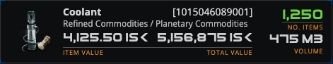

# EPIC-015 - FRONT PAGE ASSETS BY LOCATION

## Spec traceability

| Field | Value |
| --- | --- |
| Status | `applied` |
| OpenSpec changes | `front-assets-by-location` (merged [neocom-front#7](https://github.com/AdamAntinoo/neocom-front/pull/7); develop @ `d1fed92`; openspec validate passed) |
| Skip | Applying on `neocom-front` `feature/assets-by-location` (14/14 tasks coded; awaiting review/commit). Unidentified-location **icon** remains a documented gap (FAL-025). |
| Index | `L1/TRACEABILITY.md` |

## Goals

Similar to the blueprints by location I need a new page on the dashboard with a new icon (search the neocom-infinity for something appropiate). The page should render the list of assets from the new back endpoint of assets for a pilot aggregation by system and region.

## Search criteria

## Sources

## Table of contents

- [Spec traceability](#spec-traceability)
- [Goals](#goals)
- [Search criteria](#search-criteria)
- [Sources](#sources)
- [Section 01 — Dashboard Feature entry + icon](#section-01--dashboard-feature-entry--icon)
- [Section 02 — Assets by location page](#section-02--assets-by-location-page)
- [Section 03 — Pilot assets feed and Region → System aggregation](#section-03--pilot-assets-feed-and-region--system-aggregation)
- [Section 04 — Asset render (`v1-asset-render`)](#section-04--asset-render-v1-asset-render)
- [Version card](#version-card)

### Section index

| Section | Title | Origin |
| --- | --- | --- |
| [01](#section-01--dashboard-feature-entry--icon) | Dashboard Feature entry + icon | authored 2026-11-08 from `/epic front page assets by location` |
| [02](#section-02--assets-by-location-page) | Assets by location page | authored 2026-11-08 |
| [03](#section-03--pilot-assets-feed-and-region--system-aggregation) | Pilot assets feed and Region → System aggregation | authored 2026-11-08 |
| [04](#section-04--asset-render-v1-asset-render) | Asset render (`v1-asset-render`) | authored 2026-11-08 — inventory; Appearance from model-strip 2026-11-09 |

---

## Section 01 — Dashboard Feature entry + icon

Add a **new Feature** on the application **Dashboard** (same Feature / `v1-feature-button` pattern as Blueprint Availability) that opens the assets-by-location page.

### Icon (from neocom-infinity)

Infinity already uses the SDE drawable `**assets.png**` for the Assets tab:

| Source | Path |
| --- | --- |
| Infinity tab definition | `neocom-infinity-frontend/.../dashboard-tabs.json` → `"icon": "assets/res-sde/drawable/assets.png"`, `"name": "Assets"` |
| Drawable file | `neocom-infinity-frontend/src/assets/res-sde/drawable/assets.png` (64×64 PNG) |

**Interim icon (now):** reuse the Blueprint Availability Feature icon — front `imageRef` `/media/blueprints-feature.jpeg` (same asset as the blueprint Feature). Replace later with a dedicated assets icon.

**Intended final icon (later):** programme copy of infinity `assets.png` at `public/res-sde/drawable/assets.png` (or equivalent under front public assets). Alternatives in the same infinity folder: `itemhangar.png`, `items.png`, `assetscorp.png`.

| ID      | Review          | Requirement                                                                                                                                                                                            |
| ------- | --------------- | ------------------------------------------------------------------------------------------------------------------------------------------------------------------------------------------------------ |
| FAL-001 | `registered` | Dashboard Feature catalog SHALL include a Feature for **assets by location** (label e.g. **Assets by Location** / **Assets**), `interaction: PAGEROUTE`, route targeting the page in Section 02        |
| FAL-002 | `registered` | That Feature SHALL use `/media/blueprints-feature.jpeg` as interim `imageRef` (same as Blueprint Availability); a dedicated assets icon (e.g. programme copy of infinity `res-sde/drawable/assets.png`) MAY replace it later |
| FAL-003 | `registered` | Selecting the enabled Feature SHALL navigate to the assets-by-location page                                                                                                                            |

---

## Section 02 — Assets by location page

New **page** on the dashboard feature set, **similar to** blueprint-by-location (`blueprint-by-location-page` / `/industry/blueprints-by-location`).

**Short name:** `assets-by-location`  
**Selector / page:** `assets-by-location-page` (unversioned page host — UI-VER-004)  
**Module:** `**pilot`** — pilot belongings and other pilot-data pages live under this Angular module (same class as `industry` for manufacture/blueprints). MUST be reachable from the Dashboard Feature in Section 01.  
**Suggested route:** `/pilot/assets-by-location` (lazy `pilot` child route, parallel to `/industry/blueprints-by-location`)

### Pilot module ownership (pages + panels)

Programme front today seeds `v1-pilot-panel` and `v1-corporation-panel` under `modules/header/`. Those panels present **pilot / corporation** context and belong with pilot-data UI, not with chrome-only header widgets.

| Concern | Home |
| --- | --- |
| Pilot belongings pages (assets by location, later pilot-data pages) | `modules/pilot/` (+ lazy `/pilot/…` routes) |
| `v1-pilot-panel` | **Move into** `modules/pilot/` (export for secured chrome / page header composition) |
| `v1-corporation-panel` | **Move into** `modules/pilot/` (same — complements the pilot panel on the Pilot & corporation row) |
| `app-page-header` | May stay under `header` (or shared); it **consumes** the pilot-module panels, it does not own them |

### Page chrome and host panel

| ID      | Review          | Requirement                                                                                                                                                                                                                                                                                                                                                                                         |
| ------- | --------------- | --------------------------------------------------------------------------------------------------------------------------------------------------------------------------------------------------------------------------------------------------------------------------------------------------------------------------------------------------------------------------------------------------- |
| FAL-010 | `registered` | Provide page **assets-by-location** (`assets-by-location-page`) under the `**pilot`** module at `**/pilot/assets-by-location`**, reachable from the Dashboard Feature (Section 01)                                                                                                                                                                                                                  |
| FAL-011 | `registered` | The page SHALL use the common `<app-page-header />` and secured chrome consistent with other dashboard feature pages (same class as blueprint-by-location)                                                                                                                                                                                                                                          |
| FAL-012 | `registered` | The page SHALL host a panel that **renders the list of pilot assets** aggregated **by region and system**, with **unidentified-location roots** when location expansion is missing, and **asset-container** nesting from the wire tree (Section 03)                                                                                                                                                 |
| FAL-013 | `registered` | Hierarchy presentation SHALL be **Region → System → Asset/Container** (plus **Unidentified location → Asset/Container** roots); a **LocatedAssetContainer** under an Eve location expands to its **contents** children (Section 03); reuse `v1-region-render` / `v1-system-render` where they fit; asset / container leaf-or-row render per [Section 04](#section-04--asset-render-field-inventory) |
| FAL-014 | `registered` | Front SHALL introduce (or extend) a `**pilot` Angular module** as the home for **pilot belongings / pilot-data pages** (assets-by-location first; later pilot-data pages join the same module), wired as a lazy route tree under `/pilot` (same pattern as `industry` under `/industry`)                                                                                                            |
| FAL-015 | `registered` | `**v1-pilot-panel` and `v1-corporation-panel` SHALL live in the `pilot` module** (moved from `modules/header/`); secured pages keep the Pilot & corporation row composition, importing those panels from `pilot` rather than owning them under `header`                                                                                                                                             |

---

## Section 03 — Pilot assets feed and Region → System aggregation

### Back endpoint (already delivered)

Programme back (`back-assets` / EPIC-014):

| Endpoint | Role |
| --- | --- |
| `GET /v1/pilots/:pilotId/assets` | Authenticated full pilot asset list (`EveAssetV1Dto` / `LocatedAssetContainerV1Dto` tree) |
| `GET /v1/pilots/:pilotId/assets/locations/:locationId` | Same list filtered to one location id |

### Rendering / aggregation process

1. **Load** the **complete** authenticated asset list for the **selected pilot** from `GET /v1/pilots/{pilotId}/assets`.
2. **Aggregate** that list into Region / Unidentified-location roots (then System → Asset/Container as below). Grouping keys off each place-level asset’s `locationId` (and container nesting from `contents`) — **not** off nested `location` payloads stored on the asset.
3. After the aggregator has taken `locationId`, the asset’s nested `location` **field MAY be nullified** (cleared) to **reduce memory / payload space** while the tree is built and held.
4. When aggregation **first encounters a new** `locationId` (a place not yet in the aggregate), Front SHALL call a **location service** that reads the **backend space-location endpoint** for that id and use **that** response for full place information (region, system, or unidentified). **Do not** classify region/system/unidentified from `EveAssetV1Dto.location` (even if the assets response still embeds it).

Programme location lookup (already delivered): `GET /api/v1/universe/spacelocations/{locationId}` (`back-spacelocations` / space-location service). Front wraps that behind a service used by the aggregator when a new place id appears.

When that lookup **does not** yield a usable region/system chain, the place stays an **Unidentified location** root keyed by that `locationId` (same rule as before — **not** the blueprint skip path).

### Hierarchy levels (including asset containers)

The endpoint already nests **LocatedAssetContainerV1Dto** nodes: a container **is** an asset **on an Eve location** and holds other assets in `contents`. That is an **extra hierarchy level** under Region/System (or under Unidentified location): place-level children may be plain assets **or** containers; expanding a container shows its **asset children** (`contents`). Nested containers recurse the same way (wire already allows `contents` of containers).

```text
Region  (distinct regions that hold the pilot’s assets)
  └─ System  (distinct solar systems in that region that hold assets)
       ├─ Asset  (EveAssetV1Dto — leaf at this place)
       └─ AssetContainer  (LocatedAssetContainerV1Dto — asset on an Eve location)
            └─ contents…  (Asset | AssetContainer children; show when container is expanded)

UnidentifiedLocation  (distinct locationId values with no resolved region/system chain)
  ├─ Asset
  └─ AssetContainer
       └─ contents…  (same expand → children rule)
```

**Roots** of the assets-by-location tree therefore contain **Regions** and **Unidentified locations**. Under a System (or Unidentified location), place-level nodes are the pilot’s assets/containers for that place; **container expansion** reveals nested asset children from `contents`, not Region/System siblings.

### Unidentified location render

Unidentified location rows use a render **similar to** Region or System (same class of expandable hierarchy chrome: name/identity + trailing count). Exact selector / domain `jsonClass` / Appearance details are apply-time once named; **icon is defined later** (do not invent the drawable here). The row SHALL show the **count of assets** under that unidentified location.

| ID      | Review          | Requirement                                                                                                                                                                                                                                                                                                                               |
| ------- | --------------- | ----------------------------------------------------------------------------------------------------------------------------------------------------------------------------------------------------------------------------------------------------------------------------------------------------------------------------------------- |
| FAL-020 | `registered` | Front SHALL load the authenticated pilot asset list from `**GET /v1/pilots/{pilotId}/assets**` (the new back assets endpoint)                                                                                                                                                                                                             |
| FAL-021 | `registered` | Front SHALL **aggregate** the complete pilot asset list into the hierarchy using each place-level asset’s `locationId` (Region → System → Asset/Container when the location service returns a usable chain)                                                                                                                               |
| FAL-022 | `registered` | When the location service **does not** return a usable region/system chain for an asset’s `locationId`, Front SHALL **aggregate those assets under that location identifier** as an **Unidentified location** root — **not** skip them and **not** use the blueprint “no location chain → skip / empty” handling                          |
| FAL-023 | `registered` | The panel SHALL render the aggregated hierarchy so the pilot can browse assets by region and system **and** by unidentified location roots on the new page, including expandable **asset containers**                                                                                                                                     |
| FAL-024 | `registered` | Hierarchy **roots** SHALL include both **Region** nodes and **Unidentified location** nodes (grouped by the unresolved `locationId`)                                                                                                                                                                                                      |
| FAL-025 | `registered` | Each Unidentified location node SHALL be painted with a render **similar to** Region or System (expandable hierarchy row), showing at least identity for that location id and the **count of assets** under it; **icon SHALL be defined later** (gap — do not invent the drawable in this section)                                        |
| FAL-026 | `registered` | An **asset container** (`LocatedAssetContainerV1Dto`) SHALL appear as a hierarchy level under its Eve location (System or Unidentified location): it is itself an asset **located on** that place and **contains** other assets                                                                                                           |
| FAL-027 | `registered` | When an asset container is **expanded**, the panel SHALL show its **asset children** from wire `contents` (nested `EveAssetV1Dto` / `LocatedAssetContainerV1Dto`); when **collapsed**, those children SHALL not appear                                                                                                                    |
| FAL-028 | `registered` | Nested containers inside `contents` SHALL follow the same expand → show contents rule (recursive); plain `EveAssetV1Dto` nodes under a place or container are leaves for this hierarchy                                                                                                                                                   |
| FAL-029 | `registered` | Rendering SHALL **start** by loading the **complete** asset list for the **selected pilot** from `GET /v1/pilots/{pilotId}/assets` before aggregation                                                                                                                                                                                     |
| FAL-033 | `registered` | Aggregation SHALL key place grouping on `locationId`; after that id is taken, Front MAY **nullify** the asset’s nested `location` field to reduce space                                                                                                                                                                                   |
| FAL-034 | `registered` | When aggregation **adds a new location** (`locationId` not yet in the aggregate), Front SHALL resolve full place information (region, system, or unidentified) via a **location service** calling the backend `GET /api/v1/universe/spacelocations/{locationId}` endpoint — **not** by reading nested `location` data stored on the asset |
| FAL-035 | `registered` | Region / System / Unidentified classification for hierarchy roots and systems SHALL come from that location-service result, not from per-asset embedded location payloads                                                                                                                                                                 |

---

## Section 04 — Asset render (`v1-asset-render`)

**Hierarchy role:** Under Region → System (or Unidentified location), place-level nodes are **Asset** (`EveAssetV1Dto`, leaf) or **Asset container** (`LocatedAssetContainerV1Dto`, expandable). Container children come from `contents` (Section 03 FAL-026…028).

This section locks the **asset leaf** wire inventory and the **Appearance** for that leaf: programme render `v1-asset-render` (model-strip specimen).

**Endpoint result (programme back, delivered):** `GET /v1/pilots/{pilotId}/assets` returns `PilotAssetNode[]` where each node is either:

| `jsonClass` | Type | Shape |
| --- | --- | --- |
| `EveAssetV1Dto` | leaf asset | instance fields below |
| `LocatedAssetContainerV1Dto` | asset that contains others | same as `EveAssetV1Dto` **plus** `contents: PilotAssetNode[]` |

Source of truth in code: `neocom-back` `EveAssetV1Dto` / `LocatedAssetContainerV1Dto` (EPIC-014 / `back-assets`). Nested expansions: `item` → `PricedItemV1Dto`; `location` → `EveLocationV1Dto` when `locationType ≠ item`.

### `EveAssetV1Dto` — instance fields (endpoint wire)

| Field | Type | Notes |
| --- | --- | --- |
| `jsonClass` | string | `"EveAssetV1Dto"` (or `"LocatedAssetContainerV1Dto"` on containers) |
| `itemId` | number | Instance id |
| `typeId` | number | Type key (also expanded into `item`) |
| `quantity` | number | Stack size |
| `locationId` | number | Place or parent-item id |
| `locationType` | string | ESI `location_type` (`station`, `item`, …) — drives whether `location` is nested |
| `locationFlag` | string | ESI flag (e.g. `Hangar`, `Cargo`, …) |
| `isSingleton` | boolean | |
| `isBlueprintCopy` | boolean \| omitted | Present when ESI sends BPC flag |
| `name` | string \| omitted | Personal name from ESI assets/names when present |
| `ownerPilotId` | number | Owning pilot id only (no nested Pilot) |
| `item` | `PricedItemV1Dto` | **Required** expansion of `typeId` |
| `location` | `EveLocationV1Dto` \| omitted | Expansion when `locationType ≠ item`; omit for item-contained rows |

### Nested `item` — `PricedItemV1Dto` (extends `EveItemV1Dto`)

| Field | Type | Notes |
| --- | --- | --- |
| `jsonClass` | string | `"PricedItemV1Dto"` |
| `typeId` | number | |
| `name` | string | Type name |
| `description` | string | |
| `published` | boolean | |
| `groupId` | number | |
| `capacity` | number \| omitted | |
| `dogmaAttributes` | — | **Remove** — see [EPIC-016 §01](./16.EPIC-OPTIMIZATIONS.md#section-01--drop-unused-dogma-fields-from-eveitemv1dto) (OPT-001); not used by front |
| `dogmaEffects` | — | **Remove** — same (OPT-001) |
| `graphicId` | number \| omitted | |
| `iconId` | number \| omitted | |
| `marketGroupId` | number \| omitted | |
| `mass` | number \| omitted | |
| `packagedVolume` | number \| omitted | |
| `portionSize` | number \| omitted | |
| `radius` | number \| omitted | |
| `volume` | number \| omitted | |
| `groupName` | string \| omitted | Expanded group |
| `categoryId` | number \| omitted | |
| `categoryName` | string \| omitted | |
| `iconUrl` | string \| omitted | Image-server URL when resolvable |
| `buyPrice` | number | Hub buy |
| `sellPrice` | number | Hub sell |
| `marketHub` | `EveLocationV1Dto` | Nested hub location (not a bare id) |

### Nested `location` — `EveLocationV1Dto` (extends `SpaceLocationV1Dto`)

Present on root / place-located assets when back expansion succeeded. **Hierarchy aggregation (Section 03) does not use this embed** — it uses `locationId` + the universe spacelocations service; Front MAY nullify `location` after taking the id. Leaf chrome MAY still use a resolved place from that service if needed.

| Field | Type | Notes |
| --- | --- | --- |
| `jsonClass` | string | `"EveLocationV1Dto"` |
| `locationType` | string | Space / planet / ship / cargo-hold kinds |
| `locationId` | number | |
| `regionId` / `regionName` | number / string \| omitted | |
| `constellationId` / `constellationName` | number / string \| omitted | |
| `solarSystemId` / `solarSystemName` | number / string \| omitted | |
| `securityClass` / `securityStatus` | string / number \| omitted | |
| `stationId` / `stationName` | number / string \| omitted | |
| `structureId` / `structureName` / `structureTypeId` | number / string / number \| omitted | |
| `ownerId` | number \| omitted | |
| `corporationId` / `corporationName` | number / string \| omitted | |
| `planetId` / `planetName` | number / string \| omitted | EveLocation extras |
| `shipId` / `shipName` / `shipTypeId` | number / string / number \| omitted | |
| `cargoHoldId` / `cargoHoldName` | string\|number / string \| omitted | |
| `parentLocation` | `EveLocationV1Dto` \| null \| omitted | |
| `marketHub` | boolean \| omitted | |

### Container-only field

| Field | Type | Notes |
| --- | --- | --- |
| `contents` | `PilotAssetNode[]` | Only on `LocatedAssetContainerV1Dto` — nested assets under this instance |

### Appearance: `v1-asset-render`

**Base asset leaf card.** Layout source: neocom-infinity `Neocom.WebUI` `neocom-asset` (`asset.component.html`). Programme node / registry: `EveAssetV1`.

| Concern | Value |
| --- | --- |
| Selector / render name | `v1-asset-render` |
| `jsonClass` / registry | `EveAssetV1` |
| Model-strip specimen | `data-specimen="v1-asset"` on `/model-strip` (near top; Coolant fixture) |
| Appearance PNG | Captured from that specimen → `sources/L1/media/v1-asset-render.png` |
| Sample fixture | Coolant · type `9832` · qty `1250` · Planetary Commodities / Refined Commodities |

**Painted fields (DEFAULT):**

| UI                           | Source                                                                                                         |
| ---------------------------- | -------------------------------------------------------------------------------------------------------------- |
| Type icon (`neo-icon-xl` 64) | `item.iconUrl` or Image Server `types/{typeId}/icon?size=64` — standard size for asset tiles                   |
| Line 1 — name (left)         | asset `name` when present, else `item.name`                                                                    |
| Line 1 — id (right)          | `[itemId]` right-tied on the same row as the name                                                              |
| Line 2 — taxonomy            | `{groupName} / {categoryName}`                                                                                 |
| ITEM VALUE                   | Nested priced item (`item` / `PricedItemV1Dto`) hub **sell** price — `item.sellPrice` (unit value of one item) |
| TOTAL VALUE                  | **ITEM VALUE × `quantity`** (priced-item unit × number of items on the asset stack)                            |
| NO. ITEMS                    | `quantity` (stack size)                                                                                        |
| VOLUME                       | **`item.volume` × `quantity`** (unit volume from nested item × number of items on the asset stack, M3)          |



| ID      | Review          | Requirement                                                                                                                                                                                                                                              |
| ------- | --------------- | -------------------------------------------------------------------------------------------------------------------------------------------------------------------------------------------------------------------------------------------------------- |
| FAL-030 | `registered` | Asset leaf presentation SHALL be defined against the **delivered** `GET /v1/pilots/{pilotId}/assets` wire model (`EveAssetV1Dto` / `LocatedAssetContainerV1Dto` and nested `item` / `location` fields inventoried in this section) — not against raw ESI |
| FAL-031 | `registered` | Assets-by-location leaf rows SHALL use `v1-asset-render` registered to `jsonClass` `EveAssetV1` (Appearance / model-strip specimen `v1-asset`; PNG `media/v1-asset-render.png`) — do not invent a parallel ad-hoc asset row layout                       |
| FAL-032 | `registered` | When a node is `LocatedAssetContainerV1Dto`, the render/model path SHALL treat `contents` as the container’s **asset children** for expand/collaborate (Section 03 FAL-026…028), distinct from Region/System hierarchy children                          |
| FAL-036 | `registered` | `v1-asset-render` **ITEM VALUE** SHALL come from the nested priced item (`item.sellPrice` on `PricedItemV1Dto`); **TOTAL VALUE** SHALL be that item value **multiplied by** the asset stack `quantity`                                                   |
| FAL-037 | `registered` | `v1-asset-render` **VOLUME** SHALL be the nested item unit volume (`item.volume`) **multiplied by** the asset stack `quantity` (M3) |

---

## Version card

| Field | Value |
| --- | --- |
| Epic | `EPIC-015 - FRONT PAGE ASSETS BY LOCATION` |
| Created | `2026-11-08` |
| Status | `none` |
