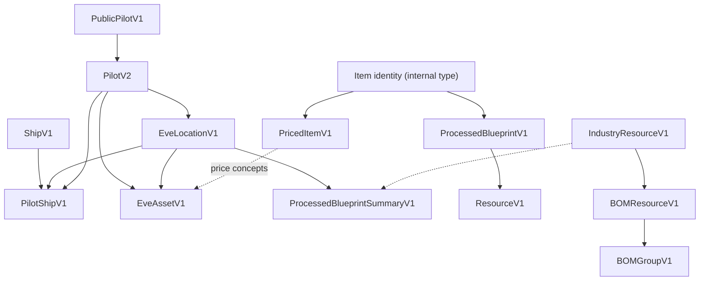

# Domain models — applied documentation

This file is the programme home for **applied and implemented** domain-model documentation: what is available in the coding systems after models are developed and published (primarily `neocom-domain`), not the requirements under review.

## Ownership split

| Concern | Where |
| --- | --- |
| Requirements, field review, versioning rules | **EPIC-004** — [`L1/04.EPIC-MODELS.md`](../../05.REQUIREMENTS-DECOMPOSITION/L1/04.EPIC-MODELS.md) |
| L2 pointers (no field lists) | [`L2/DOMAIN/MODELS/`](../../05.REQUIREMENTS-DECOMPOSITION/L2/DOMAIN/MODELS/) |
| **Implemented** model docs, hierarchy diagrams, package notes | **This file** (and linked assets under `ARCHITECTURE/` as they appear) |

Do not put unreviewed requirements here. Do not treat this file as a substitute for EPIC-004 while models are still only specified.

## When to update this file

Update this documentation **once** the corresponding models are **developed and available** in the coding systems (e.g. published types in `neocom-domain`, consumed by front and/or back):

1. Record which models are implemented (name, package version / export path, coding-system location).
2. Deploy the **model hierarchy diagram** here (or link an adjacent asset such as `ARCHITECTURE/MODELS-hierarchy.mmd` / `.svg`) so the live composition tree matches the code.
3. Note any versioned type names that are actually shipped (`…V1`, `…V2`, …) and which features depend on them.

Until at least one published model lands in code, the implemented register and diagram sections stay empty placeholders.

## Implemented register

| Model | Package / export | Coding system | Notes |
| --- | --- | --- | --- |
| `NeoCom` | `neocom-domain` → `src/domain/core/NeoCom.ts` (package root export) | front (via dep), domain | Base for published renderable nodes |
| `ApplicationInfoV1` | `neocom-domain` → `src/domain/ApplicationInfoV1.ts` | front header / `v1-application-info-render` | Consumed from package; not copied into `neocom-front` |
| `ServerStatusV1` | `neocom-domain` → `src/domain/ServerStatusV1.ts` | front header / `v1-server-status-render` | Consumed from package; not copied into `neocom-front` |
| `PublicPilotV1` | `neocom-domain` → `src/domain/PublicPilotV1.ts` | domain; front HEADER `v1-public-pilot` | Fixture character **93813310** |
| `PilotV2` | `neocom-domain` → `src/domain/PilotV2.ts` | domain; front HEADER `v2-pilot` | Extends PublicPilotV1; complements PilotShipV1 / EveLocationV1 not published yet |
| `BlueprintV1` | `neocom-domain` → `src/domain/BlueprintV1.ts` | domain; render `v1-blueprint` | Base only — no BOM / cost index |
| `SpaceLocationV1` | `neocom-domain` → `src/domain/SpaceLocationV1.ts` | thin interface artifact | No fields; new work targets EveLocationV1 |
| `SpaceLocation` | `neocom-domain` → `src/domain/locations/SpaceLocation.ts` | domain + back LOC-010 | `locationType` / `locationId` + ancestor chain |

## Model hierarchy (diagram)

Deploy the hierarchy diagram here when the models exist in code. Expected published shape (from EPIC-004; replace with the live diagram after apply):

```text
(item identity) → PricedItemV1
ShipV1 → PilotShipV1 (+ EveLocationV1, fitting)
PublicPilotV1 → PilotV2 → PilotShipV1 + EveLocationV1
EveAssetV1 → PilotV2 + EveLocationV1 (+ price)
ProcessedBlueprintV1 → type/output + ResourceV1[]
IndustryResourceV1 → BOMResourceV1 → BOMGroupV1
ProcessedBlueprintSummaryV1 → materials + EveLocationV1 (trade hub)
```



## Versioning (reminder)

Versioning rules for business objects live in EPIC-004. This file only records **which versions are implemented** in the register above once they ship.
